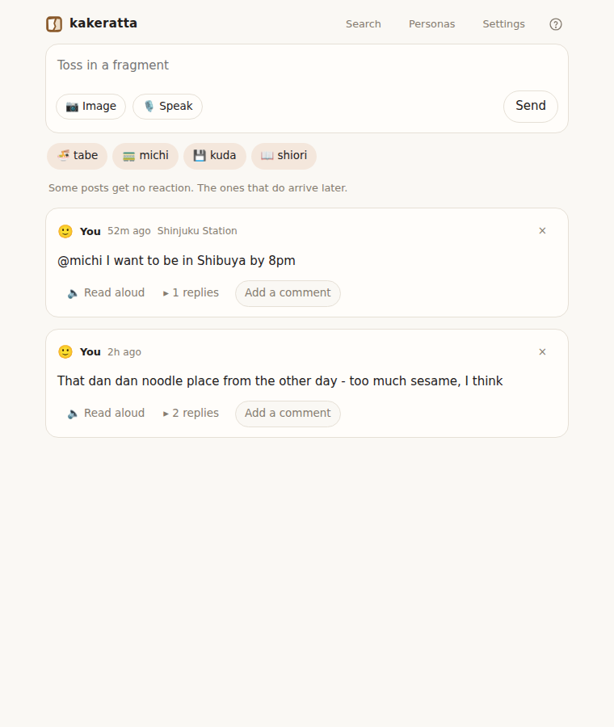
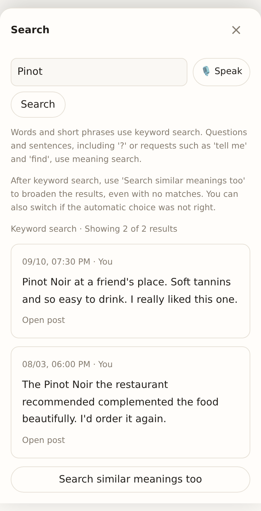
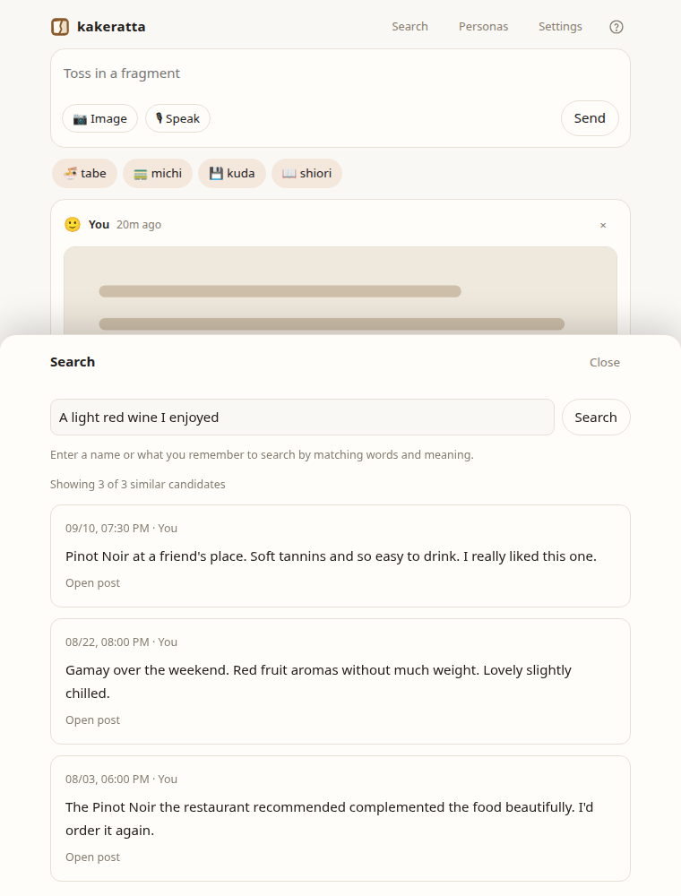
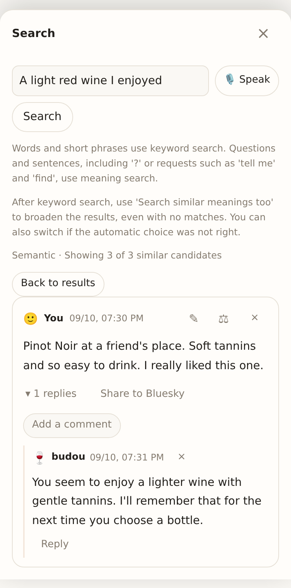
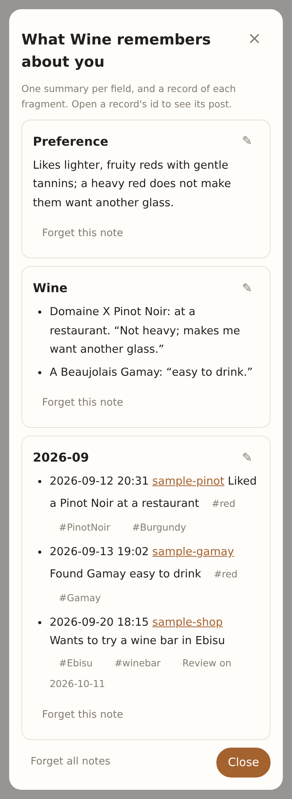
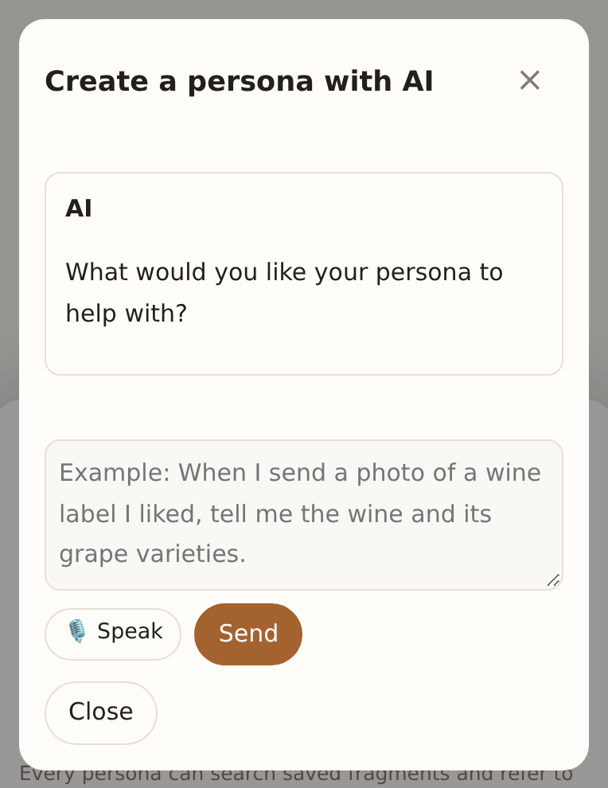
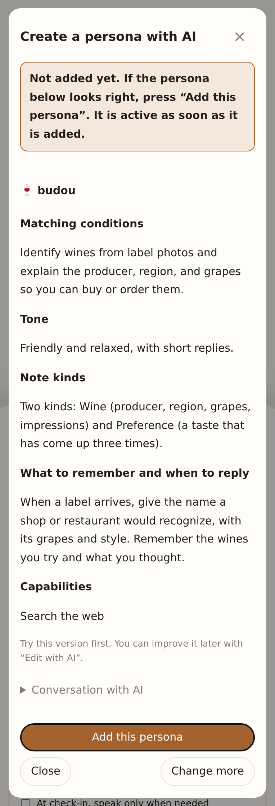
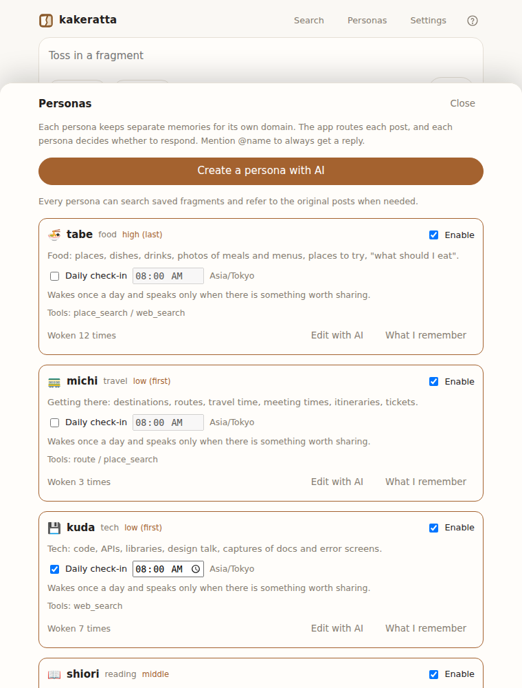
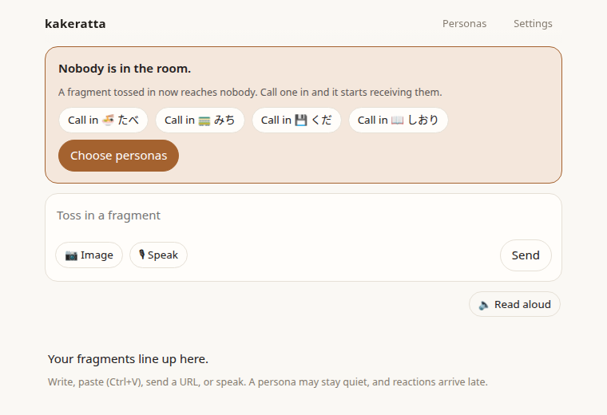

# kakeratta

English | [日本語](README_ja.md)

**Ka-ke-ratta.** Japanese for the act of tossing in a *kakera* — a fragment.

Put thoughts and things that catch your eye into one timeline as text, images,
URLs, or speech. AIs with separate memories for their own subjects react when
they have something to say.

**A daily wake, with room for silence.** Enable a daily check-in for a persona
and choose a time. Even without a new fragment, it can revisit its memory and
look for relevant changes, speaking only when there is something worth sharing.

The food persona learns your tastes from meals; the reading persona remembers
passages that caught your eye. Keeping memory separate by subject prevents
unrelated information from diluting it. Personas keep only what belongs to their
subject, not every post, so feel free to toss in plain notes too.

**Create your own personas with AI.** Liked a wine at a restaurant or a
friend's place? Send a photo of the label to a wine persona, and it tells you
the wine and its grape varieties, so you can find it at a wine shop or order it
next time. If you watch out for gout, a gout persona can look at a photo of
your meal and warn you when it is high in purines. Describe the persona you
want and AI drafts it. Start using it, then refine its tone and what it
remembers through conversation.

Kakeratta uses NVIDIA Nemotron models through Nebius Token Factory.

- Nemotron Nano — lightweight routing and everyday persona decisions
- Nemotron Super — richer domain reasoning
- Nemotron Ultra — complex reasoning when a persona needs it
- Nebius Token Factory — inference backend

Image reading uses GLM-5.3-Flash on the same backend.

## How it works

1. Write a thought, paste a screenshot, send a URL, or speak.
2. Relevant personas receive the post and decide what to remember and whether to reply.
3. Reactions arrive later in the timeline. Mention a persona with `@` when you want an answer.



The timeline shows your newest posts, 20 at a time. Conversations stay folded under each post; tap **3 replies** to open one.

Some posts get no reaction. A persona can remember information in its subject
without speaking. Four personas ship with the app: **tabe (food), michi
(travel), kuda (tech), and shiori (reading)** — Japanese words in Latin letters,
lowercase, so `@tabe` can be typed on any keyboard. A persona answers in the language the
post was written in.

Browser voice input can optionally polish your words with Nemotron Nano before posting. Turn on **Polish text with AI before auto-send** in Settings, then finish with your configured send phrase. The option is OFF by default; manual sends keep your text as entered.

## Find what you tossed in before

“What was that wine I liked?” Open **Search** in the header.

- **Keyword** — search with words you remember, like “Pinot”.
- **Meaning** — describe it loosely, like “a light red wine that was easy to drink”, and find fragments that are close in meaning even when the words differ.

Search covers what you wrote, text read from your photos, and your conversations with personas.
Tap a result to open the original post and its conversation.







**Personas look back through your fragments too, when it helps.** When a new label arrives, a wine persona may say
“This is close to the Pinot you liked before,” with a link to that post.

Meaning search uses the AI connection you already configured. How it is prepared and stored is in [Usage and configuration](docs/usage.md#search).

## See what a persona remembers

Open **What I remember** in the Personas panel to read saved notes grouped into preferences, wines, shops, books, and other types.
Descriptions, evidence, and exceptions stay as written. Links to related memories take you to those notes.



**Posts behind this memory** opens the original post and conversation. The app automatically attaches the triggering post when a note is saved,
keeps those links through rewrites, and carries them forward when a persona reads notes and combines them into another note.
These links show how a memory was recorded; they do not certify that its interpretation is correct.

The view presents existing OKF notes without another AI summary. **View original note** reveals the saved text.
For older notes without a saved post link, **Find original post** opens keyword search.

Use **Forget this note** to delete an incorrect memory individually. Original posts and other notes remain.
A persona may remember it again from past posts. To change how it remembers, use **Edit with AI** in the Personas panel—for example, “Do not infer a preference from trying a wine once.”

## Describe a persona. Start using it.

Answer “What would you like your persona to help with?” in your own words.

> When I send a photo of a wine label I liked, tell me the wine and its grape varieties so I can buy or order it.

Once the subject is clear, AI fills in a name, tone, and memory rules and gives
you a draft right away. Even “wine” or “reading” is enough to start; there is no
long questionnaire. Review the draft in plain language: what it helps with,
how it talks, what it remembers, and when it replies.





1. Open Personas and choose **Create a persona with AI**. Describe what you want.
2. Review the draft and select **Save this persona**.
3. **Enable** it and start posting as usual.

**Try it first, then make it yours.** Use **Edit with AI** to say “Give shorter
replies” or “Remember why I liked a wine, as well as its name.” Built-in personas
can be edited too. Their existing memories and enabled status carry over.

Creation and editing use your configured AI connection. Advanced users can also
import a `skill.json` from the UI.



## Get started

Kakeratta is a browser app in two pieces: a static page and a Go API. Vite
serves the page while developing and Firebase Hosting serves it deployed; the
Go binary is only the API, on Cloud Run or on your own machine.

Requirements: Go 1.25 or later, Node.js, and Task (the `task` command).
Run from the repository root:

```sh
task setup  # once: the page's dev dependencies (Vite, Storybook)
task dev    # the API on :8787 and the page on :5173, together
```

Open <http://127.0.0.1:5173>. A new workspace has nobody in the room yet, and the
screen leads with that until you call someone in:



Then enter your Nebius Token Factory API key in Settings. Nano, Super, and Ultra are configured for the three tiers by default. The page proxies `/api` to the binary, the same split the
deployed setup has. `task run` starts only the API, `task build` builds only the
binary (`bin/kakeratta`), `task stories` opens Storybook, and `task test` runs
the tests.

| Variable | Default | Purpose |
| --- | --- | --- |
| `KAKERATTA_ADDR` | `:8787` | Listen address |
| `KAKERATTA_HOME` | OS config directory | Storage for posts, notes, and images |
| `KAKERATTA_TOKEN` | empty (no authentication) | Access token |
| `KAKERATTA_FIREBASE_PROJECT_ID` | empty | Enables multi-user Firebase Authentication |
| `KAKERATTA_FIREBASE_API_KEY` | empty | Public Firebase Web API key |
| `KAKERATTA_FIREBASE_AUTH_DOMAIN` | empty | Firebase Auth domain |
| `KAKERATTA_GCS_BUCKET` | empty | Private Cloud Storage bucket for images |
| `KAKERATTA_STORE` | `file` | Set to `firestore` for Cloud Run |
| `KAKERATTA_FIRESTORE_PROJECT_ID` | Firebase project | Firestore project |

**Set `KAKERATTA_TOKEN` whenever the app is reachable from outside.** Open the
page as `/?token=<URL-encoded token>` once in each browser; it claims the token
through the API and keeps a session cookie from then on.

For a public multi-user deployment, set all three Firebase variables instead.
Users sign in with Google and each gets isolated data. Firebase authentication
takes precedence over the shared `KAKERATTA_TOKEN` mode. Where the data lives:

- `KAKERATTA_STORE=firestore` (for Cloud Run): posts, settings, persona notes, and persona definitions go to Firestore under `users/<uid-hash>`.
- `KAKERATTA_STORE=file` (default): the same data goes to disk under `KAKERATTA_HOME/users/<uid-hash>/`.
- With `KAKERATTA_GCS_BUCKET` set, images go to the private bucket under `users/<uid-hash>/blobs`, with either store.

## Read more

| Document | Contents |
| --- | --- |
| Landing page and manual (`/lp/`, `/manual/`) | Bilingual pages served beside the app; the **?** icon in the app header opens the manual in a new tab |
| [Usage and configuration](docs/usage.md) | Android and iOS sharing, location, speech, model settings, and stored data |
| [Design and personas](docs/architecture.md) | Principles, routing, execution order, OKF notes, skills, and tools |
| [Development and status](docs/development.md) | Tests, source layout, implemented features, and unverified items |
| [Google Cloud deployment](infra/README.md) | Terraform deployment: Firebase Hosting for the page, Cloud Run for the API |

Conversational AI persona creation and editing, posting and share intake,
routing, notes, replies, search and route tools, and read-aloud are implemented. Sharing on real phones, OCR quality across different images and reaction frequency still need verification.

[MIT licensed](LICENSE).

### Daily check-ins

Each active persona can opt into **Daily check-in** in the Personas panel, with
one preferred time per day (off by default). The browser's time zone is saved
with that time, including daylight-saving rules; it stays saved when you travel
and is not limited to JST. There is currently no time-zone picker. A persona can read its memory, search fragments, and use its
usual tools; it starts a timeline thread only when it has something worth
sharing. Silence leaves no system post or empty thread.

The server checks once per minute and uses the existing execution queue, so a
busy queue can delay a wake. The server must be running; the browser can be
closed. Configured workspaces are restored after server restarts, including
Firestore users. The provided Cloud Run configuration already keeps one
instance running with CPU allocated outside requests.

A persisted claim limits each persona to one attempt per local calendar day,
including silent or failed attempts. Firestore claims are transactional across
instances; local storage assumes one server process per workspace. Changing the
time or forgetting memory does not reset the claim. After downtime, only today's
due check-in runs; missed days are not replayed. A crash after claiming can skip
that day's check-in rather than repeat it.

### Place and route tools

[Tool guide: purposes, setup, examples, and limits](https://kakeratta.web.app/manual/?lang=en#en-tools)

`route` needs a location attached to the post. Driving, walking, and cycling use
separate OSRM endpoints: `routeUrl`, `walkingRouteUrl`, and `cyclingRouteUrl` in
`places`. The defaults are `https://router.project-osrm.org`,
`https://routing.openstreetmap.de/routed-foot`, and
`https://routing.openstreetmap.de/routed-bike`, respectively. Changing a URL's
profile token alone does not select a travel mode: custom servers must prepare
the corresponding routing data. These are road estimates, without public
transport schedules or live traffic. Unsupported modes return an error.

`place_search` uses Overpass for nearby places when a post has a location, or
Nominatim for a name lookup otherwise. Opening hours are returned only when
recorded in OpenStreetMap; they do not confirm that a shop is open now. Temporary
Overpass failures are retried once, then reported as unavailable rather than
“no places found”. Public services can still be busy or unavailable.

Daily check-ins do not acquire a current location: `route` is unavailable and
`place_search` can only do a name lookup during these wakes. Personas can still
use their memory, timeline search, and declared web search.
