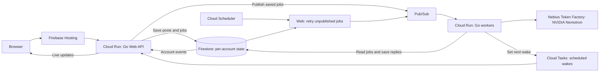

English | [日本語](README_ja.md)

**Ka-ke-ratta.** Japanese for the act of tossing in a *kakera* — a fragment.

**You cannot search for what you forgot exists.** kakeratta is a personal AI
timeline that brings it back to you. Toss in fragments of your day as text,
photos, URLs or speech. Personas, one for each person or interest you care
about, remember what matters to them and speak up when it matters.

- **A separate memory for each persona.** Each person or interest has its
  own memory. Posts reach person personas through name and keyword matching.
- **Silence is the default.** A persona replies only when it has something
  worth saying. A quiet timeline means the app is working.
- **Memory you can trace and review.** Facts link back to your posts.
  Temporary records can expire; records marked for review come back with
  a question: keep, postpone or forget? Your original posts stay intact.

[Try it](https://kakeratta.net/lp/?lang=en) ·
[Watch the demo](https://youtu.be/fdUYDI6Sd70) ·
[Devpost](https://devpost.com/software/kakeratta) ·
[Manual](https://kakeratta.net/manual/?lang=en) ·
[Design](docs/technical.md)

[](https://youtu.be/fdUYDI6Sd70)


From production and testing:
[AI cost estimate — Oct 2026](docs/production-ai-cost-2026-10-11.md) ·
[routing model comparison — Sep 2026](docs/routing-model-comparison-2026-09-19.md) ·
[lessons from what the AI got wrong](docs/ai-lessons.md)

## What you can do

- **Get timely follow-ups.** Remembering personas speak when they have something
  worth sharing. For people, choose “Look back often” or “Look back occasionally”. Birthdays, appointments and preparation checks run on
  the server; supported devices can receive reminder push notifications.
- **Inspect and correct memory.** Each remembering persona keeps facts with
  source links, field summaries and monthly kakera records. Edit or forget
  individual facts; search your timeline by words or meaning.
- **Create personas in plain language.** Describe a person or interest, then
  adjust its instructions, routing and replies as you use it.
- **Save answers as favorites.** Keep posts and persona replies in a list,
  most recently added first. Filter by persona or search only your favorites.
- **Turn an answer into a diagram.** Reply to it with
  `@infographic turn this answer into an infographic`. The Markdown diagram uses emoji
  and Mermaid in the display language selected when you send the request.
- **Keep posting offline.** Pending posts and replies send when the app is
  open and connectivity returns. Preview and share selected conversations to
  your own Bluesky account.

A direct `@` mention or reply to an active persona reaches that persona alone;
otherwise, interests receive posts by routing conditions and people by names
and keywords. A mention takes precedence over the persona being replied to.

Five personas ship with the app:

| Persona | Role | Active in new workspaces |
| --- | --- | --- |
| **tabe** | Food and dining | No |
| **shiori** | Reading and books | No |
| **sona** | Preparation, belongings, weather and small follow-ups | Yes |
| **support** | kakeratta questions, answered from the system specification | Yes |
| **infographic** | Markdown diagrams with emoji and Mermaid for text, expanded articles, interpreted images and answers | Yes |

Creation and editing offer **Remember** and **Always think deeply**.
**Remember** is on by default (off for support and infographic); turning it
off stops memory updates and periodic check-ins. **Always think deeply**
uses a stronger model for final answers (on by default for infographic).
A request that says "in detail" uses the strongest answer model in the default configuration.
See [Design and integrations](#design-and-integrations) for which model does what.

## Run locally

Requires Go 1.26+, Node.js and [Task](https://taskfile.dev), plus a Nebius Token
Factory API key. With [mise](https://mise.jdx.dev), `mise install` installs the
tools declared in [mise.toml](mise.toml).

```sh
task setup  # install frontend dependencies once
task dev    # API on :8787 and frontend on :15173
```

When running in a container, publish or forward port `15173` (for Docker, `-p 15173:15173`). Vite listens on `0.0.0.0`; open `http://localhost:15173` on the host. If the port is occupied, startup fails instead of choosing another port.

Open http://127.0.0.1:15173 and enter your API key in Settings. Local runs need
no Firebase account or external database; data is stored on disk and the API
listens on loopback. See [usage and configuration](docs/usage.md) for commands
and [self-hosting](docs/technical.md#running-it) for environment variables and
hosted storage. Use `task test` to run the Go and browser tests.

## Architecture

The diagram shows the preferred Cloud Run deployment. Production currently
runs on a shared Compute Engine VM to reduce cost. It keeps the same
Web/worker separation and durable queues; see
[current operations](infra/shared-vm/README.md).



In production, Web saves a post and its processing request together, then
publishes the job to Pub/Sub. An available worker processes it using the user's
AI settings and credentials, persists the result, and acknowledges completion.
Cloud Tasks triggers scheduled work through the same path. Unpublished requests
remain in Firestore for retry; Pub/Sub redelivers unacknowledged jobs.

Data, execution claims and conversation ordering belong to each account.
Web and worker instances can be added independently: accounts need no assigned
server, and independent accounts and conversations can run in parallel while
each conversation keeps its processing order. In the Cloud Run configuration,
workers can scale to zero when idle. Capacity grows through additional instances
and measured tuning of shared infrastructure; worker sizes are deployment
settings. The temporary shared VM has fixed capacity and a running worker.
Local development uses the same persona engine with file storage and an in-process dispatcher.

See [architecture and scaling](docs/system/architecture.md) for the full
execution model and [deployment](infra/README.md) for infrastructure settings.

## Design and integrations

The backend is Go and the browser app is JavaScript. NVIDIA Nemotron models
through Nebius Token Factory provide routing, answers and workflow checks.
The default model configuration is:

| Model | Role |
| --- | --- |
| **Nemotron 3.5 Lightning** | Optional dictation polishing |
| **Nemotron 3 Super 120B A12B** | Persona routing, reads and ordinary answers, and the note keeper |
| **Nemotron 3.5 Super VL 120B A12B** | Research for deep requests and Always think deeply, schedule planning and workflow checks, answers for personas with Always think deeply enabled, daily and monthly check-ins, the daily memory pass, and the day's and month's summaries |
| **Nemotron 3 Ultra 550B A55B** | Answers for deep requests (such as "in detail") |

OpenRouter is an optional alternative. Models are chosen by task to benefit
from smaller models' lower cost and faster responses, using stronger models
where deeper reasoning is needed. Each persona has its own memory and
permitted tools. Export your timeline, images, settings, personas and memory
from Settings; see [data portability](docs/usage.md#taking-it-with-you).

External agents such as Hermes or Obsidian's LLM Connect Hub can research and
submit answers over MCP. kakeratta owns the timeline, schedules and
memory updates. Address `@agent` to hand the agent itself a longer task -
sending an email, for instance - past the personas, and carry on by replying. The tested NemoClaw/OpenShell sandbox setup is documented in
the integration report below.

Built for the [Nebius x NVIDIA Global AI Hackathon](https://nebiusglobalaihackathon.devpost.com/).
Read the [Devpost project page](https://devpost.com/software/kakeratta) for the
inspiration and project story.
The [project background](docs/background.md) explains why remembering includes
bringing something back at the right time.

## Documentation

| Document | Use it for |
| --- | --- |
| [Manual](https://kakeratta.net/manual/?lang=en) | Illustrated instructions for everyday use |
| [Usage and configuration](docs/usage.md) | Local commands, settings, data and portability |
| [Under the hood](docs/technical.md) | Design, routing, models, memory, tools and self-hosting |
| [System implementation](docs/system/index.md) | Source-linked subsystem specifications, also used by support |
| [AI lessons](docs/ai-lessons.md) | Failures observed in development and how they were addressed |
| [External agents](docs/hermes.md) | Hermes and LLM Connect Hub setup, MCP permissions, fallback and direct `@agent` requests |
| [NemoClaw integration report](docs/nemoclaw-hermes-integration.md) | Sandbox setup and verification, with protocol-version context |
| [Google Cloud deployment](infra/README.md) | Cloud Run configuration and temporary shared VM operations |

[MIT licensed](LICENSE).
