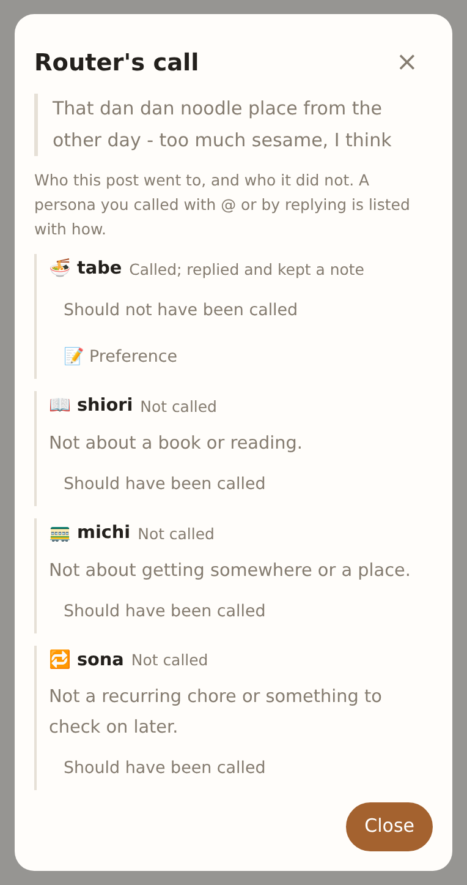
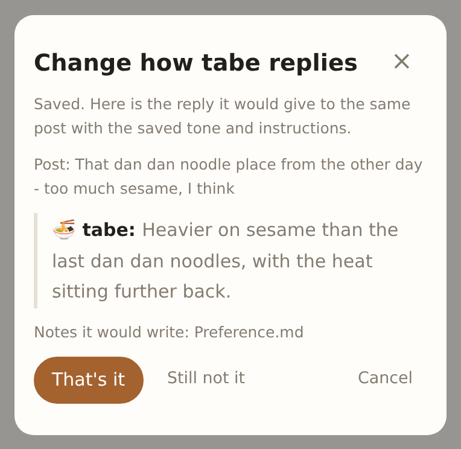
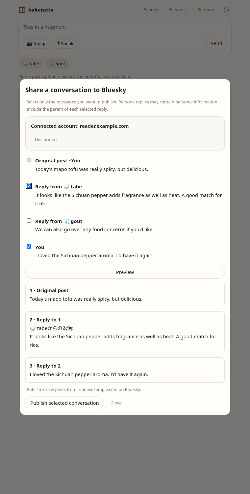
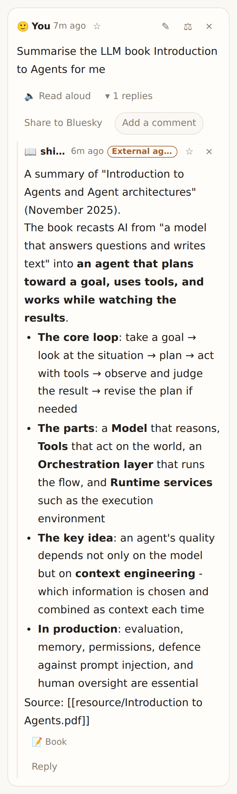

# kakeratta

English | [日本語](README_ja.md)

**Ka-ke-ratta.** Japanese for the act of tossing in a *kakera* — a fragment.

A personal AI timeline where you simply jot down fragments of your day, and
dedicated AI personas - assigned to specific interests or people - memorize only
what is relevant to them.

Built for the [Nebius x NVIDIA Global AI Hackathon](https://nebiusglobalaihackathon.devpost.com/).

**Try it:** [kakeratta.net](https://kakeratta.net/lp/?lang=en)
**Manual:** [kakeratta.net/manual](https://kakeratta.net/manual/?lang=en)
**Technical design:** [Under the hood](docs/technical.md)


## Why it exists

With smartphones, jotting down notes and snapping photos has become effortless,
leading to an overwhelming volume of data. Naturally, the more data piles up,
the less often we revisit it. We forget we even took a note, or look back at
one and have no idea what it was about.

I tried building an app that uses AI to automatically categorize and organize
notes. But much like when someone cleans up your room for you and suddenly
nothing is where you expect it to be, it only made things harder to find. When
things were cluttered, it may have been messy, but because they were always in
sight or being shuffled around, I still had a rough sense of where everything
was. That said, with the sheer volume of data I now had, leaving it scattered
meant I would never find anything.

Then it hit me: what if the organizer could tell you where things are,
anticipate that you might forget something even exists, proactively bring it
up when relevant topics arise, and ask, "Can I forget this?" for things left
untouched for far too long? Wouldn't that fulfill the true purpose of taking
notes?

One of my biggest personal regrets is losing touch with someone who always
cared about me - simply because I was too busy, forgot to send a thank-you
message, and before I realized it, the moment had passed, letting us drift
apart.

That is how kakeratta was born.

## What it does

kakeratta is a personal AI timeline where you simply jot down fragments of your
day, and dedicated AI personas - assigned to specific interests or people -
memorize only what is relevant to them.

Rather than dumping everything into one monolithic personal memory, you just
post text, photos, URLs, or voice notes as they come. Each AI persona receives
only the fragments pertinent to its domain, deciding whether to remember it,
reply, use a tool, schedule a future follow-up, or simply stay silent.

Personas can be created in natural language. For a person-based persona, you
might set it up like this:

> My partner's name is Nagomi, born Nov 10, 1972. Loves K-pop idols and
> cosmetics. Great at playing the piano. Loves spicy food, like Thai cuisine.

Once you establish that baseline, just casually share little daily moments.
Nagomi's persona will remind you when her birthday is coming up, track gifts
exchanged over time, and suggest thoughtful ideas when the time is right.

Posts reach person personas via nicknames and keywords, and interest personas
based on filtering rules - meaning not every fragment is broadcast to every AI.

By default, four interest personas are included (no person-based personas
are set by default):

* **tabe**: Dining & food
* **michi**: Travel & outings
* **shiori**: Reading & books
* **sona**: Preparing for outings, everyday belongings, weather and small follow-ups (active by default in new workspaces)

Interest personas are created in natural language too. For instance, for a
persona focused on wine:

> Remember the wines I drink and help me pick one next time.

That is all it takes to set one up. As you use it, you can fine-tune its
behavior and memory priorities:

> Keep your replies briefer.

> Don't just log the label - remember why I liked that wine.

Doing nothing is just as vital. If every AI chimed in on every post, your
timeline would become overwhelming in no time. In kakeratta, it is completely
normal for a persona to silently commit something to memory without saying a
word.

### Memory, tools and speech

You can see what a persona remembers, trace a memory back to the post it came
from, fix it, or make it forget just the one thing that is wrong.

Each persona gets only the tools declared for its role. Built-in tools include:

* **web search** through Tavily
* **place search** through OpenStreetMap, Overpass, and Nominatim
* **walking, cycling, and driving routes** through OSRM
* additional tools supplied through **MCP servers**

The user supplies their own Tavily key for web search.

With speech, a send phrase of your choosing posts what you just said, so a
thought is kept the moment it arrives.

### People and calendar notifications

Birthdays, preferences and other details supplied when creating a person or using **Edit with AI** are saved as editable **Basic information** in the persona definition. Saving does not post a fragment or copy them into notes. You can also change them in the regular editor.

Saving or editing basic information, and fragments delivered to the person, automatically register birthdays, anniversaries and appointments with known dates. Birthdays and anniversaries notify annually, one week before and on the day at 09:00 in the saved timezone. Appointments use an explicitly requested notification time, otherwise 09:00 on the day (one hour before appointments earlier than 09:00). Notifications arrive as persona posts. Future dates have no scheduling horizon; unknown dates are not guessed. Changes and cancellations are reconciled.


## How it works

1. Write a thought, paste a screenshot, send a URL, or speak.
2. The router hands a fragment only to the interest personas whose conditions it
   matches; a person persona receives the fragments that contain one of its
   nicknames or keywords.
3. Each persona decides whether to remember something, reply, use a tool, or stay silent.
4. Reactions arrive in the timeline a little later. Mention a persona with `@` when you want an answer directly.

Persona names are Japanese words in Latin letters so that `@tabe` can be typed
on any keyboard. A person persona also answers to their nicknames.

## Built with NVIDIA Nemotron on Nebius Token Factory

kakeratta uses **NVIDIA Nemotron models through Nebius Token Factory**, choosing
different model sizes according to how difficult a task is and how often it
runs instead of sending everything to one large model.

| Model                      | Role                                               |
| -------------------------- | -------------------------------------------------- |
| **Nemotron 3 Ultra**       | The replied-to persona, when a reply asks for a better answer; persona drafting |
| **Nemotron 3 Super**       | Routing, every persona, and workflow review        |
| **Nemotron 3.5 Lightning** | Judging replies for Ultra; dictation polishing     |
| **GLM-5.3-Flash**          | Reading screenshots and photos                     |
| **Qwen3-Embedding-8B**     | Meaning search over past fragments                 |

Token Factory made this division practical.

The same platform provides the large, middle, and lightweight models used by
the persona system, together with image understanding and embeddings. Each job
can therefore use a model proportionate to its difficulty and frequency without
adding another model-provider integration.

That mattered most for routing because routing happens on every post.

Early versions asked a larger model to make a broad judgement about which
personas should receive a fragment. The router was eventually redesigned as a
simpler matching problem against explicit persona conditions, making a smaller
model viable for this frequent step while keeping stronger models for work that
actually needs them.

Using one API across model sizes also accelerated experimentation during
development: models could be moved between roles without rebuilding the
surrounding application, while Token Factory usage data made the cost of those
choices visible.

Persona execution and workflow review use native tool calling. Image reading,
structured generation, and embeddings use the corresponding Token Factory APIs.

Token Factory is also used by the tested external-agent setup described below,
so both kakeratta's built-in personas and a sandboxed autonomous agent can use
remote models through the same inference platform.

The routing experiments, workflow phases and constraints, and model responsibilities are
described in [Under the hood](docs/technical.md).

## Your data stays yours

A personal AI remembers a lot, so its memory should not be a black box or a
one-way import.

You can inspect what each persona remembers, trace a memory back to the post
that produced it, edit an incorrect fact, or forget an individual note without
removing the original post.

**Backup** exports your posts, personas, notes, and images as a zip laid out in
the same structure used by a kakeratta instance running on your own machine.
API keys and external connections are not included.

Self-hosting is a normal deployment mode, not a separate edition. The default
local store is files on disk (`KAKERATTA_STORE=file`), local runs require no
login, and the server listens only on loopback by default.

The hosted app also provides full account deletion. Before leaving, the user is
given a path to **Backup** so the data can be taken out first. Deleting the
account removes the user's:

* posts and conversations
* personas and their memories
* uploaded images
* settings and stored credentials
* external connections such as Bluesky and MCP
* server-side backup data
* kakeratta login account itself

Model and search credentials are **bring your own**. The user supplies their
own Nebius Token Factory API key and, when web search is used, their own Tavily
API key.

External-agent access is opt-in. The MCP credential issued for Hermes belongs
to that workspace and can be revoked; disconnecting the integration invalidates
the credential itself. An external agent never writes directly: it submits only
an answer, and kakeratta assembles the workflow around it, checks and reviews
it, and runs it as the persona.

kakeratta is [MIT licensed](LICENSE).

## Always-on when you want it

Personas do not have to wait for a new post.

Every active persona has a **Daily check-in** once a day, at a time the app
picks for it between 07:00 and 21:00 in the user's time zone. The time drifts
by at most an hour a day, so check-ins spread across the day instead of
arriving all at once. On the rare day it would wrap from the evening round to
the morning, that day is skipped rather than checking in twice within hours.

By default the persona looks through its memory and the timeline since its
previous check-in, so nothing between two check-ins goes unread, uses
its tools, and brings something back only when it finds something worth
saying; it also asks whether a record that has reached its review date can be
forgotten. Turning on **At check-in, speak only when needed** limits it to what needs the
user's decision, such as that question. A silent check-in creates no empty
conversation.

A person's persona can instead look back once a month. Once a month the app
reads the month's timeline and posts **This month**, a summary by topic with
each line linked to the post it came from, which you can edit like your own
post. A person looked back on monthly reads that summary and the posts that
name them, so however many people there are, the timeline is read once a month.

sona can schedule a belongings check before an outing, joining your plans to what you usually carry and things you have forgotten before. With a known region and time, it checks a fresh forecast and can suggest an umbrella for rain later, even when it is sunny now. Small chores can still get a gentle follow-up afterwards.

These wakes run on the **server**, not in the browser. The browser can be
closed.

A self-hosted kakeratta server therefore needs to remain running for scheduled
work. The provided Cloud Run deployment keeps an instance available for these
server-side wakes.

## A sandboxed external agent with NVIDIA NemoClaw

Some work goes beyond what a small persona for one interest or person should do.

For those, any persona can hand its research and answer to **Hermes Agent** through MCP.
Each persona chooses its planner: the built-in model, or the external agent.
When a persona planned by the external agent wakes, kakeratta opens an *ask*
carrying the persona's identity, instructions, the trigger and its thread, the
persona's memory (field summaries and facts, and latest records), what the persona can change, and its read-only tools.
Hermes claims the ask, researches with its own tools and skills, and submits
only the answer. kakeratta then decides the turn's schedules, tool actions, and
notes with its own model, one phase at a time, assembles them with the answer
into a workflow, checks it against what the answer promises, runs it as the
persona, and publishes the answer. The answer
itself is not reviewed, so research kakeratta cannot see is never held against
it. If Hermes does not claim the ask within 3 minutes, or no answer is accepted
within 15 minutes of the claim (both configurable), the built-in model takes
the turn instead.

The integration has been built and tested with the following. That end-to-end
run used the earlier protocol, in which Hermes submitted a whole workflow; the
current answer-only protocol is covered by the automated tests.

* **NVIDIA NemoClaw** for orchestration, lifecycle, and policy setup
* **OpenShell** as the sandbox and policy-enforcement layer
* **Hermes Agent v0.20.6** as the autonomous agent runtime
* **Nebius Token Factory** for remote inference
* the production **kakeratta MCP server** at `kakeratta.net`

The tested OpenShell sandbox uses filesystem and network isolation, including
Landlock restrictions and controlled outbound access. Inference requests leave
the sandbox through the OpenShell gateway rather than placing the raw provider
credential in Hermes's own configuration.

The tested inference setup runs `nvidia/nemotron-3-super-120b-a12b` through
Nebius Token Factory. `NousResearch/Hermes-4-405B` and
`nvidia/Nemotron-3_5-Lightning` were also tried during development; Lightning
was faster but produced incorrect tool calls in multistep flows, so operation
moved to Super 120B.

Hermes then connected from inside the sandbox to the production kakeratta
instance over Streamable HTTP MCP.

The connection was tested successfully with the task-based tools of the
earlier integration, in which Hermes was a persona of its own. Those have since
been replaced by the planning tools:

`list_personas`, `get_timeline`, `get_thread`, `list_notes`, `read_note`,
`list_asks`, `claim_ask`, `read_for_ask`, `submit_answer`, and `release_ask`.

That keeps the responsibilities separate:

**kakeratta** owns the user's timeline, the personas, their memory, the
assembly, review and execution of every workflow, and MCP permissions.

**Hermes** owns its research, the answer, its tools, skills, and its own long-term memory.

**NemoClaw + OpenShell** provide the controlled environment in which the
external agent runs.

**Nebius Token Factory** provides the inference behind it.

kakeratta never has to start the Hermes process itself. The MCP boundary also
means Hermes can be operated independently or under another compatible runtime
setup.

For the kakeratta-side protocol, credential scope, the ask lifecycle, and
fall-through, see [Hermes Agent setup](docs/hermes.md)
([日本語](docs/hermes_ja.md)).

For the architecture and production end-to-end verification, see the
[autonomous agent integration report](docs/nemoclaw-hermes-integration.md)
([日本語](docs/nemoclaw-hermes-integration_ja.md)).
For an empirical inference comparison between Nemotron Super and Hermes 405B, see the
[model comparison report](docs/nemoclaw-hermes-model-comparison.md).

For the NemoClaw side, see the
[NVIDIA NemoClaw Hermes documentation](https://docs.nvidia.com/nemoclaw/user-guide/hermes/get-started/quickstart).

## Find what you tossed in before

"What was that wine I liked?"

Open **Search** in the header. A name like "Pinot" and a vague memory like "a
light red that was easy to drink" go in the same box.

Search covers your notes, text read from photos, and conversations with
personas. A result opens the original post and its conversation.


**Personas look back too.**

When a new label arrives, a wine persona may say "this is close to the Pinot
you liked before", with a link to that post.

## See what a persona remembers

Open **What it remembers** in the Personas panel. For each of its fields -
tastes and shops, books and themes - a persona keeps facts, one line each with
the post it rests on, and a summary in its own words over them. A fact is
added, replaced, or retired as your kakera arrive, and a replaced one is kept
under **以前のこと**; the summary is rewritten at the persona's check-in from
what changed. It also keeps a record of every kakera it received, one sentence
with its tags and the post to go back to - its reply when it replied, your
kakera when it did not.

The fields come first, then the records month by month. Open the post behind a
fact or a record with **元の投稿**, or tap a `#tag` to see only the months that
hold it. Delete a kakera and its record and the facts resting on it alone go
too.

Records are not kept forever by default. A record of a kakera that served its
moment, such as "where for lunch today?", shows **Gone on** a date, the next
day, and is deleted then. A record of something you said, such as a
shop you wanted to try, may show **Review on** a date the persona chose; when
that day comes, the persona asks in a short post whether to keep it. Answer
"keep it", "later", or "forget it" and it does so. A record the persona looks
up again while answering you gets its time afresh.


Fix a misspelling or a wrong fact with **✎**, or delete a field or a month of
records.

To change how it remembers, use **Edit with AI** and say, for example, "don't
call something a favourite after one glass".

Its memory is not a black box.

## See why a persona was called, or not

The app decides who receives a fragment, and it keeps the reason.

Press **⚖ (the router's call)** on a post to see the personas that were called
and, for each one that was not, a one-line reason.



When it got it wrong, press **Should have been called** and say why in your own
words.

The AI rewrites the persona's routing condition and tries the same post again
to make sure. The new condition is shown as text and can be edited before
saving.
If a previously missed persona is selected, it answers the original post and
writes its notes there.

The same mechanism works in the other direction when a persona was called when
it should not have been.

A persona that keeps a person skips the router: a post reaches it when one of
its names or keywords is in it. ⚖ shows the word that matched. **Should have
been called** has the AI propose keywords from the post and their near words,
and **Should not have been called** lets you choose which of the matched words
to remove.

## Fix a reply where it went wrong

Press **Fix the reply** on a persona's remark and say how it missed, such as:

> no recommendations, just one line on how it differs from last time

The AI rewrites only the tone and instructions; the routing condition, name,
and tools stay.



On save, the same persona is stood up on the same post again for a trial reply.

The trial stays out of the timeline until you accept it. **Good** applies its
exact reply and note changes to the original thread.

You judge the result.

**Nothing is learned behind your back.**

## Describe a persona. Start using it.

Answer **"What would you like your persona to help with?"** in your own words.

> When I send a photo of a wine label I liked, tell me the wine and its grape varieties so I can order it or buy it.

Once the subject is clear, the AI fills in the name, tone, routing condition,
and what to remember, and shows a complete draft.

A single word like "wine" is enough to start.


**Start using it, then shape it.**

"Reply more briefly", "remember why I liked a wine, not just its name": tell it
through **Edit with AI**.

Built-in personas can be edited the same way.

## Share the conversation you choose to Bluesky

Connect your own Bluesky account and choose which messages to publish from a
post, the personas' replies, and your follow-ups.

Persona replies start unchecked.

Preview the text, reply structure, and account before publishing. Persona
messages carry an attribution such as `🍚 tabeからの返信:` (reply from tabe).



[Connect and share a conversation](https://kakeratta.net/manual/?lang=en#en-bluesky)

## Fast startup and offline posts

Recent conversations are cached in the browser so the timeline can appear
immediately on the next visit instead of waiting for the server.

After the app has been online once, its **Service Worker** keeps the application
available offline. Text, images, URLs, and replies created without a connection
are stored as pending work in **IndexedDB**.

When connectivity returns, those pending posts are sent to the server and enter
the same persona-routing flow as ordinary posts.

A passing thought therefore does not have to wait for the network.

[Using offline posts](https://kakeratta.net/manual/?lang=en#en-offline)

## What we learned

An AI that organizes your information is not enough.

A room someone else has tidied can be harder to find things in than before. AI
organizing your notes is similar: perfectly filed, they are still out of reach
if you do not know where they are.

More fundamentally, **you cannot search for what you forgot exists.**

So a personal AI cannot stop at remembering and organizing. It has to bring
things to you when they are needed, and sometimes say "this might matter to you
now" without being asked.

We learned that **when to remind matters as much as what to remember.**

We also learned that making the AI more capable does not always mean giving
every decision to a larger model.

If a high-end model gets a task right and a smaller model gets it wrong, the
task may be too ambiguous.

That is what happened with routing. Instead of continuing to spend a larger
model on every post, the job was changed from a broad judgement into explicit
condition matching.

The smaller router became much more dependable, the work on every post became
cheaper, and the routing conditions became something the user could inspect and
correct.

The same principle shaped the rest of the system: strong models are useful, but
clear boundaries are useful too — between routing and execution, between a
persona and its memory, between a persona and the tools it is allowed to use,
and between kakeratta and an external autonomous agent.

The inside grew complex, but what the user does became simpler.

**Post what you are thinking. Tell a persona in plain words what you would like.**

That is all.

## Get started

Requirements:

* Go 1.26 or later
* Node.js
* Task (the `task` command)
* A Nebius Token Factory API key

With [mise](https://mise.jdx.dev), `mise install` in the repository root gets Go
and Task from `mise.toml`.

Otherwise install Task with:

```sh
go install github.com/go-task/task/v3/cmd/task@latest
```

Then:

```sh
task setup  # once
task dev    # the API on :8787 and the page on :5173, together
```

Open http://127.0.0.1:5173 and enter your **Nebius Token Factory API key** in
Settings.

Lightning, Super, and Ultra are configured for the three model slots by
default.

No Firebase account or external database is required for a local run. Data is
stored on disk by default and the server listens on loopback.

For environment variables, Firebase Authentication, Firestore, Cloud Storage,
Cloud Run, MCP servers, and self-hosting, see
[Running it](docs/technical.md#running-it).

## Advanced

None of this is needed for normal use.

### Another provider for the models

Settings → **Use OpenRouter** accepts an OpenRouter API key.

Routing alone can move to **Jev**, a decision-only model that is fast and cheap.
Because it does not return routing reasons, the router's call can show who was
chosen but cannot show the normal exclusion reasons.

**OpenRouter-only mode** can instead move the high, middle, and low model slots
to models you choose, with tool calls routed through Exacto.

Left alone, kakeratta uses its Nemotron configuration through Nebius Token
Factory.

### External agents through MCP

Hermes does not have to run under NemoClaw to use kakeratta.

The integration boundary is MCP: issue a workspace key in Settings, configure
the kakeratta MCP server in Hermes, turn on **Prefer the external agent** for a
persona, and Hermes can claim its asks and submit answers.

The NemoClaw/OpenShell setup described above is the tested sandboxed
configuration used for the hackathon integration.

kakeratta does not start or control the Hermes process itself.

Detailed credential scope, the context an ask carries, waits, and fall-through
are in [Hermes Agent setup](docs/hermes.md)
([日本語](docs/hermes_ja.md)).

The same MCP connection also serves
[LLM Connect Hub](https://github.com/takeshy/obsidian-llm-connect-hub), an
Obsidian plugin. A persona handed to it is answered by
[LLM Hub](https://github.com/takeshy/obsidian-llm-hub) in your Obsidian, with
the model you choose there and your Vault notes, RAG and skills. Enter the MCP
endpoint and `Authorization: Bearer <key>` in its **Kakeratta** settings; it
checks for asks once a minute while Obsidian is open. See the
[manual](https://kakeratta.net/manual/?lang=en#en-hermes).



### Running the server yourself

The browser app and Go API can be run locally or deployed separately.

The default local configuration uses files on disk and loopback networking.

Environment variables, authentication, storage, Cloud Run deployment,
check-ins, schedules, and operator-provided tools are documented in
[Under the hood](docs/technical.md#running-it).

## Read more

| Document                                                                                                 | Contents                                                                                                          |
| -------------------------------------------------------------------------------------------------------- | ----------------------------------------------------------------------------------------------------------------- |
| [Under the hood](docs/technical.md)                                                                      | Design principles, the system flow, routing, which model answers, workflow phases and constraints, memory, skills, storage, check-ins, tools, and deployment |
| [Manual](https://kakeratta.net/manual/?lang=en)                                                          | Using personas, search, memory, speech, sharing, tools, offline posts, and settings                               |
| [Usage and configuration](docs/usage.md)                                                                 | Android and iOS sharing, location, speech, model settings, and stored data                                        |
| [What was hard about the AI](docs/ai-lessons.md)                                                         | What went wrong with Nemotron personas in live runs and production, and how each was fixed                        |
| [Hermes Agent](docs/hermes.md) ([日本語](docs/hermes_ja.md))                                                | kakeratta MCP connection, credentials, claiming asks, submitting answers, and fall-through                      |
| [LLM Connect Hub](https://github.com/takeshy/obsidian-llm-connect-hub)                                   | Obsidian plugin that answers kakeratta personas with LLM Hub models, Vault notes, RAG, and skills                 |
| [NVIDIA NemoClaw with Hermes](https://docs.nvidia.com/nemoclaw/user-guide/hermes/get-started/quickstart) | Official setup for running Hermes in a NemoClaw/OpenShell sandbox                                                 |
| [Google Cloud deployment](infra/README.md)                                                               | Terraform deployment: Firebase Hosting for the page and Cloud Run for the API                                     |

[MIT licensed](LICENSE).
