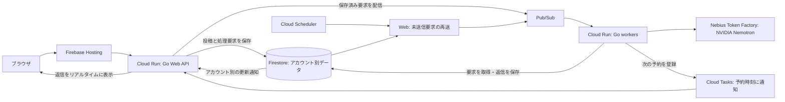

# kakeratta

[English](README.md) | 日本語

**か・け・らった。** かけらを放り込む動作の名前です。

文章・写真・URL・音声で日常のかけらをつぶやくと、人物や関心ごとの担当AIが
自分に関係することを覚え、必要なときに思い出させるパーソナルAIタイムラインです。

[使ってみる](https://kakeratta.net/lp/?lang=ja) ·
[マニュアル](https://kakeratta.net/manual/?lang=ja) ·
[技術的な設計](docs/technical_ja.md)


## できること

- **担当を自然な言葉で作る。** 覚えてほしい人物や関心ごとを伝え、使いながら
  指示・担当条件・返事を調整できます。
- **記憶を確認して直す。** 記憶する担当は、元の投稿にたどれる事実・分野ごとの
  まとめ文・月ごとのかけらの記録を持ちます。事実を個別に修正・削除でき、
  タイムラインは語句や意味で検索できます。
- **読み返したい回答をお気に入りに。** 投稿や担当の回答を保存し、最近追加した順の
  一覧で読み返せます。担当で絞り込め、検索もお気に入りだけを対象にできます。
- **必要なときに知らせる。** 記憶する担当は、伝えたいことがあるときに話しかけます。
  人物は「頻繁に振り返る」「ときどき振り返る」を選べます。誕生日・会う予定・外出前の確認はサーバーで実行し、
  対応する端末にはリマインダーのプッシュ通知も届けられます。
- **回答を図解にする。** 図解したい回答に
  `@infographic この回答をインフォグラフィックにして` と返信すると、
  送信時の表示言語で、絵文字やMermaidを使ったMarkdownの図解を表示します。
- **オフラインでも投稿する。** アプリを開いて接続が戻ると、送信待ちの投稿と
  返信を送ります。会話の必要な部分だけを選び、確認して自分のBlueskyに公開できます。

`@` で指名した投稿や、有効な担当への返信は、宛先の担当だけに届きます。
それ以外は、関心ごとは担当条件で、人物は呼び名やキーワードで届きます。
返信先と異なる担当を `@` で指名した場合は、指名が優先されます。

内蔵の担当は5つです。

| 担当 | 役割 | 新規利用時に有効 |
| --- | --- | --- |
| **tabe** | 食事 | いいえ |
| **shiori** | 読書 | いいえ |
| **sona** | 外出前の備え・持ち物・天気・小さな用事の確認 | はい |
| **support** | システム仕様を読んで答えるkakerattaのサポート | はい |
| **インフォグラフィック** | 文章・展開済み記事・読み取り済み画像・回答を絵文字・MermaidでまとめたMarkdown図解 | はい |

作成・修正時に **記憶する** と **常に熟考する** を選べます。記憶は通常オンで、
support と図解担当はオフです。オフにすると記憶の更新と定期チェックインが止まります。
常に熟考すると通常の依頼でも最終回答を上位モデル（Ultra）で生成し、
図解担当では初期状態でオンです。内蔵の調査と予定・操作の計画にはSuperを使います。

## ローカルで動かす

Go 1.26以降・Node.js・[Task](https://taskfile.dev) と、Nebius Token Factoryの
APIキーが必要です。[mise](https://mise.jdx.dev) を使う場合は `mise install` で
[mise.toml](mise.toml) に指定したツールを導入できます。

```sh
task setup  # 初回のみ：画面側の依存を導入
task dev    # APIは :8787、画面は :5173
```

http://127.0.0.1:5173 を開き、設定でAPIキーを入力します。ローカルでは
Firebaseアカウントも外部データベースも不要で、データはディスクに保存し、APIは
このPC内からのみ接続できます。コマンドは[使い方と設定](docs/usage_ja.md)、
環境変数や公開環境の保存先は[自分で動かす](docs/technical_ja.md#動かす)を参照してください。
`task test` でGoとブラウザ側のテストを実行できます。

## システム構成



本番では、Webが投稿と処理要求を一緒に保存してからPub/Subへ登録します。
空いているworkerがユーザーごとのAI設定とAPIキーで処理し、結果を保存してから
完了を通知します。予約処理はCloud Tasksが指定時刻に同じ経路へ登録します。
未送信要求はFirestoreに残して再送し、未完了のジョブはPub/Subが再配信します。

データ・実行権・会話内の処理順序はアカウントごとに管理します。
Webとworkerは別々に増やせるため、アカウントの担当サーバーを固定せず、
別アカウントや別会話の処理を並列に進められます。同じ会話の処理順序は維持します。
仕事がないときはworkerをゼロ台にできます。台数を増やし、共有基盤の負荷を測って
調整することで処理量の増加に対応します。workerのサイズは運用設定として管理します。
ローカル開発では、同じ担当の処理エンジンをファイル保存とプロセス内の実行方式で動かします。

詳細は[構成とスケールの説明](docs/system/architecture.md)（英語）と
[デプロイ手順](infra/README_ja.md)を参照してください。

## 設計と連携

バックエンドはGo、ブラウザ側はJavaScriptです。Nebius Token Factory経由の
NVIDIA Nemotronで振り分け・回答・workflowの確認を行います。標準のモデル構成は次のとおりです。

| モデル | 用途 |
| --- | --- |
| **Nemotron 3.5 Lightning** | 回答への返信が、より良い・深い回答を求めているかを判定 |
| **Nemotron 3 Super 120B A12B** | 担当への振り分け、内蔵の全調査、通常の回答、予定・操作の計画、workflowの確認 |
| **Nemotron 3 Ultra 550B A55B** | 深掘り返信や「常に熟考する」担当の最終回答 |

OpenRouterも選べます。
処理ごとにモデルを選び、小さいモデルの低コストと回答の速さを活かしながら、
深い推論が必要な場面では上位モデルを使います。
記憶と使える道具は担当ごとに分かれます。設定から投稿・画像・設定・担当・記憶を
エクスポートできます。詳しくは[データの持ち出し](docs/usage_ja.md#持ち出す)を参照してください。

HermesやObsidianのLLM Connect Hubに、MCP経由で調査と回答を任せられます。
タイムライン・予定・操作・記憶の更新はkakerattaが管理します。
NemoClaw/OpenShellのサンドボックスで検証した構成は、下の連携レポートにまとめています。

[Nebius x NVIDIA Global AI Hackathon](https://nebiusglobalaihackathon.devpost.com/) に出展した作品です。
作った理由と「必要なときに思い出させる」という考え方は[開発の背景](docs/background_ja.md)にまとめました。

## ドキュメント

| 文書 | 内容 |
| --- | --- |
| [マニュアル](https://kakeratta.net/manual/?lang=ja) | 日常の操作を画面付きで説明 |
| [使い方と設定](docs/usage_ja.md) | 起動コマンド・設定・データと持ち出し |
| [中で起きていること](docs/technical_ja.md) | 設計・振り分け・モデル・記憶・道具・サーバー運用 |
| [システム実装仕様](docs/system/index.md)（英語） | ソース参照付きのサブシステム仕様。supportも参照 |
| [AIで難しかったこと](docs/ai-lessons_ja.md) | 開発や運用で起きた失敗と対処 |
| [外部エージェント](docs/hermes_ja.md) | Hermes・LLM Connect Hubの接続、MCP権限、代替実行 |
| [NemoClaw連携レポート](docs/nemoclaw-hermes-integration_ja.md) | サンドボックス構成と検証。当時のプロトコルも明記 |
| [Google Cloudへのデプロイ](infra/README_ja.md) | Terraform・Firebase Hosting・Cloud Run |

[MITライセンス](LICENSE)です。
