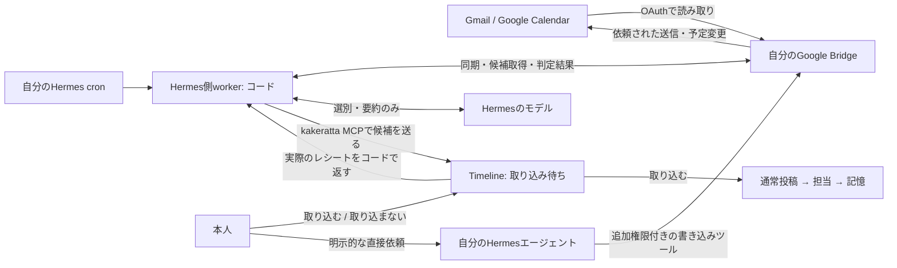
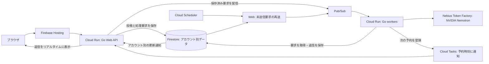

[English](README.md) | 日本語

**か・け・らった。** かけらを放り込む動作の名前です。

**存在を忘れたものは、検索できません。** kakerattaは、それを思い出させる
パーソナルAIタイムラインです。文章・写真・URL・音声で日常のかけらを放り込むと、
大切な人物や関心ごとの担当AIが、自分に関係することを覚え、必要なときに声をかけます。

- **記憶は担当ごとに。** 人物や関心ごとにそれぞれの記憶を持つので、
  互いに薄まりません。人物の担当には、LLMの推測ではなく
  呼び名やキーワードの一致で投稿が届きます。
- **普段は静かに。** 担当は、伝えたいことがあるときだけ返事をします。
  静かなタイムラインも、アプリが働いている姿です。
- **記憶をたどり、見直せる。** 覚えた事実から元の投稿を開けます。
  一時的な記録は期限で消え、見直し対象の記録は「覚えておく・先送り・忘れる」を
  確認します。元の投稿はそのまま残ります。

[使ってみる](https://kakeratta.net/lp/?lang=ja) ·
[デモ動画](https://youtu.be/Z5zML-lSXc0) ·
[Devpost](https://devpost.com/software/kakeratta) ·
[マニュアル](https://kakeratta.net/manual/?lang=ja) ·
[技術的な設計](docs/design/technical_ja.md)

[](https://youtu.be/Z5zML-lSXc0)


運用と検証の記録：
[AIコストの推計 — 2026年10月](docs/reports/production-ai-cost-2026-10-11.md)（英語） ·
[振り分けモデルの比較 — 2026年9月](docs/reports/routing-model-comparison-2026-09-19_ja.md) ·
[AIの失敗から学んだこと](docs/design/ai-lessons_ja.md)

## できること

- **必要なときに知らせる。** 記憶する担当は、伝えたいことがあるときに話しかけます。
  人物は「頻繁に振り返る」「ときどき振り返る」を選べます。誕生日・会う予定・外出前の確認はサーバーで実行し、
  対応する端末にはリマインダーのプッシュ通知も届けられます。
- **記憶を確認して直す。** 記憶する担当は、元の投稿にたどれる事実・分野ごとの
  まとめ文・月ごとのかけらの記録を持ちます。事実を個別に修正・削除でき、
  タイムラインは語句や意味で検索できます。
- **担当を自然な言葉で作る。** 覚えてほしい人物や関心ごとを伝え、使いながら
  指示・担当条件・返事を調整できます。
- **関心ごとに合わせて担当が増える。** 担当の記憶に別の話題がたまると、チェックインで
  新しい担当を提案します。**作る** を押すと担当を下書きして追加し、関係する記憶を移して、
  元の担当の担当条件からその話題を外します。
- **読み返したい回答をお気に入りに。** 投稿や担当の回答を保存し、最近追加した順の
  一覧で読み返せます。担当で絞り込め、検索もお気に入りだけを対象にできます。
- **回答を図解にする。** 図解したい回答に
  `@infographic この回答をインフォグラフィックにして` と返信すると、
  送信時の表示言語で、絵文字やMermaidを使ったMarkdownの図解を表示します。
- **オフラインでも投稿する。** アプリを開いて接続が戻ると、送信待ちの投稿と
  返信を送ります。会話の必要な部分だけを選び、確認して自分のBlueskyに公開できます。

`@` で指名した投稿や、有効な担当への返信は、宛先の担当だけに届きます。
それ以外は、関心ごとは担当条件で、人物は呼び名やキーワードで届きます。
返信先と異なる担当を `@` で指名した場合は、指名が優先されます。

内蔵の担当は5つです。

| 担当 | 役割 | 新規利用時に有効 |
| --- | --- | --- |
| **tabe** | 食事 | いいえ |
| **shiori** | 読書 | いいえ |
| **sona** | 外出前の備え・持ち物・天気・小さな用事の確認 | はい |
| **support** | システム仕様を読んで答えるkakerattaのサポート | はい |
| **インフォグラフィック** | 文章・展開済み記事・読み取り済み画像・回答を絵文字・MermaidでまとめたMarkdown図解 | はい |

作成・修正時に **記憶する** と **常に熟考する** を選べます。
**記憶する** は通常オン（support と図解担当はオフ）で、オフにすると記憶の更新と
定期チェックインが止まります。**常に熟考する** は最終回答に上位モデルを使う設定で、
図解担当では初期状態でオンです。「詳しく」と頼むと、標準構成では最上位の回答モデルを使います。
モデルごとの役割は[設計と連携](#設計と連携)を参照してください。

## Gmail・Google Calendar連携

[Google Bridge](tools/google-bridge/README.md)は、自分の端末・サーバーで動かす、
個人用の独立Webアプリ兼MCPサーバーです。自分のGoogle Cloudプロジェクトと
OAuthクライアントで接続し、Googleの資格情報はBridge専用の保存先へ暗号化して保存します。
Bridge単体の起動にkakeratta本体は不要です。

| 機能 | 動作 |
| --- | --- |
| 重要なGmailを拾う | 差分同期し、ラベル・送信元のルールと任意のHermesによるLLM判定で候補を選びます。LLM判定では署名や引用履歴などを除いた要約を届けます。 |
| 今日・明日の予定を確認する | 指定したタイムゾーンで日次に取得します。終日・定期予定の各回に対応し、この取り込みでGoogle Calendarは変更しません。 |
| 確認してから取り込む | Hermesが届けたTimelineの待機カードで「取り込む／取り込まない」を選びます。「取り込む」で初めて通常投稿・担当への振り分け・記憶の処理へ進み、待機中は検索や担当の処理へ入りません。 |
| 不要なものを次回から除外する | 破棄時にメールの種類・完全一致の送信元、単発予定・定期予定全体を除外できます。Bridgeで解除でき、送信元と予定の除外はLLM判定より前に適用します。 |
| Hermesへ直接頼む | MCPでメール検索・本文・スレッドや予定を読めます。追加権限があれば、本人の明示的な依頼で送信・返信・下書き保存・予定の作成／変更／削除もできます。取り込みとは別の操作で、直接依頼用ツールはWebでの再承認なしに実行します。 |



Hermes側workerがBridgeから候補を取得し、LLMには選別・要約だけを任せます。
担当の回答提出と同じく、判定結果の提出・候補配送・レシート確認・除外ルールの返却はコードで行います。
選別用の隔離セッションにはMCP接続や配送ツールを渡しません。BridgeはkakerattaのURL・キーを保存せず、直接通信もしません。
既存Hermes cronは`--no-agent`付きでgateを実行し、配送だけの回と仕事がない回はモデルのトークンを使いません。
Hermesへ渡すメール・予定は、設定したモデルにも
送られます。取り込んだ予定はその時点の内容で、Google側の変更は既存カードや投稿へ自動反映しません。
直接依頼による書き込みはHermesが本人の指示に従うことが前提で、サーバーは依頼の真正性を
検証できません。判定用ジョブでは書き込みツールを除外してください。


スクリーンショットは実際の画面コードとサンプルAPI応答で同期操作を撮影したものです。
実Googleアカウントの画面ではありません。[上級マニュアルのセットアップ](https://kakeratta.net/manual/?guide=advanced&lang=ja#ja-google)と
[詳しい設定・運用・復旧手順](docs/guides/google_ja.md)を参照してください。
実Google OAuthと実Hermesの接続は未検証で、画像は画面の操作例です。

## ローカルで動かす

Go 1.26以降・Node.js・[Task](https://taskfile.dev) と、Nebius Token Factoryの
APIキーが必要です。[mise](https://mise.jdx.dev) を使う場合は `mise install` で
[mise.toml](mise.toml) に指定したツールを導入できます。

```sh
task setup  # 初回のみ：画面側の依存を導入
task dev    # APIは :8787、画面は :15173
```

コンテナ内で動かす場合は、ポート `15173` を公開・転送してください（Docker なら `-p 15173:15173`）。Vite は `0.0.0.0` で待ち受けるので、ホスト側の `http://localhost:15173` から開けます。ポートが使用中の場合は、別の番号へ切り替えず起動エラーにします。

http://127.0.0.1:15173 を開き、設定でAPIキーを入力します。ローカルでは
Firebaseアカウントも外部データベースも不要で、データはディスクに保存し、APIは
このPC内からのみ接続できます。コマンドは[使い方と設定](docs/guides/usage_ja.md)、
環境変数や公開環境の保存先は[自分で動かす](docs/design/technical_ja.md#動かす)を参照してください。
`task test` でGoとブラウザ側のテストを実行できます。

## システム構成

図は推奨するCloud Run構成です。本番は費用を抑えるため、共有Compute Engine VMで
稼働させています。Web・workerの分離と永続キューは同じです。
[現在の運用手順](infra/shared-vm/README.md)（英語）を参照してください。



本番では、Webが投稿と処理要求を一緒に保存してからPub/Subへ登録します。
空いているworkerがユーザーごとのAI設定とAPIキーで処理し、結果を保存してから
完了を通知します。予約処理はCloud Tasksが指定時刻に同じ経路へ登録します。
未送信要求はFirestoreに残して再送し、未完了のジョブはPub/Subが再配信します。

データ・実行権・会話内の処理順序はアカウントごとに管理します。
Webとworkerは別々に増やせるため、アカウントの担当サーバーを固定せず、
別アカウントや別会話の処理を並列に進められます。同じ会話の処理順序は維持します。
Cloud Run構成では仕事がないときはworkerをゼロ台にできます。台数を増やし、共有基盤の負荷を
測って調整することで処理量の増加に対応します。workerのサイズは運用設定として管理します。
暫定運用の共有VMは固定容量で、workerは常時稼働します。
ローカル開発では、同じ担当の処理エンジンをファイル保存とプロセス内の実行方式で動かします。

詳細は[構成とスケールの説明](docs/system/architecture.md)（英語）と
[デプロイ手順](infra/README_ja.md)を参照してください。

## 設計と連携

バックエンドはGo、ブラウザ側はJavaScriptです。Nebius Token Factory経由の
NVIDIA Nemotronで振り分け・回答・workflowの確認を行います。標準のモデル構成は次のとおりです。

| モデル | 用途 |
| --- | --- |
| **Nemotron 3.5 Lightning** | 任意の音声入力整形 |
| **Nemotron 3 Super 120B A12B** | 担当への振り分け、読み取りと通常の回答、メモ係 |
| **Nemotron 3.5 Super VL 120B A12B** | 深い依頼と常に熟考する担当の調査、予定の計画とworkflowの確認、「常に熟考する」担当の回答、毎日・毎月のチェックイン、毎日の記憶の整理、今日のまとめ・今月のまとめ |
| **Nemotron 3 Ultra 550B A55B** | 「詳しく」などの深い依頼の回答 |

OpenRouterも選べます。
処理ごとにモデルを選び、小さいモデルの低コストと回答の速さを活かしながら、
深い推論が必要な場面では上位モデルを使います。
記憶と使える道具は担当ごとに分かれます。設定から投稿・画像・設定・担当・記憶を
エクスポートできます。詳しくは[データの持ち出し](docs/guides/usage_ja.md#持ち出す)を参照してください。

HermesやObsidianのLLM Connect Hubに、MCP経由で調査と回答を任せられます。
タイムライン・予定・記憶の更新はkakerattaが管理します。
`@agent` で呼びかければ、担当を通さず外部エージェント自身にメール送信のような長い作業も直接依頼でき、返信でやりとりできます。
NemoClaw/OpenShellのサンドボックスで検証した構成は、下の連携レポートにまとめています。

[Nebius x NVIDIA Global AI Hackathon](https://nebiusglobalaihackathon.devpost.com/) に出展した作品です。
[Devpostの作品紹介](https://devpost.com/software/kakeratta)（英語）にも、着想と開発の経緯をまとめています。
作った理由と「必要なときに思い出させる」という考え方は[開発の背景](docs/design/background_ja.md)にまとめました。

## ドキュメント

ガイド・設計解説・検証レポートの全体は[ドキュメント一覧](docs/README.md)から参照できます。

| 文書 | 内容 |
| --- | --- |
| [マニュアル](https://kakeratta.net/manual/?lang=ja) | 日常の操作を画面付きで説明 |
| [使い方と設定](docs/guides/usage_ja.md) | 起動コマンド・設定・データと持ち出し |
| [中で起きていること](docs/design/technical_ja.md) | 設計・振り分け・モデル・記憶・道具・サーバー運用 |
| [システム実装仕様](docs/system/index.md)（英語） | ソース参照付きのサブシステム仕様。supportも参照 |
| [AIで難しかったこと](docs/design/ai-lessons_ja.md) | 開発や運用で起きた失敗と対処 |
| [外部エージェント](docs/guides/hermes_ja.md) | Hermes・LLM Connect Hubの接続、MCP権限、代替実行、`@agent` での直接依頼 |
| [NemoClaw連携レポート](docs/reports/nemoclaw-hermes-integration_ja.md) | サンドボックス構成と検証。当時のプロトコルも明記 |
| [Gmail・Calendar連携](docs/guides/google_ja.md) | Google Bridge、OAuth、本人選択式の取り込み、Hermes cron |
| [Google Cloudへのデプロイ](infra/README_ja.md) | Cloud Run構成と暫定運用の共有VM |

[MITライセンス](LICENSE)です。
