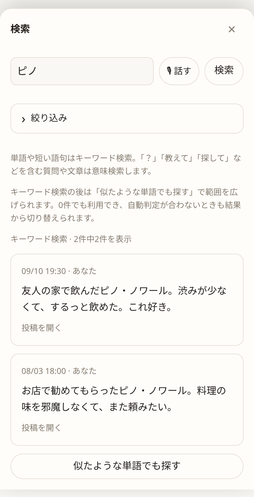
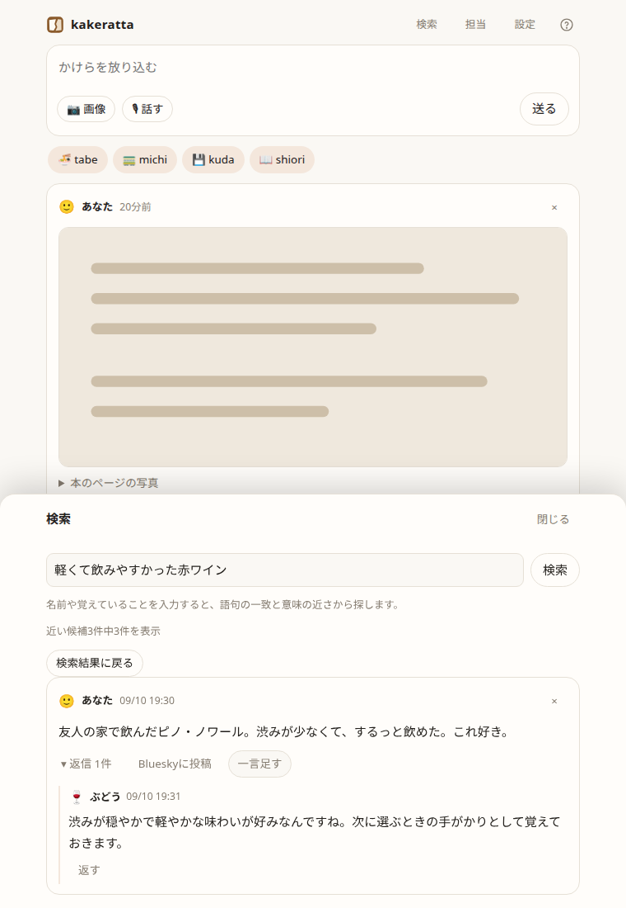
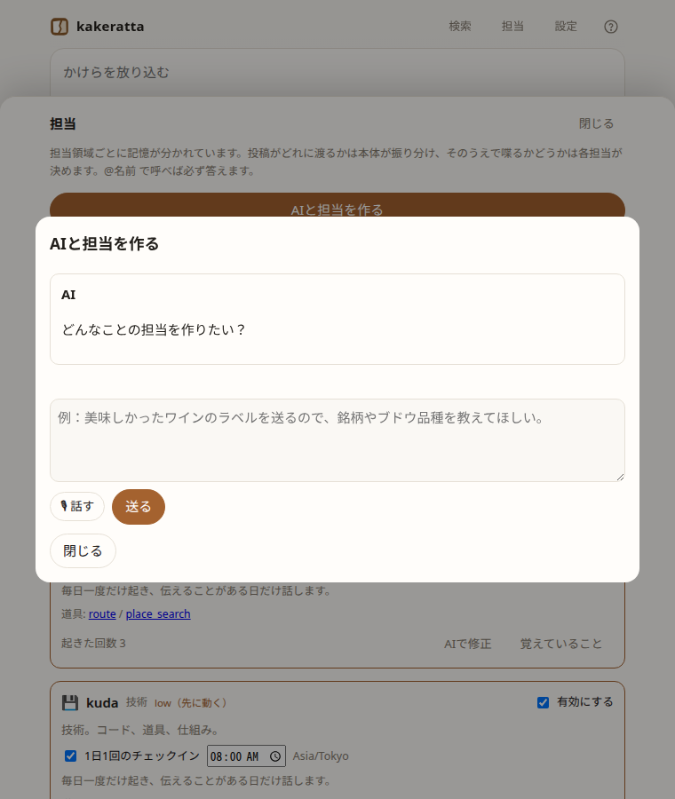

# kakeratta

[English](README.md) | 日本語

**か・け・らった。** かけらを放り込む動作の名前です。

思いついたことや気になったものを、文章・画像・URL・音声でひとつのタイムラインへ。
担当分野ごとに別々の記憶を育てるAIが、必要なときだけ反応します。

**毎日一度だけ起きる。でも、話すことがなければ黙る。** 担当ごとに定期チェックインと
希望時刻を設定できます。新しいかけらを投げない日も、自分の記憶や最近の変化を確かめ、
伝えることがあるときだけタイムラインに話しかけます。

グルメ担当は食事の記録から好みを覚え、読書担当は気になった一節を覚えます。
記憶を分野ごとに分けることで、関係のない情報で薄まるのを防ぎます。
担当が覚えるのは担当分野に関係することだけで、投稿が全部記憶されるわけではありません。
ただのメモとして気軽に放り込んでも大丈夫です。

**自分のための担当を、AIと作れます。** たとえば、お店や友人宅で飲んで美味しかったワインのラベルを
ワイン担当に送ると、銘柄やブドウ品種を解説してくれます。ワインショップで探したり、お店で注文したりするときに役立ちます。
痛風が気になる人なら、食事の写真を送ると「プリン体が多いので気をつけて」と教えてくれる痛風担当も作れます。
ほしい担当を伝えるだけでAIが完成案を作るので、まず使い始めて、話し方や覚えてほしいことはあとから会話で改善できます。

KakerattaはNebius Token Factoryを通じてNVIDIA Nemotronモデルを使用します。

- Nemotron Nano — 軽量な振り分けと、日常的な担当の判断
- Nemotron Super — 担当分野をより深く考える推論
- Nemotron Ultra — 担当が必要とする複雑な推論
- Nebius Token Factory — 推論基盤

画像の読み取りには、同じ基盤のGLM-5.3-Flashを使用します。

## 使い方

1. 思いついたことを書く、スクリーンショットを貼る、URLを送る、または音声で入力します。
2. 関係する担当が投稿を受け取り、自分のメモに残す内容と、発言するかを決めます。
3. 反応は遅れてタイムラインに届きます。返事が欲しい担当は `@` で指名できます。


タイムラインには新しい投稿から20件ずつ並びます。担当とのやりとりは投稿の下にたたまれていて、「返信 3件」を押すと開きます。

反応が付かない投稿もあります。発言しなくても、担当領域の情報はメモに残せます。
内蔵の担当は **tabe（食事）・michi（移動）・kuda（技術）・shiori（読書）** の4体です。
名前は、どのキーボードでも `@tabe` と打てるようにローマ字にしてあります。

音声入力はブラウザ認識を使います。設定の **「自動送信前にAIで文章を整える」** をONにすると、終了フレーズで話し終えたときにNemotron Nano（lowモデル）が文章を整えてから投稿します。初期状態はOFFで、手動送信では整形しません。

## 見せたい会話だけ、Blueskyへ

各ユーザーが自分のBlueskyアカウントを接続し、元投稿・担当の返信・自分の追加返信から、公開する発言を選べます。
ハンドルを入力してBluesky側で接続を許可するだけ。kakerattaにBlueskyのパスワードやAPIキーを入力する必要はありません。

**担当の返信は初期状態では未選択です。** プレビューで本文・画像・返信先・投稿アカウントを確認してから公開します。
担当の発言には `🍚 tabeからの返信:` のような署名が付き、枝分かれした返信のつながりも保ちます。


投稿済みの発言は再送せず、追加分を返信として続けられます。
[接続と公開の手順](https://kakeratta.net/manual/?lang=ja#ja-bluesky) · [運営側の初期設定・投稿履歴](docs/social-sharing.md)

## 前に放り込んだかけらを、あとから探す

「あのとき美味しかったワイン、なんだっけ？」と思ったら、ヘッダーの **「検索」** を開きます。

「ピノ」のような名前でも、「軽くて飲みやすかった赤ワイン」のような曖昧な記憶でも、同じ検索欄に入力します。語句の一致と意味の近さを合わせて探すので、検索方法を選ぶ必要はありません。

書いた文章だけでなく、写真から読み取った文字や、担当とのやりとりも探せます。
結果を押すと、元の投稿と会話がそのまま開きます。






**担当も、必要なときはあなたの過去のかけらを見返します。** たとえばワイン担当なら、新しいラベルが届いたときに
「前に気に入っていたピノに近いですね」と、元の投稿へのリンク付きで教えてくれることがあります。

意味検索は、設定したAIの接続先をそのまま使います。準備や保存の仕組みは[使い方と設定](docs/usage_ja.md#検索)にまとめています。

## 担当が何を覚えているか、確かめる

担当画面の **「覚えていること」** を開くと、好み・ワイン・お店・本など、保存済みのメモを種類ごとに読めます。
説明だけでなく、根拠や例外もそのまま表示します。関連する記憶のリンクを押すと、そのメモに移動します。


**「記憶を更新した投稿」から、元の投稿と会話を開けます。** メモの保存時にアプリが投稿リンクを自動で付け、
書き直しても保持します。メモを読んで別のメモにまとめた場合も、参照を引き継ぎます。
これは記憶が作られた経緯を確かめるためのリンクで、メモの解釈が正しいことを保証するものではありません。

新しいAIによる要約は行わず、今あるOKFを読みやすく表示します。「元のメモを見る」で保存された原文も確認できます。
以前のメモに投稿リンクが残っていない場合は、「元の投稿を探す」から検索できます。

間違ったメモは **「このメモを忘れさせる」** で1件ずつ削除できます。元の投稿やほかのメモは残ります。
過去の投稿から再び覚える場合もあるため、覚え方を変えたいときは担当画面の **「AIで修正」** を使います。
たとえば「一度飲んだだけで好みと決めない」と伝えます。

## ほしい担当を、AIとさっと作る

「どんなことの担当を作りたい？」に、自分の言葉で答えてください。

> 美味しかったワインのラベルを送るので、銘柄やブドウ品種を教えてほしい。お店で注文したり買ったりできるように。

担当分野が分かれば、AIが名前・話し方・覚えることなどを補って、すぐに完成案を出します。
「ワイン」「読書」のひと言からでも始められます。細かい質問に何度も答える必要はありません。
完成案は「担当すること」「話し方」「覚えること・返事をするタイミング」など、読みやすい文章で確認できます。




1. 担当画面で「AIと担当を作る」を押し、ほしい担当を伝えます。
2. 完成案を確認し、「この内容で保存」を押します。
3. 「有効にする」で参加させ、いつものように投稿します。

**使ってから、自分に合う担当に育てる。** 「もっと短く返事して」「ワインの名前だけでなく、好きだった理由も覚えて」
など、「AIで修正」から希望を伝えられます。内蔵の担当も修正でき、これまでの記憶と有効・無効の状態は引き継ぎます。

対話には設定済みのAI接続を使います。上級者向けに `skill.json` の追加も利用できます。


## はじめる

ブラウザで使うアプリで、静的な画面と Go の API の2つに分かれています。画面は開発中は Vite、
公開時は Firebase Hosting が配信し、Go のバイナリは API だけを持ちます（Cloud Run でも手元でも同じ）。

必要なもの: Go 1.26 以降、Node.js、Task（`task` コマンド）。
リポジトリのルートで実行します。

```sh
task setup  # 初回のみ。画面側の開発依存（Vite・Storybook）
task dev    # API（:8787）と画面（:5173）を同時に起動
```

ブラウザで <http://127.0.0.1:5173> を開きます。新しいワークスペースには担当がまだ誰もいないので、
呼ぶまでは画面がそれを先頭で伝えます。


そのあと「設定」でNebius Token FactoryのAPIキーを入力します。各段のモデルはNano・Super・Ultraが既定で設定されています。
画面は `/api` をバイナリへ中継します。公開時と同じ分け方です。API だけなら `task run`、
バイナリのビルドだけなら `task build`（出力は `bin/kakeratta`）、Storybook は `task stories`、
テストは `task test` です。

| 環境変数 | 既定 | 用途 |
| --- | --- | --- |
| `KAKERATTA_PUBLIC_URL` | 空 | Bluesky OAuthに使う公開HTTPSオリジン |
| `KAKERATTA_BLUESKY_KEY` | 空 | Bluesky接続の署名・暗号化用秘密鍵（64桁の16進文字列）。[運営設定](docs/social-sharing.md)を参照 |
| `KAKERATTA_ADDR` | `:8787` | 待ち受けアドレス |
| `KAKERATTA_HOME` | OS の設定ディレクトリ | 投稿・メモ・画像の保存先 |
| `KAKERATTA_TOKEN` | 空（認証なし） | アクセス用トークン |
| `KAKERATTA_FIREBASE_PROJECT_ID` | 空 | Firebaseによるマルチユーザー認証を有効化 |
| `KAKERATTA_FIREBASE_API_KEY` | 空 | Firebase Web APIキー（公開値） |
| `KAKERATTA_FIREBASE_AUTH_DOMAIN` | 空 | Firebase Authドメイン |
| `KAKERATTA_GCS_BUCKET` | 空 | 画像を保存する非公開Cloud Storageバケット |
| `KAKERATTA_STORE` | `file` | Cloud Runでは`firestore`を指定 |
| `KAKERATTA_FIRESTORE_PROJECT_ID` | Firebaseプロジェクト | Firestoreのプロジェクト |
| `KAKERATTA_MCP_SERVERS` | 空 | 担当が使えるMCPサーバーの一覧（JSON） |
| `KAKERATTA_NOMINATIM_URL` ほか | OpenStreetMapの公開サービス | 店舗・経路検索の接続先（後述） |

**外からアクセスできる場所で動かす場合は `KAKERATTA_TOKEN` を設定してください。**
各ブラウザで一度 `/?token=<URLエンコードしたトークン>` を開くと、画面が API 経由でトークンを
渡し、以後はセッションCookieで認証されます。

公開するマルチユーザー環境では、代わりにFirebaseの3変数をすべて設定します。
Googleでログインした利用者ごとにデータが分離されます。Firebase認証を設定した場合は、共有の `KAKERATTA_TOKEN` より優先されます。
保存先は次の組み合わせで決まります。

- `KAKERATTA_STORE=firestore`（Cloud Run向け）: 投稿・設定・担当メモ・担当の定義をFirestoreの `users/<uidのハッシュ>` 以下に保存します。
- `KAKERATTA_STORE=file`（既定）: 同じデータを `KAKERATTA_HOME/users/<uidのハッシュ>/` 以下のディスクに保存します。
- `KAKERATTA_GCS_BUCKET` を設定すると、どちらの場合も画像は非公開バケットの `users/<uidのハッシュ>/blobs` に保存します。

## 詳しく読む

| 文書 | 内容 |
| --- | --- |
| 紹介ページとマニュアル（`/lp/`、`/manual/`） | アプリと並んで配信する日英のページ。アプリのヘッダーの **?** アイコンから別タブでマニュアルが開きます |
| [使い方と設定](docs/usage_ja.md) | Android・iOSからの共有、位置情報、音声、モデル設定、保存データ |
| [設計とペルソナ](docs/architecture_ja.md) | 設計原則、振り分け、実行順序、OKFメモ、スキルとツール |
| [開発と実装状況](docs/development_ja.md) | テスト、ソース構成、実装済みの機能と未確認項目 |
| [Google Cloudへのデプロイ](infra/README_ja.md) | Terraformでの構築。画面はFirebase Hosting、APIはCloud Run |

AIとの対話による担当の作成・修正、投稿・共有の受け口、振り分け、メモ、返信、検索・経路ツール、読み上げは実装済みです。
スマホ実機での共有、さまざまな画像でのOCR品質、反応頻度は引き続き確認が必要です。

[MITライセンス](LICENSE)。

### 1日1回のチェックイン

担当画面で、有効な担当ごとに「1日1回のチェックイン」と希望時刻を設定できます
（初期状態はOFF）。時刻とともに端末のタイムゾーンを保存します。JST以外にも対応し、
夏時間も考慮します。移動後も保存したタイムゾーンを維持し、現状は手動の選択UIはありません。担当は自分の
メモ・過去のかけらの検索・普段の道具を使い、伝えることがある日だけ新しい
スレッドに投稿します。黙る日はシステム投稿も空のスレッドも残りません。

サーバーが毎分確認し、通常の投稿と同じ実行キューで処理します。処理が混んでいる
場合は希望時刻より遅れます。ブラウザを閉じても動きますが、サーバーの稼働は必要です。
再起動時にはFirestoreを含む設定済みユーザーを復元します。同梱のCloud Run構成は
すでに最小1インスタンス・リクエスト外もCPUを割り当てる設定です。

実行前に日付を保存し、沈黙・失敗も含めて現地の日付ごとに1回までに制限します。
Firestoreではトランザクションで複数インスタンス間の重複を防ぎます。ローカル保存は
ワークスペースごとに1つのサーバープロセスで動かしてください。時刻の変更や記憶の削除で
当日の実行済み状態は戻りません。停止期間の分をまとめて投稿せず、再開した当日分だけを
実行します。実行日を保存した直後に停止した場合、その日の定期便はスキップされます。

### 道具は運用者が用意する

[道具の一覧・用途・設定・依頼例・制限](https://kakeratta.web.app/manual/?lang=ja#ja-tools)

担当の道具がどこへ行くかは、サーバーを動かす人が環境変数で決め、全利用者で共有します。
地図の接続先とMCPサーバーがそれです。利用者が自分で入れるのは `web_search` に使うTavilyのAPIキーだけで、
設定画面で保存します。スキルは道具の名前を宣言するだけで、呼ぶのは本体、鍵を持つのも本体です。

**MCPサーバー**で道具を増やせます。`KAKERATTA_MCP_SERVERS` はJSONの配列です。

```json
[{"name":"geo","url":"https://geo.example.com/mcp","headers":{"Authorization":"Bearer …"}}]
```

各サーバーの道具は `サーバー名.道具名`（例: `geo.compute_commute`）として内蔵の道具と並び、
スキルはその名前で宣言します。対応するのはStreamable HTTPのリモートサーバーだけです。
道具の一覧は数分キャッシュし、応答しなくなったサーバーは最後に取得した一覧を保ちます。
呼び出しの失敗は握りつぶさず、担当にそのまま伝えます。

### 店舗検索・経路検索

`route` は投稿に付いた位置情報を必要とします。車・徒歩・自転車で接続先を分け、
`KAKERATTA_OSRM_CAR_URL`・`KAKERATTA_OSRM_FOOT_URL`・`KAKERATTA_OSRM_BIKE_URL` で指定します。
既定は順に `https://router.project-osrm.org`、
`https://routing.openstreetmap.de/routed-foot`、
`https://routing.openstreetmap.de/routed-bike` です。URLの移動手段名を書き換えるだけでは
切り替わらず、自前のサーバーでも対応する経路データが必要です。公共交通の時刻表や
リアルタイムの渋滞を含まない道路の目安です。非対応の移動手段はエラーを返します。

`place_search` は位置情報があればOverpass（`KAKERATTA_OVERPASS_URL`）で周辺検索、なければ
Nominatim（`KAKERATTA_NOMINATIM_URL`）で名前を検索します。
営業時間はOpenStreetMapに登録がある場合だけ返り、営業中である保証はありません。
周辺検索の一時的な障害は一度再試行し、失敗したら「店がない」ではなく取得不能と伝えます。
公開サービスの混雑や停止による失敗は引き続き起こり得ます。

定期チェックインでは現在地を取得しないため、`route` は使えず、`place_search` は名前検索のみです。
メモ、過去のかけらの検索、宣言済みのWeb検索は使えます。
