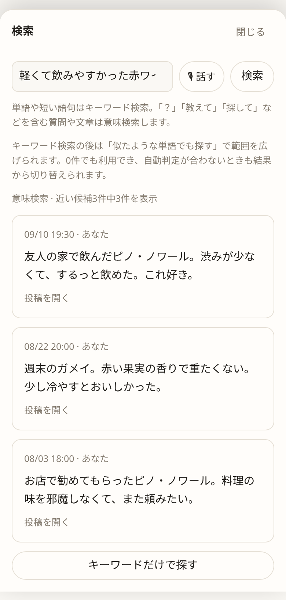
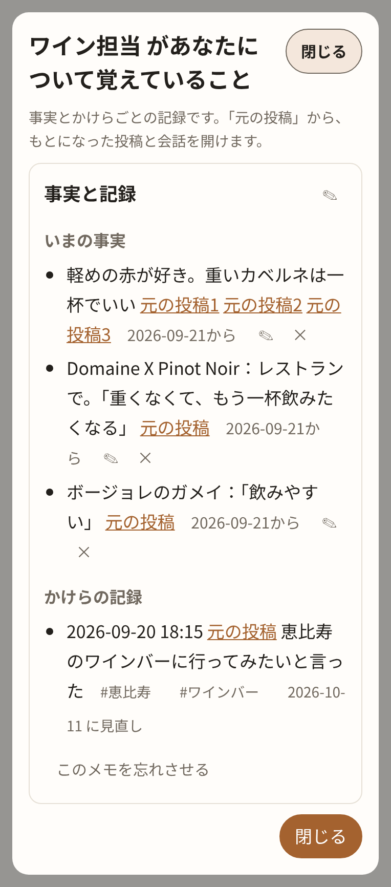
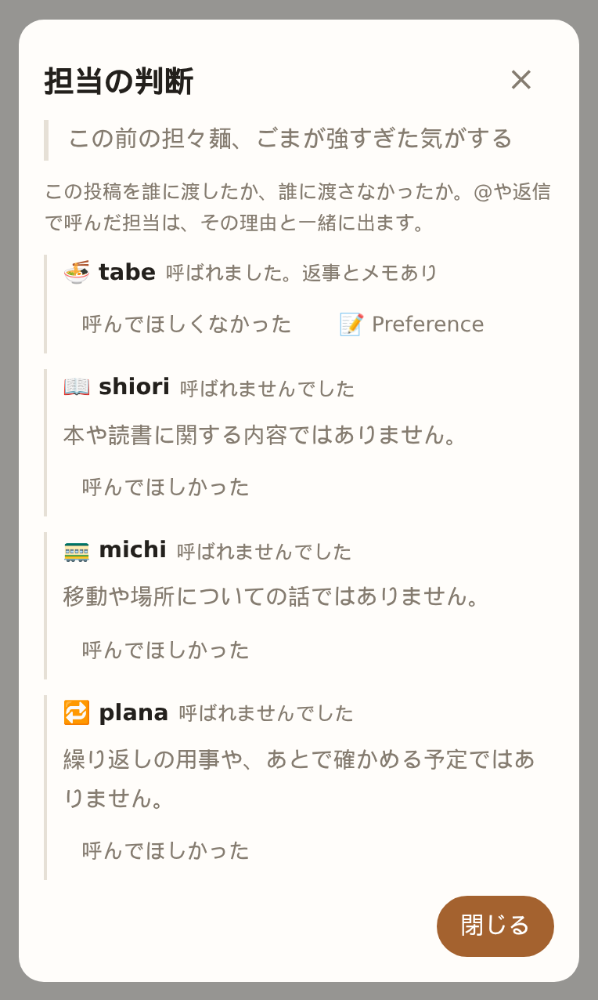
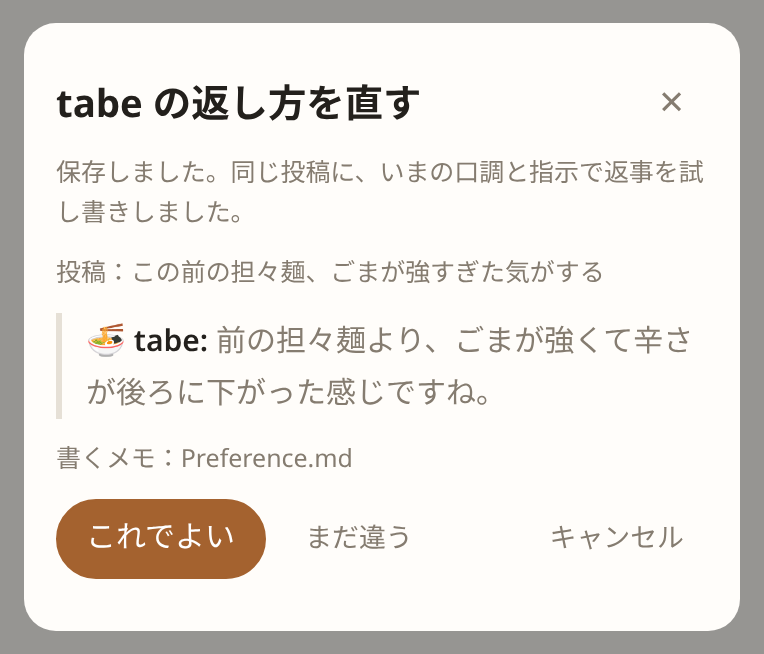
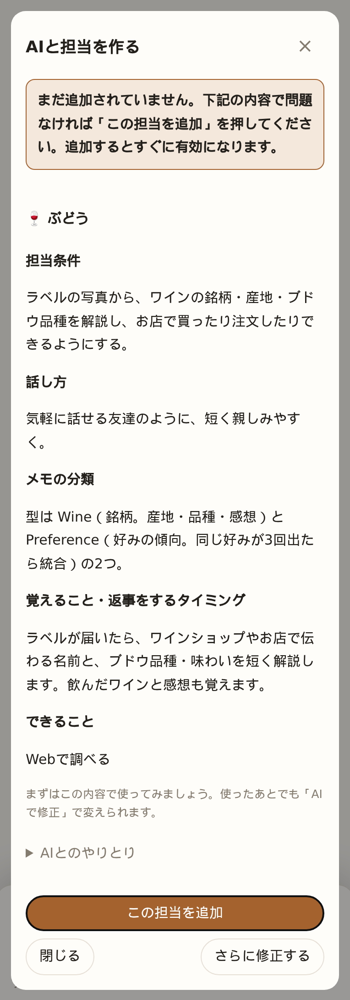
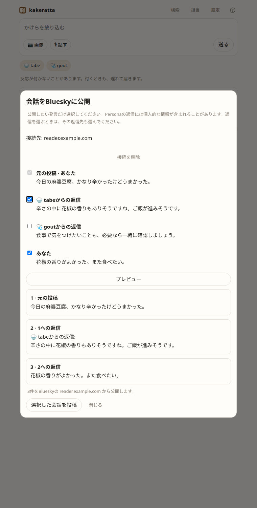

# kakeratta

**Hermes Agent連携**：外部エージェントを担当として追加し、タイムラインから依頼できます。毎日のチェックインやHermesのcronからの報告にも対応します。[設定と使い方](docs/hermes.md)。

[English](README.md) | 日本語

**か・け・らった。** かけらを放り込む動作の名前です。

思いついたことや気になったものを、文章・画像・URL・音声で、重要かどうかも分類も考えずに、
ひとつのタイムラインへ。分野ごとに別々の記憶を育てるAIが、言うことがあるときだけ反応します。

[Nebius Global AI Hackathon](https://nebiusglobalaihackathon.devpost.com/) に出展した作品です。
使ってみるなら [kakeratta.net](https://kakeratta.net/lp/?lang=ja)、中身は [中で起きていること](docs/technical_ja.md) にまとめています。


## なぜ作ったか

私はよく独り言を言います。食べたものの感想や、ふと思いついたことを口に出しておくと、
次に思い出すための「引っかかり」が残る気がするからです。でも、結局忘れてしまいます。

メモを取ることもありますが、あとから見返すことはほとんどありません。よく見るのは、
パスワードやAPIキーのように、最初から「そこにある」と分かっているメモくらいです。

AIがメモをきれいに分類してくれても、存在自体を忘れた情報は検索できません。
記録したときには重要でないと思ったことが、後になって重要になることもあります。

独り言には、考えを整理したり、面白い発見を誰かに伝えたいという側面もあります。
でも、自分と話しているだけでは、自分自身のバイアスから抜け出せません。

だったら、重要かどうかも分類も考えず、とりあえず生活の断片を雑多に放り込める場所があればいい。
AIがそれを覚え、必要なら過去やWebを調べ、良いときに良い感じで反応してくれたらいい。

そこから kakeratta を作り始めました。

## できること

kakeratta は、自分だけの「独り言タイムライン」です。文章、写真、URL、音声を、
間違いや分類を気にせず放り込めます。

そこには「担当」と呼ぶ、分野ごとのAIがいます。食事、移動、読書、やること。それぞれが関係する投稿を見つけ、
必要なら反応し、覚えておくべきことを自分の記憶に残します。ただし、すべてに返事をすると鬱陶しいので、
何も言う必要がなければ黙っています。発言しなくても、自分の分野のことならメモには残します。

担当は自然文で作成・変更できます。「飲んだワインを覚えて、次に選ぶときに手伝って」といった指示だけで作り、
使いながら自分好みに育てられます。

担当が何を覚えているか確認し、その記憶が生まれた元の投稿まで遡れます。間違った記憶だけを忘れさせることもできます。

担当は1日に一度、自分の記憶や最近のタイムラインを振り返り、必要ならWebも調べます。
過去と関係するニュースや、忘れていたことを自分から教えてくれることがあります。何もなければ黙ったままです。

音声入力では、決めておいた結び言葉を話すだけで投稿でき、思いついたことをすぐ残せます。

## 使い方

1. 思いついたことを書く、スクリーンショットを貼る、URLを送る、または音声で入力します。
2. 関係する担当が投稿を受け取り、自分のメモに残す内容と、発言するかを決めます。
3. 反応は遅れてタイムラインに届きます。返事が欲しい担当は `@` で指名できます。

内蔵の担当は **tabe（食事）・michi（移動）・shiori（読書）・plana（やること）** の4体です。
名前は、どのキーボードでも `@tabe` と打てるようにローマ字にしてあります。
内蔵の担当は網羅ではなく、分け方の見本です。ほかの分野は自分で作ってください。

plana は、カレンダーに書くまでもないが忘れると困ることを覚えます。薬、金魚の餌、洗濯、ゴミ出し。
「仕事帰りに花を買おう」と書けば、夕方ごろに「花、買った?」。いつごろかは、自分の記録から自分で見計らいます。

## 前に放り込んだかけらを、あとから探す

「あのとき美味しかったワイン、なんだっけ？」と思ったら、ヘッダーの **「検索」** を開きます。
「ピノ」のような名前でも、「軽くて飲みやすかった赤ワイン」のような曖昧な記憶でも、同じ検索欄に入力します。
書いた文章だけでなく、写真から読み取った文字や、担当とのやりとりも探せます。結果を押すと、元の投稿と会話がそのまま開きます。



**担当も、必要なときはあなたの過去のかけらを見返します。** ワイン担当なら、新しいラベルが届いたときに
「前に気に入っていたピノに近いですね」と、元の投稿へのリンク付きで教えてくれることがあります。

## 担当が何を覚えているか、確かめる

担当画面の **「覚えていること」** を開くと、好み・ワイン・お店・本など、保存済みのメモを種類ごとに読めます。
説明だけでなく、根拠や例外もそのまま表示します。担当が付けたタグで絞り込め、
**「記憶を更新した投稿」** から、その記憶が生まれた元の投稿と会話を開けます。



綴りや事実の誤りは、メモの **✎** でその場で直せます。間違ったメモは **「このメモを忘れさせる」** で1件ずつ消せます。
元の投稿やほかのメモは残ります。覚え方そのものを変えたいときは **「AIで修正」** で、
「一度飲んだだけで好みと決めない」のように伝えます。AIの記憶を、ブラックボックスにしません。

## 担当がなぜ呼ばれたか、呼ばれなかったかを確かめる

誰にかけらを渡すかは本体が決めていて、その理由も残しています。投稿の **⚖（担当の判断）** を押すと、
呼ばれた担当と、呼ばれなかった担当ごとの一行の理由が並びます。



判断が違っていたら、**「呼んでほしかった」** から理由を自分の言葉で書くだけです。AIが担当条件を書き直し、
同じ投稿でもう一度振り分けを試して確かめます。新しい条件は文章のまま表示され、保存前に手で直せます。

## 返事がずれたところで、担当を直す

担当の発言の **「返し方を直す」** を押し、「おすすめは要らない、前との違いを一言で」のように期待とどう違うかを書くと、
AIが口調と指示だけを書き直します。担当条件、名前、道具はそのままです。



保存すると、同じ投稿に同じ担当をもう一度立たせて試し書きを見せます。タイムラインには載らず、メモも予定も書かれません。
判断するのはあなたです。裏で勝手に学習することはありません。

## ほしい担当を、AIとさっと作る

「どんなことの担当を作りたい？」に、自分の言葉で答えてください。

> 美味しかったワインのラベルを送るので、銘柄やブドウ品種を教えてほしい。お店で注文したり買ったりできるように。

担当分野が分かれば、AIが名前・話し方・覚えることを補って、すぐに完成案を出します。「ワイン」のひと言からでも始められます。



**使ってから、自分に合う担当に育てる。** 「もっと短く返事して」「ワインの名前だけでなく、好きだった理由も覚えて」
など、**「AIで修正」** から希望を伝えられます。内蔵の担当も同じように修正できます。

## 見せたい会話だけ、Blueskyへ

自分のBlueskyアカウントを接続し、元投稿・担当の返信・自分の追加返信から、公開する発言を選べます。
担当の返信は初期状態では未選択。プレビューで本文・返信先・投稿アカウントを確認してから公開します。
担当の発言には `🍚 tabeからの返信:` のような署名が付きます。



[接続と公開の手順](https://kakeratta.net/manual/?lang=ja#ja-bluesky)

## 素早い表示とオフライン投稿

直近の会話をブラウザに保存し、次回はそれを先に表示します。一度オンラインで開いた端末なら、
オフラインでも文章・画像・URL・返信を「送信待ち」として保存でき、接続が戻ると自動送信します。
[画面付きの手順](https://kakeratta.net/manual/?lang=ja#ja-offline)

## 学んだこと

AIが情報を整理してくれるだけでは、十分ではありません。

誰かに部屋をきれいに整理してもらったのに、以前より物を見つけにくくなることがあります。
AIによるメモの整理も似ています。完璧に分類されていても、どこにあるか分からなければ取り出せません。
もっと根本的には、**存在を忘れたものは検索できません。**

だから Personal AI は、記憶して整理するだけでは足りない。必要になったときにAIの側から持ってきて、
ときには質問していなくても「これ、今のあなたに関係あるのでは？」と教えてくれる。
「何を覚えるか」と同じくらい、**「いつ思い出させるか」** が重要だと学びました。

内部は複雑になりましたが、使う人がすることは逆に単純にできました。
思ったことを投稿する。自然な言葉で担当に「こうしてほしい」と伝える。それだけです。

## はじめる

必要なもの: Go 1.26 以降、Node.js、Task（`task` コマンド）、Nebius Token Factory の API キー。

```sh
task setup  # 初回のみ
task dev    # API（:8787）と画面（:5173）を同時に起動
```

<http://127.0.0.1:5173> を開き、「設定」で API キーを入力します。
環境変数、認証、保存先、デプロイは [中で起きていること](docs/technical_ja.md#動かす) にあります。

## 詳しく読む

| 文書 | 内容 |
| --- | --- |
| [中で起きていること](docs/technical_ja.md) | 全体の流れ、振り分けと workflow をこう設計した経緯、モデル、環境変数と保存先、チェックインの仕組み、道具と経路検索 |
| 紹介ページとマニュアル（[/lp/](https://kakeratta.net/lp/?lang=ja)、[/manual/](https://kakeratta.net/manual/?lang=ja)） | アプリと並んで配信する日英のページ。アプリのヘッダーの **?** アイコンから別タブでマニュアルが開きます |
| [使い方と設定](docs/usage_ja.md) | Android・iOSからの共有、位置情報、音声、モデル設定、保存データ |
| [設計とペルソナ](docs/architecture_ja.md) | 設計原則、振り分け、実行順序、OKFメモ、スキルとツール |
| [AIまわりで苦労したこと](docs/ai-lessons_ja.md) | Nemotron の担当が実機・本番で起こした問題と、それぞれの対処 |
| [開発と実装状況](docs/development_ja.md) | テスト、ソース構成、実装済みの機能と未確認項目 |
| [Google Cloudへのデプロイ](infra/README_ja.md) | Terraformでの構築。画面はFirebase Hosting、APIはCloud Run |

[MITライセンス](LICENSE)。
