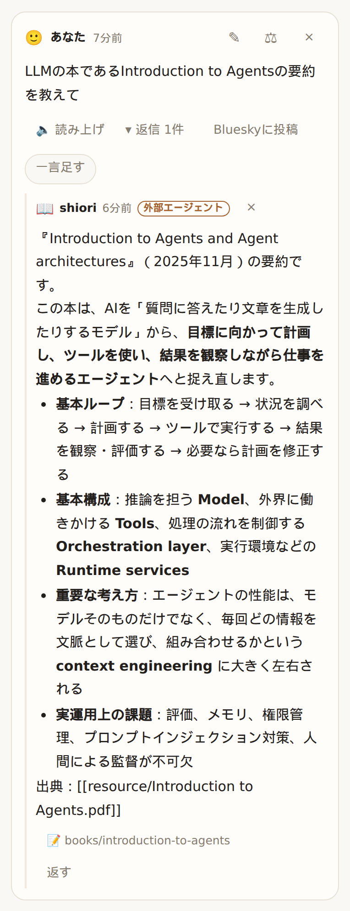

# kakeratta

[English](README.md) | 日本語

**か・け・らった。** かけらを放り込む動作の名前です。

日常のかけらをつぶやくだけで、人物や関心ごとの担当AIが、自分に関係するものだけを記憶していくパーソナルAIタイムラインです。

[Nebius x NVIDIA Global AI Hackathon](https://nebiusglobalaihackathon.devpost.com/) に出展した作品です。

**使ってみる:** [kakeratta.net](https://kakeratta.net/lp/?lang=ja)
**マニュアル:** [kakeratta.net/manual](https://kakeratta.net/manual/?lang=ja)
**技術的な設計:** [中で起きていること](docs/technical_ja.md)


## なぜ作ったか

スマホでいつでも気軽にメモや写真を残せるようになり、それらのデータが大量に増えました。
大量になればやはり見返すことが少なくなり、メモを取ったのに忘れてしまっていたり、メモを見ても
何についてのメモか思い出せなかったりします。

AIにより自動でメモをカテゴライズして整理するアプリを作ってみたものの、誰かに部屋を片付けられてしまうと
かえって物が探しにくくなるのと同様に、かえって見失う結果になりました。
散らかっていた頃は、邪魔だと思いながらも常に目に触れたり探ったりしていたので、
自分なりにどこにあるか把握できていたからです。
とはいえ、ここまでのデータ量になると、散らかったままではいつまでたっても見つけられません。

そこで考えたのは、整理しつつ、整理した人がどこに何があるかを答えてくれて、さらにあることすら本人が
忘れていることも想定して、関連した話題のときに提案してくれたり、あまりにも長い間使わなかったものに対して
「忘れていいですか?」と聞いてくれたりすれば、本来のメモの役割を果たせるのではないか、ということでした。

特に後悔していることがあります。いつも気にかけてくれていた人に、自分の忙しさのあまりお礼の連絡を忘れてしまい、
気づいたときには連絡するきっかけもなく、ずるずると疎遠になってしまったことです。

そうして生まれたのが kakeratta です。

## できること

kakeratta は、日常のかけらをつぶやくだけで、人物や関心ごとの担当AIが、自分に関係するものだけを記憶していく
パーソナルAIタイムラインです。

話したことすべてを1つの巨大な個人記憶に放り込むのではなく、kakeratta ではテキスト、写真、URL、音声を
気軽に投稿するだけです。各担当はその役割に関連するかけらだけを受け取り、何かを記憶するか、返信するか、
道具を使うか、後日のフォローアップを予定するか、あるいは単に黙っているかを判断します。

担当は自然文で作成・編集できます。人物の場合は、

> 恋人の名前は nagomi。1972/11/10 生まれ。韓流アイドルやコスメが好き。ピアノが得意。タイ料理など辛いものが好き。

とおおまかに入力し、その後は日々の出来事をつぶやいておけば、誕生日が近いことを教えてくれたり、
今までに贈ったプレゼントやもらったプレゼントも把握しながら提案してくれたりします。

人物の担当には呼び名とキーワードで、関心ごとの担当には振り分け条件で投稿が届くため、すべてのかけらが
すべてのAIに送られるわけではありません。

最初から関心ごとの担当が4つ用意されています（人物の担当は用意されていません）。

* **tabe**：食事
* **michi**：旅行やお出かけ
* **shiori**：読書
* **sona**：外出前の持ち物点検、予定と天気を合わせた備え、小さな用事の確認（新規利用時は有効）

関心ごとの担当も、同じように自然文で作れます。たとえばワインの担当の場合は、

> 飲んだワインを覚えておいて、次回選ぶのを手伝って。

これだけで作成できます。使いながら、次のように伝えることもできます。

> もっと手短に返答して。

> 銘柄だけでなく、なぜそのワインが気に入ったのかを覚えておいて。

このようにして、振る舞いや何を記憶すべきかを調整できます。

何もしないことも同様に重要です。すべてのAIがすべての投稿に反応していたら、タイムラインはあっという間に
煩わしいものになってしまいます。kakeratta では、担当が何も言わずに記憶だけにとどめるのはごく普通のことです。

### 記憶、道具、音声入力

担当が何を覚えているか確認し、その記憶が生まれた元の投稿まで遡り、直し、
間違っている一件だけを忘れさせることができます。

担当が使える道具は、役割ごとに宣言されたものだけです。内蔵の道具には次があります。

* **Web検索**（Tavily）
* **場所の検索**（OpenStreetMap・Overpass・Nominatim）
* **徒歩・自転車・車の経路**（OSRM）
* **MCPサーバー** から追加する道具

Web検索のTavilyキーは、使う人が自分のものを用意します。

音声入力では、決めておいた結び言葉を話すだけで投稿でき、思いついたことをその瞬間に残せます。

### 人物の基本情報と通知

人物の作成時や「AIで修正」で伝えた誕生日・好み・出来事などは、編集できる**基本情報**として担当の設定に保存されます。かけらの投稿やメモへの転記は行いません。基本情報は通常の編集画面でも修正できます。

基本情報の保存・編集や、その人物に届いたかけらから、日付の分かる誕生日・記念日・会う予定を自動で登録します。誕生日・記念日は毎年、1週間前と当日の午前9時に知らせます。会う予定は指定された通知時刻を優先し、指定がなければ当日午前9時（午前9時より早い予定は1時間前）に知らせます。通知は担当の投稿として届きます。未来の予定に日数の上限はなく、日付の分からない情報は推測で登録しません。予定の変更や中止も反映します。


## 使い方

1. 思いついたことを書く、スクリーンショットを貼る、URLを送る、または音声で入力します。
2. 振り分け役（ルーター）が、条件に合う関心ごとの担当だけを起こします。人物の担当には、その人の呼び名か
   キーワードが書かれたかけらが届きます。
3. 各担当が、覚える・返事をする・道具を使う・黙る、を決めます。
4. 反応は少し遅れてタイムラインに届きます。直接返事が欲しい担当は `@` で指名します。

担当の名前は、どのキーボードでも `@tabe` と打てるようにローマ字にしてあります。人物の担当は、その人の呼び名でも指名できます。

## Nebius Token Factory 上の NVIDIA Nemotron で作る

kakeratta は **Nebius Token Factory 経由の NVIDIA Nemotron モデル** を使い、
すべてをひとつの大きなモデルに送るのではなく、タスクの難しさと頻度に応じてモデルの大きさを選んでいます。

| モデル                     | 役割                                       |
| -------------------------- | ------------------------------------------ |
| **Nemotron 3 Super**       | すべての担当の回答、振り分け、workflowのレビュー |
| **Nemotron 3 Ultra**       | より良い回答を求められた返信先の担当の回答と、担当の下書き |
| **Nemotron 3.5 Lightning** | 返信がより良い回答を求めているかの判定と、音声入力の整文 |
| **GLM-5.3-Flash**          | スクリーンショットや写真の読み取り         |
| **Qwen3-Embedding-8B**     | 過去のかけらの意味検索                     |

この分担を現実的にしたのが Token Factory です。

担当の仕組みが使う大・中・軽量のモデルに加えて、画像理解と埋め込みも同じプラットフォームで提供されます。
そのため、モデル提供元との連携を増やさずに、それぞれの仕事に難しさと頻度に釣り合ったモデルを当てられます。

これが最も効いたのが振り分けです。振り分けは投稿のたびに走るからです。

初期のバージョンでは、どの担当にかけらを渡すかを大きなモデルに広く判断させていました。
最終的に振り分けは、明示された担当条件との照合という単純な問題に設計し直しました。
頻繁に走るこの段階を小さなモデルで済ませ、強いモデルは本当に必要な仕事に残せるようになりました。

モデルの大きさをまたいで同じAPIで使えることは、開発中の試行錯誤も速めました。
周りのアプリケーションを作り直さずにモデルの役割を入れ替えられ、
Token Factory の使用量データで、その選択のコストが見えました。

担当の実行と workflow のレビューはネイティブのツール呼び出しを使います。
画像の読み取り、構造化生成、埋め込みは、それぞれ対応する Token Factory の API を使います。

Token Factory は、後述の外部エージェント構成の検証でも使っています。
kakeratta の内蔵担当と、サンドボックス内の自律エージェントの両方が、同じ推論基盤のリモートモデルを使えます。

振り分けの実験、workflow のフェーズと制約、モデルの役割分担は [中で起きていること](docs/technical_ja.md) にまとめています。

## データはあなたのもの

Personal AI は多くを覚えます。だからその記憶は、ブラックボックスでも、入れたら出せないものでもあってはいけません。

各担当が何を覚えているか確認し、記憶が生まれた元の投稿まで遡り、間違った事実を直し、
元の投稿は残したまま一件だけを忘れさせることができます。

**バックアップ** は、投稿・担当・メモ・画像を、手元で動かす kakeratta と同じ構成の zip に書き出します。
APIキーや外部連携は含まれません。

セルフホストは別エディションではなく、通常のデプロイ形態のひとつです。
既定のローカル保存先はディスク上のファイル（`KAKERATTA_STORE=file`）で、ローカル実行にログインは要らず、
サーバーは既定でループバックにだけ待ち受けます。

ホスト版ではアカウントの完全な削除もできます。退会の前に **バックアップ** への導線があり、
先にデータを持ち出せます。アカウントを削除すると、次のものが消えます。

* 投稿と会話
* 担当とその記憶
* アップロードした画像
* 設定と保存済みの認証情報
* Bluesky や MCP などの外部連携
* サーバー側のバックアップデータ
* kakeratta のログインアカウント自体

モデルと検索の認証情報は **自分で用意する** 方式です。Nebius Token Factory のAPIキーと、
Web検索を使う場合は Tavily のAPIキーを、使う人が自分で持ち込みます。

外部エージェントのアクセスはオプトインです。Hermes 向けに発行するMCPの認証情報はそのワークスペースに属し、
失効できます。連携を解除すると認証情報そのものが無効になります。外部エージェントが直接書き込むことはなく、
提出するのは回答だけで、kakeratta がそれを含む workflow を組み立て、検査・レビューしてから担当として実行します。

kakeratta は [MITライセンス](LICENSE) です。

## 待たせないなら、常時稼働

担当は、新しい投稿を待つだけではありません。

有効な担当はすべて、1日1回 **毎日のチェックイン** をします。時刻は、ユーザーの時刻帯の 7時〜21時の中で担当ごとに本体が決め、
日ごとに最大1時間ずつゆるやかにずらして、一度に集中しないよう1日の中に散らします。
時刻が夜から朝へ回り込む日は、数時間おきに2回起きないよう、その日を休みにします。

既定では、担当は自分の記憶と、前回のチェックインから今までのタイムラインを見返し（チェックインの間の記録を取りこぼしません）、道具も使って、言う価値のあることを見つけたときだけ話します。
見直しの日が来た記録を忘れてよいかも聞きます。「チェックインでは最低限のことだけ話す」をONにすると、話すのはその確認のような、
あなたの判断が必要なことだけになります。黙ったチェックインは、空の会話を残しません。

人物の担当は、毎日振り返るか、月1回振り返るかを選べます。月に1回、本体がその月のタイムラインを読んで **今月のまとめ** を投稿し、
月1回の人物はそのまとめと、その人の名前が出た投稿だけを読んで振り返ります。人物が増えても、タイムラインを読むのは月に1回で済みます。
まとめは話題ごとの箇条書きで、各項目から元の投稿に戻れ、自分の投稿と同じように直せます。

sona は、これからの予定と、いつもの持ち物や過去に忘れたことを合わせて、出発前に一言点検する予定を置きます。
外出する地域と日時が分かれば、そのときに天気予報も調べ、今晴れていても帰りに雨なら傘を勧めます。
「仕事帰りに花を買おう」のような用事は、あとで買ったかどうか控えめに確認します。

これらの起動は **サーバー** で走り、ブラウザではありません。ブラウザは閉じていて構いません。

そのため、セルフホストの kakeratta サーバーは、予定された仕事のために動き続ける必要があります。
同梱の Cloud Run 構成は、このサーバー側の起動のためにインスタンスを1台確保します。

## NVIDIA NemoClaw によるサンドボックス内の外部エージェント

人物や関心ごとの小さな担当に任せるには大きすぎる仕事もあります。

そうしたときのために、どの担当も調べものと回答を MCP 経由で **Hermes Agent** に任せられます。
担当ごとに「外部エージェントを優先する」をONにすると、その担当は外部エージェントに考えさせます。外部エージェントの担当が起きると、
kakeratta は担当の人格・指示、対象発言とスレッド、担当の記憶（分野ごとのまとめと最近の記録）、担当にできる変更、読み取り専用の道具を載せた *ask* を出します。
Hermes は ask を取得し、自分の道具とスキルで調べて回答だけを提出します。kakeratta はそのあと予定・道具の操作を自分のモデルでフェーズごとに決めて回答とあわせた workflow を組み立て、回答の約束と照らして検査し、担当として実行してから回答を公開します。
回答そのものはレビューしないので、kakeratta から見えない調査を理由に差し戻されることはありません。
3分以内に取得されない、または取得後15分以内に回答が受理されない場合（どちらも設定で変更可）は、内蔵モデルが代わりに考えます。

この連携は、次の構成で構築・検証しました。このエンドツーエンドの検証は、Hermes が workflow 全体を提出していた以前のプロトコルで行ったものです。回答だけを提出する現在のプロトコルは自動テストで確認しています。

* **NVIDIA NemoClaw**：オーケストレーション、ライフサイクル、ポリシー設定
* **OpenShell**：サンドボックスとポリシー適用の層
* **Hermes Agent v0.20.6**：自律エージェントのランタイム
* **Nebius Token Factory**：リモート推論
* `kakeratta.net` で稼働する本番の **kakeratta MCPサーバー**

検証した OpenShell のサンドボックスは、Landlock による制限と外向き通信の制御を含む、ファイルシステムとネットワークの分離を使います。
推論リクエストは OpenShell のゲートウェイを通ってサンドボックスの外に出るため、
Hermes 自身の設定に提供元の生の認証情報を置きません。

検証した推論構成では、Nebius Token Factory 経由で
`nvidia/nemotron-3-super-120b-a12b` を運用しています。開発中には
`NousResearch/Hermes-4-405B` と `nvidia/Nemotron-3_5-Lightning` も試しました。
Lightning は高速でしたが、多段の処理で誤ったツール呼び出しが発生したため、運用を
Super 120B に切り替えました。

Hermes はサンドボックスの中から、Streamable HTTP の MCP で本番の kakeratta に接続しました。

接続は、Hermes が独立した担当だった以前の連携の依頼用ツールで検証し、成功しました。
これらは現在、計画用のツールに置き換わっています。

`list_personas`、`get_timeline`、`get_thread`、`list_notes`、`read_note`、
`list_asks`、`claim_ask`、`read_for_ask`、`submit_answer`、`release_ask`。

これで責任が分かれます。

**kakeratta** は、ユーザーのタイムライン、担当、その記憶、すべての workflow の組み立て・レビュー・実行、MCPの権限を持ちます。

**Hermes** は、自分の調べもの、回答、道具、スキル、自分の長期記憶を持ちます。

**NemoClaw + OpenShell** は、外部エージェントが走る管理された環境を提供します。

**Nebius Token Factory** は、その裏の推論を提供します。

kakeratta が Hermes のプロセスを起動する必要はありません。MCP を境界にしているので、
Hermes は単独でも、互換性のある別のランタイム構成の下でも運用できます。

kakeratta 側のプロトコル、認証情報の範囲、ask のライフサイクル、フォールスルーは
[Hermes Agent の設定](docs/hermes_ja.md)（[English](docs/hermes.md)）にあります。

NemoClaw / OpenShell、Hermes、Nebius Token Factory を接続した構成と本番環境での検証結果は
[自律型エージェント統合・検証レポート](docs/nemoclaw-hermes-integration_ja.md)（[English](docs/nemoclaw-hermes-integration.md)）にまとめています。
また、実機ログに基づく推論モデル比較（Nemotron Super vs Hermes 405B）は [モデル比較レポート (英語)](docs/nemoclaw-hermes-model-comparison.md) を参照してください。

NemoClaw 側は
[NVIDIA NemoClaw の Hermes ドキュメント](https://docs.nvidia.com/nemoclaw/user-guide/hermes/get-started/quickstart) を参照してください。

## 前に放り込んだかけらを、あとから探す

「あのとき美味しかったワイン、なんだっけ？」

ヘッダーの **「検索」** を開きます。「ピノ」のような名前も、「軽くて飲みやすかった赤ワイン」のような曖昧な記憶も、
同じ検索欄に入れます。

書いた文章だけでなく、写真から読み取った文字や、担当とのやりとりも探せます。結果を押すと、元の投稿と会話がそのまま開きます。


**担当も、過去を見返します。**

ワイン担当なら、新しいラベルが届いたときに「前に気に入っていたピノに近いですね」と、
元の投稿へのリンク付きで教えてくれることがあります。

## 担当が何を覚えているか、確かめる

担当画面の **「覚えていること」** を開きます。担当が持つ記憶は2つです。
分野ごと（好みとお店、本とテーマなど）に、これまでに分かったことをまとめた本文が1つずつ。かけらが届くたびに書き換わります。
もう1つは、受け取ったかけらごとの記録です。1文の要約とタグ、たどれる投稿（担当が返事をしたならその返事、しなかったならかけら自身）が1行ずつ残ります。

まとめが先に、記録が月ごとに並びます。記録のIDから投稿を開け、`#タグ` を押すとそのタグの記録がある月だけに絞れます。

記録は何もしなくてもずっと残るわけではありません。「今日のランチどこがいい？」のような、その場限りのかけらの記録には
翌日の **「… に消える」** が付き、その日に消えます。あなたが言ったこと（行きたいと言っていた店など）の記録には、
担当が内容から決めた **「… に見直し」** が付くことがあり、その日が来ると担当が短い投稿で「そろそろ忘れていい？」と聞きます。
「まだ要る」「もう少し」「もういい」と返せば、そのとおりにします。担当があなたへの返事のために読み返した記録は、期限が延びます。


綴りや事実の誤りは **✎** で直せます。まとめや月ごとの記録を消すこともできます。
かけらを消すと、その記録も消え、担当がまとめから関係する記述を外します。

覚え方そのものを変えたいときは **「AIで修正」** で、「一度飲んだだけで好みと決めない」のように伝えます。

AIの記憶を、ブラックボックスにしません。

## 担当がなぜ呼ばれたか、呼ばれなかったかを確かめる

誰にかけらを渡すかは本体が決めていて、その理由も残しています。

投稿の **⚖（担当の判断）** を押すと、呼ばれた担当と、呼ばれなかった担当ごとの一行の理由が並びます。


判断が違っていたら、**「呼んでほしかった」** を押して、理由を自分の言葉で書きます。

AIが担当条件を書き直し、同じ投稿でもう一度振り分けを試して確かめます。
新しい条件は文章のまま表示され、保存前に手で直せます。
呼ばれなかった担当が狙いどおりに選ばれたら、担当が元の投稿に返事やメモを残します。

呼ばれるべきでない担当が呼ばれたときも、同じ仕組みが逆向きに働きます。

人物の担当は振り分けのモデルを通らず、呼び名やキーワードが投稿にあると届きます。⚖ には一致した語が出て、
**「呼んでほしかった」** では AI が投稿の語と類似語から足すキーワードを提案し、**「呼んでほしくなかった」** では
一致した語から外すものを選べます。

## 返事がずれたところで、担当を直す

担当の発言の **「返し方を直す」** を押し、期待とどう違うかを書きます。たとえば、

> おすすめは要らない、前との違いを一言で

AIが口調と指示だけを書き直します。担当条件、名前、道具はそのままです。


保存すると、同じ投稿に同じ担当をもう一度立たせて試し書きを見せます。

試し書きの間はタイムラインにもメモにも反映されません。「これでよい」を押すと、その返事とメモ変更を元のスレッドに反映します。

判断するのはあなたです。

**裏で勝手に学習することはありません。**

## 担当を言葉で描く。すぐ使う。

**「どんなことの担当を作りたい？」** に、自分の言葉で答えてください。

> 美味しかったワインのラベルを送るので、銘柄やブドウ品種を教えてほしい。お店で注文したり買ったりできるように。

担当分野が分かれば、AIが名前・話し方・担当条件・覚えることを補って、完成案を出します。

「ワイン」のひと言からでも始められます。


**使ってから、自分に合う担当に育てる。**

「もっと短く返事して」「ワインの名前だけでなく、好きだった理由も覚えて」など、**「AIで修正」** から伝えます。

内蔵の担当も同じように修正できます。

## 見せたい会話だけ、Blueskyへ

自分のBlueskyアカウントを接続し、元投稿・担当の返信・自分の追加返信から、公開する発言を選べます。

担当の返信は初期状態では未選択です。

プレビューで本文・返信の構造・投稿アカウントを確認してから公開します。
担当の発言には `🍚 tabeからの返信:` のような署名が付きます。


[接続と公開の手順](https://kakeratta.net/manual/?lang=ja#ja-bluesky)

## 素早い表示とオフライン投稿

直近の会話をブラウザに保存し、次回はサーバーを待たずにタイムラインをすぐ表示します。

一度オンラインで開いたあとは、**Service Worker** がアプリをオフラインでも使える状態に保ちます。
接続がないときに作った文章・画像・URL・返信は、**IndexedDB** に「送信待ち」として保存されます。

接続が戻ると、送信待ちの投稿はサーバーへ送られ、通常の投稿と同じ担当の振り分けに入ります。

ふと浮かんだ思いつきは、ネットワークを待たなくて済みます。

[オフライン投稿の使い方](https://kakeratta.net/manual/?lang=ja#ja-offline)

## 学んだこと

AIが情報を整理してくれるだけでは、十分ではありません。

誰かに部屋をきれいに整理してもらったのに、以前より物を見つけにくくなることがあります。
AIによるメモの整理も似ています。完璧に分類されていても、どこにあるか分からなければ取り出せません。

もっと根本的には、**存在を忘れたものは検索できません。**

だから Personal AI は、記憶して整理するだけでは足りない。必要になったときにAIの側から持ってきて、
ときには聞かれていなくても「これ、今のあなたに関係あるのでは？」と教えてくれる。

「何を覚えるか」と同じくらい、**「いつ思い出させるか」** が重要だと学びました。

もうひとつ学んだのは、AIを賢くすることは、すべての判断を大きなモデルに渡すことと同じではないということです。

高性能なモデルなら正解し、小さなモデルなら間違うタスクは、タスクのほうが曖昧すぎるのかもしれません。

振り分けで起きたのがそれでした。投稿のたびに大きなモデルを使い続ける代わりに、
仕事の中身を「広い判断」から「明示された条件の照合」に変えました。

小さな振り分け役はずっと頼れるものになり、投稿ごとの処理は安くなり、
担当条件は使う人が確認して直せるものになりました。

同じ原則が、システムの他の部分も形づくりました。強いモデルは役に立つ。でも、はっきりした境界も役に立つ。
振り分けと実行の間、担当とその記憶の間、担当と使ってよい道具の間、そして kakeratta と外部の自律エージェントの間に。

内部は複雑になりましたが、使う人がすることは逆に単純になりました。

**思ったことを投稿する。自然な言葉で担当に「こうしてほしい」と伝える。**

それだけです。

## はじめる

必要なもの:

* Go 1.26 以降
* Node.js
* Task（`task` コマンド）
* Nebius Token Factory の API キー

[mise](https://mise.jdx.dev) があれば、リポジトリ直下で `mise install` すると `mise.toml` から Go と Task が入ります。

無ければ、次で Task を入れてください。

```sh
go install github.com/go-task/task/v3/cmd/task@latest
```

続けて:

```sh
task setup  # 初回のみ
task dev    # API（:8787）と画面（:5173）を同時に起動
```

http://127.0.0.1:5173 を開き、「設定」で **Nebius Token Factory の API キー** を入力します。

low・middle・high の3つのモデルの枠には、既定で Lightning・Super・Ultra が設定されています。

ローカル実行に Firebase のアカウントや外部データベースは要りません。
データは既定でディスクに保存され、サーバーはループバックに待ち受けます。

環境変数、Firebase Authentication、Firestore、Cloud Storage、Cloud Run、MCPサーバー、セルフホストは
[動かす](docs/technical_ja.md#動かす) を参照してください。

## 上級者向け

ここから先は、使うだけなら必要ありません。

### モデルを別の提供元にする

「設定 → **OpenRouterを使う**」で OpenRouter の API キーを入れられます。

振り分けだけを **Jev** に移せます。判定専用のモデルで、速くて安い一方、理由を返しません。
そのため担当の判断は「誰に配ったか」は表示できますが、通常の「呼ばれなかった理由」は表示できません。

**OpenRouter専用モード** では、代わりに high・middle・low の3つの枠を選んだモデルに移し、ツール呼び出しは Exacto を経由します。

何もしなければ、kakeratta は Nebius Token Factory 経由の Nemotron 構成で動きます。

### MCP による外部エージェント

kakeratta を使うために、Hermes を NemoClaw の下で動かす必要はありません。

連携の境界は MCP です。「設定」でワークスペースのキーを発行し、Hermes に kakeratta の MCP サーバーを設定し、
担当の「外部エージェントを優先する」をONにすれば、Hermes はその担当の ask を取得して回答を提出できます。

前述の NemoClaw/OpenShell 構成は、ハッカソンの連携で検証したサンドボックス構成です。

kakeratta が Hermes のプロセスを起動・制御することはありません。

認証情報の範囲、ask が運ぶ文脈、待ち時間、フォールスルーの詳細は
[Hermes Agent の設定](docs/hermes_ja.md)（[English](docs/hermes.md)）にあります。

同じ MCP 接続は、Obsidian のプラグイン
[LLM Connect Hub](https://github.com/takeshy/obsidian-llm-connect-hub) からも使えます。
任せた担当には、Obsidian の [LLM Hub](https://github.com/takeshy/obsidian-llm-hub) が、
そこで選んだモデルと Vault のノート・RAG・スキルを使って答えます。
LLM Connect Hub の **Kakeratta** 設定に MCP エンドポイントと `Authorization: Bearer <キー>` を入れると、
Obsidian を開いている間、1分ごとに依頼を確認します。手順は
[マニュアル](https://kakeratta.net/manual/?lang=ja#ja-hermes)にあります。



### サーバーを自分で動かす

ブラウザアプリと Go の API は、ローカルで動かすことも、別々にデプロイすることもできます。

既定のローカル構成は、ディスク上のファイルとループバックのネットワークを使います。

環境変数、認証、保存先、Cloud Run へのデプロイ、チェックイン、予定、運用者が用意する道具は
[中で起きていること](docs/technical_ja.md#動かす) にまとめています。

## 詳しく読む

| 文書 | 内容 |
| --- | --- |
| [中で起きていること](docs/technical_ja.md) | 設計原則、全体の流れ、振り分け、どのモデルが答えるか、workflow のフェーズと制約、記憶、スキル、保存先、チェックイン、道具、デプロイ |
| [マニュアル](https://kakeratta.net/manual/?lang=ja) | 担当、検索、記憶、音声、共有、道具、オフライン投稿、設定の使い方 |
| [使い方と設定](docs/usage_ja.md) | Android・iOSからの共有、位置情報、音声、モデル設定、保存データ |
| [AIまわりで苦労したこと](docs/ai-lessons_ja.md) | Nemotron の担当が実機・本番で起こした問題と、それぞれの対処 |
| [Hermes Agent](docs/hermes_ja.md)（[English](docs/hermes.md)） | kakeratta の MCP 接続、認証情報、ask の取得・回答の提出・フォールスルー |
| [LLM Connect Hub](https://github.com/takeshy/obsidian-llm-connect-hub) | LLM Hub のモデル、Vault のノート、RAG、スキルで kakeratta の担当に答える Obsidian プラグイン |
| [NVIDIA NemoClaw と Hermes](https://docs.nvidia.com/nemoclaw/user-guide/hermes/get-started/quickstart) | NemoClaw/OpenShell のサンドボックスで Hermes を動かす公式手順 |
| [Google Cloudへのデプロイ](infra/README_ja.md) | Terraformでの構築。画面はFirebase Hosting、APIはCloud Run |

[MITライセンス](LICENSE)。
