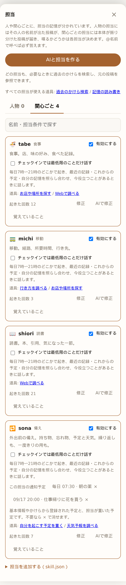

# kakeratta

[English](README.md) | 日本語

**か・け・らった。** かけらを放り込む動作の名前です。

思いついたことや気になったものを、文章・画像・URL・音声でひとつのタイムラインへ。
担当分野ごとに別々の記憶を育てるAIが、必要なときだけ反応します。

グルメ担当は食事の記録から好みを覚え、読書担当は気になった一節を覚えます。
記憶を分野ごとに分けることで、関係のない情報で薄まるのを防ぎます。

ブラウザで使うアプリで、静的な画面と Go の API の2つに分かれています。画面は開発中は Vite、
公開時は Firebase Hosting が配信し、Go のバイナリは API だけを持ちます（Cloud Run でも手元でも同じ）。
[MITライセンス](LICENSE)。

## 使い方

1. 思いついたことを書く、スクリーンショットを貼る、URLを送る、または音声で入力します。
2. 関係する担当が投稿を受け取り、自分のメモに残す内容と、発言するかを決めます。
3. 反応は遅れてタイムラインに届きます。返事が欲しい担当は `@` で指名できます。


反応が付かない投稿もあります。発言しなくても、担当領域の情報はメモに残せます。
内蔵の担当は **tabe（食事）・michi（移動）・kuda（技術）・shiori（読書）** の4体です。
名前は、どのキーボードでも `@tabe` と打てるようにローマ字にしてあります。
担当画面の「AIと担当を作る」で、「どんなことの担当を作りたい？」から質問に答えて担当を作れます。担当分野を伝えると、AIが細かい設定を補ってすぐに完成案を作り、「担当すること」「話し方」「覚えること・返事をするタイミング」などの読みやすい文章で表示します。使い始めてから「AIで修正」で改善できます。追加の要望を伝えて調整し、「この内容で保存」で反映します。作成した担当は「有効にする」で参加させてください。

既存の担当（内蔵を含む）は「AIで修正」から変更できます。記憶と有効・無効の状態は引き継ぎます。対話には設定済みのAI接続を使います。上級者向けに `skill.json` の追加も利用できます。



## はじめる

必要なもの: Go 1.25 以降、Node.js、Task（`task` コマンド）。
リポジトリのルートで実行します。

```sh
task setup  # 初回のみ。画面側の開発依存（Vite・Storybook）
task dev    # API（:8787）と画面（:5173）を同時に起動
```

ブラウザで <http://127.0.0.1:5173> を開きます。新しいワークスペースには担当がまだ誰もいないので、
呼ぶまでは画面がそれを先頭で伝えます。


そのあと「設定」で推論の接続先・APIキー・モデルを設定します。
画面は `/api` をバイナリへ中継します。公開時と同じ分け方です。API だけなら `task run`、
バイナリのビルドだけなら `task build`（出力は `bin/kakeratta`）、Storybook は `task stories`、
テストは `task test` です。

| 環境変数 | 既定 | 用途 |
| --- | --- | --- |
| `KAKERATTA_ADDR` | `:8787` | 待ち受けアドレス |
| `KAKERATTA_HOME` | OS の設定ディレクトリ | 投稿・メモ・画像の保存先 |
| `KAKERATTA_TOKEN` | 空（認証なし） | アクセス用トークン |
| `KAKERATTA_FIREBASE_PROJECT_ID` | 空 | Firebaseによるマルチユーザー認証を有効化 |
| `KAKERATTA_FIREBASE_API_KEY` | 空 | Firebase Web APIキー（公開値） |
| `KAKERATTA_FIREBASE_AUTH_DOMAIN` | 空 | Firebase Authドメイン |
| `KAKERATTA_GCS_BUCKET` | 空 | 画像を保存する非公開Cloud Storageバケット |
| `KAKERATTA_STORE` | `file` | Cloud Runでは`firestore`を指定 |
| `KAKERATTA_FIRESTORE_PROJECT_ID` | Firebaseプロジェクト | Firestoreのプロジェクト |

**外からアクセスできる場所で動かす場合は `KAKERATTA_TOKEN` を設定してください。**
各ブラウザで一度 `/?token=<URLエンコードしたトークン>` を開くと、画面が API 経由でトークンを
渡し、以後はセッションCookieで認証されます。

公開するマルチユーザー環境では、代わりにFirebaseの3変数をすべて設定します。
Googleでログインした利用者ごとに `KAKERATTA_HOME/users/<uidのハッシュ>/` 以下へデータが分離されます。
Firebase認証を設定した場合は、共有の `KAKERATTA_TOKEN` より優先されます。
`KAKERATTA_GCS_BUCKET`を設定すると画像は非公開オブジェクトとして保存し、
投稿メタデータ・設定・担当メモはワークスペースのディスクに残します。

## 詳しく読む

| 文書 | 内容 |
| --- | --- |
| [使い方と設定](docs/usage_ja.md) | Android・iOSからの共有、位置情報、音声、モデル設定、保存データ |
| [設計とペルソナ](docs/architecture_ja.md) | 設計原則、振り分け、実行順序、OKFメモ、スキルとツール |
| [開発と実装状況](docs/development_ja.md) | テスト、ソース構成、実装済みの機能と未確認項目 |
| [Google Cloudへのデプロイ](infra/README_ja.md) | Terraformでの構築。画面はFirebase Hosting、APIはCloud Run |

投稿・共有の受け口、振り分け、メモ、返信、検索・経路ツール、読み上げは実装済みです。
スマホ実機での共有、モデルのvision対応、OCR品質、反応頻度は引き続き確認が必要です。
