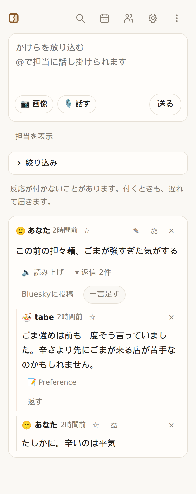
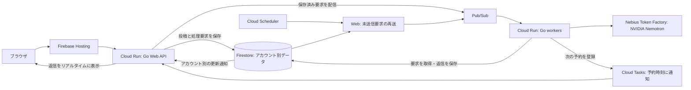

[English](README.md) | 日本語

**か・け・らった。** かけらを放り込む動作につけた名前です。

**存在を忘れたものは、検索できません。** kakerattaは、それを思い出させる
パーソナルAIタイムラインです。文章・写真・URL・音声で日常のかけらを放り込むと、
大切な人物や関心ごとの担当AIが、自分に関係することを覚え、必要なときに声をかけます。

- **記憶は担当ごとに。** 人物や関心ごとにそれぞれの記憶を持つので、
  互いに薄まりません。人物の担当には、LLMの推測ではなく
  呼び名やキーワードの一致で投稿が届きます。
- **普段は静かに。** 担当は、伝えたいことがあるときだけ返事をします。
  静かなタイムラインも、アプリが働いている姿です。
- **記憶をたどり、見直せる。** 覚えた事実から元の投稿を開けます。
  一時的な記録は期限で消え、見直し対象の記録は「覚えておく・先送り・忘れる」を
  確認します。元の投稿はそのまま残ります。

[使ってみる](https://kakeratta.net/lp/?lang=ja) ·
[デモ動画](https://youtu.be/Z5zML-lSXc0) ·
[Devpost](https://devpost.com/software/kakeratta) ·
[マニュアル](https://kakeratta.net/manual/?lang=ja) ·
[技術的な設計](docs/design/technical_ja.md)

[](https://youtu.be/Z5zML-lSXc0)



運用と検証の記録：
[AIコストの推計 — 2026年10月](docs/reports/production-ai-cost-2026-10-11.md)（英語） ·
[振り分けモデルの比較 — 2026年9月](docs/reports/routing-model-comparison-2026-09-19_ja.md) ·
[AIの失敗から学んだこと](docs/design/ai-lessons_ja.md)

## できること

- **必要なときに知らせる。** 記憶する担当は、伝えたいことがあるときに話しかけます。
  人物は「頻繁に振り返る」「ときどき振り返る」を選べます。誕生日・会う予定・外出前の確認はサーバーで実行し、
  対応する端末にはリマインダーのプッシュ通知も届けられます。
- **記憶を確認して直す。** 記憶する担当は、元の投稿にたどれる事実・分野ごとの
  まとめ文・月ごとのかけらの記録を持ちます。事実を個別に修正・削除でき、
  タイムラインは語句や意味で検索できます。
- **担当を自然な言葉で作る。** 覚えてほしい人物や関心ごとを伝え、使いながら
  指示・担当条件・返事を調整できます。
- **関心ごとに合わせて担当が増える。** 担当の記憶に別の話題がたまると、チェックインで
  新しい担当を提案します。**作る** を押すと担当を下書きして追加し、関係する記憶を移して、
  元の担当の担当条件からその話題を外します。
- **読み返したい回答をお気に入りに。** 投稿や担当の回答を保存し、最近追加した順の
  一覧で読み返せます。担当で絞り込め、検索もお気に入りだけを対象にできます。
- **回答を図解にする。** 図解したい回答に
  `@infographic この回答をインフォグラフィックにして` と返信すると、
  送信時の表示言語で、絵文字やMermaidを使ったMarkdownの図解を表示します。
- **オフラインでも投稿する。** アプリを開いて接続が戻ると、送信待ちの投稿と
  返信を送ります。会話の必要な部分だけを選び、確認して自分のBlueskyに公開できます。

`@` で指名した投稿や、有効な担当への返信は、宛先の担当だけに届きます。
それ以外は、関心ごとは担当条件で、人物は呼び名やキーワードで届きます。
返信先と異なる担当を `@` で指名した場合は、指名が優先されます。

内蔵の担当は4つです。

| 担当 | 役割 | 新規利用時に有効 |
| --- | --- | --- |
| **tabe** | 食事 | いいえ |
| **shiori** | 読書 | いいえ |
| **sona** | 外出前の備え・持ち物・天気・小さな用事の確認 | はい |
| **インフォグラフィック** | 文章・展開済み記事・読み取り済み画像・回答を絵文字・MermaidでまとめたMarkdown図解 | はい |

使い方や担当をまたぐ質問は `@ai` に聞けます。アプリの質問では関連する仕様を読み、メモ保存・予定登録は行いません。`@agent` は接続した外部エージェントへの依頼です。

作成・修正時に **記憶する** と **常に熟考する** を選べます。
**記憶する** は通常オン（図解担当はオフ）で、オフにすると記憶の更新と
定期チェックインが止まります。**常に熟考する** は最終回答に上位モデルを使う設定で、
図解担当では初期状態でオンです。「詳しく」と頼むと、標準構成では最上位の回答モデルを使います。
モデルごとの役割は[設計と連携](#設計と連携)を参照してください。

## Alexa連携

Alexaスキル「**かけらノート**」（登録する呼び出し名は `欠片ノート`、英語版は **Memory Timeline**）では、内容を読み返して確認した後の投稿、担当の最新の返事の読み上げと返信、今後の保存済み予定の読み上げができます。「アレクサ、かけらノートを開いて」、英語では “Alexa, open Memory Timeline” で起動します。

Alexaスキルストアで公開されており（ストアで「kakeratta」と検索）、Alexaアプリでスキルを有効にしてkakerattaのアカウントと連携すれば使えます。自分の環境で動かす場合は[Alexa設定ガイド](docs/guides/alexa_ja.md)を参照してください。

## Gmail・Google Calendar連携

[Google Bridge](tools/google-bridge/README.md)は、自分のGoogle CloudのOAuthクライアントを使って自分で動かす、任意の連携アプリです。
Hermesが重要なメールと今日・明日の予定を選び、Timelineへ取り込み待ちのカードとして届けます。「取り込む」を選ぶまで担当や記憶には渡りません。
画面例・仕組みは[Google BridgeのREADME](tools/google-bridge/README.md)、設定手順は[設定ガイド](docs/guides/google_ja.md)を参照してください。

## ローカルで動かす

Go 1.26以降・Node.js・[Task](https://taskfile.dev) と、Nebius Token Factoryの
APIキーが必要です。[mise](https://mise.jdx.dev) を使う場合は `mise install` で
[mise.toml](mise.toml) に指定したツールを導入できます。

```sh
task setup  # 初回のみ：画面側の依存を導入
task dev    # APIは :8787、画面は :15173
```

コンテナ内で動かす場合は、ポート `15173` を公開・転送してください（Docker なら `-p 15173:15173`）。Vite は `0.0.0.0` で待ち受けるので、ホスト側の `http://localhost:15173` から開けます。ポートが使用中の場合は、別の番号へ切り替えず起動エラーにします。

http://127.0.0.1:15173 を開き、設定でAPIキーを入力します。ローカルでは
Firebaseアカウントも外部データベースも不要で、データはディスクに保存し、APIは
このPC内からのみ接続できます。コマンドは[使い方と設定](docs/guides/usage_ja.md)、
環境変数や公開環境の保存先は[自分で動かす](docs/design/technical_ja.md#動かす)を参照してください。
`task test` でGoとブラウザ側のテストを実行できます。

## システム構成

図は推奨するCloud Run構成です。本番は費用を抑えるため、共有Compute Engine VMで
稼働させています。Web・workerの分離と永続キューは同じです。
[現在の運用手順](infra/shared-vm/README.md)（英語）を参照してください。



本番では、Webが投稿と処理要求を一緒に保存してからPub/Subへ登録します。
空いているworkerがユーザーごとのAI設定とAPIキーで処理し、結果を保存してから
完了を通知します。予約処理はCloud Tasksが指定時刻に同じ経路へ登録します。
未送信要求はFirestoreに残して再送し、未完了のジョブはPub/Subが再配信します。

データ・実行権・会話内の処理順序はアカウントごとに管理します。
Webとworkerは別々に増やせるため、アカウントの担当サーバーを固定せず、
別アカウントや別会話の処理を並列に進められます。同じ会話の処理順序は維持します。
Cloud Run構成では仕事がないときはworkerをゼロ台にできます。台数を増やし、共有基盤の負荷を
測って調整することで処理量の増加に対応します。workerのサイズは運用設定として管理します。
暫定運用の共有VMは固定容量で、workerは常時稼働します。
ローカル開発では、同じ担当の処理エンジンをファイル保存とプロセス内の実行方式で動かします。

詳細は[構成とスケールの説明](docs/system/architecture.md)（英語）と
[デプロイ手順](infra/README_ja.md)を参照してください。

## 設計と連携

バックエンドはGo、ブラウザ側はJavaScriptです。Nebius Token Factory経由の
NVIDIA Nemotronで振り分け・回答・workflowの確認を行い、同じ基盤のGLMとQwenで画像の読み取りと意味検索を行います。標準のモデル構成は次のとおりです。

| モデル | 用途 |
| --- | --- |
| **Nemotron 3.5 Lightning** | 任意の音声入力整形 |
| **Nemotron 3 Super 120B A12B** | 担当への振り分け、読み取りと通常の回答、メモ係、毎日・毎月のチェックイン、毎日の記憶の整理、今日のまとめ・今月のまとめ |
| **Nemotron 3.5 Super VL 120B A12B** | 深い依頼と常に熟考する担当の調査、予定の計画とworkflowの確認、チェックイン以外での「常に熟考する」担当の回答 |
| **Nemotron 3 Ultra 550B A55B** | 「詳しく」などの深い依頼の回答 |
| **GLM-5.3-Flash** | 添付したスクリーンショット・写真の読み取り（1投稿につき1回） |
| **Qwen3-Embedding-8B** | 過去のかけらを意味で探すための埋め込み |

本番での実測では、この割り当てにした後の担当1人への投稿2件が、振り分け・回答・記憶を含めて
1件あたり **$0.0028と$0.0037**（約0.44円・0.58円）、6〜7秒で完了しました。
以前の1投稿あたり$0.009から約60〜70%の削減です。

**Nebius Token Factoryを選んだ理由**

Nebius Token Factoryのおかげで、モデル選びがずっと楽になりました。APIが共通なので、
同じプロンプトを複数のモデルに送り、振り分けの一致率・応答時間・トークン使用量・費用を
比較できました。ダッシュボードでモデルごとの支出も簡単に追えました。

意外だったのは、振り分けモデルを選んだときの結果です。Nemotron 3.5 Lightningは
トークン単価が最も安く、基準モデルとの一致率もSuperと同じ（実際の投稿20件中17件）でした。
しかしLightningははるかに多くのトークンを生成し、振り分け1回あたり平均6.55秒かかりました。
Superは1.91秒です。

Superは使うトークンがずっと少ないため、実際の費用差は小さく（振り分け1回あたりSuperが約$0.00065、
Lightningが約$0.00047。上の投稿全体の費用ではなく、振り分け単体の数字です）、
3倍以上速い応答のためなら十分に見合う差でした。
そこで振り分けにはSuperを選びました。

Token Factoryは開発期間を通じて安定していました。HTTP 429のレート制限エラーは一度もなく、
応答時間も一貫して安定していました。そのため、レート制限や予測できない遅延を気にせず、
モデルの比較も日々の開発も見通しよく進められました。

Token Factoryが開発を加速したのはこの点です。同じ条件でモデルを比較し、実際の
トレードオフを把握して、モデルの仕様や価格だけでなく実測の結果に基づいて判断できました。

**Tavilyを選んだ理由**

TavilyはAI担当の `web_search` ツールとして簡単に組み込めました。ツール呼び出しを
アプリ側で制御することで、1回の依頼あたりの検索回数に上限を設け、検索の暴走を防いで
API使用量を予測可能に保てました。通常のターンでは最大2回、深い依頼では最大4回まで検索し、
それぞれユーザーが開ける出典リンクを返します。

Tavilyの手厚い無料枠も開発中に大いに助かりました。担当が外部の情報をどう検索し、
どう使うかを、検索費用をあまり気にせず繰り返し試せました。

これらの点から、Tavilyは使用量を抑えつつAI担当に最新の情報を届けるための
実用的な選択でした。

OpenRouterも選べます。
処理ごとにモデルを選び、小さいモデルの低コストと回答の速さを活かしながら、
深い推論が必要な場面では上位モデルを使います。
記憶と使える道具は担当ごとに分かれます。設定から投稿・画像・設定・担当・記憶を
エクスポートできます。詳しくは[データの持ち出し](docs/guides/usage_ja.md#持ち出す)を参照してください。

HermesやObsidianのLLM Connect Hubに、MCP経由で調査と回答を任せられます。
タイムライン・予定・記憶の更新はkakerattaが管理します。
`@agent` で呼びかければ、担当を通さず外部エージェント自身にメール送信のような長い作業も直接依頼でき、返信でやりとりできます。
NemoClaw/OpenShellのサンドボックスで検証した構成は、下の連携レポートにまとめています。

[Nebius x NVIDIA Global AI Hackathon](https://nebiusglobalaihackathon.devpost.com/) に出展した作品です。
[Devpostの作品紹介](https://devpost.com/software/kakeratta)（英語）にも、着想と開発の経緯をまとめています。
作った理由と「必要なときに思い出させる」という考え方は[開発の背景](docs/design/background_ja.md)にまとめました。

## ドキュメント

ガイド・設計解説・検証レポートの全体は[ドキュメント一覧](docs/README.md)から参照できます。

| 文書 | 内容 |
| --- | --- |
| [マニュアル](https://kakeratta.net/manual/?lang=ja) | 日常の操作を画面付きで説明 |
| [使い方と設定](docs/guides/usage_ja.md) | 起動コマンド・設定・データと持ち出し |
| [中で起きていること](docs/design/technical_ja.md) | 設計・振り分け・モデル・記憶・道具・サーバー運用 |
| [システム実装仕様](docs/system/index.md)（英語） | ソース参照付きのサブシステム仕様。内蔵AIも参照 |
| [AIで難しかったこと](docs/design/ai-lessons_ja.md) | 開発や運用で起きた失敗と対処 |
| [外部エージェント](docs/guides/hermes_ja.md) | Hermes・LLM Connect Hubの接続、MCP権限、代替実行、`@agent` での直接依頼 |
| [NemoClaw連携レポート](docs/reports/nemoclaw-hermes-integration_ja.md) | サンドボックス構成と検証。当時のプロトコルも明記 |
| [Gmail・Calendar連携](docs/guides/google_ja.md) | Google Bridge、OAuth、本人選択式の取り込み、Hermes cron |
| [Google Cloudへのデプロイ](infra/README_ja.md) | Cloud Run構成と暫定運用の共有VM |

[MITライセンス](LICENSE)です。
