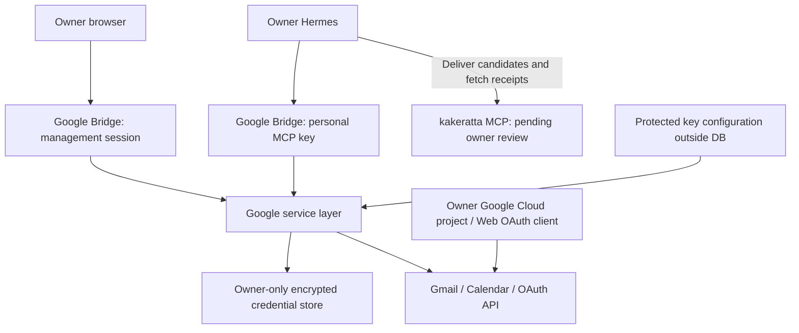

# Personal Google Bridge: research and implementation design

[Japanese](./google-hermes-integration-spec_ja.md)

- Initial research and implementation review: 2026-10-20
- Reconciled with current implementation: 2026-10-22
- Original specification: kakeratta × Hermes Google integration v1.1
- Research baseline: `338c539e0b6fe715f6129befd1dde32db945700f`
- Deployment: a single-owner Web application running on each user's own machine or server
- Status: research, read MVP, approved writes, incremental sync and owner-selected Timeline imports implemented. The owner confirmed real Google and Hermes connectivity on 2026-10-22; this does not establish live coverage of every write operation. Setup guidance, CLI command generation, OAuth JSON validation and recovery guidance are implemented. Automatic Cloud operations, semantic urgency detection and immediate Push are not implemented.

## Current-specification update (2026-10-22)

The numbered sections and phase additions below preserve the original research and implementation history. For current instructions, see the [Google guide](../guides/google.md) and [system integration chapter](../system/integrations.md#personal-google-bridge-companion). These points supersede the original design:

- **Google writes:** the current MCP write tool is `google_action_run`. A direct owner request to Hermes records the verbatim `userRequest` in the audit journal and executes without another Web confirmation. Immutable payloads, idempotency keys, persistence before execution and no automatic retry after an unknown result remain. Owner-cookie approval APIs remain for legacy proposals. Direct-owner-only use is a tool instruction; the server cannot verify request origin. Mail, event descriptions and cron decisions must not become owner instructions.
- **Hermes intake:** `google_bridge_worker.py` handles sync, candidate delivery and actual receipt forwarding in code. The model only selects and summarizes in an isolated session without tools; gates return `wakeAgent:false`. Bridge never contacts kakeratta directly or retains its endpoint or key.
- **Live verification:** the existing [verification record](../system/integrations.md#personal-google-bridge-companion) records owner confirmation of Google OAuth, Hermes connectivity and Gmail/Calendar intake on 2026-10-22. Later statements about unverified connections or no real Google calls describe the original test window, not current connectivity. They do not establish verification of every write operation.

## 1. Selected architecture

Following user clarification, the design changed from Google settings inside kakeratta to a separate **Google Bridge**. It independently provides a Web UI, OAuth callback, credential storage and personal MCP endpoint. Google operations need no changes to kakeratta/Hermes core or the distributed worker. Owner-selected Timeline intake adds only pending intake, review UI and provenance protection to kakeratta.

The entry point is [tools/google-bridge/cmd/google-bridge](../../tools/google-bridge/cmd/google-bridge/main.go). The Go binary embeds Web assets and defaults to `http://127.0.0.1:8094`. One instance, dedicated data directory and management key belong to one owner. Multiple owners cannot sign into the same process; tools have no owner/workspace argument for selecting another user's connection.

Hermes interprets intent and selects tools; the Go service handles Google APIs, refresh, validation and encryption. Google tokens and client secrets never enter MCP responses, resources or conversations. Bridge retains explicitly selected important-mail bodies in encrypted caches with expiration. One-shot scripts use existing Hermes cron; worker code fetches candidates and asks the model only to select and summarize. Code submits decisions, delivers through the owner's kakeratta MCP connection and returns real receipts and exclusions. Bridge stores no kakeratta URL/key and removes legacy destination credentials on startup after upgrading. There is no separate resident sync loop. See [setup and operations](../guides/google.md).

## 2. Existing implementation research and reuse

Relevant chapters were read from the [system index](../system/index.md) and checked against source.

| Area | Existing implementation | Use in this design |
| --- | --- | --- |
| Web user isolation | [gateway.go](../../internal/server/gateway.go): workspace per Firebase identity | Reference for shared hosting; standalone personal instances do not require Firebase |
| MCP authentication | [mcp_server.go](../../internal/server/mcp_server.go): SHA-256 key checks, stateless Streamable HTTP | Reuse the pattern in a separate MCP server with a separate key |
| Encryption and locking | [oauth_store.go](../../internal/social/oauth_store.go), [social_state.go](../../internal/store/social_state.go), [runtime.go](../../internal/store/runtime.go) | Reuse SocialValue/CAS/Lock; add Google-specific AES-GCM and key versions |
| Secret export | [export.go](../../internal/store/export.go) | Test that social-state and Google credentials are excluded; companion exposes no export API |
| Hermes extensions | [direct_request_worker.py](../../frontend/public/integrations/hermes/kakeratta/scripts/direct_request_worker.py): personal workers can copy configured extra MCP servers | Add Bridge to `kakeratta_worker.mcp_servers`; preserve judge/persona-home isolation |
| Model review | [integrations.md](../system/integrations.md): schedule review; direct requests execute tools | Model review is not human authorization; Phase 1 exposes no writes |
| External writes | [social.go](../../internal/server/social.go): Bluesky preview/digest/claim | Reference for later approval, immutable payloads and execution claims |
| Post intake | [entries.go](../../internal/server/entries.go): atomic CreateEntry and routing reaction | Reuse acceptEntry/CreateEntry and initial reactions only after owner selection |
| External provenance | [timeline.go](../../internal/timeline/timeline.go), [requests.go](../../internal/persona/requests.go) | Keep pending items outside Timeline; retain provenance and prevent mail `@agent` from becoming a direct request |
| Jobs and notifications | [due.go](../../internal/persona/due.go), [push.go](../../internal/server/push.go) | Consider for future sync/immediate notifications; do not prebuild another scheduler |

Upstream Hermes [MCP documentation](https://hermes-agent.nousresearch.com/docs/user-guide/features/mcp) and [implementation](https://github.com/NousResearch/hermes-agent/blob/main/tools/mcp_tool.py) confirmed HTTP, Authorization headers, tool filtering and disabling resources. Connectivity with the installed Hermes version had not yet been tested at the original review.

### Alternatives

| Approach | Decision |
| --- | --- |
| Add Google OAuth/APIs to Hermes core | Rejected: spreads credential management and complicates upstream updates |
| Extend kakeratta MCP and settings | Original approach; in-progress changes removed following the request for a standalone app |
| Personal Web app plus MCP | Selected: independent Google tools/credentials through existing Hermes extension points |

## 3. Review against Google's official specifications

### Required scopes

Scope names below follow `https://www.googleapis.com/auth/`. [G1][G2]

| Feature | Scope | Original implementation status |
| --- | --- | --- |
| Gmail search, bodies, threads, unread state | `gmail.readonly` (Restricted) | Implemented; does not mark mail read |
| Gmail sending | `gmail.send` (Sensitive) | Implemented with owner approval |
| Google drafts | `gmail.compose` (Restricted; also permits sending) | Implemented with owner approval |
| Calendar events | `calendar.events.readonly` | Implemented |
| Calendar list | `calendar.calendarlist.readonly` | Added only when selected; events readonly is insufficient [G7] |
| Free/busy | `calendar.events.freebusy`, etc. | Excluded by later scope choice in favor of daily event intake [G8] |
| Event changes | `calendar.events`, etc., plus target ACL | Implemented with owner approval |

`openid` and `email` support account matching/display. Actual token-response scopes are checked; missing required scopes prevent connection completion. A subject from a fixed userinfo endpoint identifies the account. Both Phase 1 services connect to the same Google account.

### Personal use, token lifetime and revocation

These are the findings of the original research window, with sources listed below:

- Google's personal-use verification exceptions include owner-only use. Owning the project alone does not guarantee exemption from every review or assessment for every distribution model. [G3]
- External/Testing Gmail and Calendar refresh tokens generally expire after seven days. Production must still handle revocation, inactivity, Gmail password changes and issuance limits. [G5]
- Use a Web application client, authorization code and offline access, with PKCE S256. Fake-provider tests verify the verifier during exchange; real interoperability requires the owner's client. Do not substitute a native Desktop client for the server. [G4]
- Redirects use configured canonical origin plus a fixed callback path and are checked against the supplied registered URI, not derived from Host/forwarded headers. Real authorization verifies the final Google registration match. [G4]
- Google revocation can affect other clients in the same project. Local Gmail/Calendar disconnects are independent; Google-side revocation is an explicit choice with its impact explained. Strictly independent revocation needs separate projects. [G4]
- Limited Use and related rules constrain Google data use, transfer and retention. Interactive bodies are not persisted; only consented imports enter encrypted caches. Hermes/model/answer retention must be checked separately. [G6]

### Setup automation

Official documentation and local help confirmed `gcloud projects create` and `gcloud services enable`. [G9][G10] No real project creation or API enablement was performed. A general stable automation API for consent-screen and Web-client creation was not established, so Phase 1 documents console setup. [G11] `gcloud iam oauth-clients` is for Workforce OAuth and is not a substitute for Workspace Auth Platform clients. [G12]

The owner performs login, consent and identity verification. No private browser APIs, CAPTCHA bypass or security-control bypass is used. Automated Cloud creation is not a prerequisite for the read MVP.

## 4. Phase 1 authentication, storage and execution boundaries

### Management UI and MCP

First-run CLI initialization creates independent random management/encryption keys in protected configuration. The management key is loaded at startup and checked through a dedicated browser login form; it never enters logs, URLs or localStorage.

Management sessions put a random secret in an HttpOnly / SameSite=Strict cookie; storage contains only its hash and the management-key fingerprint. Sessions last eight hours. New login, logout or management-key changes invalidate previous sessions. Mutation APIs require the configured Origin; request Host is also checked against the canonical origin.

The UI-issued MCP key is separate, displayed once, and stored only as a SHA-256 hash. Every MCP request checks it; rotation/revocation affects subsequent requests immediately. It cannot authenticate management APIs or OAuth configuration changes.

`/mcp` uses stateless Streamable HTTP POST and validates protocol version, JSON-RPC, body size, types, unknown arguments, IDs, periods and counts. Tools read only the dedicated workspace bound at startup, without an owner selector.

### OAuth and encryption

OAuth state is single-use with a ten-minute lifetime, encrypted with service/client configuration and PKCE verifier. A tab-local browser secret rejects cross-tab/cross-instance completion and replay. The callback moves only code/state/error into the site's URL fragment; the authenticated browser calls the finish API to exchange them.

Credentials use AES-256-GCM in `google-v1:gmail` / `google-v1:calendar` SocialValue records. AAD includes workspace ID and service; records retain format/key version, nonce and ciphertext. Keys stay in owner-only configuration outside the database directory. Plain client secrets/tokens never enter ordinary settings, MCP or exports.

Refresh, OAuth completion, reads and disconnect share a workspace lock and CAS updates. A file lock prevents multiple CLI processes using one data directory. Google requests use fixed HTTPS endpoints, timeouts and no redirects. Raw Google errors, request URLs and credentials are replaced with fixed errors rather than exposed through logs or MCP.

A minimal target-API read follows authorization. A 401 during reads triggers one refresh/retry; repeated 401 or `invalid_grant` sets `needs_reauth`. 429/5xx/network failures are temporary errors; missing scopes are permission errors. Adding scopes or changing accounts requires owner reconnection.

### Reads and disconnect

Gmail returns at most 16,000 plain-text characters per body, 20 messages per thread and 50 search results. Attachments/HTML bodies are not imported; HTML-only mail returns a snippet. Calendar lists are limited to 50 items and event searches to 366 days. Responses select needed fields and label them as external data, not instructions. No code executes URLs or commands from those bodies.

Explicit consent to model disclosure is required at connection. Phase 1 persists credentials/status only, without mail/event bodies or automatic posts; later opt-in caches are described below. Connection tests do not return bodies to the browser. Model disclosure and Hermes history/answers follow those systems' retention rules.

Disconnect removes the selected service's credentials and pending OAuth. Google revocation is attempted only when explicitly chosen; local deletion remains even if it fails. Locks coordinate short in-flight reads, but the UI does not promise to recall data already sent to Hermes. Cloud projects are not deleted.

## 5. Implementation files and verification

| Files | Responsibility |
| --- | --- |
| [main.go](../../tools/google-bridge/cmd/google-bridge/main.go), lock implementation/tests | Initialization, protected configuration, one-process constraint, standalone HTTP startup |
| [service.go](../../tools/google-bridge/internal/google/service.go), [read.go](../../tools/google-bridge/internal/google/read.go) | OAuth, AES-GCM, refresh, accounts/scopes, Google reads |
| [server.go](../../tools/google-bridge/internal/server/server.go) | Management authentication, key issuance, Host/Origin, embedded Web assets |
| [api.go](../../tools/google-bridge/internal/server/api.go), [mcp.go](../../tools/google-bridge/internal/server/mcp.go) | Web connection APIs, MCP declarations and stateless execution |
| [web/](../../tools/google-bridge/internal/server/web/) | Separate configuration, login and MCP configuration display |
| [service_test.go](../../tools/google-bridge/internal/google/service_test.go), [server_test.go](../../tools/google-bridge/internal/server/server_test.go), [main_test.go](../../tools/google-bridge/cmd/google-bridge/main_test.go) | Fake Google, identity boundaries, encryption, refresh races, revocation, CLI configuration |
| [google.test.js](../../tools/google-bridge/tests/google.test.js) | Tab binding, URL cleanup, consent, prevention of browser secret persistence |

The original verification ran Go/JS tests and a CLI build. Browser checks covered management login, MCP key issuance/initialize/revocation, required consent, 390px layout and logout. No real Google calls were made in that test window. The race detector could not run because the environment lacked a C compiler.

The original kakeratta investigation also passed server/store/social Go tests and 19 Hermes isolation tests. Core/distributed-worker changes were removed from the final standalone configuration, so Bridge tests run independently.

## 6. Phase 2 boundaries and remaining phases

This section records the original Web-approval path; the current direct-request path is described at the top.

Code, assets and tests are under `tools/google-bridge/`, reusing only the root Go module and storage primitives. `internal/google/actions.go` implements encrypted journals and deterministic writes; `internal/server/api.go` provided MCP proposal/execution and management-cookie approval; `web/actions.js` provided owner review. See [action tests](../../tools/google-bridge/internal/google/actions_test.go).

Proposals bind connection ID, reconnection generation, payload hash, idempotency-key hash and a five-minute expiry. Originally, changes required a new proposal/approval and Hermes could not issue approval. Execution persists consumption first; the CLI persistence wrapper fsyncs file and parent directory. Persistence failure prevents the write. Lost responses, restarts and timeouts become `unknown` without automatic resend. Received email instructions do not authorize writes.

Gmail uses a fixed sender, explicit To/CC, plain text and no attachments. Reply Message-ID/thread are retrieved server-side. Draft creation originally required approval; sending by mutable draft ID is unsupported. Calendar supports owner calendars, ordinary events and individual recurring instances. Updates replace supported fields and show before/after values. ETag preflight and If-Match detect conflicts and invalidate approval. Attendees, sendUpdates, Meet creation, exclusive all-day ends, IANA timezone and offset are part of the approved payload.

Up to eight unfinished proposals per service are encrypted. Completion, rejection, disconnect or the next journal read after expiry removes content, retaining audit metadata and idempotency hashes. Explicit journal deletion also deletes replay protection; do not reuse old keys. Full deletion means stopping Bridge, removing its data directory and managing backups. See the [operations guide](../guides/google.md).

| Phase | Scope at original review |
| --- | --- |
| 1: Read MVP | Implemented; owner OAuth setup and live Google/Hermes verification remained |
| 2: Writes | Web owner approval, five-minute immutable payload, single consumption, no retry on unknown, Gmail send/reply/draft, Calendar create/update/delete and audit implemented; no live writes tested |
| 3: Important mail | Incremental sync, explicit rules, deduplication, retention, feedback, existing cron and owner-selected intake implemented; advanced deadline/authenticity/memory checks and immediate Push absent |
| 4: Setup | CLI generation, console links, OAuth JSON checks and recovery guidance implemented; reuses connection/sync/pending/retry status; owner performs Cloud operations |

The original Phase 2 retained human approval and invalidation after recipient/body/timezone/attendee/notification changes. Lost send responses do not guarantee exactly-once delivery; `unknown` stops automatic resend.

Google login/consent, client registration and API enablement belong to the owner. Live sends/event mutations need explicit authorization for the target and content. The original work did not publish a deployment, create/change Cloud resources or act on the owner's Google account.

## 7. Phase 3: owner-selected intake

Important mail appears as a pending Timeline card instead of automatically becoming an owner post. **Import** enters the normal pipeline once; **Discard** deletes the pending item without search inclusion. Google APIs, classification, storage and delivery remain in the dedicated companion directory; kakeratta gains no Google OAuth implementation or dedicated router.

- **Bridge:** [inbox.go](../../tools/google-bridge/internal/google/inbox.go) / [timeline.go](../../tools/google-bridge/internal/google/timeline.go) provide opt-in, history deltas/404 recovery, page/processed IDs, local priority rules, at most 20 messages per sync and body retention. `google_review_context` returns up to five tool/arguments/token items. Python worker code delivers through its kakeratta MCP and returns actual receipts through `google_review_receipt`. Bridge destination/key configuration was removed.
- **Intake:** [gmail_import.go](../../internal/server/gmail_import.go) / [MCP declarations](../../internal/server/mcp_tools.go) permit only owner-bound MCP credentials to call `propose_gmail_import`; shared judges are excluded. There is no owner argument. Existing locks/CAS/social-state are reused.
- **Pending storage:** separate from Timeline, search, memory and persona jobs. First default Timeline pages and SSE overlay cards for display; search and MCP Timeline reads exclude them. Limits are 20 cards/700 KiB, retained until owner decision and excluded from exports.
- **Import:** authenticated Web APIs record owner choice; existing `acceptEntry` atomically accepts body, provenance and initial routing reaction. Duplicate selection returns the existing post. Owner retries clean up failed post-acceptance processing; MCP retries do not approve or rerun it automatically.
- **Discard:** removes pending body; a separate receipt retains hashes/status/ID and explicitly chosen type/From exclusions. Retries and later post deletion do not re-present the same connection/message. Backup deletion follows operational retention.
- **Provenance:** `ImportSource` in [timeline.go](../../internal/timeline/timeline.go) and pending/imported rendering in [feed.js](../../frontend/src/feed.js). Accepted mail remains external content to the model; embedded `@agent`/`@persona` is not a forced recipient. Ordinary owner replies use existing behavior.
- **Scheduling:** [check_google_bridge.py](../../tools/google-bridge/hermes/check_google_bridge.py) runs as an existing Hermes cron gate with `--no-agent`. It starts `google_bridge_worker.py` for classification, undelivered candidates or receipt polling, always returning `wakeAgent:false`. Classification has no MCP/external tools; Python handles delivery/receipts. The owner installs real jobs. No second scheduler/router is added.

Owner review replaces immediate automatic posting. Semantic urgency and immediate Push are excluded. The original separate write approval has since been superseded by the direct-request path above; importing content never promotes arbitrary mail instructions into owner requests.

## 8. Official sources (checked 2026-10-19)

- [G1: Gmail scopes](https://developers.google.com/workspace/gmail/api/auth/scopes)
- [G2: Calendar scopes](https://developers.google.com/workspace/calendar/api/auth)
- [G3: Restricted scope verification and personal-use exceptions](https://developers.google.com/identity/protocols/oauth2/production-readiness/restricted-scope-verification)
- [G4: Web-server OAuth, redirects and revocation](https://developers.google.com/identity/protocols/oauth2/web-server)
- [G5: Refresh-token expiration](https://developers.google.com/identity/protocols/oauth2#expiration)
- [G6: Workspace user-data and developer policy](https://developers.google.com/workspace/workspace-api-user-data-developer-policy)
- [G7: CalendarList.list](https://developers.google.com/workspace/calendar/api/v3/reference/calendarList/list)
- [G8: Freebusy.query](https://developers.google.com/workspace/calendar/api/v3/reference/freebusy/query)
- [G9: gcloud projects create](https://docs.cloud.google.com/sdk/gcloud/reference/projects/create)
- [G10: gcloud services enable](https://docs.cloud.google.com/sdk/gcloud/reference/services/enable)
- [G11: Create access credentials](https://developers.google.com/workspace/guides/create-credentials)
- [G12: Workforce OAuth application](https://docs.cloud.google.com/iam/docs/workforce-manage-oauth-app)

### Added requirements: modal, editable triage prompt and From exclusions

A pending Timeline card opens a separate Import/Discard modal. Only Discard can save independent “Exclude this type” and “Exclude this From” preferences. Type rules go to Hermes and the tool layer rejects matching type IDs. From exclusions match normalized addresses without display names and run before model disclosure.

Bridge displays editable triage instructions and type/From exclusions together; removing a row and saving cancels an exclusion. Worker code returns the actual authenticated kakeratta receipt. Bridge trusts the authenticated relay rather than independently verifying its issuer. Applied-feedback records prevent retries from restoring cancelled rules. Optional classification uses the existing Hermes model, without another inference loop or credential path. At most 50 candidates wait, contexts contain at most ten, and bodies follow configured limits. Only the owner finalizes import.

### Phase 4: setup assistance

[setup.js](../../tools/google-bridge/internal/server/web/setup.js) generates project/API creation, enablement and readback commands plus console links for selected services. Project IDs use server-equivalent character/length validation. It does not change the CLI default project or execute Cloud operations. Generated instructions are not treated as completed; the API connection test determines readiness.

Consent-screen and Web-client creation retain manual console fallback. Browser JSON import is limited to 64 KiB and validates Web client type, required fields and exact redirect URI before filling the form. OAuth endpoints from the JSON are ignored. Raw files/secrets are not persisted in browser storage. Fixed recovery categories do not reveal Google secrets.

## Added requirement: daily Calendar intake for today and tomorrow

Free/busy and creating recurring events are excluded in favor of daily today/tomorrow intake, independently of writes. Hermes selects/summarizes events and delivers owner-review cards through its own kakeratta MCP. Defaults are primary calendar, Asia/Tokyo, a 2,000-character description limit and disabled sync. Calendar-day boundaries use the chosen timezone; `singleEvents` expands recurring instances. The same connection/calendar/event is not duplicated the next day.

Plain Discard affects only that occurrence. Checkbox exclusions match calendar plus event ID for single events, or calendar plus `recurringEventId` for a series, before model access. Rules are editable/removable beside the Calendar triage prompt. Old receipts cannot restore cancelled exclusions. Cards already delivered for other occurrences are not deleted automatically. Existing intake, routing and memory flows are shared with mail.

Implementation: `calendar_inbox.go`, `calendar_triage.go`, `calendar-inbox.js` and `check_calendar_bridge.py` under `tools/google-bridge/`, plus `internal/server/calendar_import.go` and small review-UI extensions. Intake performs no Google writes. Live Google/Hermes verification had not occurred at the original review; see the current-status note above.
