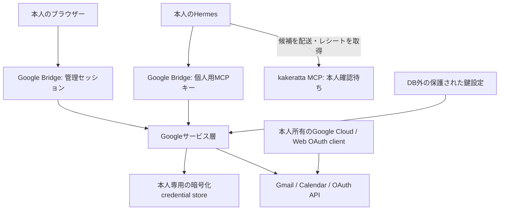

# 個人用Google Bridge: 調査・実装設計

[English](./google-hermes-integration-spec.md)

- 初回調査・実装レビュー日: 2026-10-20
- 現行実装との照合日: 2026-10-22
- 元仕様: kakeratta × Hermes Google連携 v1.1
- 調査基準コミット: `338c539e0b6fe715f6129befd1dde32db945700f`
- 利用形態: 各ユーザーが自分の端末・サーバーで起動する1ユーザー専用Webアプリ
- 状態: Phase 0調査・Phase 1読取MVP・Phase 2承認付き書込、Phase 3の差分同期と本人選択式Timeline取り込みを実装。実Googleアカウント・実Hermes接続は2026-10-22に所有者から確認済み（全書込操作の実検証を意味しない）。Phase 4の設定案内・CLI手順生成・OAuth JSON検証・復旧案内も実装。Cloudの実操作自動実行と、意味解析による緊急判定・即時Pushは未実装

## 現行仕様への更新（2026-10-22）

以下の番号付き章とPhase別追記は当初の調査・実装経緯を残したもの。現在の操作手順は[Google連携ガイド](../guides/google_ja.md)、実装仕様は[systemの連携章](../system/integrations.md#personal-google-bridge-companion)を参照する。特に次の点は当初の記述から変更されている。

- **Googleへの書込**: 現在のMCP書込ツールは`google_action_run`。本人がHermesへ直接依頼すると、原文`userRequest`を監査記録へ保存し、Webでの再承認なしで実行する。不変payload、冪等キー、実行前の永続化、結果不明時の自動再送停止は維持する。管理cookieによる承認APIは旧操作案向けに残る。本人の直接依頼だけに限定するのはツール指示であり、サーバーが依頼元を検証できるわけではない。メール・予定本文やcronの判定結果を本人の依頼として扱わない。
- **Hermesによる取り込み**: `google_bridge_worker.py`のコードが同期・候補転送・実レシートの返送を担当する。LLMはツールなしの分離セッションで選別・要約だけを行い、ゲートは`wakeAgent:false`を返す。Bridgeはkakerattaへ直接送信せず、その接続先やキーも保持しない。
- **実接続の確認**: 既存の[検証記録](../system/integrations.md#personal-google-bridge-companion)では、所有者が2026-10-22に実Google OAuth、Hermes接続、Gmail・Calendar取り込みを確認済み。後述の「未検証」「実Google通信は行っていない」は当時のテスト範囲であり、現在の接続状況ではない。全書込操作の実検証まで確認されたものではない。

## 1. 確定した構成

ユーザーの補足により、Google設定をkakeratta本体へ組み込む案から、独立した**Google Bridge**へ変更した。Google BridgeはWeb UI・OAuth callback・資格情報保存・本人用MCPを単独で提供する。Google処理にkakeratta/Hermes本体・配布workerの改変は必要ない。本人選択式Timeline連携のため、kakeratta側には待機受付・選択画面・出自の保護を最小追加する。

起動点は[tools/google-bridge/cmd/google-bridge](../../tools/google-bridge/cmd/google-bridge/main.go)。GoバイナリにWeb assetsを埋め込み、既定は`http://127.0.0.1:8094`で起動する。1インスタンス・専用データディレクトリ・管理キーを1人の所有者へ対応させ、別ユーザーを同じプロセスへログインさせる構成は提供しない。別ユーザーの接続先を指定するowner/workspace引数は存在しない。

Hermesは意図解釈・ツール選択を行い、Google API・refresh・入力検証・暗号化はGoのサービス層が行う。Google tokenやclient secretをMCP応答・resource・会話へ渡さない。Google Bridgeは明示設定された重要メール本文だけを期限付きで暗号化保存する。既存Hermes cronの単発scriptから同期し、Hermes側workerが取得し、モデルに選別・要約だけを依頼する。判定の提出・自分のkakeratta MCP接続での候補配送・実際のレシートと除外ルールの返却はコードで行う。Bridgeはkakerattaへ直接通信せず、URL・接続キーを保存しない。旧投稿先の資格情報は更新後の起動時に削除する。独自の常駐同期ループは設けない。

[操作と設定の手順](../guides/google_ja.md)を参照。

## 2. 既存実装の調査と再利用

[システム索引](../system/index.md)から関連章を読み、以下をソースと照合した。

| 領域 | 既存実装と調査結果 | 今回の使い方 |
| --- | --- | --- |
| Webユーザー分離 | [gateway.go](../../internal/server/gateway.go): Firebase主体ごとのWorkspace | 共用Webサービスの場合の参考。個人用独立インスタンスにはFirebaseを要求しない |
| MCP認証 | [mcp_server.go](../../internal/server/mcp_server.go): キーのSHA-256照合、stateless Streamable HTTP | 同じ認証・応答パターンで独立MCPを実装。kakerattaのキーを流用しない |
| 暗号化と排他 | [oauth_store.go](../../internal/social/oauth_store.go)、[social_state.go](../../internal/store/social_state.go)、[runtime.go](../../internal/store/runtime.go) | WorkspaceのSocialValue/CAS/Lockを再利用。Google専用AES-GCMと鍵versionを追加 |
| 秘密情報のexport | [export.go](../../internal/store/export.go) | social-stateがexport対象外であることをGoogle資格情報のテストでも確認。独立アプリはexport APIを公開しない |
| Hermes拡張 | [direct_request_worker.py](../../frontend/public/integrations/hermes/kakeratta/scripts/direct_request_worker.py): 個人workerは設定された追加MCPを複製できる | 既存の`kakeratta_worker.mcp_servers`へGoogle Bridgeを追加するだけ。共有judge・persona homeの既存分離を維持 |
| モデルreview | [integrations.md](../system/integrations.md): 予定判断のモデル検査。直接依頼はツールを直接実行 | 人間の明示承認の代わりにはならない。Phase 1はGoogle書込を公開しない |
| 既存外部書込 | [social.go](../../internal/server/social.go): Blueskyのpreview/digest/claim | 後続の承認・不変payload・実行claimの参考 |
| 投稿受付 | [entries.go](../../internal/server/entries.go): CreateEntryとrouting反応の原子的保存 | 取り込み選択時に既存acceptEntry/CreateEntryと初期reactionを再利用する境界 |
| 外部出自 | [timeline.go](../../internal/timeline/timeline.go)、[requests.go](../../internal/persona/requests.go) | 待機は通常Timeline外で保存し、選択時だけ既存受付へ渡す。出自を保持し、メール内@agentを直接依頼から除外する |
| ジョブと通知 | [due.go](../../internal/persona/due.go)、[push.go](../../internal/server/push.go) | 将来の同期・即時通知で検討。独立アプリに新しい定期ループを先行実装しない |

Hermes上流の[MCP文書](https://hermes-agent.nousresearch.com/docs/user-guide/features/mcp)と[MCP実装](https://github.com/NousResearch/hermes-agent/blob/main/tools/mcp_tool.py)でHTTP、Authorization header、tool filtering、resource無効化を確認した。実際に使うHermesのバージョンでの接続は未検証。

### 方式比較

| 方式 | 判断 |
| --- | --- |
| Hermes本体へGoogle OAuth/APIを追加 | 上流追従と秘密管理が分散するため採用しない |
| kakeratta本体のMCPと設定画面を拡張 | 当初案。独立アプリにするユーザー指示に従い、実装途中の本体変更を取り除いた |
| 個人用Webアプリ＋MCP | 採用。Googleツールと資格情報を独立運用し、既存Hermes拡張点から接続できる |

## 3. Google公式仕様との照合

### 必要なscope

以下は`https://www.googleapis.com/auth/`に続く値。[G1][G2]

| 機能 | scope | 実装状況 |
| --- | --- | --- |
| Gmail検索・本文・スレッド・未読状態 | `gmail.readonly`（Restricted） | 実装済み。既読変更はしない |
| Gmail送信 | `gmail.send`（Sensitive） | 本人承認付きで実装 |
| Google上の下書き | `gmail.compose`（Restricted、送信能力も含む） | 本人承認付きで実装 |
| Calendar予定読取 | `calendar.events.readonly` | 実装済み |
| カレンダー一覧 | `calendar.calendarlist.readonly` | UIで選んだ場合だけ追加。events.readonlyだけでは不可 [G7] |
| 空き時間 | `calendar.events.freebusy`等 | 追加指定で今回の対象外。日次の予定取り込みを優先 [G8] |
| 予定変更 | `calendar.events`等＋対象ACL | 本人承認付きで実装 |

アカウント照合・表示に`openid` / `email`も要求する。token応答の実scopeを確認し、必要scopeが欠ければ接続完了としない。固定userinfo endpointから取得したsubjectでアカウントを照合する。Phase 1の両サービスは同一Googleアカウントへ接続する。

### 個人利用・token寿命・失効

- Google公式には本人のみ等のPersonal use審査例外がある。今回はこちらを起点に案内する。所有プロジェクトという事実だけで全提供形態の審査・評価免除を保証しない。[G3]
- External＋TestingのGmail/Calendar refresh tokenは原則7日で失効する。Productionでも取消・非使用・Gmailパスワード変更・発行上限等による失効を処理する。[G5]
- WebアプリなのでWeb applicationクライアントと認可コード・offline accessを使う。PKCE S256も付け、fake providerで交換時verifierを検証する。実Googleとの相互運用は利用者のclientで確認する。ネイティブDesktopクライアントをサーバー用の代用にしない。[G4]
- redirectは設定の正規origin＋固定callback pathとし、入力された登録URIと照合する。Host/forwarded headerで生成しない。Google側の登録値との最終一致は実認可で確認する。[G4]
- Google revokeは同じプロジェクトの他clientにも影響する。Gmail/Calendarを独立してローカル切断できるが、Google側も失効させる場合は影響を示して明示選択させる。厳密な独立失効にはサービス別プロジェクトが必要。[G4]
- Googleデータの利用・外部転送・保持にはLimited Use等の制約がある。Bridgeは対話読み取りの本文を永続保存せず、取り込みで許可した分だけ暗号化キャッシュへ保持する。Hermes・モデル・回答の保存先の条件は別途確認する。[G6]

### セットアップ自動化

`gcloud projects create`、`gcloud services enable`は公式資料とローカルhelpで存在を確認した。[G9][G10] 実プロジェクト作成・API有効化は実施していない。OAuth同意画面とWeb client作成の一般的な安定自動化APIについて確証を得ておらず、Phase 1ではConsole操作を案内する。[G11] `gcloud iam oauth-clients`はWorkforce用OAuthの仕組みであり、Workspace用Auth Platformクライアントの代替にしない。[G12]

本人のログイン・同意・本人確認はユーザーが行う。ブラウザー内部API、CAPTCHA、セキュリティ制限の迂回はしない。Google Cloud自動作成を読取MVPの前提にしない。

## 4. Phase 1の認証・保存・実行境界

### 管理画面とMCP

初回CLIが独立したランダム管理キーと暗号鍵を保護された設定ファイルに生成する。管理キーは起動設定から読み、ブラウザーの専用ログインフォームで照合する。管理キー自体をログ・URL・localStorageへ出さない。

管理セッションはランダム秘密値をHttpOnly / SameSite=Strict cookieへ格納し、DBにはそのハッシュと管理キーの指紋だけを保存する。8時間有効で、新規ログイン・ログアウト・管理キー変更で以前のセッションを拒否する。変更APIは設定originと一致するOriginを必須とし、全要求のHostも正規originと照合する。

本人が画面で発行するMCPキーは管理キーと別で、DBにはSHA-256ハッシュだけを保存する。一度だけ画面表示し、各MCP要求で照合する。キー再発行・失効は後続要求に即時反映する。MCPキーでは管理APIやOAuth設定変更を認証できない。

MCPは`/mcp`のstateless Streamable HTTP POST。protocol version、JSON-RPC、body size、型・未知引数・ID・期間・件数を検証する。ツールにowner指定はなく、サーバー起動時に束縛した専用Workspaceだけを読む。

### OAuthと暗号化

OAuth stateは10分・単回使用で、サービス・client設定・PKCE verifierとともに暗号化保存する。ブラウザーのtab-local秘密値を追加照合し、別タブ/別インスタンスの認可結果とreplayを拒否する。callbackはcode/state/errorだけを自サイトのfragmentへ移し、認証済みブラウザーがfinish APIで交換する。

Google資格情報は`google-v1:gmail` / `google-v1:calendar`のSocialValueにAES-256-GCMで保存する。AADにはWorkspace IDとサービスを含め、形式版・key version・nonce・ciphertextを保持する。鍵はDBディレクトリ外のowner-only設定に置く。平文のclient secret/tokenを通常設定・MCP・exportへ出さない。

refresh、OAuth完了、読取、切断は同じWorkspaceロックで直列化し、CASで更新する。個人用CLIは同じdataDirの複数プロセス起動もファイルロックで拒否する。Googleネットワーク要求は固定HTTPS endpoint、timeout、redirect禁止を適用する。生のGoogleエラー・要求URL・資格情報をログやMCPへ出さず、固定エラーへ変換する。

認可直後に対象APIへ最小限の読取テストを行う。読取中の401はrefresh後に一度だけ再試行し、再度401またはinvalid_grantならneeds_reauthへ移す。429/5xx/ネットワーク障害は一時エラー、scope不足は権限エラーとする。scope追加やアカウント変更は本人の再接続操作で行う。

### 読み取りと切断

Gmailの本文はプレーンテキスト最大16,000文字、スレッド最大20件、検索最大50件。添付とHTML本文は取り込まず、HTMLのみならsnippetを返す。Calendar一覧は最大50件、予定検索は最大366日の期間とする。戻り値は必要なフィールドだけを抽出し、外部出自と指示ではない旨を添える。本文からURLやコマンドを実行する処理は存在しない。

モデル転送への明示同意を接続時に必須とする。Bridgeは資格情報と接続状態のみ永続化し、メール本文・予定本文の保存や自動投稿を行わない。接続テストは本文をブラウザーへ返さない。モデルへ渡した内容や、Hermes自身の履歴・回答の保存はそのシステムの保持条件に従う。

切断時は選択サービスのcredential recordとpending OAuthを消去する。Google側失効を明示選択した場合のみrevokeを試み、失敗してもローカル削除を維持する。既に実行中の短い読取はロックで完了を調整するが、Hermesへ渡った情報を回収できるとは表示しない。Google Cloudプロジェクトは削除しない。

## 5. 実装ファイルと検証

| 対象 | 責務 |
| --- | --- |
| [tools/google-bridge/cmd/google-bridge/main.go](../../tools/google-bridge/cmd/google-bridge/main.go)、lock実装・test | 初期化、保護された設定、1プロセス制約、独立HTTP起動 |
| [tools/google-bridge/internal/google/service.go](../../tools/google-bridge/internal/google/service.go)、[read.go](../../tools/google-bridge/internal/google/read.go) | OAuth、AES-GCM、refresh、アカウント/scopes、Google読取 |
| [tools/google-bridge/internal/server/server.go](../../tools/google-bridge/internal/server/server.go) | 管理認証、キー発行、Host/Origin、埋込Web assets |
| [api.go](../../tools/google-bridge/internal/server/api.go)、[mcp.go](../../tools/google-bridge/internal/server/mcp.go) | Web接続API、MCP宣言とstateless実行 |
| [web/](../../tools/google-bridge/internal/server/web/) | 独立した設定・ログイン・MCP設定表示画面 |
| [service_test.go](../../tools/google-bridge/internal/google/service_test.go)、[server_test.go](../../tools/google-bridge/internal/server/server_test.go)、[main_test.go](../../tools/google-bridge/cmd/google-bridge/main_test.go) | fake Google、主体境界、暗号化、refresh競合、取消、CLI設定 |
| [tools/google-bridge/tests/google.test.js](../../tools/google-bridge/tests/google.test.js) | tab binding、URL消去、同意、秘密値のブラウザー保存防止 |

Goテスト、JSテスト、CLIビルドを実行。ブラウザーで管理ログイン・MCPキー発行・MCP initialize・キー取消・同意必須・390px表示・ログアウトを確認した。実Google通信は行っていない。race detectorは環境にCコンパイラーがなく実行できていない。

元のkakeratta側調査時にはserver/store/social関連GoテストとHermes分離テスト19件も成功した。最終構成では本体・配布workerへの変更を除去しており、Bridge側のテストを独立して行う。

## 6. Phase 2の追加境界と残りのフェーズ

コード・assets・テストを`tools/google-bridge/`へ集約する。root Go moduleと既存store primitiveのみを再利用する。`internal/google/actions.go`が暗号化操作ジャーナルと決定論的な書込、`internal/server/api.go`がMCPの操作案/実行と管理cookie限定の承認、`web/actions.js`が本人確認画面を提供する。操作テストは[actions_test.go](../../tools/google-bridge/internal/google/actions_test.go)にある。

操作案は接続ID・再接続世代・payload hash・冪等キーのハッシュ・5分期限へ束縛する。変更は新しい操作案と承認を要し、Hermesから承認を発行できない。実行前に消費状態を永続化し、CLIの専用persistence wrapperがファイルと親ディレクトリをfsyncする。保存確定の失敗時は書込を開始しない。応答喪失・再起動・タイムアウトはunknownへ落として自動再送しない。受信メール本文の指示では承認や外部書込を許可しない。

Gmailは固定送信元・To/CC・平文・添付なし。返信は元Message-ID/threadをサーバーで取得し、送信先は明示入力する。Google下書き保存自体も承認対象とし、mutable draft IDからの送信を提供しない。Calendarはownerカレンダー・通常予定・繰り返しの個別回だけを扱う。更新は対応項目一式を置換し、変更前後を表示する。ETagの事前照合とIf-Matchを併用し、競合時に承認を無効化する。参加者、sendUpdates、Meet作成、終日終了日の排他性、IANA timezoneとoffsetを承認内容へ含める。

同時8件/サービスの未完了操作案を暗号化保存する。完了・却下・切断、または期限切れ後の次回journal参照で内容を消し、監査metadataと冪等ハッシュだけを保持する。journalの明示削除は再実行防止履歴も消すため、旧操作キーを使い直さない。Google Bridgeの停止・dataDir削除とバックアップの本人管理を全削除手順とする。詳細な操作例と制限は[操作ガイド](../guides/google_ja.md)に記載する。

| フェーズ | 次の範囲 |
| --- | --- |
| 1 読取MVP | 実装済み。本人のOAuth設定と実Google/Hermesでの検証が必要 |
| 2 書込 | 実装済み。独立Webの本人承認、5分の不変payload hash、単回consume、unknown時の再送停止、Gmail送信・返信・下書き、Calendar作成/変更/削除、監査。実Google書込テストは行わない |
| 3 重要メール | 差分同期・明示ルールの一次判定・重複排除・保持・フィードバック・既存cron script・本人選択式Timeline取り込みを実装。高度な期限/真正性/記憶照合と即時Pushは未実装 |
| 4 セットアップ改善 | CLI手順生成・Consoleリンク・OAuth JSON検証・復旧案内を実装。接続/最終同期/判定待ち/再試行時刻の既存表示を利用。Cloud実操作は本人が行い、実環境検証は未実施 |

Phase 2の承認をHermesが自己発行できないこと、送信先・本文・TZ・参加者・通知影響の変更で承認を無効にすることは元仕様を維持する。Gmail送信等の成功応答喪失時に完全なexactly-once配送を保証せず、unknown状態で自動再送を止める。

実Googleアカウントのログイン・同意、client登録、API有効化は本人の作業。実アカウントでの送信・予定変更テストは対象と内容への明示許可がない限り行わない。公開デプロイ、Google Cloudリソースの作成/変更、ユーザーのGoogle操作は今回行っていない。

## 7. Phase 3: 本人選択式の取り込み

ユーザーの追加指定により、重要メールを自動で本人の発言に変換せず、Timelineに「取り込み待ち」として表示する。「取り込む」で既存の通常投稿パイプラインへ一度だけ渡し、「取り込まない」で削除して検索からも除外する。Google APIや分類・保管・配信は専用ディレクトリ内に残し、kakeratta側のGoogle OAuth実装や専用ルーターを追加しない。

- Bridge: [inbox.go](../../tools/google-bridge/internal/google/inbox.go) / [timeline.go](../../tools/google-bridge/internal/google/timeline.go)。明示opt-in、履歴差分と404復旧、ページ/処理済みID、ローカル重要度ルール、最大20メッセージ/同期、本文保持。google_review_contextは最大5件のtool・arguments・tokenを返し、Hermes側Python workerが自分のkakeratta MCPで配送する。google_review_receiptで実際のレシートをコードで戻す。Bridgeに投稿先や鍵を設定する機能は廃止。
- kakeratta受付: [gmail_import.go](../../internal/server/gmail_import.go) / [MCP宣言](../../internal/server/mcp_tools.go)。認証済み所有者のMCPだけが`propose_gmail_import`を呼べる。共有judgeは除外。owner指定引数は存在しない。既存workspace lock/CAS、social-stateを再利用する。
- 待機保管: 通常Timeline・検索索引・memory・personaジョブとは別。通常Timeline APIの最初の既定ページとSSEへ表示用に重ねる。検索やMCPのTimeline読取へは流さない。保留は最大20件/700KiB。本人選択まで保持し、exportには含めない。
- 取り込み: Web認証限定APIで本人選択を保存し、既存`acceptEntry`を使って本文・出自と初期routing reactionを原子的に受け付ける。重複選択は既存投稿を返す。投稿受付後の後処理が失敗した場合は本人の再試行で清掃し、MCPの再送では自動承認/再実行しない。
- 破棄: 待機本文を消し、別の単位のreceiptにhash/状態/IDと、本人が選んだ場合だけ種類/Fromの除外設定を残す。再試行・投稿削除後も同じconnection+messageを再提示しない。既に転送・保存されたバックアップの消去は運用保持方針に従う。
- 出自: [timeline.go](../../internal/timeline/timeline.go)の`ImportSource`、[feed.js](../../frontend/src/feed.js)の待機/取り込み表示。受理後も外部メールとしてモデルへ表示し、メール内の@agent/@personaを強制指名として実行しない。本人が普通に返信して依頼する場合は既存の扱い。
- スケジュール: [check_google_bridge.py](../../tools/google-bridge/hermes/check_google_bridge.py)を既存Hermes cronのscript gateとして実行する。cronは--no-agentでgateを動かす。判定待ち・未配送・待機レシート照会がある回にgoogle_bridge_worker.pyを起動し、常にwakeAgent=falseを返す。選別用モデルにはMCP・外部ツールを渡さず、配送・レシート返却はPythonコードが行う。ジョブの実環境登録は本人が行う。独自の定期ループや第二ルーターはない。

元仕様の「重要メールを直ちに通常投稿へ投入」は今回の本人確認方式に置き換える。高い緊急度の自動判定・即時Pushは今回実装しない。予定変更・送信に対する別の人間承認は維持する。取り込みはメール本文中の任意の命令を本人の指示へ格上げする承認ではない。

## 8. 公式資料（2026-10-19確認）

- [G1: Gmail scopes](https://developers.google.com/workspace/gmail/api/auth/scopes)
- [G2: Calendar scopes](https://developers.google.com/workspace/calendar/api/auth)
- [G3: Restricted scope verification・Personal use例外](https://developers.google.com/identity/protocols/oauth2/production-readiness/restricted-scope-verification)
- [G4: Web server OAuth・redirect・revocation](https://developers.google.com/identity/protocols/oauth2/web-server)
- [G5: OAuth refresh token expiration](https://developers.google.com/identity/protocols/oauth2#expiration)
- [G6: Workspace user data and developer policy](https://developers.google.com/workspace/workspace-api-user-data-developer-policy)
- [G7: CalendarList.list](https://developers.google.com/workspace/calendar/api/v3/reference/calendarList/list)
- [G8: Freebusy.query](https://developers.google.com/workspace/calendar/api/v3/reference/freebusy/query)
- [G9: gcloud projects create](https://docs.cloud.google.com/sdk/gcloud/reference/projects/create)
- [G10: gcloud services enable](https://docs.cloud.google.com/sdk/gcloud/reference/services/enable)
- [G11: Create access credentials](https://developers.google.com/workspace/guides/create-credentials)
- [G12: Workforce OAuth application](https://docs.cloud.google.com/iam/docs/workforce-manage-oauth-app)

### 追加指定: モーダル・編集可能な判定文・From除外

Timelineの待機カードから独立モーダルを開いて取り込む/取り込まないを決定する。破棄時だけ「この種のメールは取り込まない」「このFromからのメールは取り込まない」を個別に保存できる。前者は種類ルールとしてHermesへ渡し、同じ種類IDをツール層でも拒否する。後者は表示名を除いた正規化アドレス完全一致で、LLMへ渡す前に機械的に除外する。

個人用WebアプリではLLM判定の依頼文と種類・From除外を同じ設定欄に表示し、編集・行削除による解除ができる。Hermes側workerのコードが認証済みkakerattaの実際のレシートをBridgeへ戻す。Bridgeはレシート発行元を独立に検証せず、認証済みHermesの忠実な中継を信頼する。中継の再試行で解除済みルールが復活しないよう適用済みのフィードバックを記録する。任意のLLM判定は既存Hermesモデルを使用し、独自の推論ループ・モデル用認証経路は追加しない。判定待ちは最大50件、コンテキストは最大10件、本文は設定上限に制限する。正式な取り込みは引き続き本人だけが確定する。

### Phase 4: セットアップ支援

[setup.js](../../tools/google-bridge/internal/server/web/setup.js)で利用APIとプロジェクトを選択し、作成・API有効化・確認のCLI手順とConsoleリンクを生成する。project IDはサーバーと同じ文字種/長さ制約で検証し、CLIの既定プロジェクトを変更しない。Cloud操作はアプリから実行しない。生成手順を実行済みと推測せず、API接続テストを実際の利用可能性の確認とする。

OAuth同意画面とWebクライアントの作成は手動フォールバックを維持する。ダウンロードしたJSONはブラウザーで最大64KiBに制限し、Web型・必須フィールド・redirect URI一致を確認して既存フォームへ反映する。JSONのOAuth endpointは採用しない。生ファイルや秘密情報を永続ブラウザーストレージへ保存しない。復旧案内は固定のエラー分類から表示し、Googleの秘密情報を出力しない。

## 追加指定: Calendarは日次の今日・明日取り込みを優先

空き時間APIと繰り返し予定の新規作成は今回の対象から外す。既存の書き込み経路と独立し、日次に今日・明日の予定を読み取り、Hermesが各予定を選別・要約し、メールと同じ本人確認カードへ自分のkakeratta MCPで届ける。初期設定はprimary / Asia/Tokyo / 説明文2,000文字、停止状態。指定TZの暦日で区切り、定期予定はsingleEventsで各回へ展開する。同じ接続・カレンダー・予定IDは翌日も重複しない。

単なる破棄はその回だけ。チェック付き破棄では、単発はカレンダー＋予定ID、定期予定はカレンダー＋recurringEventIdで機械的に除外する。除外はLLMより前に適用し、専用Webの編集可能なCalendar判定文と並べて表示・解除できる。解除済みルールを古いレシートで復活させない。既に転送した別の回の確認カードは自動削除しない。メールと同じ既存のTimeline受付・ルーター・記憶フローを共用する。

実装: `calendar_inbox.go`, `calendar_triage.go`, `calendar-inbox.js`, `check_calendar_bridge.py`（tools/google-bridge配下）、本体の`internal/server/calendar_import.go`と既存レビューUIの最小拡張。CalendarからGoogleへの書き込みはこのフローで行わない。実アカウント/実Hermesでの検証は未実施。
