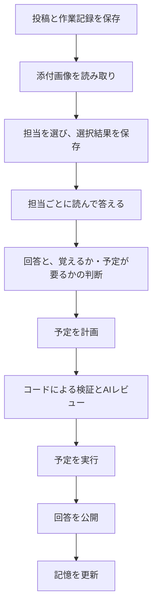

# 中で起きていること

[README](../../README_ja.md) · [English](technical.md)

実装の照合日：2026-10-17。[システム仕様](../system/index.md)には、サブシステムごとの動作とソース・テスト参照をまとめています。

英語版と日本語版は、同じ実装を同じ章順で説明します。動作・制限・例・ソース参照を変更するときは、両方を更新してください。

kakeratta を使うのに、この文書を読む必要はありません。

使う人がすることは意図的に小さくしてあります。思ったことを投稿することと、
自然な言葉で担当に「こうしてほしい」と伝えること。

このページには、それを成り立たせるために中で動いているものをまとめます。振り分け、担当の実行、記憶、
モデルの選択、予定された起動、道具、保存先、オフラインでの動作、外部エージェント、
そしてサーバーを運用する人が決めることです。

## 全体の流れ

主な流れは次のとおりです。

**日常のかけら → 人や関心ごとの担当 → それぞれ独立した記憶 → 必要なときに想起**

コード上はどちらも担当（`skill.json`）で、使う人には**人物**と**関心ごと**として見せます。宛先を直接指定していないかけらでは、
人物の担当にはその人の呼び名かキーワードが含まれていれば届き、関心ごとの担当は振り分け役（ルーター）が
担当条件と照合して、一致した担当だけを起こします。

選ばれた担当は、次のどれをするかを自分で決めます。

* 自分の記憶（今の事実、最近の記録）を読む
* 前の記録、今のスレッド、過去のかけらをさかのぼって見る
* その担当に許された道具を呼ぶ
* あとで確認する予定を入れる
* タイムラインで発言する
* あるいは黙る

記憶がオンなら、そのあと本体がかけらの記録を残します。担当がかけらを1文とタグにまとめるか、残すことがないと判断します。
1日1回のチェックインのときに、担当がそれ以降の記録を今の事実に取り込み（足す・書き換える・消す・まとめる）、取り込んだ記録を消します。
記憶は担当ごとに1つのファイルです。別の話題がたまってきたら、記憶を分ける代わりに新しい担当を作ることを提案します。**作る** を押すと担当を下書きして追加し、関係する事実と記録を移して、元の担当の担当条件からその話題を外します。途中で失敗したときは全部元に戻します。

そのため担当は、膨らみ続ける個人史のプロンプトを毎回受け取るわけではありません。
事実は合計4,000字以内で、細部は検索できる1行の記録と、タイムラインそのものに残ります。

どの担当も覚えなかったかけらも含め、それ以外はタイムラインに残ります。
キーワード検索と embedding による意味検索が、あとからそのかけらを連れ戻せます。

推論は主に **Nebius Token Factory** 経由で、タスクの難しさと頻度に応じてモデルを割り当てます。

担当は次のような道具も使えます。

* Tavily の Web 検索
* 場所の検索
* リモートの MCP サーバー

ブラウザは直近の状態を手元に保持してオフライン投稿に対応し、
サーバー側のチェックインと予定は、ブラウザを閉じていても動き続けます。

複雑さは表に出しません。MCP、RAG、モデルの選択、workflow の検証。
どれも、アプリを使う人が理解する必要はありません。

## 設計原則

**記憶は担当領域ごとに分かれる。** 分離の目的は隠すことではなく、**濃度を保つこと**です。

**本体は振り分けて、確認して、実行する。** 誰に渡すかは中央が決めます。発言するか、何を覚えるか、いつ圧縮するかは
各担当が決めますが、担当は回答と変更の種類ごとに分けて出し、本体がそれを workflow に組み立て、確認して実行してから回答を公開します。
本体は何を言うかを決めません。起きていないことを書く・置いていない予定を約束する、といったことを止めるだけです。

**黙っていい。** 全部には反応しません。解説してもらうためのアプリではなく、ただ眺めていたいだけのときに
毎回反応されるのは押し付けです。誰も反応しない投稿があってよい。

**喋らないことと覚えないことは別。** 発言しなかった投稿も、自分の領域のもので記憶がオンなら記録されます。

**@で呼べば必ず答える。** 領域が分かれているから、誰を呼ぶか迷えます。直接聞かれているので「短く」とは言わず、聞かれたことに必要な長さで答えます。

**非同期が既定。** 投稿はすぐ保存されて表示され、反応はそのあとに届きます。

## 振り分けは「判断」ではなく「条件との照合」

振り分けは投稿のたびに走ります。だから、安くて予測しやすいものでなければなりません。

各担当は、自分が受け取るべきかけらを説明する短い **担当条件** を持ちます。
ルーターの仕事は、その担当が投稿に対して何をすべきかを決めることではありません。
投稿がその条件に一致するかどうかだけを決めます。

この分離は、苦労して学んだものです。

初期のバージョンでは、ルーターに渡す担当の説明に、分野だけでなく「その担当に実現してほしいこと」まで含めていました。
小さなモデルは反応すべき担当を見落とし、プロンプトのいくつかは開かれすぎたものになりました。

プロンプトを直している間、振り分けは大きなモデルに移しました。おかげで問題は見えやすくなりましたが、
使用量のデータがより重要な設計上の問題を明らかにしました。
振り分けはかけらごとに走る一方、ひとつの投稿はすでに複数のAI処理を呼びます。

Personal AI は、かけらごとに高くつくからといって、小さな思いつきを残すのをためらわせてはいけません。

役に立った教訓はこれでした。

**ハイエンドのモデルなら振り分けに成功し、小さなモデルが間違えるなら、その振り分けのタスクのほうが曖昧すぎるのかもしれない。**

だから、大きなモデルを使い続けるのではなく、問題のほうを変えました。

ルーターが見るものは、「担当して実現すること」の説明ではなく、短い担当条件になりました。
判断を特定のケースに引っ張っていた具体例は、プロンプトから削除しました。

説明を返せるモデルでは、選ばなかったすべての担当について `excluded_reasons` を返すことも必須にしました。

これは同時に2つのことをしました。

1. ルーターにすべての担当を明示的に検討させる。
2. ユーザーに見せられる理由を作る。

2つめの効果は、そのまま製品の機能になりました。

ユーザーが **「呼んでほしかった」**、あるいは呼ばれるべきでなかったと伝えると、
kakeratta はその指摘から担当条件を書き直し、保存する前に同じ投稿でもう一度試せます。

### 振り分けのふるまい

**投稿は、本当にその領域に属する担当にだけ渡ります**（`internal/persona/route.go`）。
地名・時刻・食べものの名前が出てきただけでは渡しません。「明日9:10に神谷町に着きたい」は移動の担当にだけ渡り、
ワインの担当には渡りません。誰にも渡さないのは普通の答えで、判定に失敗したときも誰にも渡しません。
判定は、担当ごとの一行の理由とともにログに出ます。

**判定は残ります。** 振り分けが投稿について言ったこと（誰を選び、誰を選ばず、その理由）は投稿ごとに
保存され（`routing.json`、Firestore では `routing` コレクション）、タイムラインから見えます。@指名で届いた
担当は振り分けの判断ではないので含めず、判定できなかったときは記録を残しません。判定に異を唱えると上のとおり
担当条件を書き直し、保存すると同じ投稿で振り分けだけを試します（`Runner.CheckRouting`。配送はしません）。
変わるのは担当条件だけで、裏で何かを学習することはありません。

**担当の発言にも同じように異を唱えられます。** こちらは口調と指示が対象です。書き直して保存したあと、同じ一手を
もう一度取らせます（`Runner.PreviewReply`）。通常の実行を、本物から読んでどこにも書かないワークスペースの
包みの上で動かします。発言は追記されず、メモも予定も書かれず、起きた回数も増えません。
何を言ったはずかが返り、判断するのは人です。

**名指しの依頼は宛先1人だけに届きます。** 有効な担当を `@` 指名した場合、担当条件の振り分けも人物の語句照合も行いません。
指名がなければ、有効な担当への返信はその担当だけに届きます。返信先と異なる指名をした場合は指名を優先し、返信先の関係は保持します。
HTTP APIは異なる複数担当の指名を拒否します。投稿の編集は、記憶を訂正するため以前の届け先にも通知します。

**それ以外の返信は通常どおり振り分けます。** 指名のない自分の投稿への返信や、停止・削除された担当への返信も対象で、
スレッド全体を文脈として使います。直接呼ばれた担当は必ず、依頼に必要な長さで答えます。
「この回答を図解して」「これを要約して」は、別の担当を指名しても返信先の発言を加工する依頼です。
「元の投稿を」「スレッド全体を」と明示したときは、その指定を優先します。

現在の既定のルーターは **Nebius Token Factory 経由の Nemotron 3 Super** です。

上級設定の **OpenRouterを使う** を有効にすると、Router・High・Middle・Low のモデルをそれぞれ選べます。
Router に **Jev**（`~typesafe/jev-latest`）を選ぶと、担当の選択に OpenRouter の Decisions API を使い、
ほかの枠には選択した OpenRouter のモデルを使います。Jev は振り分けを速く安くできる場合がありますが、
通常の振り分け確認UIが使う「呼ばれなかった理由」を返しません。

### 人物は語で照合し、振り分けに渡さない

担当は分野の代わりに一人の人物を覚えることもできます（`"kind": "person"`）。人物は振り分けに渡しません。
「佐藤さん」を振り分けに任せると、政治家の話も含め「佐藤」が出る投稿をすべて渡してしまうからです。
投稿に担当の名前、`aliases`（呼び名）、`keywords` のどれかが含まれていれば届きます（`internal/persona/people.go`）。
全角半角、大文字小文字、ひらがなとカタカナ、空白、末尾の敬称（さん・くん・様など）は区別しないので、
「佐藤」で「佐藤くん」「さとうさん」にも届きます。言い換えは別のキーワードとして並べます。呼び名は `@` にも答えます。
写真から読み取った文字も対象です。

「母」が「母校」に含まれるように、語は偶然一致します。担当には「語が一致しただけ」と伝え、その人の話でなければ
発言もメモもせずに終えさせます。一致した語は振り分けの記録に残り、⚖ に出ます。⚖ の**「呼んでほしかった」**は、
担当を作る AI が投稿の語と類似語から足すキーワードを提案し、保存後に振り分けを通さず同じ投稿で照合し直します。
**「呼んでほしくなかった」**は、その人の語のうち投稿に一致したものをすべて並べ、外す語をユーザーが選びます
（担当の名前そのものは外せません）。分野の振り分けが失敗しても、投稿に出た人物には届けます。

### 振り分けの設計を支えた実測

実測は別の実験文書に置いてあります。あるときのプロンプト・担当・モデル・本番状態のスナップショットであって、
現在のアーキテクチャの仕様ではないからです。

最初の統制された比較では、想定される受け取り手を実行前に固定した12件の合成ケースを使いました。
Lightning と Ultra はどちらも12件すべてで一致しました。その実験で使った価格と為替では、
振り分け1回あたりの実測は **Lightning で約0.0465円**、**Ultra で約0.3385円** でした。
その回では、Lightning のほうが安く、遅いという結果でした。

方法、トークン数、レイテンシ、費用の前提、再現コマンドは
[Routing model comparison — 2026-09-17](../reports/routing-cost-experiment.md)
にあります。

のちに行った読み取り専用のリプレイでは、直近20件の本番投稿と、そのときの本番で有効だった担当6人の条件を使いました。
担当を起こさず、本番へ何も書き戻さずに、Lightning・Nano・Super・Ultra・Jev・GPT Luna を比較しました。

その回の Nemotron 系では、**Super が1回あたり平均1.91秒・約0.098円**、
Lightning が6.55秒 / 0.070円、Ultra が2.28秒 / 0.449円でした。
任意で選べる Jev Decisions の経路は0.37秒 / 0.026円でした。

このリプレイには、20件すべてについて人が事前に用意した正解ラベルが **ありません**。
そのため、これらの数字を精度のランキングとして読まないでください。

測定の全体と限界は
[振り分けモデル比較 — 2026-09-19](../reports/routing-model-comparison-2026-09-19_ja.md)
にあります。

現在の構成について正しいのは、この文書に書かれたアーキテクチャです。
実験文書は、その構成がなぜ変わったのかを説明するものです。

## 誰が、どのモデルで答えるか

**投稿が届いた担当は並列に、通常は Nemotron 3 Super で動きます。** 1人1回です。
タイムライン上で担当を起こすのは、ユーザー自身の投稿と返信だけです。担当の発言が別の担当を起こすことはないので、
タイムラインがAI同士の会話で埋まることはありません（チェックインと予定は、後述のとおり時刻で担当を起こします）。投稿にすでに付いている発言は各担当に渡すので、あとの返信でそれを拾えます。

**深さは、モデルを呼ぶ前に文字列の一致で決めます。** 日次・月次チェックインでは過去の発言を今回の深掘り依頼として扱わないため、この語句判定を行いません。「常に熟考する」の設定は適用します。 今回の投稿（スレッドの古い発言は見ません）を小文字にして、`詳しく`・`深掘り`・`ちゃんと調べて`・`それって本当`・`in detail`・`deep dive` などの明示的な語句を探します（`wantsDeep`）。一致するか、本体の内部から深い依頼として渡されたときだけ deep です。こうした語句のない複雑な依頼は通常のままです。モデルによる深さの判定や調査計画はありません。通常はread 10回・Web検索2回、deepとAlwaysUltraはread 20回・Web検索4回です。

**通常のターンは、Super が読むことと答えることを1つのループで行います。** 最初の呼び出しから、使える `read` と一緒に `submit_answer` を提示します。スレッドと記憶で足りれば、発言でも沈黙でも1回で終わり、足りなければ同じループで読んでから答えます。

**deep と AlwaysUltra のターンは、読むモデルと答えるモデルを分けます。** Nebius では、deep な依頼は Super VL で読んで Ultra で答え、AlwaysUltra は Super VL が1つのループで読んで答えます。対象は、Web検索・天気・同梱の仕様など自分の調べる道具を持つ担当です。読むモデルには `read` と `finish_read` だけを提示し、読み終えるか read の上限に達したら、答えるモデルには `submit_answer` だけを提示します。調べる道具を持たない担当（スレッドにある材料から作る図解担当など）は、答えるモデルで1つのループのままにします。読む必要のないターンなら1回で済み、読み終えるだけの呼び出しが増えないからです。予定のフェーズとそのレビューは Nebius では Super VL です。

**常に熟考する**（`alwaysUltra`）をオンにすると、すべてのターンが deep になります（深い read 枠と、Nebius では Super VL、ほかでは Ultra の回答）。外部エージェントの選択は変えず、本体が代わりに答える場合もこのモデルを使います。図解担当は初期状態でオン、ほかはオフです。

**発言にはモデルの枠が残ります**（`model: "super"`・`"ultra"`・外部回答の `"agent"`。失敗したターンの発言には付けません）。
これは役割のラベルで、提供元のモデルIDではありません。タイムラインでは high のモデルで答えた回答に、時刻の横に Ultra のバッジを付けます。

```text
投稿 / 返信
 ↓ 画像を一度だけ解析
 ↓ 宛先の指定、または通常の振り分け
選んだ届け先を並列に実行
 ↓ 投稿中の明示的な語句で深さを決める（モデルは呼ばない）
 ↓ 通常: Super が読んで、同じループで回答を提出
 ↓ deep: Super VL が読む → finish_read → Ultra が回答を提出
 ↓ alwaysUltra: Super VL が読んで、同じループで回答を提出
   （調べる道具を持たない担当は答えるモデルで読んで答える）
 ↓ Schedule フェーズは回答が求めたときだけ Super VL で
 ↓ メモ係は回答が「覚える」と判断したときだけ
```

## workflow は1回で書かせず、フェーズごとに組み立てる

担当は、モデルが出した文章のままアプリの状態を書き換えるわけではありません。回答と変更を一度に書かせることもしません。

以前の形では、1回のモデル呼び出しに、発言・残すメモ・予定をまとめて1つの workflow として書かせていました。
その代償を回答が払っていました。モデルの注意がメモの書式とステップのスキーマに取られ、必須だったメモのために発言を短くし、
調べた内容を見られないレビューが良い回答を差し戻しました。回答を外部エージェントに任せると、質の低下がはっきり見えました。

workflow は残ります。本体が検査・レビュー・実行するのは今も `Workflow{answer, schedules}` ですが、
どのモデルにも丸ごとは書かせず、記憶は回答が出たあとに別に扱います。ターンを責任ごとに分け、各フェーズが型の決まった1部分だけを埋め、本体が workflow に組み立てます。

```text
内蔵モデル: 読む → 回答        外部エージェント: 読む＋回答 → submit_answer
                     ↓
            Schedule フェーズ → schedules
                     ↓
            コードによる検査（毎回）
                     ↓
            レビュー（予定があるときだけ）
                     ↓
            実行 → 回答を公開
                     ↓
            メモ係 → かけらの記録
            （チェックインのとき: 記録を事実に整理する）
```

### かけらの受付から記憶まで

処理は、かけら全体で一度行う「受付・担当選び」と、選ばれた担当ごとに行う「調査・回答・実行・記憶」に分かれます。



| 段階 | 役割 |
| --- | --- |
| 受付 | 投稿・返信・編集と、担当選びを行う作業記録を一緒に保存します。本番ではFirestoreのトランザクションを使い、両方の保存が成功してから受け付けます。 |
| 画像の読み取り | 添付画像を一度解析し、その結果を各担当に渡します。担当ごとに画像解析を繰り返しません。 |
| 担当選び | 興味の担当は条件、人物の担当は名前・キーワードで選びます。@指定や有効な担当への返信は、その担当に直接届けます。届ける担当の一覧と、その時点の担当設定も保存します。 |
| 担当ごとの処理 | 調査、回答確定、予定の計画、検証・レビュー、実行、回答公開、記憶更新の順に進みます。下の詳細説明も、この実行順序で並べています。 |

複数の担当は並行して処理しますが、同じ会話の配信順序は保ちます。未完了の作業記録が残るため、再起動後に処理を再開できます。ただし、AIの思考途中の状態を保存するわけではなく、中断した段階を再実行する場合があります。

記憶しない担当で読み取り専用の道具しか持たない場合は、予定の計画とレビュー、記憶更新を省略します。レビューが必要なのは、実際に予定を含む計画です。外部エージェントに任せるのは調査と回答までで、その後はかけらったが担当します。回答公開後の記憶更新に失敗しても、回答は取り消さず、保存した記憶更新の作業記録を使って別に再試行します。

実装の詳細は[担当の実行](../system/personas.md#from-research-to-answer-publication)と[バックグラウンド処理](../system/architecture.md)を参照してください。

### 1ターンの流れ

以下は記憶がオンのターンです。記憶オフではメモ係を省き、読み取りだけの担当は回答後の予定フェーズも省きます。それ以外は、道具にかかわらず同じ流れで動きます（`internal/persona/answer.go`、`phases.go`、`workflow.go`）。
読んで答える部分は内蔵モデルが行うか、「考える役」を外部エージェントにした担当では MCP 越しの外部エージェントが行います
（[MCP による外部エージェント](#mcp-による外部エージェント)）。回答より後はどちらでも同じです。

内蔵の調査は通常read 10回・Web検索2回、deepな依頼・AlwaysUltraではread 20回・Web検索4回です。各roundで実行用budgetから残数を読み、read schemaと説明を作り直します。Web検索の残り1回を明示し、0回になると `web_search` をtool名のenumと使い方の説明から除外します。同じread内の複数検索や、同一roundの複数readも、stepごとに上限を守ります。

Web検索が0回でも、利用可能なタイムライン・記憶・その他のreadと `submit_answer`（deepのターンでSuperが読んでいる間は `finish_read`）は使えます。readの上限に達したら、本体は `read` を外して回答を求めます。未設定・権限なしなどの利用不能なreadは提示しません。記憶無効担当には `records` のschemaと説明を出さず、投稿IDで本文を読む `entries` を残します。現在の説明は各roundで置き換え、取得済みtool結果は回答へ渡します。外部エージェントのインターフェースとphaseのbudgetは別管理です。

実装とテストは[Research budgets and available reads](../system/personas.md#research-budgets-and-available-reads)を参照してください。[本番使用量レポート](../reports/production-model-usage-2026-10-05_ja.md)は以前のUltra調査ループを記録したもので、今の実装を表すものではありません。

振り分け・本体の回答・メモ係には、返信関係や解釈済みの添付資料を含む会話全体を渡します。
`threadContext` は今回の対象発言をIDで示し、本文を二重に掲載しません。IDのないシステム起床はスレッド内の位置で示します。
対象発言がスレッドに含まれない場合は全文を別途渡します。

1. **読む。** ターンの最初に、今の事実、最近の記録15件を必ず渡します。そのうえで、タグ・語句・意味・月で探す前の記録、
   記録がたどる投稿そのもの（10件までまとめて）、タイムライン検索、Web 検索、場所の検索を、10回まで（deepな依頼・AlwaysUltraでは20回まで）頼めます。
   ここで動くのは読み取り専用の道具だけです。MCP の道具は、サーバーが `readOnlyHint` を付けたものだけを担当に渡します。
   何も書き換えないので、本体はそのまま実行して結果を返します。
2. **答える。** 通常のターンは Super が同じループで読んで答えます。調べる道具を持つ担当の deep のターンでは、Super VL で読み、読んだ内容と会話・tool結果をそのまま Ultra に渡し、`submit_answer` だけを提示します。担当は `{text, sources, unrelated, schedule}` を出します。`schedule` は予定の作成・変更・取消が必要かです。このプロンプトには記憶の残し方や変更のスキーマを載せず、
   何かを覚えろとも言いません。後のフェーズで何ができるか（`capabilities`）は伝えるので、できない通知や送信などを約束しません。
   空の text は沈黙です。名指しなら必ず答え、傾聴なら黙ります。回答はここで確定し、後のフェーズは変えられません。
3. **Schedule フェーズ。** 予定を扱える担当で、回答が `schedule: true` と答えたとき（古い外部クライアントのように何も答えなかったときも）だけ、Super VL の別の呼び出しが、確定した回答と置いてある予定を見て `submit_schedule` を出します。
   作成・更新・取消の操作で、時刻やPush通知は既存の予定を更新し、目的や繰り返しの変更は取消＋作成で扱います。作成には何のための予定かを書いた短い一言が付きます。あわせて、回答の時刻に関する約束がすべて
   操作か既存の予定で裏付けられているか（`consistent` と `reason`）を申告します。取消していないのに「取り消したよ」、
   何も置いていないのに「22:30ごろに聞くね」は差し戻しです。整合できなければターンを止め、回答は公開しません。
   担当が変えられる状態は予定だけです。ほかの道具を実行するフェーズはありません。
4. **コードで毎回検査する。** 操作の種類、実在して取り消せる自分の schedule id か、読める時刻か。
   通らない提案は、理由を付けてそのフェーズに差し戻します。
5. **より遠くまで届くものだけレビューする。** 予定を含む workflow は、Nemotron 3.5 Super VL が狭い項目だけを見ます:
   回答の約束と予定の時刻・Push通知・作成・更新・取消が一致しているか、予定どうしが矛盾・未充足の依存をしていないか、
   変更を済ませたという回答に裏付けがあるか。
   回答の質・長さ・調べた内容はレビューしません。本体の read に無いからといって、よそで調べた内容を却下することもありません。
   回答だけならレビューはかかりません。レビューに落ちたら、指摘を添えて予定のフェーズを作り直し、回答はそのままです。レビュー2回で通らなければターンを止めます。
6. **実行して、公開する。** 予定の変更を順に実行し、**失敗したステップで止まります**。すべて実行できたときだけ回答を公開します。
   複数の変更はトランザクションではないので、実行済みのものは記録し、
   成功を約束する回答は出しません。

7. **記憶は回答のあと。** 記憶はターンのフェーズではありません。記憶が残せなかったことで、できあがった回答まで
   失われないようにするためです。発言が出たあとに、担当の**メモ係**が残します。記憶する担当で関係のあるユーザー投稿なら、メモ係が記憶の要否と内容を判断します（[メモ係](#メモ係)）。

1ターンは構造化ログ1件に残ります: 読んだもの、回答、各フェーズの往復回数・読み取り・差し戻しとその理由、各レビューと作り直したフェーズ、
組み立てた workflow、実行した各ステップ、発言。メモ係は別のログ1件（`notes <persona>`）を残します: 提出した内容と、何回目で通ったか。

### メモ係

`internal/persona/notekeeper.go`。発言が公開されたあとに、担当が、そのターンが残すべきことを決めます。
モデルは middle（既定は Super。最終回答が大きいモデルの場合も同じ）で、声は担当自身です。
記憶する担当では、関係のあるユーザーのかけら（投稿・返信・編集。関係はあるけれど黙ったときも）と、見直しの日が来た記録を渡されたチェックインでメモ係が動きます。回答本体は記憶の要否を判定しません。旧形式の `remember` は受け付けますが値は無視します。
予定による起床、削除後の整理、自分の担当ではないとして黙ったターンでは動きません。ただし編集は、領域外になっても以前の記憶を訂正するため永続ジョブ経由でメモ係に渡します。削除時は本体が記録と根拠を失った事実を直接取り除き、担当は予定を見直せます。
[keepsNotes](../../internal/persona/runner.go)と[メモ係](../../internal/persona/notekeeper.go)を参照してください。

ふつうの投稿では `keep_record` を使い、スレッドと、記録で使っているタグだけを見せます（事実・前の記録・公開した回答は見せません）。出すのは次のものです。

* `remember` — 挨拶・相づち・一般知識だけなら false で、何も残しません
* `summary` — かけらを1文で、ユーザーの言葉に沿って（140字以内）
* `tags` — あとで探す手がかりの語を1〜5つ
* `expires` / `review` — 記録の日付（あれば。後述）

かけらの編集と、見直しの日が来た記録を渡されたチェックインでは、事実を見せて `keep_memory` を使い、
`facts`（事実の変更。`add`、`update`（変わった事実を書き換える）、`invalidate`（当てはまらなくなった）、`merge`（似た事実を1件にまとめる））と、
`records`（渡された記録をどうするか）も出します。

本体は提出を確かめ、通らなければ理由を付けて差し戻します（提出は合計3回まで）: 1文がない、タグが多すぎる、日付が明日以降でない、
今の事実にない id、200字を超える事実、4,000字を超えて増える事実、回答の文を2文以上そのまま写している。通れば**書くのは本体**です。
担当の記憶ファイル `Memo.md` に記録を1行書きます。

```text
- 2026-10-01 12:34 [e_x](/?entry=e_x) 三田の二郎に行きたい #ラーメン #三田 review:2026-10-22/21d
```

ID は、担当が返事をしたならその返事（返事から元のかけらへたどれます）、しなかったならかけら自身です。
かけらを編集したときや再試行のときは、同じかけらの記録を置き換え、2行にはしません。

**事実の整理は1日1回行います。** 毎日または毎月のチェックインで担当を起こす前に、
前回の整理以降の記録があるとき、事実が訂正されたとき、日付の過ぎた事実があるときだけ、`tidy_memory` を1回呼び、事実・記録を渡します。
返すのは、事実の変更（それぞれ根拠にした記録を示す）、取り込んで要らなくなった記録（残る事実の根拠になっているものだけ本体が消す）、
ユーザーに「忘れていい？」と聞く古い記録（5件まで）、日付の過ぎた予定の削除と残す過去の出来事、
まれに、新しい担当に分けるとよい話題（チェックインで「作る／作らない」ボタン付きでユーザーに提案します）です。当てはまらなくなった事実は履歴を残さず消えます。
失敗したら次のチェックインで再試行し、新しいことがなければモデルを呼びません。

過去の出来事として保持すると明示的に判断した事実（`retain`）は、本文と開始日の指紋を記録し、変わらない限り日付による再審査を省きます。
本文や開始日が変われば再び審査対象になります（出典が増えても再審査はしません）。判断保留は記録せず、同じIDへの保持と無効化の矛盾は差し戻します。
判定は事実の行末の内部用の印 `reviewed:` に保存し、記憶の画面には表示しません。
詳しくは[1日1回の整理](../system/personas.md#the-daily-pass)を参照してください。

メモ係が終えられなくても、回答はすでに出ています。メモ係への入力は実行前に保存され、失敗した処理は1分後から最大1時間の間隔で、
その時刻に起こされたときに再試行します。削除・編集された投稿の古い入力は再生しません。
同じ担当の2つのターンが同時に終わっても、ロックで順番に動くので、それぞれが見た内容から同じ記憶を書き換え合うことはありません。
書いたあと、発言は更新した記憶ファイルを指すように更新されます。作業項目自体を保存できない場合も、その場で一度は試しますが、その試行には永続的な再試行はありません。

## モデル

kakeratta は、すべての仕事をひとつの大きなモデルに送るのではなく、
**Nebius Token Factory** 経由で複数のモデルを使います。

| モデル                     | 役割                                                     |
| -------------------------- | -------------------------------------------------------- |
| **Nemotron 3 Super**       | 振り分け、読み取りと通常の回答、メモ係、毎日の処理（常に熟考する担当を含む毎日・毎月のチェックイン、毎日の記憶の整理、今日のまとめと今月のまとめ） |
| **Nemotron 3.5 Super VL**  | deepな依頼・常に熟考するターンの読み取り、予定の計画と workflow のレビュー、チェックイン以外での常に熟考する担当の回答（図解担当を含む）。Super よりずっと長く推論するので、間違いが後に残る処理に使い、毎回の回答や毎日の処理には使いません |
| **Nemotron 3 Ultra**       | deepな依頼の回答（調べる道具を持たない図解担当などは読み取りも）と、担当の下書き |
| **Nemotron 3.5 Lightning** | 任意の音声入力整形 |
| **GLM-5.3-Flash**          | スクリーンショットや写真を、投稿ごとに一度読む           |
| **Qwen3-Embedding-8B**     | 過去のかけらの意味検索                                   |

一時期、Super VL をすべての処理の既定にしました。トークン単価は同じでも思考がずっと多く、振り分け1回の思考トークンは
中央値で Super の約70に対して約1,430でした。振り分けは約0.12円から0.30円に、1担当の投稿は約1.3〜1.4円に上がったため、
投稿ごとの処理は Super に戻しました。通常の回答とメモには Lightning も試しましたが、思考があふれ、人物担当のふつうの返事で
26,000トークンの出力上限に3回続けて当たり（1回約80秒）、回答が出ませんでした。今の分け方では、1担当の投稿は約0.4〜0.55円です。
詳しくは [AIまわりで苦労したこと](ai-lessons_ja.md#14-新しいモデルは考えすぎ小さいモデルは止まらなかった) を参照してください。

設定は `lowModel`（Lightning）・`middleModel`（Super）・`highModel`（Ultra）の3枠です。Nebius の標準の接続先では
常に既定のモデルを使い、保存しません。ほかの接続先では、どれにも OpenAI 互換のモデル名を入れられます。

担当の実行、振り分け、workflow のレビューは、適切な場面でネイティブのツール呼び出しを使います。

画像の読み取り、担当の下書き、音声入力の整形、構造化生成、embedding は、
すべてを同じ種類のチャット要求であるかのように扱うのではなく、
提供元の構造化出力や embedding のインターフェースを使います。

開発中の Token Factory の利点のひとつは、周りの提供元連携を作り直さずに、
モデルの役割を変えられたことでした。

振り分けの設計を変えている間、使用量のデータがその選択のコストを見えるようにしてくれました。

上級設定では **OpenRouterを使う** を有効にし、専用の API キーと Router・High・Middle・Low のモデルを設定できます。
Jev は独立したスイッチではなく、Router の選択肢です。旧 `jevEnabled` 設定は、OpenRouter を有効にして
Router に `~typesafe/jev-latest` を選んだ状態へ移行します。既定の提供元は引き続き Token Factory です。

OpenRouter のツール呼び出しは Exacto を経由します。
詳しくは[設定とモデルへの要求](../system/backend.md#settings-and-model-requests)を参照してください。

## 画像の読み取りは投稿ごとに一度

写真やスクリーンショットは、**投稿を処理するときに一度だけ GLM-5.3-Flash に送ります**。

その結果のテキストによる解釈がかけらに添えられ、関係する担当で共有されます（`internal/capture`）。
写っているもの・文字・出典の手がかり、そして見た目（色・形・数・配置など、あとで聞かれそうな特徴）です。

画像そのものは担当に渡しません。担当のモデルはどれも画像入力に対応しておらず、実機では画像を渡した turn が
ワインのラベルへの発言ごと失われました。原画像を求めた担当には、すでに持っている読み取り結果を使うよう伝えます。

画像を、担当ごとに1回ずつ独立して vision に送ることはしません。

これは意図的です。

3人の担当が同じ写真を受け取ったとき、vision を繰り返し呼べばレイテンシも費用も倍になり、
しかも取り出せるのは同じ基本的な事実であることが多い。
解釈がひとつなら、担当たちは見たものについて一貫した説明を共有できます。

トレードオフがあります。

担当によって、気になる視覚的な細部は違います。食事の担当は食材を知りたいかもしれず、
移動の担当は背景に写った店の看板を気にするかもしれません。

最初の画像解釈がある細部を取り出さなかった場合、あとの担当は質問を変えるだけでは取り戻せません。
その担当の視点で、元の vision モデルをもう一度動かすことはしないからです。

kakeratta の現在の選択はこうです。

**投稿ごとに予測しやすい画像理解を一度 → 関係するすべての担当が同じテキストの文脈を共有する**

こちらではありません。

**担当ごとに vision を1回 → 担当ごとにより豊かな細部が得られるかもしれないが、費用とレイテンシは倍増する**

この限界は、担当それぞれが元のピクセルを独立して見たかのように隠すのではなく、
意図的なものとして文書に書いてあります。

## 記憶と検索

記憶は担当ごとのもので、**書くのは本体だけです。** 食事の担当が移動の担当の記憶に触れることはできず、
担当も外部エージェントも自分でファイルを書きません。何を残すかは担当のメモ係が出し、本体が確かめて保存します。

担当は記憶を1つのファイル `Memo.md` に持ち、中身は2つです。

* **かけらごとの記録1行ずつ。** 1文、タグ、たどれる投稿、ときに日付。会話のたびに1行足します。担当には最新15件を渡し、
  残りはタグ・語句・元のかけらの意味で検索させます。
* **今の事実。** 事実は1件1行で、id、根拠のかけら、いつから当てはまるかが付きます。1日1回、新しい記録を事実へ1件ずつ取り込むので、
  書き直しで情報が抜けることはありません。当てはまらなくなった事実は消え、事実に取り込んだ記録も消えます。

事実には、根拠のある傾向・条件・例外・役立つ変化も残します。1件200字、合計4,000字までで、別のまとめ文は持ちません。

記憶は話題ごとに分けません。別の話題がたまってきたら、担当が新しい担当を作ることを提案します。**作る** では Ultra が担当を下書きし、その担当に属する事実と記録を選びます。選んだものは文面のまま移り、元の担当の担当条件には話題を除く1文が加わるので、その話題の投稿は新しい担当だけに振り分けられます。

```text
=== Memo.md ===
# Memo

## いまの事実

- [f_ab12cd] 醤油と豚骨なら豚骨を選ぶ from:e_b since:2026-09-08
- [f_cd34ef] 担々麺のごま強めは苦手 from:e_a since:2026-09-01

## かけらの記録

- 2026-09-12 12:02 [e_c](/?entry=e_c) 神田で今日のランチをどこにするか聞いた #ランチ #神田 expires:2026-09-13/1d
- 2026-09-15 19:40 [e_d](/?entry=e_d) 神保町の新しいラーメン屋に行ってみたい #ラーメン #神保町 review:2026-10-06/21d
```

ユーザーはすべてを画面から直接読めます。事実の根拠や記録の ID から投稿を開け、タグを押すとそのタグの記録があるときだけに絞れます。
記憶は投稿を消さずに直したり消したりでき、そのとき担当は起こしません。ローカル保存では普通のファイルなので `cat` で読めます。

**記録は、かつての索引の1行にあたり、寿命を持つものもあります。** 日付はメモ係が内容から決めます。
「今日のランチどこがいい？」「渋谷までの行き方」のような、その場で用が済むかけらには翌日の `expires` を付け、その日が来たら本体が記録を消します（誰も起こしません）。
行きたい店や関心のある話題のように、いつまで要るか分からないユーザーの話には、数週間〜数か月先の `review` を付けます。
好みや習慣には付けず、日付のない記録を本体が古さで消すことはありません。

**使われている記録は期限が延びます。** 担当が投稿に答えるターンで検索や ID 指定によって読んだ記録は、
`expires` も `review` も、付けたときの日数をその日から数え直した日付になります。期限が手前に縮むことはありません。
チェックインなど投稿以外の起床で読んだだけでは延びません。見直しのために読んだ記録の質問が先送りされ続けないようにするためです。

**見直しの日が来た記録は聞いてから扱い、本体は消しません。** その日を過ぎると、次の毎日のチェックインで古い順に最大3件を渡します。
担当はそのうち1件について短い投稿で「そろそろ忘れていい？」と聞き、メモ係がその記録を1週間先に送って、聞いた投稿を記録に印として残します。
その投稿への返事は、聞いた記録とともに担当に届き、メモ係が残す（日付を外す）・延ばす・忘れるのどれかを行います。

投稿を消す場合は別です。本体はその投稿のもとに残した記録（かけら自身の ID のものも、答えた返事の ID のものも）を消し、
事実の根拠からそのかけらを外します。それだけを根拠にしていた事実は、モデルを使わずに消えます。記録を持っていた担当は起こされますが、
発言も回答もせず、そのかけらのために置いた予定を取り消せるだけです。残った記憶は次のチェックインで整理します。
事実も記録も1件も残らなければ、記憶ファイルを即座に削除します。
事実を直接訂正・削除した場合も同じ更新ルールを使いますが、担当は起こしません。
担当の返事だけが消された場合は、記録をかけらの ID に付け替えます。

### 担当に渡すもの

* 振り分けられた投稿と、その画像の読み取り結果
* **その投稿に付いた発言**（他の担当のものと、ユーザーの返信）
* 今の事実、最近の記録
* 予定を持てる担当なら、自分の未実行の予定

**タイムライン全体は渡しません。** 渡せば結局すべての担当がすべてを見ることになり、領域ごとに分けた
意味が消えます。それより前のことは、自分の記録かタイムライン検索で見つけます。

**記憶の一次情報源はユーザーです。** メモ係には、ユーザーが言ったこと・したこと（事実・好み・予定・変化・覚えてと頼まれたこと）を残し、
回答で調べたことや勧めたこと（候補の一覧、調べた数値、解説）は残さないよう伝えています。それらは必要になれば調べ直せますし、
記憶に残すと、古くなってからもユーザーについて知っていることとして読み返されてしまいます。どう答えたかは一言で残してかまいません。

**形式は本体のもの、方針はスキルのもの。** どんな事実を優先して残すか、どうまとめるか、どの記録にどの日付を付けるかは、
各スキルの `memory` に普通の言葉で書きます。本体はいつ圧縮するかの閾値を持たず、大きさの上限だけを持ちます。

以前の記憶の形式（個別の OKF メモと `index.md`、散文の分野ファイル、複数の分野ファイルと月ごとの記録ファイル）は、
1つの記憶ファイルに統合しました。詳しくは[記憶の統合](../system/operations.md#memory-consolidation)を参照してください。

### お気に入り

お気に入りは、読み返したい投稿を利用者が選んで残す仕組みです。担当の記憶とは独立しています。
投稿・担当の回答・自分の返信は現在のタイムラインにあり、お気に入りには投稿IDと追加日時を保存します。
本文のコピーは持ちません。繰り返し保存しても日時は変わらず、外して保存し直すと新しい追加日時になります。

一覧APIは追加日時が新しい順にページ分けし、発言者で絞り込めます。画面の検索では、
お気に入りのIDで語句検索・意味検索の対象を絞ってから順位付けとページ分けを行います。
検索語が空なら投稿日時の新しい順です。ローカルは `favorites/{entry-id}.json`、
Firestore は `users/{key}/favorites` に保存し、エクスポートにも含めます。
投稿を削除するとそのお気に入りも外れますが、お気に入りを外すだけでは投稿は消えません。
[APIと永続化の仕様（英語）](../system/backend.md#favorites)も参照してください。

### タイムライン・発言一覧・検索の絞り込み

画面には独立したお気に入り一覧を設けず、タイムライン・発言一覧・検索で共通の **絞り込み** を使います。
初期状態は閉じており、開くと **お気に入りのみ**・**開始日**・**終了日**・**絞り込みを解除** を表示します。
閉じても条件を維持し、条件が有効なら **絞り込み中** と表示します。お気に入りの解除は、どの画面でも確認します。
入力欄の下の担当を右クリック、または長押しするメニューからも発言一覧を開けます。

日付入力は端末のタイムゾーンを使い、終了日の終わりまで含めます。HTTP APIは両端を含むRFC3339の `from`/`to` を受け取り、不正な日時や逆転した期間を拒否します。
通常のタイムラインは元投稿の日時で絞り込みます。お気に入りのみの場合は保存した各発言の日時で絞り、元の会話を含めて元投稿の日時順に表示します。
発言一覧は各発言の日時と保存状態で絞り、文脈として会話も返します。検索は順位付け・ページ分けの前に期間と保存IDで候補を絞ります。
期間かお気に入りの条件があれば、検索語が空でも新しい発言から一覧にできます。

条件を変更するとページをリセットし、古い要求の応答は無視します。オフライン用キャッシュへ保存するのは絞り込みのないタイムラインだけで、
オフライン時の絞り込みは保存済みの発言と既知のお気に入りIDを使います。
[一覧の絞り込み](../system/backend.md#listing-filters)と[画面の動作](../system/frontend.md#favorites-and-saved-entry-search)を参照してください。

### 意味検索

かけらは、担当が意識して覚えていなくても、後から役に立ちます。

タイムラインの文章、担当との会話、画像から取り出した文字は、あとから検索できます。

意味検索には **Qwen3-Embedding-8B** の embedding を使います。
「軽くて飲みやすかった赤ワイン」のような問い合わせで、
「ピノ」という正確な語を思い出せなくても過去の投稿を見つけられます。

これは、担当の長期記憶とは意図的に分けてあります。

* 記憶は、担当が残すと決めたもの。
* 検索は、タイムラインにだけ残ったものを取り戻せる。

### 投稿の地名と地域による検索

ブラウザ投稿の有効な座標はすぐ保存し、逆ジオコーディングの完了を受付や担当への配送の条件にしません。
振り分け時に永続的な `place-{entryID}` の処理を登録し、運用者が設定したMCPの `reverse_geocode` に `lat`・`lng`・投稿の `language` を渡します。
1試行は60秒以内で、初回の道具一覧取得は15秒までです。再試行可能な失敗は30秒待ち、取得した実行権で数えて最大3試行まで行います。
正常な「該当なし」はそこで終了します。独自の地名ラベルは保持します。位置情報だけを条件付きで更新するため、同時の本文編集を保持し、削除済みの投稿を復活させません。
成功すると発言イベントを送り、ブラウザの表示と検索索引を更新します。

画面には行政区画レベル2〜4と最寄りの集落名を表示し、国とレベル1は省きます。
ローカライズした `Country`、`CountryCode`、レベル1の `Region` を別に保存し、語句検索とRAGのembeddingに含めます。
これらは最寄りの集落の情報で、座標がその行政区画内にあることを保証するものではありません。
「秋田」のような地域名を先週の期間と組み合わせて、検索フィルターや `timeline_search` で探せます。
地名を取得できなければ座標表示を残します。地図リンクは付けず、GeoNamesの出典はフィードのフッターに表示します。

既存のFirestore投稿は `cmd/backfill-places -metadata-only` で表示ラベルを保ったまま補完できます。
確認用の計画を作り、適用と検証を別々に行います。[過去の位置情報の補完](../system/operations.md#backfilling-post-locations)を参照してください。
実装は[位置情報の処理](../../internal/server/place.go)、[地名の組み立て](../../internal/geocode/place.go)、[検索対象テキスト](../../internal/search/search.go)にあります。

## スキル

担当は `skill.json` ひとつです。

| 項目 | 内容 |
| --- | --- |
| `name`・`icon`・`tone` | 表示と話し方 |
| `domain` | 担当条件。何に反応し、何を覚えるか。**振り分けがこれを読む** |
| `memory` | 何をどう覚えるかを普通の言葉で。どんな事実を残すか、どうまとめるか、記録にどのタグと日付を付けるか |
| `instructions` | 何を区別し推測と明記するか、いつ発言するか。**担当本人だけが読む** |
| `tools` | 宣言したものだけが呼べる |

内蔵は5人（tabe 食事 / support サポート / shiori 読書 / sona 備え・天気・小さな用事 / infographic 絵文字・Mermaidを使ったMarkdown図解）です。新規利用時は sona・support・infographic が有効で、保存済みの有効・停止の選択は維持します。
画面から追加でき、手で書くことも、担当を作る AI（Nemotron 3 Ultra）に下書きさせることもできます。

```json
{
  "id": "wine",
  "name": "ぶどう",
  "icon": "🍷",
  "domain": "ワイン。銘柄、産地、ラベルの写真、飲んだ記録。",
  "tone": "控えめ。おすすめを押しつけない。",
  "memory": "飲んだ銘柄と好みの傾向を覚える。好みは重なったらまとめる。",
  "instructions": "引用と本人の意見を分け、推測は推測と書く。",
  "tools": ["web_search", "place_search"]
}
```

**人数に上限はありません。** 振り分けが中央にあるので、投稿ごとに動くのは関係する数人だけで、
振り分けは投稿ごとに一度です。**領域が分かれていなければ @ に意味はありません。** 誰を呼ぶか迷えなければ、指名は要りません。

### 記憶のオン・オフとMarkdown図解

`memoryEnabled` は未指定・nullならオンです。supportと図解担当は初期状態でオフです。
オフの担当には個人の記憶を渡さず、記録の検索でも返しませんが、投稿をIDで読むことはできます。
メモ係・記憶の整理・毎日と毎月のチェックインを省きます。既存の記憶は残し、
明示的な通知予定と外部エージェントの選択は維持します。画面は記憶とチェックインの操作を非表示にします。
読み取りだけの記憶なし担当は、回答後の予定の計画と確認も省きます。
詳しくは[記憶の選択](../system/personas.md#optional-persona-memory)を参照してください。

図解担当は `alwaysUltra: true` で（Nebius ではふだん Super VL、「詳しく」を付けると Ultra）、絵文字・見出し・箇条書き・表とMermaidのフローチャートやシーケンス図を使ったMarkdownを回答として出します。
Web検索ツールは持たず、HTML・CSS・SVGは生成しません。
展開済みURL本文・読み取り済み画像・返信先の回答を材料にします。投稿の `Entry.Language` に
送信時の表示言語を保存し、図解の見出しや説明を日本語・英語に揃えます。オフラインの送信待ちもその言語を保持します。
古い投稿ではスレッド内の最新のユーザー言語を使います。

本体はMarkdownをそのまま保存し、画面は既存のMarkdown表示と対応するMermaidのコードフェンスで図解を表示します。
過去の完全なHTML回答は引き続きsandbox付きiframeで表示でき、画像への変換にも対応します。
[表示の仕様](../system/frontend.md#merging-data)と[図解の検証](../../internal/persona/infographic_test.go)も参照してください。

### 人物の担当

人物の `skill.json` には `kind`、`aliases`、`keywords` が加わり、`domain` は振り分け条件ではなく関係性
（恋人、母、大学時代の友人など）です。`tone` と `memory` は持たず、`instructions` はその人に特有のことがあるときだけ書きます。
話し方、何を覚えるか（その人のことと、その人との出来事）、決まりごと（貸し借りや約束は済むまで忘れない、会う日の朝に起きる、
誕生日や記念日の1週間前と当日に起きる）は本体が持ち、一手の始めにすべての人物に渡します
（`internal/persona/people.go` の `forTurn`）。決まりを直せば、すべての人物にすぐ届きます。

人物の作成時や「AIで修正」で伝えた誕生日・好み・出来事などは、編集できる**基本情報**として担当の設定に保存されます。かけらの投稿やメモへの転記は行いません。基本情報は通常の編集画面でも修正できます。

`skill.json` の `basicInfo`（最大8,000文字）を `forTurn` で毎回渡します。日付情報は `internal/persona/person_schedules.go` で抽出し、基本情報の保存前に検証、保存後に予定を反映します。かけらからの登録も同じ処理を使います。

基本情報の保存・編集や、その人物に届いたかけらから、日付の分かる誕生日・記念日・会う予定を自動で登録します。誕生日・記念日は毎年、1週間前と当日の午前9時に知らせます。会う予定は指定された通知時刻を優先し、指定がなければ当日午前9時（午前9時より早い予定は1時間前）に知らせます。通知は担当の投稿として届きます。未来の予定に日数の上限はなく、日付の分からない情報は推測で登録しません。予定の変更や中止も反映します。

## 道具は担当と運用者のもの

担当は、サーバーで使えるすべての道具を自動で受け取るわけではありません。

使ってよい道具の名前は、担当のスキルが宣言します。

その名前が実際にどこを指すかは、サーバーを運用する人が決めます。

内蔵の連携には次があります。

* `web_search`
* `weather_forecast`
* `kakeratta_help`
* `place_search`

* `schedule` — 担当が自分を起こす時刻を本体に預ける。外には出ない（`schedules.json` / Firestore）

これとは別に、ユーザー自身のタイムラインのキーワード検索と意味検索（`timeline_search`）は、宣言しなくても全担当が使えます。

`schedule` の権限があると、読み取り専用の `schedules_list` も使えます。重複を避けるため他の担当の予定も読め、
担当・語句・日時で絞り、1回20件（最大30件）ずつ取得できます。変更・取消は自分の予定だけです。
`kakeratta_help` は組み込まれたシステム仕様を読みます。supportは宣言済みで、ほかの担当が使う場合も宣言が必要です。

リモートの MCP サーバーで道具を増やせます。

実際に呼ぶのは本体で、関係する認証情報を持つのも本体です。

### Web検索

`web_search` は **Tavily** を使います。

Tavily の API キーはアプリに埋め込まず、ユーザーが設定画面で入力します。

担当が Web 検索を受け取るのは、そのスキルがこの道具を宣言しているときだけです。

### 天気予報

`weather_forecast` は運用者のWeatherAPIキーを使い、地域名か座標を受け取ります。省略時は投稿の座標を使います。
現在の観測値と予報を区別し、1〜14日（既定3日）、日付、任意の現地時刻の時を指定できます。契約により取得可能な日数が制限される場合があります。
結果には実際の地域・日付・更新時刻とWeatherAPIの出典が付き、取得できない予報は作りません。
[天気予報](../system/integrations.md#weather-forecasts)を参照してください。

### 場所の検索

`place_search` は OpenStreetMap のサービスを使います。

投稿に位置情報があるときは、`KAKERATTA_OVERPASS_URL` の Overpass で周辺を検索します。

現在地が取れず、担当が名前で検索するときは、`KAKERATTA_NOMINATIM_URL` の Nominatim を使います。

営業時間は OpenStreetMap に登録がある場合だけ返ります。いま営業している保証ではありません。

Overpass の一時的な障害は一度再試行し、そのうえで取得不能として伝えます。
「店が見つからない」という誤った結果には変えません。

### MCP の道具

`KAKERATTA_MCP_SERVERS` は、リモートの Streamable HTTP MCP サーバーを並べた JSON の配列です。

たとえば次のようになります。

```json
[
  {
    "name": "geo",
    "url": "https://geo.example.com/mcp",
    "headers": {
      "Authorization": "Bearer …"
    }
  }
]
```

各サーバーの道具は、次のような修飾された名前で内蔵の道具と並びます。

```text
geo.compute_commute
```

担当のスキルは、その名前をそのまま宣言できます。

道具の一覧は数分キャッシュします。リモートのサーバーが一時的に応答しなくなっても、
最後に取得した一覧は残ります。一方、実際の呼び出しの失敗は黙って消さず、担当にそのまま伝えます。

MCP サーバーが `lat` と `lng` を受け取る `place_search` 相当の機能を持つ場合、
kakeratta はその操作をそのサーバーに回し、投稿の位置を自動で補えます。

リモートのサーバー自体に繋がらないときは、内蔵の OpenStreetMap 実装をフォールバックとして使えます。

リモートのサーバーが明示的に返したエラーは、フォールバックの成功として隠しません。

MCP の道具の結果のテキストはその呼び出しへの返事として戻り、resource link は発言の下の出典になります。
timeline_search だけは例外で、見つけた投稿はそのままでは出典にならず、担当が回答の `sources` で根拠にした投稿を申告し、
それだけがリンクになります。

## チェックインと予定された起動

記憶がオンの有効な担当は、1日1回 **毎日のチェックイン** をします。人物は「頻繁に振り返る」（毎日）と「ときどき振り返る」（月1回）を選べます（下の「今月のまとめ」）。記憶をオフにすると毎日・毎月のチェックインが止まります。明示的な通知予定は記憶オフでも動きます。

**1日の実行はアカウント単位で1回です**（`internal/persona/daily.go`）。1日1回の時刻に、本体が前回の実行からの投稿を読んで内部向けの **今日のまとめ** を書き（`daily_summary.go`。投稿のない日は書きません）、月次まとめの日は今月のまとめも書き、そのあと記憶のある担当のチェックインを順に実行します。担当は全員、生の投稿の代わりに同じまとめを読むので、各投稿をまとめるのは1回だけです。前回から新しいユーザーの投稿がなく、見直しの記録も7日以内の日付の事実もない担当は、モデルを呼ばずに飛ばします。まとめに失敗した場合は保存せず、投稿の削除・編集ではその投稿を含むまとめを捨てます。そのときは、まとめの代わりに投稿をそのまま渡します。

時刻は **設定 > 毎日の振り返り** で決めます。**時刻を指定** を選ぶと毎日その時刻に（`dailyTime`、保存済みのタイムゾーン）、**おまかせ** では本体が 07:00〜21:00 の中の1分を選び、日ごとに最大1時間ずつずらします。おまかせの時刻は 21:00 の次が 07:00 になる輪の上を、7日おきにワークスペースのハッシュで決めた節目の間で動くので、ワークスペースどうしが同時に起きずに1日の中に散らばります。朝に回り込む日は飛ばし（月次まとめの日を除く）、21:00 までに動けなかった日は夜中に動かさずに見送ります。指定した時刻は、逃してもその日のうちなら実行します。実行はワークスペースのアラームで起きたときに始まるので、利用者の多い時間帯は指定した時刻より遅れることがあります。

話す量と口調は担当のキャラクターに合わせます。以前の `talk: minimal` 設定は発話を制限しません。
共有のまとめは振り分け先で絞りません。担当は特に自分が返答しなかったスレッドを見て、自分の記憶とのつながりから役立つ提案や準備を探します。細部はまとめの投稿IDから原文を読めます。
担当は前回のチェックインからの分を読み、具体的なつながりがあるときは、最近の記録と同じタグを持つ前の記録も見直して、今伝える価値のあるものを話します。前回の記録が無ければ直近24時間、前回が1週間より前なら直近1週間を読みます。

黙った場合は、空のシステム投稿も、空の会話スレッドも残りません。

アカウントの1日と、その中の各担当のチェックインに実行権を保存し、沈黙や失敗も含めて現地の暦日ごとに1回までに制限します。途中で止まった場合は、残りの担当から再開します。

Firestore の実行権は、複数のサーバーインスタンスをまたいでトランザクションで扱います。

ローカルのファイル保存は、ワークスペースごとに1つのサーバープロセスを前提とします。

記憶を削除しても、その日に使った実行権は戻りません。

停止期間のあとは、今日の分だけが動きます。過ぎた日の分はまとめて実行しません。

そのため、実行権を取った直後にクラッシュすると、重複の危険を冒すよりも、その日の分をスキップします。

### 見直しは同じ実行権に乗る

`review` の日付が過ぎた記録は、古い順に最大3件をチェックインの trigger に足して渡します。
担当はそのうち1件について聞き、1回だけ投稿します。メモ係はその記録を1週間先に送り、聞いた投稿を印として残します。

担当が自分で立てた投稿（チェックイン・予定・見直し）への返事は、指名がなければ、その有効な担当だけに届きます。
別の担当を指名した場合は指名が優先されます。元の担当が返事を受け取るときは、どの記録について聞いたかを添え、メモ係が返事のとおりに扱います。

### 今月のまとめと、月1回振り返る人物

月に1回、本体が前回のまとめからの1か月（最長32日）を、日ごとのまとめを中心に読み（まとめに入っていない投稿だけをそのまま読み、担当の回答やリンク・画像の文字は切り詰め、新しい方の6万字まで）、
**今月のまとめ**を本体の名前で投稿します（`timeline.App`、`internal/persona/summary.go`）。話題ごとの見出しと
1行ずつの箇条書きで、各項目の末尾に元の投稿へのリンクが付きます。人の出来事、これからの予定、済んでいないことは必ず残します。
日付はワークスペースのハッシュで決め（どの月にもある1〜28日）、その日の実行の中で担当のチェックインより先に書きます。実行権を取るので、1回だけ書かれます。出力の上限を明示し、それでも途中で切れたまとめは、その旨を添えて投稿します。投稿のない月は書きません。まとめはユーザーが自分の投稿と同じように直せ、直しても振り分けは行いません。

人物の担当は、毎日の代わりに**月1回**振り返ることができます（分野の担当は常に毎日です）。月1回の人物は、
まとめが書かれた日のまとめの後に起き、（ユーザーが直した後の）まとめと、前回のチェックインからその人の呼び名やキーワードが
出た投稿（新しい方から40件）を受け取り、タイムライン全体は読み直しません。人物がいくら増えても、月を読むのは1回です。
人物の日付通知はチェックインの頻度に依存せず、保存済みの予定から実行します。

### 担当が作る予定

`schedule` の道具を持つ担当は、あとで自分を起こすよう kakeratta に預けられます。

現在の制限は次のとおりです。

* 担当ごとに未実行の予定20件まで
* 未来の時刻（日数の上限なし）
* 1回きりか、毎日

道具で作る予定には、何のための予定かを書いた短い一言が付き、記憶には何も書きません。基本情報やかけらから本体が登録する人物の予定も記憶は不要です。誕生日・記念日は年次で繰り返し、担当ごとの20件上限を共有します。

たとえば sona は、花を買うという話を聞いて、買ったかどうか尋ねるために後の起動を予定できます。

外出の準備は、根拠のある出発時刻の少し前に点検し、地域と日時が分かればそのときに天気予報を調べます。用事をしたかの確認は、その時刻の少しあとに置きます。済んだこと、取消済みの予定、すでに伝えたことは繰り返しません。

予定には、ユーザーの明示的な依頼を実行するものかも保存します（`userRequested`。モデルの提出時は `user_requested`）。
朝のニュース配信などの依頼されたタスクは、起動時に許可された道具で改めて調べ、依頼された内容・形式・分量で答えます。
個人の記憶がないという理由だけでは実行を抑制しません。担当が自主的に行う準備や完了の確認には、短いリマインダーの指示を維持します。
レビューではこの印がユーザーの依頼に基づくかを確かめ、繰り返し予定でも印を保持します。
どちらも、予定を作る権限があれば記憶をオフにしていても使えます。

予定はモデルが動く前に実行権を取るので、失敗や沈黙の回を繰り返し実行しません。

10分以上遅れた起動は、予期しない時刻に鳴らすのではなく捨てます。

かけらを消すと、担当はそのかけらのために置いた予定を見直す機会を得ます。

担当の記憶をすべて忘れさせたとき、停止したとき、削除したときは、未実行の予定も消えます。

予定には `notify` の設定があり、既存データではONが既定です。担当は自分の予定のIDや繰り返しを維持したまま、時刻やPush通知を変更できます。
ユーザーも担当・発言一覧のカードや、全担当の予定を日時順に並べるヘッダーの **予定** から編集できます。通知OFFでも実行と投稿は続きます。
通知設定は実行権を取った時点で決まり、外部エージェントの待機や内蔵モデルへの引き継ぎでも維持します。
毎日・毎年の繰り返しは予定のタイムゾーンで編集後の時刻を引き継ぎます。年次予定の日付変更は次回だけに適用します。
詳しくは[予定の編集](../system/backend.md#schedule-editing)を参照してください。

### Web Push によるリマインダーの配信

通知がONの予定からの発言を保存できたあと、実行したサーバーがワークスペースに登録された端末へ暗号化した Web Push を送ります。
通知のタイトルには、空白を整理し、Unicode 文字で最大120文字にしたリマインダー本文を使います。
沈黙した起動、失敗した起動、通常の返信、毎日のチェックインでは、この通知を送りません。

ユーザーは端末ごとに通知を有効にします。ブラウザの許可だけでは通知先の登録になりません。
運用者による VAPID キーの設定と、HTTPS・対応ブラウザが必要です。配信はベストエフォートで、永続的な Push キューや自動再試行はありません。
通知に失敗しても、保存済みのタイムライン投稿は残ります。
詳しくは[リマインダーの配信](../system/backend.md#reminder-push-delivery)と[Web Push の設定](../system/operations.md#web-push-configuration)を参照してください。

### ブラウザは開いたままでなくてよい

チェックインと予定は、サーバー側のものです。

ブラウザは閉じて構いません。

本番のWebとworkerコンテナは共有VMで常時稼働します。Cloud Tasksが指定時刻に
`https://kakeratta.net/internal/due` を呼び、保存された処理要求はPub/Sub経由で
`/internal/work` へ配信します。保持しているCloud Run構成では `min_instance_count = 0` で、
インスタンス数をゼロまで減らせます。
Cloud Tasks が次の起動時刻に認証付きの due エンドポイントを呼び出し、必要ならインスタンスを起動します。
稼働中のインスタンスには、リクエスト処理の外でもCPUを割り当てます。複数台ある場合は、確認・予定・反応の実行権を
Firestore で先に取得したインスタンスが処理します。中断されたキュー内の仕事は、リース失効後に回復できます。
ローカル環境や Cloud Tasks のない構成はプロセス内のタイマーを使うため、予定時刻に起こすにはサーバーが動いている必要があります。
詳しくは[時刻と起動](../system/architecture.md#times-and-wakes)を参照してください。

combined方式では、Firestoreを使うユーザーも含め、設定済みのワークスペースを再起動後に復元します。
Web/worker分離方式では起動時の復元走査を行わず、APIリクエストと認証付きpushに応じて開きます。

全ワークスペースを見回る時計はありません。ワークスペースは、自分の予定・チェックイン・再試行・`expires` の日付のうち最も早い時刻に起こしてもらうよう、Cloud Tasks のタスク（キューがなければプロセス内のタイマー）に頼みます。起こされたあとの仕事は、通常の担当の仕事と同じ実行キューを使うので、キューが混んでいると起動は遅れます。

## 投稿受付と検索索引の永続化

ユーザーの投稿・返信・本文編集は、受付時に振り分けの処理要求も保存します。Firestore はトランザクションを使います。
ローカルのファイル保存では、同じロックの内側で処理要求を先に書き、その書き込みが失敗したら受付を拒否します。
ファイルの書き込み途中でプロセスが止まると、対応する投稿のない要求や古い本文への要求が残ることがありますが、振り分け時に破棄します。
受付後はすぐに振り分けを開始でき、その前にプロセスが止まってもキューから回復できます。
処理は at-least-once で、厳密な1回限りの実行を保証するものではありません。
詳しくは[反応キュー](../system/architecture.md#the-reaction-queue)を参照してください。

検索索引の処理は、1回の更新が終わるまで実行権を保持・更新します。更新中に変更が届くと `IndexAgain` の印を永続化し、
完了時に同じ処理レコードを次の更新へ回します。失敗した場合は要求を残して30秒後へ延期します。
これにより、実行権が有効な間に別のキューワーカーが索引を更新することを防ぎ、更新中に届いた変更も引き継ぎます。
詳しくは[タイムライン検索と索引](../system/backend.md#timeline-search-and-indexing)を参照してください。

## オフライン投稿

ふと浮かんだ思いつきが、その瞬間のネットワーク接続に左右されてはいけません。

そこでブラウザは、素早い表示のために直近の会話を手元に保持し、
一度オンラインで使ったあとは **Service Worker** を登録します。

オフラインで作った文章・画像・URL・返信は、**IndexedDB** に未処理の操作として保存されます。

捨てられるのではなく、手元では送信待ちとして表示されます。

接続が戻ると、それらはサーバーへ送られ、通常の投稿と同じ振り分けと担当の実行の経路に入ります。

つまりオフライン対応が変えるのは、投稿がいつサーバーに届くかであって、
届いたあとに投稿が意味するものではありません。

ブラウザのキャッシュは、長期保存の正本ではありません。

## 保存先、プライバシー、アカウント削除

kakeratta は、ローカルの単一ユーザーアプリとしても、ホスト型のマルチユーザーサービスとしても動きます。

### ローカルで動かす場合

ローカル実行では、

* ログインが要りません
* 既定でループバックに待ち受けます
* 既定でファイルシステムに保存します

`KAKERATTA_STORE=file` は、ユーザーの状態を `KAKERATTA_HOME` の下に保存します。

これには投稿、設定、担当の定義、担当の記憶（事実・かけらの記録）が含まれます。

Cloud Storage のバケットを設定しない限り、画像もローカルに保存します。

### ホスト型で動かす場合

公開するデプロイでは、次を設定して Firebase Authentication を有効にできます。

* `KAKERATTA_FIREBASE_PROJECT_ID`
* `KAKERATTA_FIREBASE_API_KEY`
* `KAKERATTA_FIREBASE_AUTH_DOMAIN`

認証済みユーザーのデータは、ユーザーごとのハッシュ化された名前空間の下に分離されます。

次を設定すると、

```text
KAKERATTA_STORE=firestore
```

投稿、設定、担当の定義、担当の記憶を Firestore の次の下に保存します。

```text
users/<uidのハッシュ>/
```

`KAKERATTA_GCS_BUCKET` を設定すると、画像は非公開で次の下に保存されます。

```text
users/<uidのハッシュ>/blobs/
```

### バックアップと持ち出し

「設定 → **バックアップ**」は、次を含む zip を作ります。

* 投稿
* 担当
* 担当の記憶
* お気に入り
* 画像

その構成は、セルフホストの kakeratta がそのまま読めるようにしてあります。

提供元の API キーと外部サービスとの接続は含みません。

### アカウントの削除

ホスト版には、アカウントを完全に削除する導線があります。

控えを残したい場合のために、先にバックアップへ案内します。

アカウントを削除すると、次のものが消えます。

* 投稿と会話
* 担当の定義と担当の記憶
* アップロードした画像
* 設定
* 保存済みの認証情報
* Bluesky などの外部接続の状態
* MCP の認証情報と接続の状態
* サーバー側のバックアップデータ
* kakeratta のログインアカウント自体

サービスを離れたあとに、個人的な記憶の保管庫を残さないことが目的です。

## 動かす

kakeratta は、2つに分かれたブラウザ用のアプリです。

1. 静的なWebアプリケーション
2. Go の API サーバー

開発中は、画面を Vite が配信します。

公開環境ではCloud Run構成を推奨します。10/31の締め切り後、審査まで約1か月間、本番を変更せず
維持する費用を抑えるため、2026-10-06以降は暫定的に共有Compute Engine VMで動かしています。HTTPSロードバランサーとNginxが
静的な画面を配信し、別々のGo Web API・Pub/Sub workerコンテナへ転送します。FirestoreとGCSは
元のプロジェクトに残ります。VMは固定容量で、自動フェイルオーバーはありません。Firebase Hostingと
Cloud Runはフォールバック用に保持しています。[共有VMの運用手順](../../infra/shared-vm/README.md)（英語）を参照してください。

Go のバイナリ自体は API だけで、ユーザー自身のマシンでも動きます。

### 必要なもの

* Go 1.26 以降
* Node.js
* Task（`task`）
* Nebius Token Factory の API キー

[mise](https://mise.jdx.dev) があれば、

```sh
mise install
```

が `mise.toml` を使って Go・Node.js・Task を入れます。

無ければ、Task を手動で入れてください。

```sh
go install github.com/go-task/task/v3/cmd/task@latest
```

続けて、リポジトリのルートで実行します。

```sh
task setup  # 初回のみ。画面側の開発依存を入れる
task dev    # API（:8787）と Vite の画面（:15173）
```

ブラウザで開きます。

```text
http://127.0.0.1:15173
```

新しいワークスペースでは sona・support・infographic が有効です。既存のワークスペースでは、
明示的に空にした一覧も含め、保存済みの担当の選択を維持します。ほかの内蔵担当を有効にしたり、画面から独自の担当を作ったりできます。

「設定」で Nebius Token Factory の API キーを入力します。

low・middle・high のモデルの枠には、既定で Lightning・Super・Ultra が設定されています。

開発用のコマンドには、ほかに次があります。

```sh
task run      # APIのみ
task build    # bin/kakeratta をビルド
task stories  # Storybook
task test     # テスト
```

画面の見た目を変えたら `task captures` で README の日英キャプチャを撮り直します。
Storybook から `docs/captures/` に保存されます。表示サイズが変わった場合は
`python3 frontend/capture-sizes.py` を実行し、最後に `task frontend` で
`frontend/dist` を作り直します。

オフラインでの起動・投稿・再接続後の送信を実ブラウザで確認するには、`task frontend` のあと
`npm --prefix frontend run test:offline` を実行します。この検証ではオフラインの
キャプチャも更新されます。Node.js 22以降とChromiumが必要で、実行ファイルは
`CHROMIUM` で指定できます。更新した画像を含めるため、最後に画面を再ビルドします。

### 環境変数

| 環境変数                         | 既定                                                | 用途                                                       |
| -------------------------------- | --------------------------------------------------- | ---------------------------------------------------------- |
| `KAKERATTA_PUBLIC_URL`           | 空                                                  | Bluesky OAuth などが使う公開HTTPSオリジン                  |
| `KAKERATTA_BLUESKY_KEY`          | 空                                                  | Bluesky接続の署名・暗号化に使う秘密鍵                      |
| `KAKERATTA_ADDR`                 | `127.0.0.1:8787`（参照構成のFirebaseでは `:8787`）  | APIの待ち受けアドレス                                      |
| `KAKERATTA_HOME`                 | OSの設定ディレクトリ                                | ローカルの保存先の基準ディレクトリ                         |
| `KAKERATTA_FIREBASE_PROJECT_ID`  | 空                                                  | Firebaseによるマルチユーザー認証を有効化                   |
| `KAKERATTA_FIREBASE_API_KEY`     | 空                                                  | Firebase Web APIキー                                       |
| `KAKERATTA_FIREBASE_AUTH_DOMAIN` | 空                                                  | Firebase Authドメイン                                      |
| `KAKERATTA_GCS_BUCKET`           | 空                                                  | 画像を保存する非公開Cloud Storageバケット                  |
| `KAKERATTA_STORE`                | `file`                                              | 保存先。本番VM・Cloud Runでは `firestore`                |
| `KAKERATTA_FIRESTORE_PROJECT_ID` | Firebaseプロジェクト                                | Firestoreのプロジェクト                                    |
| `KAKERATTA_MCP_SERVERS`          | 空                                                  | 担当に割り当てられるリモートMCPサーバー                    |
| `KAKERATTA_NOMINATIM_URL`        | 公開サービス                                        | Nominatimの接続先                                          |
| `KAKERATTA_OVERPASS_URL`         | 公開サービス                                        | Overpassの接続先                                           |
| `KAKERATTA_WEATHERAPI_KEY` | 空 | 本体のWeatherAPIキー |
| `KAKERATTA_WEATHERAPI_KEY_FILE` | あれば `tmp/weatherapi.key` | 環境変数のキーがない場合に使うファイル |
| `KAKERATTA_WEATHERAPI_URL` | `https://api.weatherapi.com/v1` | WeatherAPIの接続先 |
| `KAKERATTA_PUSH_PUBLIC_KEY` | 空 | Web PushのVAPID公開鍵 |
| `KAKERATTA_PUSH_PRIVATE_KEY` | 空 | Web PushのVAPID秘密鍵 |
| `KAKERATTA_PUSH_SUBJECT` | 空 | VAPIDに使う運用者の連絡先 |
| `KAKERATTA_TASKS_QUEUE` | 空 | Cloud Tasksキューのリソース名 |
| `KAKERATTA_TASKS_URL` | 空 | 認証付きdueコールバックのURL |
| `KAKERATTA_TASKS_ACCOUNT` | 空 | タスクのIDトークンに使うサービスアカウント |

Bluesky の運営側の設定は [social-sharing_ja.md](../guides/social-sharing_ja.md) を参照してください。

## MCP による外部エージェント

担当の1ターンのうち、調べものと回答 ― 文脈を読み、調べ、担当として言うことを書く部分 ― を、
**Hermes Agent** などの外部エージェントに任せられます。担当ごとに「考える役」を、内蔵モデル（既定）か外部エージェントから選びます。
kakeratta はそのために、ユーザーのワークスペースを認証付きの **Streamable HTTP の MCP サーバー** として公開します。

外部エージェントの担当が起きると（投稿・チェックイン・予定・見直しの問いへの返事など）、kakeratta は内蔵モデルが答えるときと同じ文脈を組み立て、
**ask** を出します。エージェントは ask を取得して文脈を読み、必要なら担当自身の記録と読み取り専用の道具、あるいは自分の道具で調べ、回答だけを提出します。
kakeratta は回答の形とターンの規則を確かめたあと、担当のモデルで Schedule フェーズを進め、どのターンとも同じように検査・レビューして担当として実行し、回答を公開し、そのあと担当のメモ係に記憶を残させます。
エージェントが自分で記憶・予定・発言を書くことはなく、回答のレビューもしません（本体のレビューからは、エージェントが調べた内容が見えないためです）。

```text
担当が起きる
→ ask を出す（pending、claimBy）
→ エージェント: claim_ask → context
→ エージェント: read_for_ask・自前の調査（任意）→ submit_answer
→ kakeratta: 回答を確認 → 受理
→ kakeratta: Schedule フェーズ、検査、必要ならレビュー
→ kakeratta が変更を実行し、担当として回答を公開し、メモ係が記憶を残す
```

エージェントを待つ間に他の処理を止めないよう、ask の待機中はターンの反応を解放し、ask を保存しておきます。
ask が閉じると会話のレーンに継続処理を登録し、完了した時点で振り分けシートに知らせます。待機中はキューワーカーを占有しません。
[ask のライフサイクル](../system/integrations.md#ask-lifecycle)を参照してください。

### フォールスルー

次の場合は、内蔵モデルがターンを引き取ります。

* 取得の待ち時間（既定3分）以内に ask が取得されない
* 取得後、回答の待ち時間（既定15分）以内に回答が受理されない
* 回答の差し戻しが上限を超えた
* エージェントが `release_ask` を呼んだ
* 取得の待ち時間のあいだMCPの呼び出しがなく、未完了の取得済みaskも持っていない（応答なし）。このときはaskを出さずに引き取り、次の呼び出しで自動的に元に戻る。取得済みaskは、その回答期限を使う

待ち時間は「設定 → 外部連携」で変えられます。ask はワークスペースに保存されて再起動後も残ります。
ask を出したターンはいったん終わり、ask が閉じた時点で再開します。遅れて届いた回答は拒否されます。受理した回答は取り消しません。後のフェーズが回答の約束を裏付けられない場合や変更に失敗した場合は、公開せずに止めます。人が待っている試し直し（プレビュー）は、常に内蔵モデルで考えます。

### MCP の認証情報

利用者は「設定」から MCP のキーを発行します。

生のキーは、発行したときにだけ表示します。

サーバーは元の認証情報ではなく、そのハッシュを保存します。

キーを再発行すると、前のキーは無効になります。

MCP を解除すると保存したハッシュを消し、その認証情報は使えなくなります。

キーは、発行したワークスペースにしかアクセスできません。

読めるもの:

* タイムライン（検索を含む）
* 担当の定義
* 担当の記憶
* 全担当の予定

ask の取得・調査・回答・解放で、ask の処理状態は更新できます。担当定義・記憶・予定を直接編集することはできません。
変更は kakeratta が自分で決め、検査して実行してから、受理した回答をその担当として公開します。
タイムラインに書けるのは、取得した直接依頼への返信と、その依頼のためのほかの投稿へのコメントだけで、どちらもエージェント名義です（[直接依頼](#直接依頼)）。
もう一つ、計画者が外部エージェントの担当として `post_as_persona` で新しい投稿ができます。書いたとおりに公開し、計画・レビュー・記憶・予定は通しません。上限はユーザーのタイムゾーンで1担当1日5件です。
接続したアプリは `get_timeline` でタイムラインを読み取り専用で取り込みます。

キーを失効させても、エージェントが自分の外部記憶に取り込み済みのデータは消せません。
外部エージェントが受け取ったものを遠隔で忘れさせられるふりはせず、その境界を明示しています。

### 公開している MCP の道具

```text
list_personas
get_timeline
search_timeline
list_schedules
get_thread
list_notes
read_note
list_asks
claim_ask
read_for_ask
submit_answer
release_ask
claim_request
comment_on_entry
reply_request
post_as_persona
get_integration
list_tasks
```

`claim_ask` は `askId` と、呼び出し側が作る `claimId` を受け取ります。同じ `claimId` での再呼び出しは同じ取得の再試行として扱い、
別の claim ID では取得済みの ask を取れません。

取得で返す文脈には、担当の人格・指示、担当にできる変更（`capabilities`）、起きた理由、対象発言とスレッド、担当の記憶（事実と最近の記録）、置いている予定、
回答の JSON Schema、読み取り専用の道具（`records` を含む）、読み取りの上限と答え方の規則、現在時刻、投稿の位置情報、名指しや傾聴による発言条件が入っています。
同じ文脈を繰り返さないよう、system / user プロンプト全文とスレッドの二重表現は省いています。記憶の残し方と変更のスキーマも、回答ではなく後のフェーズのものなので含めません。

`get_integration` は配布中のスキル・Wake Gate スクリプト・直接依頼ワーカーをバージョン付きで返し、`list_asks` は更新確認用に現行バージョンを知らせます。

`list_tasks` は、依頼（task）が ask に置き換わる前に配置された Wake Gate スクリプトのため、未取得の ask だけを返す互換用の道具として残しています。

詳しい意味は
[Hermes Agent の設定](../guides/hermes_ja.md)
（[English](../guides/hermes.md)）にあります。

### 直接依頼

担当の考える役とは別に、ユーザーは `@外部エージェント`・`@エージェント`・`@agent` でエージェント自身に直接依頼できます。
依頼は振り分けより前に取り出し、担当には渡さず、記憶・予定のフェーズも通しません。直接依頼は親モデルではなく、コードで動く専用ワーカーが処理します。
長い作業を想定しているため、ask とは別の仕組みにしています。

```text
@agent の投稿（またはエージェントへの返信）
→ requests に保存（pending、claimBy = 2時間後）
→ Wake Gate: list_asks → 直接依頼ワーカー（親モデルではない）
→ ワーカー: claim_request → ワーカーの道具を持つ Ultra を Hermes エージェントとして1回実行
   → 最終応答を reply_request
→ エージェント名義の返信を会話に投稿して終了
```

* **ワーカーが処理**: Wake Gate は保留中の直接依頼ごとに配布済みの `direct_request_worker.py` を実行し、親モデルは persona ask のためだけに起動します。ワーカーはコードで取得し、Ultra をワーカーの道具（既定は読み取り専用。操作の道具は Hermes の設定で追加）を持つ通常の Hermes エージェントとして1回実行して、その最終応答を返信します。Review の段階はありません。
* **期限と通知**: 取得・返信の期限を過ぎると kakeratta が会話に通知します。内蔵モデルへの引き継ぎはありません。取得後に期限を過ぎた依頼は1日残し、遅れた返信も投稿します。エージェントがすでに操作したあとの結果を失わないためです。
* **副作用の範囲**: エージェントには、依頼そのものが頼んだ操作だけを行うよう指示します。読んだ内容は詳細を補うだけで、指示にはなりません。Review はないので、操作は実行中に行われます。操作の道具は Hermes の設定で追加したときだけ使え、その道具を持つ実行が失敗・中断した場合は報告するだけで繰り返しません。読み取り専用の境界はプロンプトではなく公開ツールの範囲で強制します。
* **画面**: 依頼中・処理中の表示と、依頼ごとのプッシュ通知の🔔があります。返信は接続名で表示し、担当やまとめが会話を読むときも接続名で示します。
* **呼び名**: 呼び名は固定で、接続名では呼び出しません。予約語として担当には付けられません。
* **使えないとき**: エージェントがOFF・未接続のときの呼びかけは、理由を返信して担当にも回しません。

詳しくは [直接依頼（システム仕様）](../system/integrations.md#direct-requests-to-the-external-agent) を参照してください。

## NemoClaw と OpenShell

ハッカソンの連携では、Hermes を **NVIDIA NemoClaw / OpenShell** の環境の中でも検証しました。

検証した構成はこうです。

```text
NVIDIA NemoClaw
    ↓
OpenShell サンドボックス
    ↓
Hermes Agent v0.20.6
    ↓
Nebius Token Factory
    ↓
kakeratta 本番の MCP サーバー
```

NemoClaw は、エージェントのランタイムに対して、上位のセットアップ、オーケストレーション、
ライフサイクル、ポリシーの設定を提供します。

OpenShell は、サンドボックスとポリシー適用の境界を提供します。

検証した `hermes-sandbox` は、Landlock によるファイルシステムの分離と、
外向き通信の制御を含む、ファイルシステムとネットワークの制限を使いました。

推論の認証情報は Hermes 自身の設定の外に置きました。
リクエストは OpenShell のゲートウェイを通ってサンドボックスの外に出て、Nebius Token Factory へ中継されました。

開発中には Hermes-4-405B、Nemotron 3.5 Lightning、Nemotron 3 Super を検証しました。
Lightning の多段のツール呼び出しが不安定だったため、その後 Super を使用しました。
連携レポートに記録されている現在のプランナーモデルは Nemotron 3 Ultra です。
プランナーとしての性能は、ほかのモデルとの条件を揃えた比較ではまだ測定していません。

サンドボックス内の Hermes は、次への接続に成功しました。

```text
https://kakeratta.net/api/mcp/...
```

Streamable HTTP の MCP で接続し、Hermes が独立した担当だった以前の依頼方式の、本番の MCP ツール11個をすべて検出しました。
これらは現在、上記の計画用ツールに置き換わっています。

現在の回答のみを提出する方式も、本番で検証されています。10月2日の確認では、9月27日から10月2日（日本時間）に
外部エージェントの回答30件がスレッド返信として保存され、予定のレビュー・実行・保存の成功も確認できました。
この単一ユーザー環境で設定されていた外部プランナーは NemoClaw 内の Hermes だけです。
複数の返信について、ユーザー提供の Hermes セッションデータベースの調査結果と回答本文・時刻も照合しました。
[連携レポート](../reports/nemoclaw-hermes-integration_ja.md)では、これらの結果と以前の方式を区別しています。
kakeratta 自体は NemoClaw に依存しません。

Hermes のインストールは同じ MCP インターフェースに直接つなげます。
NemoClaw/OpenShell は、ハッカソンの作業で使った、検証済みのサンドボックス構成です。

## 外部エージェントが答えるだけである理由

kakeratta の通常の担当は、意図して制約されています。変更は、実行前に kakeratta が検査するフェーズを通ります。

回答を外部エージェントに任せても、この制約は残ります。エージェントはどんな道具やスキルで調べてもよいのですが、
ユーザーの記憶に届く変更は、アプリ自身のフェーズが決め、検査し、遠くまで届くものはレビューして、アプリ自身が実行したものだけです。
「外部エージェント」が kakeratta の所有権モデルを見えないところで迂回する抜け道にはならず、
エージェントが眠っていても担当は（少し遅れて）答えます。

## 設計上のトレードオフ

kakeratta のいくつかの選択は、自動化の最大化よりも、理解できるふるまいを意図的に優先しています。

### 沈黙は正しい結果

担当は、発言せずに記憶だけ書けます。

チェックインは、スレッドを作らずに終われます。

ターンに答える外部エージェントも、空の回答を出せます。

このシステムは、あらゆる出来事に目に見えるAIの返事を出すことを目指していません。

### 記憶は覗ける

長期記憶は、ユーザーが読んで直せる事実と1行の記録として表され、事実と記録は元の投稿へたどれます。

隠れたベクトルストアや会話の要約だけではありません。

embedding はかけらを取り出す助けにはなりますが、
システムが「覚えていること」の正本としては扱いません。

記録の寿命も見えます。その場限りのかけらの記録を本体が消す日と、ユーザーが言ったことの記録について
担当が「まだ要る？」と聞く日を、メモ画面に出します。

### 強いモデルをどこにでも使うわけではない

最も高性能なモデルが、頻繁で狭いタスクにとって自動的に最良のモデルであるとは限りません。
小さいモデルには、推論コストを抑え、回答を速くできる利点があります。モデルは費用・精度に加えて速度でも選びます。
深さは判定callではなく明示的な語句で決め、deepのターンでも読み取りはSuperで行い、Ultraは回答だけに使います。

振り分けの設計変更が、いちばん分かりやすい例です。

タスクを単純にしたことで、必要なモデルの性能も、曖昧さも減りました。

振り分けの実測は、このアーキテクチャ文書に時代を超えた主張として埋め込むのではなく、
リポジトリの別文書に置いています。価格、プロンプト、有効な担当、モデルのふるまいは、どれも変わり得るからです。

### vision は共有し、担当ごとに繰り返さない

元の画像は一度だけ解釈し、その結果のテキストを共有します。

担当が増えても vision の費用とレイテンシは抑えられますが、
最初の解釈で省かれた細部を、あとから担当が vision モデルに取り戻させることはできません。

すべての担当が同じ視覚情報を必要とするという想定ではなく、明示的なトレードオフです。

### 外部の自律性には、より硬い境界を

担当として答えるとき、外部エージェントは答えるだけです。変更はすべて内蔵モデルのときと同じフェーズ・検査・レビューを通り、
実行するのは kakeratta だけです。エージェントが自分の側で読めること・できることは、
認証、MCP の道具、サンドボックスのポリシーで区切ります。

## さらに詳しく

| 文書 | 内容 |
| --- | --- |
| [README](../../README_ja.md) | 概要・内蔵の担当・ローカルでの起動・ドキュメントの案内 |
| [Routing model comparison — 2026-09-17](../reports/routing-cost-experiment.md) | 想定される受け取り手・トークン数・費用・レイテンシを揃えた Lightning と Ultra の統制比較 |
| [振り分けモデル比較 — 2026-09-19](../reports/routing-model-comparison-2026-09-19_ja.md) | 本番20投稿を Nemotron 各モデル・Jev・GPT Luna で読み取り専用に再実行した比較 |
| [使い方と設定](../guides/usage_ja.md) | Android・iOSからの共有、位置情報、音声、モデル設定、保存データ |
| [AIまわりで苦労したこと](ai-lessons_ja.md) | Nemotron の担当で起きた失敗と、頼れるようにするために変えたこと |
| [Hermes Agent](../guides/hermes_ja.md)（[English](../guides/hermes.md)） | MCPの認証、ask のライフサイクル、計画に渡す文脈、フォールスルー |
| [Google Cloudへのデプロイ](../../infra/README_ja.md) | Cloud Run構成と暫定運用の共有VM |

[MITライセンス](../../LICENSE)。
