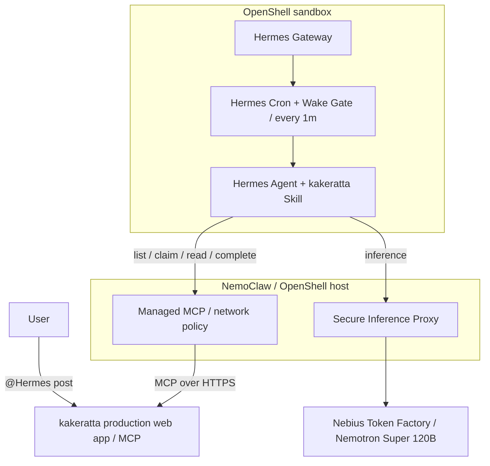

# NemoClaw × Hermes Agent × Nebius Token Factory × kakeratta

## Autonomous personal AI agent integration and verification report

[README](../README.md) · [日本語](nemoclaw-hermes-integration_ja.md) · [Hermes setup](hermes.md)

> [!NOTE]
> This report records the verification of the earlier integration, in which Hermes was a persona of its own and took requests through `list_tasks` / `claim_task` / `complete_task`. Hermes now plans turns for the personas whose planner is set to the external agent, through `list_asks` / `claim_ask` / `submit_workflow`; see [Hermes setup](hermes.md). The sandbox, network policy and inference findings below still apply. The every-minute Wake Gate now also tells kakeratta that Hermes is there: with no MCP call for the claim wait (3 minutes by default), kakeratta plans the turns itself until Hermes calls again.

This report documents an integration in which Hermes Agent runs inside NVIDIA NemoClaw / OpenShell, uses Nebius Token Factory for inference, and retrieves, processes, and replies to requests through kakeratta's MCP server. The goal was to delegate work safely from a production personal AI application to an autonomous agent and return the result to the original conversation. Credentials, workspace IDs, access tokens, and internal task IDs are intentionally omitted.

## Architecture and responsibilities



| Component | Responsibility |
| --- | --- |
| kakeratta | Manages conversations, tasks, MCP authentication, and access scope |
| Hermes Agent | Interprets tasks, works with its own tools, and returns results according to the Skill |
| NemoClaw / OpenShell | Manages the sandbox, Gateway lifecycle, network policy, and inference route |
| Nebius Token Factory | Provides model inference |

kakeratta does not start the Hermes process, and Hermes does not access kakeratta's database directly. MCP is the boundary between them. Model inference goes through the OpenShell proxy. The MCP connection uses a separate authentication key.

## MCP and autonomous execution

The production connection exposed 11 MCP tools during verification.

| Tool | Purpose |
| --- | --- |
| `list_personas` | List AI personas |
| `get_timeline` | Read the timeline |
| `get_thread` | Read a conversation thread |
| `list_notes` / `read_note` | List and read persona notes |
| `write_note` | Save notes in Hermes's own area |
| `list_tasks` | Inspect pending and claimed tasks |
| `claim_task` | Claim a task exclusively |
| `cancel_task` | Cancel a task |
| `complete_task` | Save a result and post it to the original thread |
| `post_report` | Post an unsolicited report from Hermes |

The Hermes connection test succeeded and discovered all 11 tools. Within Hermes, their callable names have the `mcp__kakeratta__` prefix, such as `mcp__kakeratta__list_tasks`.

The distributed [kakeratta Skill](../frontend/public/integrations/hermes/kakeratta/SKILL.md) defines the following workflow, and names the required arguments of every `mcp__kakeratta__*` call so the model cannot omit them (`complete_task` takes `taskId`, `claimId`, and `text`; an empty `text` completes quietly without posting). A one-minute Hermes cron job runs with the Wake Gate script attached:

```text
list_tasks → claim_task → get_thread → reason / use tools → complete_task
```

Initially, Hermes returned `[SILENT]` when there was no task; an idle run took about 3 seconds. After switching to Super 120B, this still invoked the model every minute. The current setup uses a **Wake Gate** pre-check script attached to the cron job. It returns `{"wakeAgent": false}` when there are no tasks, skipping the agent run. One verified idle tick took about 0.06 seconds with zero LLM calls. If tasks exist, or the pre-check has a connection error, it returns `{"wakeAgent": true}`. The [distributed script](../frontend/public/integrations/hermes/kakeratta/scripts/check_kakeratta_gate.py) is attached to the cron job.

Additionally, the Wake Gate script integrates a **daily skill auto-update mechanism**. Once per day, it resolves the distribution origin from Hermes's MCP configuration in `config.yaml`, fetches the latest `SKILL.md`, and atomically updates the local skill when the distributed `metadata.version` is updated (see "Daily skill auto-update via Wake Gate" below). *Later superseded:* fetching `SKILL.md` from a separate path of the same host was refused by an OpenShell policy that allows only the MCP path, so the skill and the Wake Gate itself now update through MCP - `list_asks` reports their versions and `get_integration` returns them; see [Hermes setup](hermes.md).

The final architecture removed the custom polling script and output-diff monitor used earlier. That monitor could leave a failed task stuck: when the pending task ID matched the previous output, it treated the result as unchanged and did not start Hermes again. The Wake Gate checks `list_tasks` on each run.

The design principle from this failure is that **unfinished tasks must remain visible for rechecking until they are completed**. Cron checks tasks on every run, regardless of whether the list changed. A pending task can be picked up on the next run. For a claimed task, checking its state is separate from repeating an external action whose outcome may be unknown; see [Hermes setup and retries](hermes.md#if-hermes-crashes-after-claiming).

## Problems encountered during integration

| Problem | Cause and resolution |
| --- | --- |
| Adding MCP stopped the entire sandbox | Hermes Gateway returned exit code `75` to request a restart, but `set -e` in `start.sh` treated it as a normal process failure. The startup script was changed to catch `75` and restart only the Gateway. |
| Noninteractive onboarding chose the wrong inference provider | Explicitly passing `NEMOCLAW_PROVIDER="custom"`, `NEMOCLAW_MODEL="nvidia/Nemotron-3_5-Lightning"`, and `NEMOCLAW_ENDPOINT_URL="https://api.tokenfactory.nebius.com/v1"` selected Nebius as the OpenAI-compatible custom endpoint. |
| The smaller model wandered into unnecessary tool discovery and shell commands | `--tool-disclosure direct` exposed tool definitions directly, and the Skill named the official `mcp__kakeratta__*` tools and their order. |
| Cron stopped running inference after a model change | Hermes logged `global inference config drifted since this job was created` and skipped the run. Explicitly pinning the model resolved it. This protects scheduled jobs from unintended model and cost changes. |
| MCP returned `401 Unauthorized` | OpenShell's L7 proxy expects generation-scoped placeholders (e.g., `openshell:resolve:env:v<REVISION>_KAKERATTA_MCP_TOKEN`). If the revision in `config.yaml` does not match the active provider revision, OpenShell skips token substitution and forwards the unresolved placeholder string to kakeratta. Inspecting the active provider environment revision and updating the placeholder in `config.yaml` restored authentication. |
| NemoClaw CLI commands hang indefinitely | After an interrupted sandbox recreation, stale lock files (`~/.nemoclaw-portable-host.lock` and locks under `~/.nemoclaw/state/mcp-lifecycle-locks/`) remained with defunct owner PIDs. Each `nemoclaw` command blocked waiting for lock release. Checking for active PIDs and pruning orphan locks restored immediate responsiveness. |
| Sandbox stuck in `Phase: Error` (Reconciliation deadlock) | When a container stopped during Gateway lifecycle changes, OpenShell Gateway recorded `Phase: Error`. Even after `docker start`, `openshell sandbox stop` failed (requiring `Ready`) and `start` failed (requiring `Stopped`). Reconciling the sandbox status payload back to `Ready` in the Gateway database (`openshell.db`) cleared the deadlock and restored CLI execution. It recurred when a SIGTERM-killed `nemoclaw-hermes-start.service` (its stale `gateway-route:nemoclaw` lock under `~/.nemoclaw/state/mcp-lifecycle-locks/`) coincided with a Gateway restart: the container kept running and Hermes stayed healthy, but the control plane kept reporting `Error`, and `nemoclaw <name> start`, `recover`, and `doctor --fix` cannot clear a running-container `Error` (`docker restart` did not clear it either). Working byte-level fix: stop `nemoclaw-hermes-start.service`, remove stale locks whose owner PID is dead, back up `openshell.db`, flip the sandbox object payload's phase byte from `SANDBOX_PHASE_ERROR` (enum 3) to `SANDBOX_PHASE_READY` (enum 2), restart `nemoclaw-openshell-gateway.service`, and confirm `openshell sandbox list` shows `Ready`. |
| NemoClaw / sandbox does not start automatically on host reboot | Caused by a Gateway database path mismatch and NemoClaw's authority validation failsafe (`GatewayAuthorityError`). Running the Gateway as a systemd user service introduced an authority drift against the onboarding checkpoint (`standalone`), causing port-forward recovery probes to be rejected. Resolved by configuring the official environment file (`~/.config/openshell/gateway.env`), using the managed service (`nemoclaw-openshell-gateway.service`), and reconciling the authority source in `onboard-session.json` to `"packaged-service"`. |
| Web search and page extraction blocked with `403 Forbidden` causing hallucinations | OpenShell's L7 proxy default egress policy blocked outbound traffic to search/extraction endpoints (Keenable: `api.keenable.ai`, Exa: `mcp.exa.ai`, and external websites). After failing external research, the agent hallucinated confident but false answers and stubbornly defended them in the thread. Resolved by applying the `personal-open-internet` policy preset (`nemoclaw <name> policy add personal-open-internet --yes`) to permit port 80/443 egress. In a later sandbox generation this preset no longer coexisted with the host-specific policies (see the next row), so egress was opened per host instead. |
| Egress approvals never took effect | Approvals surfaced by OpenShell stayed as pending `draft_policy_chunk` objects and never merged into the active policy; the first merge was rejected because adding `/usr/bin/python3.13` to the `brew` policy would grant that binary undeclared authorization for `formulae.brew.sh`. Treat an approval as applied only after verifying the live policy (`openshell policy get -g <gateway> <sandbox> --full -o json`, or `nemoclaw <name> policy explain`). |
| `personal-open-internet` rejected next to host-specific policies | OpenShell refuses a policy document whose endpoints overlap on the same port with conflicting metadata (`network endpoint ambiguity validation failed`: `tls=skip` vs auto, differing `allowed_ips`, protocol/enforcement). The broad `<any-host>:80,443` endpoint conflicts with `brew`, `huggingface`, `npm`, `pypi`, `nvidia`, `nous_research`, and `mcp_bridge_kakeratta`. Replaced it with per-host endpoints for the keyless search backends via `openshell policy update --add-endpoint` (see the egress section below). |
| Applying a policy preset during `Phase: Error` wiped the composed policy | `nemoclaw <name> policy add personal-open-internet --yes` reported success while the sandbox was in `Phase: Error`, but the written base contained only the new preset; the composed entries (`mcp_bridge_kakeratta`, `managed_inference`, `nvidia`, `nous_research`, and the user presets) were dropped. kakeratta MCP calls then failed with `Server returned an error response` because the credential binding was gone and the unresolved `openshell:resolve:env:...` placeholder was forwarded. After restoring `Ready`, the full pre-incident document was rewritten with `openshell policy set --policy <file> --wait <name>`; the restored revision hash matched the pre-incident revision exactly. |
| First `complete_task` call rejected for missing arguments | Nemotron Super 120B omitted `text` (and sometimes `claimId`) on the first `mcp__kakeratta__complete_task` call; Hermes rejected it locally (`The tool was NOT invoked`) and the retry roughly 5 seconds later succeeded, adding latency to every task. The Skill now names all three arguments (`taskId`, `claimId`, `text`), requires them on every call including retries, and forbids an empty `text`, which completes quietly without posting. |
| Skill updates required manual reinstallation in each sandbox | Revisions to `SKILL.md` (such as reply formatting guidelines or error diagnostic instructions) required manual reinstallation inside the container. Integrated daily auto-update into `check_kakeratta_gate.py` to compare `metadata.version` and fetch over the existing `mcp_bridge_kakeratta` egress (`kakeratta.net:443`), eliminating maintenance overhead while keeping update failures silent and non-blocking. |

### Opening egress for web search and page extraction (preventing hallucinations)

To ensure Hermes can accurately look up external and up-to-date documentation before answering, it needs egress to its keyless web search and page extraction backends: Tavily (`api.tavily.com`), Exa (`mcp.exa.ai`), Parallel (`search.parallel.ai`), Firecrawl (`api.firecrawl.dev`), Keenable (`api.keenable.ai`), Brave (`api.search.brave.com`), and DuckDuckGo (`duckduckgo.com`, `html.duckduckgo.com`).

However, in a default sandbox, OpenShell's L7 proxy rejects all non-whitelisted egress with `403 Forbidden`. Certain models (especially code- or reasoning-tuned) will not concede when a search fails; instead, they hallucinate speculative facts from fragment words, state them with high confidence, and stubbornly reject user corrections.

Two ways to open the egress:

1. **Broad**: apply the `personal-open-internet` preset to open outbound TCP ports 80 and 443. This is the simplest option, but it only validates when the sandbox has no host-specific endpoints that conflict with a broad `<any-host>:80,443` rule (see the ambiguity row above), and it must be applied while the sandbox is `Ready`. Afterwards, confirm that the composed entries (`mcp_bridge_kakeratta`, `managed_inference`) survived in the live policy.

   ```bash
   nemoclaw <name> policy add personal-open-internet --yes
   ```

2. **Per host** (used in the current setup): add explicit endpoints for the backends plus any sites Hermes is expected to fetch. `openshell policy update` merges incrementally and never replaces the rest of the document, so it composes safely with the host-specific presets:

   ```bash
   openshell policy update -g <gateway> <sandbox> \
     --add-endpoint "api.tavily.com:443:full" \
     --add-endpoint "mcp.exa.ai:443:full" \
     --add-endpoint "search.parallel.ai:443:full" \
     --add-endpoint "api.firecrawl.dev:443:full" \
     --add-endpoint "api.keenable.ai:443:full" \
     --add-endpoint "api.search.brave.com:443:full" \
     --add-endpoint "duckduckgo.com:443:full" \
     --add-endpoint "html.duckduckgo.com:443:full" \
     --binary "/usr/local/bin/hermes" --binary "/usr/bin/python3*" --binary "/opt/hermes/.venv/bin/python*" \
     --wait
   ```

   Add the same kind of endpoint for specific sites you expect `web_extract` to fetch (for example `openclaw.ai:443:full` and `www.openclaw.ai:443:full`). To verify what is actually active, run `nemoclaw <name> policy explain` or `openshell policy get -g <gateway> <sandbox> --full -o json`; approved-but-unapplied requests remain visible only as pending drafts and do not count.

### Restore the policy document after an accidental clobber

`policy set` writes a complete base document, so a write prepared from a wrong or empty base drops every policy that is not part of it — including provider-composed entries such as `mcp_bridge_kakeratta` and `managed_inference`. When that happens:

1. Restore the sandbox phase to `Ready` first (see the `Phase: Error` row above); writes are rejected with `sandbox is not ready` while it is not.
2. Export the full pre-incident policy (`openshell policy get --full -o json`, or a `nemoclaw <name> policy get` export kept beforehand), extract its `policy` object, and write it back with `openshell policy set -g <gateway> --policy <file.yaml> --wait <sandbox>`.
3. Confirm the result with `openshell policy list -g <gateway> <sandbox>`: the restored revision's hash must equal the pre-incident revision.
4. Re-add any host endpoints that were introduced after the exported snapshot.

Prefer `openshell policy update --add-endpoint` for additions on a healthy sandbox; it merges instead of replacing.

### Keep the Gateway restart fix across sandbox recreation

Hermes Gateway exits with **exit code `75` (EX_TEMPFAIL)** when registering or modifying managed MCP providers to request a process reload.
However, NemoClaw's standard container entrypoint script (`/usr/local/bin/nemoclaw-start`) treats this exit code as a fatal failure (due to `set -e` or unhandled return codes), causing the entire container process to terminate. This stops the sandbox immediately after MCP registration and frequently triggers `exec relay closed` or OpenShell Gateway database `Phase: Error` reconciliation deadlocks.

Patching `/usr/local/bin/nemoclaw-start` inside a running container is only temporary; recreating the sandbox (`recreate` or re-onboarding) overwrites it with the base image. To resolve this permanently, build a **custom Docker image that catches exit code 75 and restarts only the Gateway process**.

Below is the verified, reproducible procedure used in this integration.

#### 1. Prepare the build directory and entrypoint script
Create a build directory on the host (e.g. `~/.config/nemoclaw/hermes-image/`), extract the startup script from the base container, and make it executable:

```bash
mkdir -p ~/.config/nemoclaw/hermes-image
cd ~/.config/nemoclaw/hermes-image

# Extract the original startup script from the running container
docker cp <hermes_container_id>:/usr/local/bin/nemoclaw-start ./start.sh

# Make executable (mandatory; otherwise the container fails to start with Permission Denied)
chmod 755 start.sh
```

#### 2. Modify `start.sh` (Add the exit code 75 restart loop)
Wrap the Hermes Gateway process wait logic in a `while true; do ... done` loop. When the process exits with code `75`, restart only the Gateway process and continue the monitoring loop instead of terminating the container:

```bash
# Modified section in start.sh (excerpt)
while true; do
  if wait "$GATEWAY_PID"; then
    rc=0
  else
    rc=$?
  fi

  # Catch exit code 75 (Hermes restart request) and restart process only
  if [ "$rc" -eq 75 ]; then
    echo "[gateway] Hermes requested restart (exit code 75). Restarting gateway..." >&2
    launch_hermes_gateway_current_user || exit 1
    wait_for_hermes_gateway_internal "$GATEWAY_PID" || exit 1
    ensure_hermes_supervised_auxiliaries || exit 1
    continue
  fi

  # Exit on all other return codes
  exit "$rc"
done
```

#### 3. Create the `Dockerfile`
Specify a pinned, verified base image digest and copy the patched `start.sh` over `/usr/local/bin/nemoclaw-start`:

```dockerfile
# ~/.config/nemoclaw/hermes-image/Dockerfile
FROM ghcr.io/nvidia/nemoclaw/hermes-sandbox@sha256:73fec1566a2cdf859a8c2832f77f90d7101755843847ecf78d5cd270f92790ed
ARG NEMOCLAW_TOOL_DISCLOSURE=direct
ENV NEMOCLAW_TOOL_DISCLOSURE=${NEMOCLAW_TOOL_DISCLOSURE}

# Preserve Hermes gateway restarts (exit 75) across sandbox recreation
COPY --chown=root:root start.sh /usr/local/bin/nemoclaw-start
```

#### 4. Build and onboard with NemoClaw
Pass the Dockerfile to `nemoclaw onboard` using the `--from` option. The CLI automatically invokes Docker build and provisions the sandbox from the custom image:

```bash
nemoclaw onboard --from ~/.config/nemoclaw/hermes-image/Dockerfile --tool-disclosure direct
```

#### 5. Verification
After the container starts, verify that the exit code 75 handling is present inside `/usr/local/bin/nemoclaw-start`:

```bash
nemoclaw hermes-sandbox exec -- grep "exit code 75" /usr/local/bin/nemoclaw-start
```

Afterward, confirm that the sandbox reaches `Ready` (`openshell sandbox list -g <gateway>`), managed kakeratta MCP is enabled in `hermes mcp list`, and the skill, Wake Gate script, and cron job are active. Store MCP credentials in OpenShell rather than in the Dockerfile, skill, or cron command.

### Daily skill auto-update via Wake Gate

> Superseded on 2026-09-26: the skill and the Wake Gate now update over MCP (see "Moving to asks, and updating over MCP" below). This section records the earlier daily mechanism.

The Hermes Skill (`SKILL.md`) evolves alongside application improvements—such as formatting rules (GFM Markdown / HTML documents) or stricter error diagnostic requirements (mandatory `complete_task` arguments and failure reporting). Because the skill is installed as static files under Hermes's home directory (`/sandbox/.hermes/skills/kakeratta`), updates previously required manual reinstallation inside each sandbox container.

To automate this maintenance, the Wake Gate pre-check script (`check_kakeratta_gate.py`) includes a daily skill auto-update mechanism:

1. **Trigger and frequency**:
   On each minute's wake check, the script consults its state flag (`~/.hermes/state/kakeratta_gate_skill_check`). It executes the check only when the state indicates it has not run yet today (once per day).
2. **Dynamic origin resolution**:
   The script inspects `mcp_servers.kakeratta.url` in Hermes's `config.yaml`, extracts the origin (`https://kakeratta.net`), and fetches the distribution path (`integrations/hermes/kakeratta/SKILL.md`) over HTTPS.
3. **Network policy alignment**:
   Although sandbox egress is strictly restricted, the skill's origin matches the managed MCP endpoint over port 443. It falls directly under the egress already permitted by OpenShell's composed `mcp_bridge_kakeratta` policy, requiring **no additional egress rules**.
4. **Version comparison and atomic replacement**:
   The script parses `metadata.version` from the fetched markdown frontmatter. If it differs from the installed copy, the new text is written to a temporary file (`.md.tmp`) and atomically replaced via `os.replace`.
5. **Fail-safe resilience**:
   If network glitches or download failures occur, the state flag is not updated, allowing retry on the subsequent cron tick. Any exceptions during skill update are silently caught, guaranteeing that the primary wake decision (`wakeAgent: true/false`) is never interrupted (fail-open).

> [!NOTE]
> The script only updates `SKILL.md`, not itself. Manual placement into `/sandbox/.hermes/scripts/check_kakeratta_gate.py` is required upon initial sandbox onboarding or when modifying the script's internal logic.

### Ensure reliable auto-start on host reboot

To maintain continuous Hermes and kakeratta operation after a host Linux machine reboot, systemd user services are typically configured. Be aware of two critical operational pitfalls:

#### 1. Waiting for Docker at boot (preventing `Phase: Error` deadlocks)
systemd user services (`systemctl --user`) cannot directly declare `Requires=` dependencies on root-level system units such as `docker.service`.
Consequently, at system boot, user services may start seconds before the Docker daemon is responsive, failing with `Failure layer: docker_unreachable`.
When this happens, OpenShell Gateway marks the sandbox as **`Phase: Error`**. Once in `Error`, OpenShell rejects all subsequent start/stop commands with `sandbox must be Stopped to start (current phase: Error)`, creating an unrecoverable deadlock.

**Mitigation**: Always introduce a pre-execution wait loop in `ExecStartPre` to block service startup until the Docker daemon responds:

```bash
# ExecStartPre helper script (nemoclaw-wait-docker.sh)
until docker info >/dev/null 2>&1; do
  sleep 1
done
```

#### 2. Reconciling NemoClaw Gateway authority (`GatewayAuthorityError`)
When `nemoclaw onboard` is performed interactively from the CLI, NemoClaw records the gateway authority source as `standalone` in `~/.nemoclaw/onboard-session.json`.
Running the gateway as a systemd user service (`packaged-service`) causes an authority mismatch. NemoClaw's security verification detects this change and refuses port-forward recovery with `host port ... is held by a listener that NemoClaw cannot attribute to this sandbox's OpenShell forward`.

**Mitigation**:
- Use the official managed service unit **`nemoclaw-openshell-gateway.service`** with the `# NEMOCLAW_MANAGED_OPENSHELL_GATEWAY=1` header.
- Store configuration in `~/.config/openshell/gateway.env` (`0600`), ensuring `OPENSHELL_DATA_DIR` points to the correct database directory.
- Reconcile `checkpoint.gatewayAuthority.value.source` to `"packaged-service"` in `~/.nemoclaw/onboard-session.json`.


Early tests with Nemotron-3.5-Lightning also produced incorrect MCP arguments, malformed JSON, repeated tool calls, and unnecessary configuration checks in complex multistep flows. A temporary design moved deterministic task management into a Python worker. It was stable but required custom orchestration code. The final design uses Hermes's native **Skill + Cron + MCP** capabilities, with direct tool disclosure and explicit Skill instructions.

## End-to-end verification

The production site at `https://kakeratta.net` received this post:

> `@Hermes こんにちは！自己紹介して`

The autonomous path was:

```text
post → Cron → list_tasks → claim_task → get_thread
     → Nemotron-3.5-Lightning response generation
     → complete_task → reply in the original thread
```

The user posted at **09:08:53 UTC** and Hermes replied at **09:09:13 UTC**. This run completed in about **20 seconds**, including the one-minute scheduling interval. No one operated the Hermes CLI or management UI during the run. This is one observed run, not a general latency guarantee.

Development tested both `NousResearch/Hermes-4-405B` and `nvidia/Nemotron-3_5-Lightning`. In this environment, a simple prompt sometimes took about 45 seconds with the former and about 2–3 seconds with the latter. Later, Lightning sometimes attempted unnecessary configuration changes and long troubleshooting loops after tool or network errors. Operation was therefore switched to **`nvidia/nemotron-3-super-120b-a12b`** for tasks requiring more complex context and tool decisions.

In a further Super 120B test, Hermes detected a user's model question through `list_tasks`, claimed it, performed a web search, and posted a response to the original thread with `complete_task`. This verified autonomous processing that included external research. Specific model specifications and benchmark figures in the generated answer are not treated as findings of this integration test.

The Skill's error handling was also revised. When a tool or external API fails after a task is claimed, Hermes is instructed to use `complete_task` to tell the user what failed and why. A reply cannot be guaranteed if `complete_task` itself is unreachable; the connection must be checked after recovery. A later revision additionally names every `complete_task` argument explicitly, because the model's first call was repeatedly rejected for omitting `text` (see the problems table).

## Moving to asks, and updating over MCP (2026-09-26)

On 2026-09-26 the integration changed from Hermes being a persona of its own (`list_tasks` / `claim_task` / `complete_task`) to Hermes planning the turns of personas whose planner is the external agent (`list_asks` / `claim_ask` / `read_for_ask` / `submit_workflow` / `release_ask`). The server kept `list_tasks` for older Wake Gates and retired the other task tools.

**What went wrong the same day.** Every externally planned turn fell back to the built-in model with `claim timeout`. The production logs showed the Wake Gate finding the pending ask and Hermes waking within seconds, but the claim never succeeded. Hermes was still running the older skill and Wake Gate: the gate found the ask through the kept `list_tasks`, and the skill called the retired `claim_task`, which the server rejected as `Unknown tool`. The daily skill update had not helped, because it fetched `SKILL.md` with a plain GET from another path of the same host, and the OpenShell policy allows only the MCP path there; the failure was silent, and the Wake Gate did not update itself.

**What changed.**

- A retired task tool now answers that the kakeratta skill is out of date, with the URL of the current `SKILL.md` and the tools to use, instead of only `Unknown tool`.
- `list_asks` carries the versions of the distributed skill and Wake Gate (`integration: {skill, gate}`), and a new MCP tool, `get_integration`, returns both files. When either version differs from what is installed, the Wake Gate replaces the skill and itself through a temporary file, over the MCP endpoint it already calls. Updates and failures are written to stderr. No other host, path or daily state file is involved.

**Verified.** The Wake Gate was replaced by hand once, from version 1 to 2, and the Hermes Gateway restarted; MCP then registered 12 tools, `get_integration` among them. On its next run the Wake Gate found the skill behind and updated it through `get_integration` from version 6 to 7. The sandbox now runs skill 7 and Wake Gate 2, and both follow later versions by themselves.

As of this record, a turn planned end to end through `claim_ask` and `submit_workflow` under NemoClaw has not yet been confirmed; it will be added here once it is.

## Verified scope and possible extensions

Verification covered Hermes startup inside OpenShell, inference through Nebius, production kakeratta MCP access, discovery of all 11 tools, Skill installation and one-minute Cron execution, skipping LLM calls on idle ticks with the Wake Gate, task detection and claim, conversation retrieval, autonomous inference, web search, and automatic posting to the original thread.

The final kakeratta-side pieces are **MCP Server + Hermes Skill + Wake Gate script**. Hermes owns autonomous execution, NemoClaw / OpenShell controls the execution boundary, and Nebius Token Factory provides inference. No custom daemon or orchestration service is needed.

The same boundary can support research, file conversion, code execution, data analysis, other MCP services, and reports back to the timeline. External actions follow the approval policy on the Hermes side; they do not pass through kakeratta's usual workflow review.
