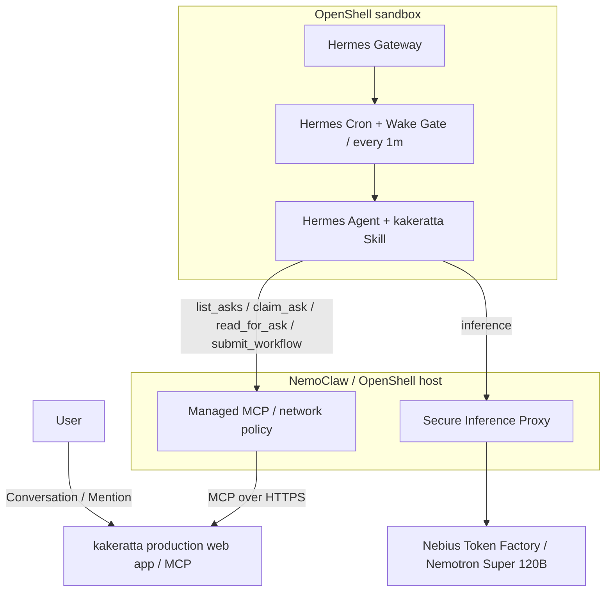

# NemoClaw × Hermes Agent × Nebius Token Factory × kakeratta

## Autonomous External Planner Integration and Verification Report

[README](../README.md) · [日本語](nemoclaw-hermes-integration_ja.md) · [Hermes setup](hermes.md)

This report documents an integration in which Hermes Agent runs inside NVIDIA NemoClaw / OpenShell, acts as an external **planner** (thinking engine) for designated kakeratta personas, uses Nebius Token Factory for inference, and safely plans turns, formulates workflows, and keeps itself updated via kakeratta's MCP server. Credentials, workspace IDs, access tokens, and internal task IDs are intentionally omitted.

> [!NOTE]
> **Protocol change after this verification.** The end-to-end run recorded here used the earlier protocol (skill v11), in which Hermes submitted a whole workflow (`submit_workflow`: the remark, notes, schedules and tool calls). Hermes now submits only the answer (`submit_answer`, skill v12); kakeratta plans the schedule, action and note phases with its own model, reviews schedules and actions, runs them, and then publishes the answer. The current protocol is covered by kakeratta's automated tests but **has not been re-verified end to end in this NemoClaw environment**. The sandbox, credential, network-policy, Gateway and Wake Gate findings below still apply. See the [Hermes Agent Setup Guide](hermes.md) for the current protocol.

## Architecture and responsibilities



| Component | Responsibility |
| --- | --- |
| kakeratta | Manages conversations, asks, MCP authentication, workflow validation and execution |
| Hermes Agent (Planner) | Interprets asks according to Skill, performs lookups, and returns persona workflows |
| NemoClaw / OpenShell | Isolates the sandbox, manages Gateway lifecycle, network policy, and inference proxy |
| Nebius Token Factory | Provides high-performance model inference (`nvidia/nemotron-3-super-120b-a12b`) |

kakeratta does not start the Hermes process, and Hermes does not access kakeratta's database directly. MCP (Model Context Protocol) is the boundary between them. Model inference routes through OpenShell's proxy, keeping credentials completely hidden. The recurring Wake Gate also serves as a heartbeat: if no MCP calls arrive within the claim wait window (3 minutes by default), kakeratta's built-in model answers instead.

## MCP and autonomous planning

For the full specification of Kakeratta's current MCP tools (`list_asks`, `claim_ask`, `read_for_ask`, `submit_answer`, etc.), the answering loop, and Wake Gate's zero-token standby and self-updating mechanisms, refer to the [**Hermes Agent Setup Guide**](hermes.md#mcp-and-autonomous-planning).

Key aspects of operating MCP under NemoClaw / OpenShell include:

- **L7 Proxy and Credential Isolation**: Kakeratta does not run the Hermes process, and Hermes cannot access Kakeratta's database directly. MCP (Model Context Protocol) is the sole boundary. Tokens are kept in OpenShell's credential vault and dynamically injected by the L7 proxy using generation-scoped placeholders (`openshell:resolve:env:...`).
- **Autonomous Updates under Egress Restrictions**: Initial sandbox policies block arbitrary outbound HTTP requests. However, the Wake Gate script leverages the `get_integration` MCP tool across the already-authorized `kakeratta.net` route to self-update the Skill and itself without requiring external web access.
- **Heartbeat and Fall-through**: Every 1-minute `list_asks` call by Wake Gate acts as a liveness heartbeat. If MCP calls cease during the claim wait window (3 minutes by default), Kakeratta's built-in model answers automatically (fall-through), preventing turns from hanging even during sandbox outages.

The following sections document issues encountered during verification and long-running operation. They are not required for a normal installation; use them as troubleshooting references if the corresponding symptoms occur. For the normal connection procedure, see [Using Hermes Agent as a persona's planner](hermes.md).

## Key operational issues resolved

| Observed issue | Root cause and resolution |
| --- | --- |
| Container stops on MCP registration | Hermes Gateway exits with code `75` (EX_TEMPFAIL) to request a process restart on MCP changes. Default startup scripts treat this as fatal under `set -e`. Resolved by building a custom image with a restart loop on code 75. |
| Non-interactive onboarding picks unexpected provider | Specified `NEMOCLAW_PROVIDER="custom"`, `NEMOCLAW_MODEL="nvidia/nemotron-3-super-120b-a12b"`, and `NEMOCLAW_ENDPOINT_URL="https://api.tokenfactory.nebius.com/v1"` explicitly to route through Nebius. |
| MCP tool calls fail due to JSON string escape corruption | When Progressive Tool Disclosure (`tools.tool_search.enabled: true`) is active, Hermes hides MCP tools behind a `tool_call` wrapper expecting arguments as a stringified JSON blob. Complex nested workflow schemas failed during string escaping. Resolved by disabling Progressive Tool Disclosure via `tools.tool_search.enabled: "off"` in `/sandbox/.hermes/config.yaml` to expose tools directly (Direct disclosure). |
| MCP returned `401 Unauthorized` | OpenShell's L7 proxy expects generation-scoped placeholders (e.g., `openshell:resolve:env:v<REVISION>_KAKERATTA_MCP_TOKEN`). Synchronizing the placeholder revision in `config.yaml` with the provider environment revision restored authentication. |
| NemoClaw CLI commands hang indefinitely | Orphan lock files (`~/.nemoclaw-portable-host.lock`) remained with defunct owner PIDs after interrupted operations. Pruning stale locks whose owner PIDs were dead restored responsiveness. |
| Sandbox stuck in `Phase: Error` (Reconciliation deadlock) | Abrupt container exit caused Gateway to record `Phase: Error`. OpenShell CLI `start` requires `Stopped` and `stop` requires `Ready`, creating a deadlock. Reconciled the sandbox state directly in `openshell.db` back to `Ready` (2) to recover. |
| Sandbox does not start on host reboot (`GatewayAuthorityError`) | Running the Gateway as a systemd user service drifted authority against the onboarding checkpoint (`standalone`). Resolved by configuring `~/.config/openshell/gateway.env` (`0600`), using `nemoclaw-openshell-gateway.service`, and reconciling authority to `"packaged-service"`. |
| Host shutdown triggers `Phase: Error` deadlock on subsequent boot | Abrupt host shutdown killed the container with SIGTERM (exit code 143) without clean stopping. Resolved by adding `ExecStop=/home/takeshy/.local/bin/nemoclaw hermes-sandbox stop` and `TimeoutStopSec=60` to `nemoclaw-hermes-start.service` to ensure clean transition to `Stopped`. |
| Web search and page extraction blocked with `403 Forbidden` causing hallucinations | OpenShell's L7 proxy default egress policy blocked search backends. After failed research, the agent hallucinated confident but false answers. Resolved by whitelisting search/extraction endpoints per host. |
| Cron stops executing inference after model change | Hermes suspended execution with `global inference config drifted since this job was created`. Pinning the model explicitly in the job resolved it. This is a built-in safety feature against unintended drift and cost spikes. |
| Granted egress approvals never take effect | Approvals surfaced by OpenShell may remain pending as `draft_policy_chunk` and not merge into the active policy. Never consider an approval active until confirmed directly via `openshell policy get` or `nemoclaw policy explain`. |
| `personal-open-internet` rejected next to host-specific policies | Overlapping endpoints on port 443 with differing metadata trigger `network endpoint ambiguity validation failed`. Resolved by adding keyless endpoints individually per host via `openshell policy update --add-endpoint` instead of broad opening. |
| Applying policy preset during `Phase: Error` wipes composed policy | Running `policy add` while the sandbox is in `Phase: Error` drops composed entries (`mcp_bridge_kakeratta`, `managed_inference`), breaking token resolution. Resolved by restoring the pre-incident policy backup via `openshell policy set --policy <file> --wait`. |

### Opening egress for web search and page extraction (preventing hallucinations)

To ensure Hermes can accurately look up external and up-to-date documentation before planning, it needs egress to keyless search and page extraction backends: Tavily (`api.tavily.com`), Exa (`mcp.exa.ai`), Parallel (`search.parallel.ai`), Firecrawl (`api.firecrawl.dev`), Keenable (`api.keenable.ai`), Brave (`api.search.brave.com`), and DuckDuckGo (`duckduckgo.com`, `html.duckduckgo.com`).

Initial sandbox policies block external egress, risking hallucinations when models guess instead of researching. Add per-host endpoints via `openshell policy update`:

```bash
openshell policy update -g <gateway> <sandbox> \
  --add-endpoint "api.tavily.com:443:full" \
  --add-endpoint "mcp.exa.ai:443:full" \
  --add-endpoint "search.parallel.ai:443:full" \
  --add-endpoint "api.firecrawl.dev:443:full" \
  --add-endpoint "api.keenable.ai:443:full" \
  --add-endpoint "api.search.brave.com:443:full" \
  --add-endpoint "duckduckgo.com:443:full" \
  --add-endpoint "html.duckduckgo.com:443:full" \
  --binary "/usr/local/bin/hermes" --binary "/usr/bin/python3*" --binary "/opt/hermes/.venv/bin/python*" \
  --wait
```

### Restoring policy after accidental removal

`policy set` rewrites the base document entirely. Writing an incomplete base removes composed entries (`mcp_bridge_kakeratta`, `managed_inference`, etc.). To recover:

1. Return the sandbox to `Ready` first (writes during non-ready states fail with `sandbox is not ready`).
2. Extract the complete pre-incident policy from exports or backups, and restore via `openshell policy set -g <gateway> --policy <file.yaml> --wait <sandbox>`.
3. Confirm revision hashes match using `openshell policy list -g <gateway> <sandbox>`.
4. Re-add any per-host endpoints added after the backup.

Prefer `openshell policy update --add-endpoint` for delta changes on running sandboxes.

### Keep the Gateway restart fix across sandbox recreation

Hermes Gateway exits with **code 75** on configuration reloads. Standard NemoClaw startup scripts exit abruptly on code 75. Wrap the wait call in a restart loop:

```bash
# Extract and patch start.sh from container
docker cp <hermes_container_id>:/usr/local/bin/nemoclaw-start ./start.sh
chmod 755 start.sh
```

Patch `start.sh` wait loop:

```bash
while true; do
  if wait "$GATEWAY_PID"; then
    rc=0
  else
    rc=$?
  fi

  if [ "$rc" -eq 75 ]; then
    echo "[gateway] Hermes requested restart (exit code 75). Restarting gateway..." >&2
    launch_hermes_gateway_current_user || exit 1
    wait_for_hermes_gateway_internal "$GATEWAY_PID" || exit 1
    ensure_hermes_supervised_auxiliaries || exit 1
    continue
  fi

  exit "$rc"
done
```

Create a custom Dockerfile and onboard:

```dockerfile
# ~/.config/nemoclaw/hermes-image/Dockerfile
FROM ghcr.io/nvidia/nemoclaw/hermes-sandbox@sha256:73fec1566a2cdf859a8c2832f77f90d7101755843847ecf78d5cd270f92790ed
ARG NEMOCLAW_TOOL_DISCLOSURE=direct
ENV NEMOCLAW_TOOL_DISCLOSURE=${NEMOCLAW_TOOL_DISCLOSURE}

COPY --chown=root:root start.sh /usr/local/bin/nemoclaw-start
```

```bash
nemoclaw onboard --from ~/.config/nemoclaw/hermes-image/Dockerfile --tool-disclosure direct
```

### Automatic startup and deadlock avoidance on host reboot

For resilient 24/7 background operation across host reboots:

#### 1. Wait for Docker on boot
Prevent `Failure layer: docker_unreachable` by waiting for Docker in `ExecStartPre`:

```bash
# nemoclaw-wait-docker.sh
until docker info >/dev/null 2>&1; do
  sleep 1
done
```

#### 2. Authority reconciliation (`GatewayAuthorityError`)
Use managed `nemoclaw-openshell-gateway.service`, configure `~/.config/openshell/gateway.env` (`0600`), and set `checkpoint.gatewayAuthority.value.source` to `"packaged-service"` in `~/.nemoclaw/onboard-session.json`.

#### 3. Clean stop handler (`ExecStop`)
Prevent abrupt SIGTERM exits from marking `Phase: Error` during host shutdown:

```ini
[Unit]
Description=Start Hermes sandbox through NemoClaw
Requires=nemoclaw-openshell-gateway.service
After=nemoclaw-openshell-gateway.service

[Service]
Type=oneshot
RemainAfterExit=yes
ExecStartPre=/home/takeshy/.local/bin/nemoclaw-wait-docker.sh
ExecStart=/home/takeshy/.local/bin/nemoclaw hermes-sandbox start
ExecStop=/home/takeshy/.local/bin/nemoclaw hermes-sandbox stop
TimeoutStartSec=600
TimeoutStopSec=60
Restart=on-failure
RestartSec=10
```

### `Phase: Error` deadlock mechanism and manual recovery procedure

A critical operational issue encountered in OpenShell sandboxes is the **`Phase: Error` reconciliation deadlock**.

#### 1. Deadlock mechanism
OpenShell Gateway's sandbox state machine enforces strict preconditions:
- `openshell sandbox start` requires the sandbox to be in **`Stopped`** phase.
- `openshell sandbox stop` requires the sandbox to be in **`Ready`** phase.

When abrupt container termination (such as host shutdown SIGTERM / exit code 143), Docker daemon race conditions during boot, or stale locks force Gateway into **`Phase: Error`**, the system enters an unresolvable loop:
- `openshell sandbox start` fails with `sandbox must be Stopped to start (current phase: Error)`.
- `openshell sandbox stop` fails because the sandbox is not in `Ready`.
- Restarting the container via `docker restart` leaves Gateway's SQLite database state in `Error`, continuing to reject CLI operations.
- `nemoclaw recover` or `doctor --fix` call the same underlying OpenShell APIs and cannot bypass the precondition check.

#### 2. Emergency manual recovery (Gateway DB Byte-Level Repair)
During verification, the following emergency procedure was used to repair Gateway's internal SQLite database (`openshell.db`) when the sandbox was locked in `Phase: Error`:

```bash
# 1. Stop the start service
systemctl --user stop nemoclaw-hermes-start.service

# 2. Prune orphan locks
rm -f ~/.nemoclaw-portable-host.lock
rm -f ~/.nemoclaw/state/mcp-lifecycle-locks/*

# 3. Back up Gateway DB
DB_PATH="$HOME/.local/state/nemoclaw/openshell-docker-gateway/openshell.db"
cp "$DB_PATH" "${DB_PATH}.bak.$(date +%Y%m%d%H%M%S)"

# 4. Deserialize Protobuf payload and reconcile phase to Ready (enum 2)
python3 -c "
import sqlite3

db_path = '$DB_PATH'
conn = sqlite3.connect(db_path)
c = conn.cursor()
payload = bytearray(c.execute(\"SELECT payload FROM objects WHERE object_type='sandbox' AND name='hermes-sandbox'\").fetchone()[0])

def encode_varint(val):
    b = bytearray()
    while val > 0x7F:
        b.append((val & 0x7F) | 0x80)
        val >>= 7
    b.append(val & 0x7F)
    return bytes(b)

def encode_tag(field_num, wire_type):
    return encode_varint((field_num << 3) | wire_type)

def encode_len_delim(field_num, data):
    return encode_tag(field_num, 2) + encode_varint(len(data)) + data

def parse_protobuf(data):
    i = 0
    items = []
    while i < len(data):
        start_pos = i
        shift = 0; key = 0
        while True:
            if i >= len(data): return items
            b = data[i]; i += 1
            key |= (b & 0x7F) << shift
            shift += 7
            if not (b & 0x80): break
        fnum = key >> 3
        wtype = key & 7
        if wtype == 0:
            shift = 0; val = 0
            while True:
                b = data[i]; i += 1
                val |= (b & 0x7F) << shift
                shift += 7
                if not (b & 0x80): break
            items.append((fnum, wtype, val, start_pos, i))
        elif wtype == 2:
            shift = 0; length = 0
            while True:
                b = data[i]; i += 1
                length |= (b & 0x7F) << shift
                shift += 7
                if not (b & 0x80): break
            val = data[i:i+length]
            i += length
            items.append((fnum, wtype, val, start_pos, i))
        else:
            items.append((fnum, wtype, 'unknown', start_pos, i))
    return items

top_items = parse_protobuf(payload)
f3 = [it for it in top_items if it[0] == 3][0]

field3_data = f3[2]
f3_items = parse_protobuf(field3_data)
cond_data = encode_len_delim(1, b'Ready') + encode_len_delim(2, b'True')

rebuilt_f3 = bytearray()
for fnum, wtype, val, s, e in f3_items:
    if fnum == 5:
        rebuilt_f3 += encode_len_delim(5, cond_data)
    elif fnum in (6, 7):
        rebuilt_f3 += encode_tag(fnum, 0) + encode_varint(2) # SANDBOX_PHASE_READY (enum 2)
    elif fnum == 9:
        pass # Remove exit_code 143
    else:
        if wtype == 0:
            rebuilt_f3 += encode_tag(fnum, 0) + encode_varint(val)
        elif wtype == 2:
            rebuilt_f3 += encode_len_delim(fnum, val)

new_payload = bytearray(payload[:f3[3]]) + encode_len_delim(3, bytes(rebuilt_f3))

c.execute(\"UPDATE objects SET payload=?, status='Ready' WHERE object_type='sandbox' AND name='hermes-sandbox'\", (bytes(new_payload),))
conn.commit()
print('Successfully restored hermes-sandbox to Ready')
"

# 5. Restart Gateway service
systemctl --user restart nemoclaw-openshell-gateway.service

# 6. Verify and resume service
openshell sandbox list
systemctl --user start nemoclaw-hermes-start.service
```

This was used as an emergency recovery procedure to reconcile the Gateway database back to `Ready` without recreating the sandbox. In that instance, CLI responsiveness and background automatic restarts were restored.

## End-to-end verification

Verified in production on `https://kakeratta.net` with personas configured for external planning:

```text
User post → Cron (every 1m with Wake Gate) → list_asks (detects pending ask)
          → claim_ask (fetches context)
          → Nemotron-3-Super-120B reasoning & lookups (read_for_ask / Web search)
          → submit_workflow (submits speak, write_note steps)
          → kakeratta review, execution, and thread posting
```

The entire cycle completed autonomously with zero human intervention.

### Model selection and reliability (Direct Disclosure)

Multiple models were evaluated during development:
- **`NousResearch/Hermes-4-405B`**: Highly capable, but simple prompts took ~45 seconds, adding unacceptable latency to a 1-minute scheduling cadence.
- **`nvidia/Nemotron-3_5-Lightning`**: Extremely fast (2–3 seconds), but prone to argument omission, JSON structure syntax errors during multi-step MCP operations, and getting caught in troubleshooting loops (attempting unwanted configuration changes and shell commands) upon transient network or tool hiccups.
- **`nvidia/nemotron-3-super-120b-a12b`**: Provided the best operational balance between response speed and sophisticated context understanding/tool judgment, making it the standard model for production autonomous planning.

Furthermore, applying `tools.tool_search.enabled: "off"` (Direct disclosure) in Hermes allows the model to pass complex, nested workflow structures as pure native JSON objects without double-escaping, structurally eliminating parse failures.

## Summary

The boundary between kakeratta and Hermes is minimal: **MCP Server + Hermes Skill + Wake Gate script**. NemoClaw / OpenShell guarantees isolation and network governance, while Nebius Token Factory delivers fast inference for high-quality persona planning.
