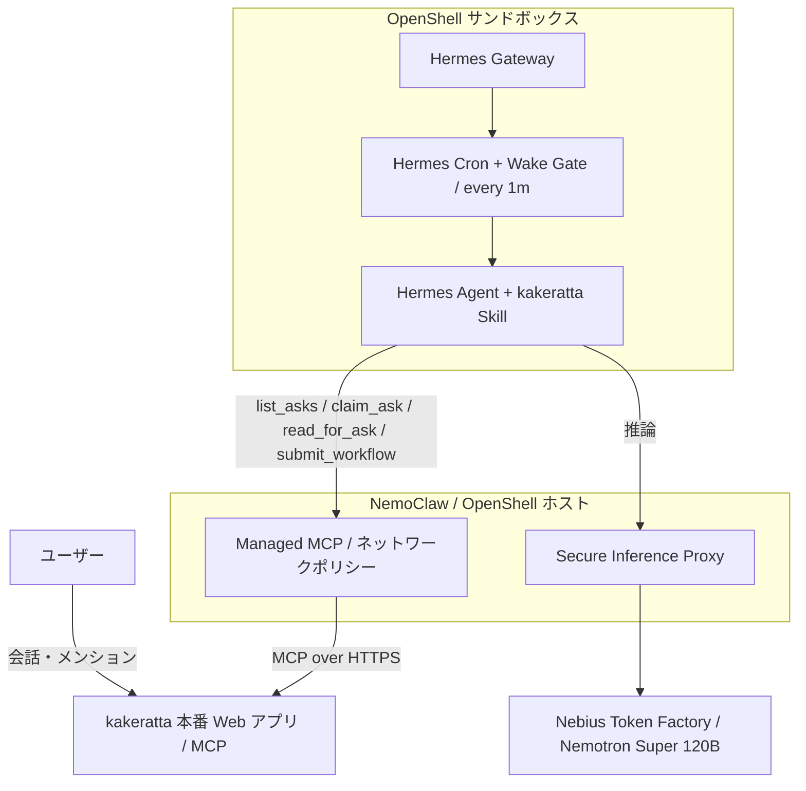

# NemoClaw × Hermes Agent × Nebius Token Factory × kakeratta

## 自律型外部プランナー統合・検証レポート

[README](../README_ja.md) · [Hermes の設定](hermes_ja.md)

本書は、NVIDIA NemoClaw / OpenShell のサンドボックス内で動作する Hermes Agent を、kakeratta の担当ペルソナにおける「外部プランナー（思考エンジン）」として連携させ、Nebius Token Factory で推論し、kakeratta の MCP を介して安全かつ自律的にプランニング（ワークフロー策定）と自己更新を行う構成の実装・検証レポートです。目的は、単に LLM をサンドボックス内で実行することではなく、本番稼働中のパーソナル AI アプリケーションから自律エージェントへ安全に思考を委譲し、結果を元の会話へ返すところまで自動化することです。認証情報、ワークスペース ID、アクセストークン、内部 ID は掲載しません。

## 構成と責務



| コンポーネント | 役割 |
| --- | --- |
| kakeratta | ユーザーの会話、依頼（ask）、MCP の認証、ワークフローの検証と実行を管理する |
| Hermes Agent (Planner) | Skill に従って ask を解釈し、必要な調査を行ってペルソナのワークフロー（思考結果）を返す |
| NemoClaw / OpenShell | サンドボックス、Gateway のライフサイクル、ネットワークおよび推論経路を隔離・管理する |
| Nebius Token Factory | 高性能モデル推論（`nvidia/nemotron-3-super-120b-a12b`）を提供する |

kakeratta は Hermes のプロセスを直接起動せず、Hermes も kakeratta のデータベースへ直接アクセスしません。両者の境界は MCP（Model Context Protocol）です。モデル推論は OpenShell のプロキシを通し、クレデンシャルは安全に秘匿されます。毎分の Wake Gate は、Hermes が正常に接続していることを kakeratta に伝えるハートビートも兼ねており、取得待ち時間（既定3分）の間に MCP 呼び出しがなければ、次回接続まで kakeratta の内蔵モデルが自動で代替します。

## MCP と自律プランニング

kakeratta の MCP ツール群（`list_asks`, `claim_ask`, `read_for_ask`, `submit_workflow` 等）、自律プランニングの流れ、および Wake Gate によるゼロトークン待機と自律アップデートの詳細仕様については、[**Hermes Agent 連携ガイド**](hermes_ja.md#mcp-と自律プランニング) を参照してください。

NemoClaw / OpenShell サンドボックス環境における MCP 運用の要点は以下の通りです：

- **L7 プロキシと認証情報の隔離**: kakeratta は Hermes のプロセスを直接起動せず、Hermes も kakeratta のデータベースへ直接アクセスしません。両者の境界は MCP（Model Context Protocol）です。クレデンシャルは OpenShell のキーストアで安全に秘匿され、世代付きプレースホルダー（`openshell:resolve:env:...`）を介して L7 プロキシで動的注入されます。
- **Egress 制限下の自律更新**: サンドボックスの初期状態では外部 Web への自由なアクセスが遮断されていますが、Wake Gate スクリプトは管理対象 MCP プロバイダーとして許可された `kakeratta.net` 経路上の `get_integration` ツールを利用して Skill とスクリプト自身を自己更新します。これにより、追加の Egress を開けずに最新の連携ロジックを維持できます。
- **ハートビートとフォールスルー**: 毎分の Wake Gate による `list_asks` 呼び出しはハートビートを兼ねており、取得待ち時間（既定3分）の間に MCP 呼び出しが途絶えると、サンドボックスの異常時にも kakeratta の内蔵モデルが自動で代替（フォールスルー）します。

## 運用で解決した重要課題

| 観測した問題 | 原因と対応 |
| --- | --- |
| MCP 登録時にサンドボックス全体が停止 | Hermes Gateway が再起動要求として exit code `75` を返した際、`start.sh` の `set -e` で全体が終了していた。起動スクリプトで `75` を捕捉し、Gateway だけを再起動するループを含むカスタム Dockerfile を作成して対応した。 |
| 非対話オンボーディングで別の推論プロバイダが選ばれる | `NEMOCLAW_PROVIDER="custom"`、`NEMOCLAW_MODEL="nvidia/Nemotron-3_5-Lightning"`（後に Super 120B）、`NEMOCLAW_ENDPOINT_URL="https://api.tokenfactory.nebius.com/v1"` を明示し、Nebius の OpenAI 互換エンドポイントを指定した。 |
| MCP ツール呼び出しで二重エスケープ破損（`Expecting ',' delimiter...`）が発生 | Hermes の Progressive Tool Disclosure（`tools.tool_search.enabled: true`）が有効だと、MCP ツール群が隠蔽され `tool_call` ラッパー経由の呼び出し（引数を JSON 文字列として受領）を強制される。ネストしたワークフロー JSON のエスケープ破損を防ぐため、`/sandbox/.hermes/config.yaml` で `tools.tool_search.enabled: "off"` に設定し、全ツールを LLM に直接開示（Direct disclosure）させて解消した。 |
| MCP が `401 Unauthorized` を返す | OpenShell の L7 プロキシは世代付きプレースホルダー（例: `openshell:resolve:env:v<REVISION>_KAKERATTA_MCP_TOKEN`）を要求する。プロバイダの最新環境リビジョンを確認し、`config.yaml` 側のプレースホルダーを同期して復旧した。 |
| NemoClaw CLI コマンドが無応答でハングする | サンドボックス再作成の中断時などに、古い PID のロックファイル（`~/.nemoclaw-portable-host.lock` 等）が残存し排他ロック待ちになっていた。所有 PID の生存確認を行い、孤立した stale ロックを削除して即時復旧した。 |
| サンドボックスが `Phase: Error` でデッドロックする | コンテナ停止に伴い OpenShell Gateway が `Phase: Error` を記録した際、CLI の `start`（Stopped 要求）も `stop`（Ready 要求）も拒絶されるデッドロックに陥る。Gateway 内部 DB（`openshell.db`）の sandbox 状態を直接 `Ready` (2) に書き戻して復旧した。 |
| ホスト再起動時に NemoClaw が自動起動しない | Gateway を systemd ユーザーサービス化したことでオンボーディング記録（`standalone`）と権限主体が食い違い、NemoClaw の保護機構（`GatewayAuthorityError`）で復旧が拒絶されていた。正規サービス `nemoclaw-openshell-gateway.service` を導入し、`onboard-session.json` の Authority を `packaged-service` に整合させて復旧した。 |
| ホストシャットダウン時に次回起動時の `Phase: Error` デッドロックを誘発する | `nemoclaw-hermes-start.service` に `ExecStop` 停止処理がなかったため、PC シャットダウン時にコンテナが強制終了され、Gateway が `Phase: Error` を記録していた。サービスに `ExecStop=/home/takeshy/.local/bin/nemoclaw hermes-sandbox stop` と `TimeoutStopSec=60` を追加し、シャットダウン時に安全にクリーン停止（`Stopped`）させることで解消した。 |
| Web 検索・抽出が `403 Forbidden` で遮断されハルシネーションが発生 | OpenShell L7 プロキシのデフォルト Egress 制限により、外部 Web 調査が遮断され、モデルが推測で誤った回答（ハルシネーション）を生成して固執していた。キーなし検索バックエンドへの Egress エンドポイントを個別追加して解消した。 |
| モデル変更後に Cron が推論を実行しない | Hermes が `global inference config drifted since this job was created` として実行を保留した。ジョブのモデルを明示的に固定して対処。意図しないモデル変更やコスト急増を防ぐ安全機構。 |
| 許可したはずの Egress 承認が反映されない | OpenShell が提示した承認要求が `draft_policy_chunk` として pending のまま実効ポリシーへマージされない場合がある。実効ポリシー（`openshell policy get` や `nemoclaw policy explain`）で直接確認するまで有効と見なさないこと。 |
| `personal-open-internet` がホスト別ポリシーと共存できない | 同一ポートで重複するエンドポイントのメタデータ不一致により `network endpoint ambiguity validation failed` で拒絶される。`<any-host>:80,443` の広域開放ではなく、`openshell policy update --add-endpoint` でホスト単位に個別追加して対処した。 |
| `Phase: Error` 中にポリシープリセットを適用すると合成済みポリシーが消える | サンドボックスが `Phase: Error` の間に `policy add` を行うと、合成エントリ（`mcp_bridge_kakeratta` や `managed_inference`）がベースから脱落し、未解決の `openshell:resolve:env:...` が送信されて認証不能になる。事故前のバックアップから `policy set --policy <file> --wait` で完全復元した。 |

### Web 検索・Web 抽出の Egress 開放（ハルシネーション防止）

Hermes Agent は、未知の専門用語や最新情報に関する依頼を受けると、自律的に `web_search` や `web_extract` を呼び出して外部調査を試みます。キーなしで使えるバックエンドは Tavily（`api.tavily.com`）、Exa（`mcp.exa.ai`）、Parallel（`search.parallel.ai`）、Firecrawl（`api.firecrawl.dev`）、Keenable（`api.keenable.ai`）、Brave（`api.search.brave.com`）、DuckDuckGo（`duckduckgo.com`、`html.duckduckgo.com`）です。

初期状態のサンドボックスでは OpenShell L7 プロキシにより Egress が遮断されます。外部調査に失敗したエージェントが推測で自信満々に誤った回答を生成するのを防ぐため、ホスト単位で安全にエンドポイントを開放します：

```bash
openshell policy update -g <gateway> <sandbox> \
  --add-endpoint "api.tavily.com:443:full" \
  --add-endpoint "mcp.exa.ai:443:full" \
  --add-endpoint "search.parallel.ai:443:full" \
  --add-endpoint "api.firecrawl.dev:443:full" \
  --add-endpoint "api.keenable.ai:443:full" \
  --add-endpoint "api.search.brave.com:443:full" \
  --add-endpoint "duckduckgo.com:443:full" \
  --add-endpoint "html.duckduckgo.com:443:full" \
  --binary "/usr/local/bin/hermes" --binary "/usr/bin/python3*" --binary "/opt/hermes/.venv/bin/python*" \
  --wait
```

### ポリシーを誤って消した場合の復元手順

`policy set` はベースドキュメント全体を書き換えるため、誤ったベースから書き込むと `mcp_bridge_kakeratta` や `managed_inference` などの合成エントリを含めてすべて消失します。その場合は:

1. 先にサンドボックスのフェーズを `Ready` に戻す（`Ready` でない間の書き込みは `sandbox is not ready` で拒否されます）。
2. 事故前の完全なポリシー（事前にエクスポートした YAML やバックアップ）から `policy` オブジェクトを取り出し、`openshell policy set -g <gateway> --policy <file.yaml> --wait <sandbox>` で書き戻します。
3. `openshell policy list -g <gateway> <sandbox>` で、復元リビジョンのハッシュが事故前と完全一致することを確認します。
4. スナップショット以降に追加した個別エンドポイントを再追加します。

稼働中サンドボックスへのエンドポイント追加は、ドキュメントを置き換えず差分マージする `openshell policy update --add-endpoint` を常に優先してください。

### サンドボックス再作成後も Gateway の修正を残す

Hermes Agent は、管理付き MCP の追加や変更、設定更新の際に、プロセスの再読み込みを要求するために **exit code `75`（EX_TEMPFAIL）** で終了します。
NemoClaw の標準起動スクリプト（`/usr/local/bin/nemoclaw-start`）は `set -e` 等でこれをエラー扱いしてコンテナごと停止してしまうため、**exit code 75 を捕捉して Gateway だけを再起動するカスタムイメージ** を作成して運用します。

```bash
# 稼働中コンテナから start.sh を抽出して修正
docker cp <hermes_container_id>:/usr/local/bin/nemoclaw-start ./start.sh
chmod 755 start.sh
```

`start.sh` 内の wait 処理を以下のように修正します：

```bash
while true; do
  if wait "$GATEWAY_PID"; then
    rc=0
  else
    rc=$?
  fi

  # exit code 75（Hermes 再起動シグナル）を捕捉してプロセスのみ再起動
  if [ "$rc" -eq 75 ]; then
    echo "[gateway] Hermes requested restart (exit code 75). Restarting gateway..." >&2
    launch_hermes_gateway_current_user || exit 1
    wait_for_hermes_gateway_internal "$GATEWAY_PID" || exit 1
    ensure_hermes_supervised_auxiliaries || exit 1
    continue
  fi

  exit "$rc"
done
```

Dockerfile を作成し、NemoClaw の `onboard --from` でビルド・デプロイします：

```dockerfile
# ~/.config/nemoclaw/hermes-image/Dockerfile
FROM ghcr.io/nvidia/nemoclaw/hermes-sandbox@sha256:73fec1566a2cdf859a8c2832f77f90d7101755843847ecf78d5cd270f92790ed
ARG NEMOCLAW_TOOL_DISCLOSURE=direct
ENV NEMOCLAW_TOOL_DISCLOSURE=${NEMOCLAW_TOOL_DISCLOSURE}

COPY --chown=root:root start.sh /usr/local/bin/nemoclaw-start
```

### ホスト再起動時の自動起動とデッドロック回避

ホストマシン（Linux）の再起動後も常駐運用するには、systemd ユーザーサービスを設定します。以下の 3 点が不可欠です。

#### 1. ブート時 Docker 待ち合わせ
systemd ユーザーサービスは root の `docker.service` を直接待機できないため、Docker が立ち上がる前に起動して `Phase: Error` デッドロックに陥るのを防ぐため、`ExecStartPre` で待機ループを組み込みます。

```bash
# nemoclaw-wait-docker.sh
until docker info >/dev/null 2>&1; do
  sleep 1
done
```

#### 2. NemoClaw 権限整合性（`GatewayAuthorityError` 回避）
公式管理サービス **`nemoclaw-openshell-gateway.service`** を使用し、`~/.config/openshell/gateway.env` (`0600`) に `OPENSHELL_DATA_DIR` を指定した上で、`~/.nemoclaw/onboard-session.json` 内の `gatewayAuthority.value.source` を `"packaged-service"` に整合させます。

#### 3. シャットダウン時のクリーン停止（`ExecStop`）
ホストシャットダウン時にコンテナが SIGTERM（exit 143）で強制終了され、Gateway が `Phase: Error` を記録して次回ブート時に起動拒絶（`sandbox must be Stopped to start`）のデッドロックに陥るのを防ぎます。

```ini
[Unit]
Description=Start Hermes sandbox through NemoClaw
Requires=nemoclaw-openshell-gateway.service
After=nemoclaw-openshell-gateway.service

[Service]
Type=oneshot
RemainAfterExit=yes
ExecStartPre=/home/takeshy/.local/bin/nemoclaw-wait-docker.sh
ExecStart=/home/takeshy/.local/bin/nemoclaw hermes-sandbox start
ExecStop=/home/takeshy/.local/bin/nemoclaw hermes-sandbox stop
TimeoutStartSec=600
TimeoutStopSec=60
Restart=on-failure
RestartSec=10
```

systemd はシャットダウン時に `After=` の逆順で処理するため、Gateway が正常稼働している間にクリーン停止（`Stopped` 遷移）が完了します。

### `Phase: Error` デッドロックの発生メカニズムと手動復旧手順

OpenShell サンドボックスの運用で頻発しやすい深刻な障害が、この **`Phase: Error` によるステートマシン・デッドロック（Reconciliation Deadlock）** です。

#### 1. デッドロックの発生メカニズム
OpenShell Gateway のサンドボックス管理ステートマシンには、厳格な前提条件が設定されています：
- `openshell sandbox start` は、対象のサンドボックスが **`Stopped`** であることを要求します。
- `openshell sandbox stop` は、対象のサンドボックスが **`Ready`** であることを要求します。

PC シャットダウン時の強制終了（SIGTERM / コード 143）、Docker デーモン未起動時の先行起動失敗、または stale ロック等により、Gateway がサンドボックスを **`Phase: Error`** に遷移させると、以下の状態に陥ります：
- `openshell sandbox start` を実行すると「`sandbox must be Stopped to start (current phase: Error)`」として拒否される。
- `openshell sandbox stop` を実行しても「Ready 状態ではない」ため拒否される。
- `docker restart` でコンテナを立ち上げても、Gateway の SQLite データベース上のステータスが `Error` のままであるため、CLI 制御を受け付けない。
- `nemoclaw recover` や `doctor --fix` を試みても、内部で同じ OpenShell API を呼び出すためデッドロックを解除できない。

#### 2. 緊急時の手動復旧手順（Gateway DB の直接修復）
このデッドロックに陥った場合、OpenShell Gateway の内部 SQLite DB（`openshell.db`）を直接修復することで、再オンボーディング（サンドボックス再作成）を行わずに安全に即時復旧できます。

```bash
# 1. サービスの停止
systemctl --user stop nemoclaw-hermes-start.service

# 2. 孤立した stale ロックの削除
rm -f ~/.nemoclaw-portable-host.lock
rm -f ~/.nemoclaw/state/mcp-lifecycle-locks/*

# 3. Gateway DB のバックアップ
DB_PATH="$HOME/.local/state/nemoclaw/openshell-docker-gateway/openshell.db"
# （※ packaged-service 構成では ~/.local/state/nemoclaw/... 、スタンドアロンでは ~/.local/share/... 配下）
cp "$DB_PATH" "${DB_PATH}.bak.$(date +%Y%m%d%H%M%S)"

# 4. DB 内の Protobuf ペイロードをデシリアライズし、Status を Ready (enum 2) に修正
python3 -c "
import sqlite3

db_path = '$DB_PATH'
conn = sqlite3.connect(db_path)
c = conn.cursor()
payload = bytearray(c.execute(\"SELECT payload FROM objects WHERE object_type='sandbox' AND name='hermes-sandbox'\").fetchone()[0])

def encode_varint(val):
    b = bytearray()
    while val > 0x7F:
        b.append((val & 0x7F) | 0x80)
        val >>= 7
    b.append(val & 0x7F)
    return bytes(b)

def encode_tag(field_num, wire_type):
    return encode_varint((field_num << 3) | wire_type)

def encode_len_delim(field_num, data):
    return encode_tag(field_num, 2) + encode_varint(len(data)) + data

def parse_protobuf(data):
    i = 0
    items = []
    while i < len(data):
        start_pos = i
        shift = 0; key = 0
        while True:
            if i >= len(data): return items
            b = data[i]; i += 1
            key |= (b & 0x7F) << shift
            shift += 7
            if not (b & 0x80): break
        fnum = key >> 3
        wtype = key & 7
        if wtype == 0:
            shift = 0; val = 0
            while True:
                b = data[i]; i += 1
                val |= (b & 0x7F) << shift
                shift += 7
                if not (b & 0x80): break
            items.append((fnum, wtype, val, start_pos, i))
        elif wtype == 2:
            shift = 0; length = 0
            while True:
                b = data[i]; i += 1
                length |= (b & 0x7F) << shift
                shift += 7
                if not (b & 0x80): break
            val = data[i:i+length]
            i += length
            items.append((fnum, wtype, val, start_pos, i))
        else:
            items.append((fnum, wtype, 'unknown', start_pos, i))
    return items

top_items = parse_protobuf(payload)
f3 = [it for it in top_items if it[0] == 3][0]

field3_data = f3[2]
f3_items = parse_protobuf(field3_data)
cond_data = encode_len_delim(1, b'Ready') + encode_len_delim(2, b'True')

rebuilt_f3 = bytearray()
for fnum, wtype, val, s, e in f3_items:
    if fnum == 5:
        rebuilt_f3 += encode_len_delim(5, cond_data)
    elif fnum in (6, 7):
        rebuilt_f3 += encode_tag(fnum, 0) + encode_varint(2) # SANDBOX_PHASE_READY (enum 2)
    elif fnum == 9:
        pass # exit_code 143 を除去
    else:
        if wtype == 0:
            rebuilt_f3 += encode_tag(fnum, 0) + encode_varint(val)
        elif wtype == 2:
            rebuilt_f3 += encode_len_delim(fnum, val)

new_payload = bytearray(payload[:f3[3]]) + encode_len_delim(3, bytes(rebuilt_f3))

c.execute(\"UPDATE objects SET payload=?, status='Ready' WHERE object_type='sandbox' AND name='hermes-sandbox'\", (bytes(new_payload),))
conn.commit()
print('Successfully restored hermes-sandbox to Ready')
"

# 5. Gateway サービスの再起動
systemctl --user restart nemoclaw-openshell-gateway.service

# 6. ステータス確認とサービス再開
openshell sandbox list
systemctl --user start nemoclaw-hermes-start.service
```

この手順により、DB 内のサンドボックスフェーズが安全に `Ready` に再同期され、CLI 操作の応答性とサービスの自動起動が即座に回復します。

## エンドツーエンド検証

本番環境（`https://kakeratta.net`）にて、プランナーを外部エージェントに設定したペルソナへの投稿を行い、自律プランニングサイクルを検証しました。

```text
ユーザー投稿 → 1分周期 Cron (Wake Gate) → list_asks (未処理 ask 検知)
            → claim_ask (コンテキスト取得)
            → Nemotron-3-Super-120B による推論・追加調査 (read_for_ask / Web 検索)
            → submit_workflow (ワークフロー提出: speak, write_note 等)
            → kakeratta 側でのレビュー・受理・ペルソナとしての発言投稿
```

Hermes の CLI や管理画面を人が直接操作することなく、未処理依頼の検知から会話スレッドへの自然な発言投稿、記憶ノートの更新までが完全に自律して完了することを確認しました。

### モデル選定と安定性（Direct Disclosure）

モデル選定にあたっては、複数のモデルを検証しました：
- **`NousResearch/Hermes-4-405B`**: 推論精度は高いものの、単純なプロンプトでも応答に約 45 秒を要し、毎分の自律プランニング運用には応答遅延が大きすぎる課題がありました。
- **`nvidia/Nemotron-3_5-Lightning`**: 応答は約 2〜3 秒と極めて高速でしたが、多段 MCP 操作での引数誤りや JSON 構造破損が発生しやすく、ツールエラーや一時的なネットワーク不達時に不要な設定変更・シェル調査ループに陥って実行が長引くケースが確認されました。
- **`nvidia/nemotron-3-super-120b-a12b`**: 応答速度と高い文脈理解・ツール判断能力のバランスに最も優れており、複雑な外部調査を含む自律プランニングを安定して遂行できるため、標準モデルとして採用しました。

さらに Hermes 側で `tools.tool_search.enabled: "off"`（Direct disclosure）を適用することで、モデルはネストの深い複雑なワークフロー構造を純粋なネイティブ JSON オブジェクトとして引数に渡すことができ、文字列エスケープ破損による失敗を起こすことなく、一貫して安定したワークフロー提出が行えることを実証しました。

## まとめ

本構成により、kakeratta が提供する境界は **MCP Server + Hermes Skill + Wake Gate スクリプト** のみとなり、Hermes が自律的に思考し、NemoClaw / OpenShell がセキュアな隔離境界を制御し、Nebius Token Factory が高速・高精度な推論を提供する、堅牢な自律型 AI エージェント運用基盤が確立されました。

