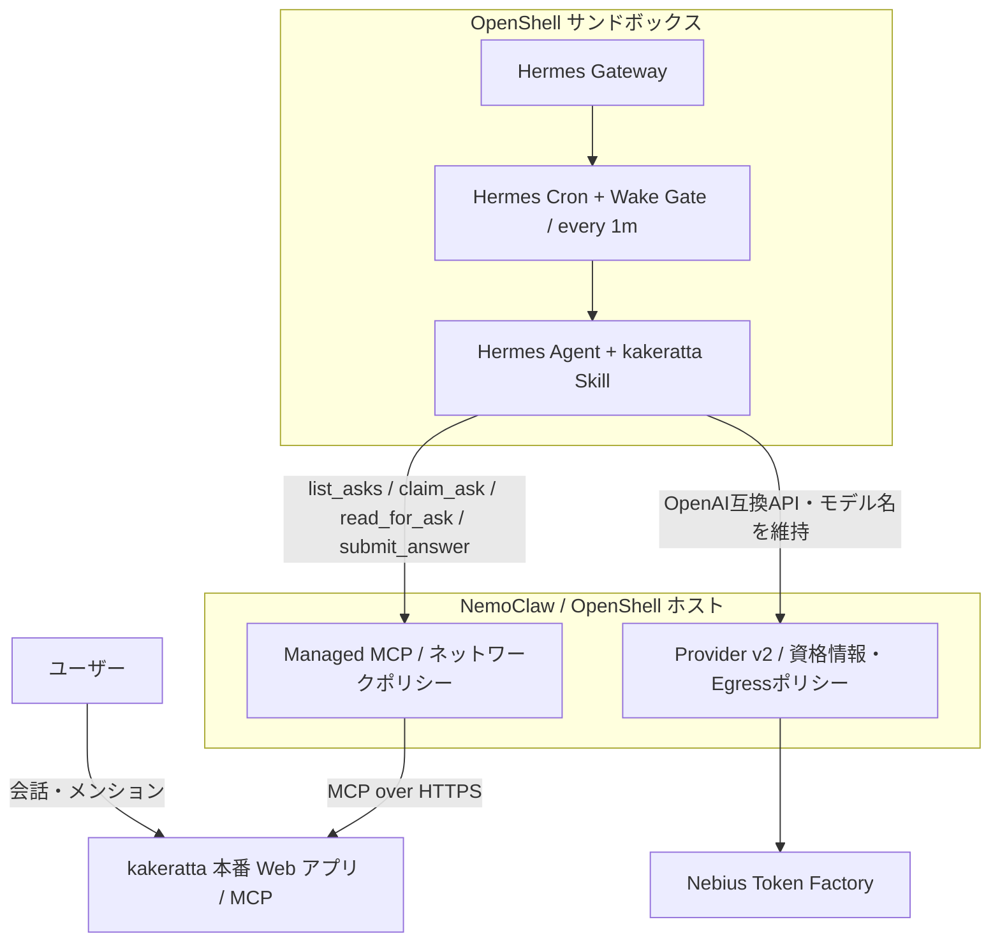

# NemoClaw × Hermes Agent × Nebius Token Factory × kakeratta

## 自律型外部プランナー統合・検証レポート

[README](../README_ja.md) · [English](nemoclaw-hermes-integration.md) · [Hermes の設定](hermes_ja.md) · [モデル比較レポート (英語)](nemoclaw-hermes-model-comparison.md) · [暴走ループ事故の分析 (英語)](nemoclaw-hermes-runaway-incident.md)

本書は、NVIDIA NemoClaw / OpenShell のサンドボックス内で動作する Hermes Agent を、kakeratta の担当ペルソナにおける「外部プランナー（思考エンジン）」として連携させ、Nebius Token Factory で推論し、kakeratta の MCP を介して安全かつ自律的にプランニング（ワークフロー策定）と自己更新を行う構成の実装・検証レポートです。目的は、単に LLM をサンドボックス内で実行することではなく、本番稼働中のパーソナル AI アプリケーションから自律エージェントへ安全に思考を委譲し、結果を元の会話へ返すところまで自動化することです。認証情報、ワークスペース ID、アクセストークン、内部 ID は掲載しません。

> [!NOTE]
> **現在のプロトコルと本番検証（2026-10-02）。** 以下の当初の検証は `submit_workflow`（スキル v11）で行いました。現在の Hermes は `submit_answer` で回答だけを提出し、kakeratta が予定・操作の計画、レビュー、実行、回答の公開、記憶の更新を行います。詳しくは [Hermes 連携ガイド](hermes_ja.md) を参照してください。
>
> 2026-09-27〜2026-10-02 JST の本番記録で、**外部回答がスレッド返信として保存された30ターン**を確認しました。予定のレビュー・実行・永続化に成功した例も含みます。この単一ユーザーのデプロイで設定された外部プランナーは、NemoClaw 内の Hermes 1つだけです。複数の返信をユーザー提供の Hermes セッションDB調査と照合し、回答本文と時刻の一致から、それらの回答元が Hermes であることを確認しました。自動テストは、モデル応答をモックして回答・予定・メモの各フェーズを検証しています。

## 構成と責務



| コンポーネント | 役割 |
| --- | --- |
| kakeratta | ユーザーの会話、依頼（ask）、MCP の認証、ワークフローの検証と実行を管理する |
| Hermes Agent (Planner) | Skill に従って ask を解釈し、必要な調査を行ってペルソナのワークフロー（思考結果）を返す |
| NemoClaw / OpenShell | サンドボックスとGatewayのライフサイクルを管理し、Provider v2で資格情報と送信先ポリシーを合成する |
| Nebius Token Factory | 親のSuperと子のUltraを、Hermesが指定したモデル名のままOpenAI互換APIで提供する |

kakeratta は Hermes のプロセスを直接起動せず、Hermes も kakeratta のデータベースへ直接アクセスしません。両者の境界は MCP（Model Context Protocol）です。推論はProvider v2が許可したToken FactoryのAPIへHermesから直接送信され、OpenShellが資格情報とEgressを管理します。毎分の Wake Gate は、Hermes が正常に接続していることを kakeratta に伝えるハートビートも兼ねており、取得待ち時間（既定3分）の間に MCP 呼び出しがなければ、次回接続まで kakeratta の内蔵モデルが自動で代替します。

## OpenShell Provider v2への移行（2026-10-13）

### 移行理由と最終構成

OpenShell 0.0.116の `inference.local` は、Hermesがリクエストに指定したモデル名をGateway側のモデルへ置き換えます。また同じGateway配下のサンドボックスが1つの推論設定を共有するため、Hermesの親と委譲した子を別モデルにする用途には適しません。Provider v2でToken FactoryをHermesのOpenAI互換エンドポイントとして直接使うと、Hermesが選んだモデル名を維持したまま、OpenShellに資格情報と通信先の管理を残せます。

検証後の役割分担は次のとおりです。

| 実行主体 | モデル | 用途 |
| --- | --- | --- |
| Hermes親・kakeratta cron | `nvidia/nemotron-3-super-120b-a12b` | 依頼の受付、振り分け、通常処理、最終回答 |
| Hermes子（delegation） | `nvidia/Nemotron-3-Ultra-550b-a55b` | 委譲された高難度の調査・推論・実行 |
| OpenShell Provider v2 | `tokenfactory-v2` | `TOKENFACTORY_API_KEY`の注入とToken FactoryへのEgress合成 |
| Token Factory | `https://api.tokenfactory.nebius.com/v1` | OpenAI互換の推論API |

Hermes設定の要点は次のとおりです。APIキーの実値は書かず、Providerが注入する環境変数を参照します。

```yaml
model:
  provider: custom
  base_url: https://api.tokenfactory.nebius.com/v1
  api_key: ${TOKENFACTORY_API_KEY}
  default: nvidia/nemotron-3-super-120b-a12b

delegation:
  provider: custom
  base_url: https://api.tokenfactory.nebius.com/v1
  api_key: ${TOKENFACTORY_API_KEY}
  model: nvidia/Nemotron-3-Ultra-550b-a55b
```

ProviderはGatewayに作成してサンドボックスへattachします。プロファイル名や作成方法はOpenShellのインストールに依存するため、利用可能な型を先に確認します。

```bash
openshell provider list-profiles -g <gateway>
openshell provider create -g <gateway> \
  --name tokenfactory-v2 --type tokenfactory \
  --credential TOKENFACTORY_API_KEY
openshell sandbox provider attach -g <gateway> <sandbox> tokenfactory-v2
```

値なしの `--credential TOKENFACTORY_API_KEY` は、コマンドを実行するホスト環境から値を読みます。シェル履歴や文書へキーを直書きしません。attach後は `openshell policy get --full` で `_provider_tokenfactory_v2` が存在し、`api.tokenfactory.nebius.com:443` がHermesの実行バイナリにだけ許可されていることを確認します。旧 `compatible-endpoint` / `inference.local` はロールバック用に残せますが、通常のHermes推論には使いません。

cronジョブは作成時のモデルを保持します。グローバルの `model.default` をSuperへ変えただけでは、既存のkakerattaジョブが別モデルに固定されたままになることがあります。次のように明示して確認します。

```bash
hermes cron edit <job-id> \
  --model nvidia/nemotron-3-super-120b-a12b \
  --provider custom
hermes cron list
```

### 検証

移行時には次を別々に確認しました。

1. Hermes APIの通常ターンがSuperで完了する。
2. `delegate_task` で起動した子がUltraを使う。
3. OpenShell監査ログにToken Factoryの `/v1/chat/completions` が `_provider_tokenfactory_v2` で許可されたと記録される。
4. kakerattaの直接依頼が `list_asks` → `claim_request` → 推論 → `reply_request` を完走し、依頼一覧から消える。
5. 待機中の次tickが `wakeAgent=false` になり、不要なモデル呼び出しをしない。

切り替え後は、親ログにSuper、`platform=subagent` の子ログにUltraが記録されることを確認します。kakeratta cronの明示モデルもSuperへ更新します。この構成では、親を軽量な受付・振り分け役として動かし、高難度の処理だけをUltraへ委譲します。

### ローカルデモ環境へ一時接続する場合

`0.0.0.0` はサーバーの待受指定であり、Hermesの接続先には使えません。ホストのLANアドレスなど、サンドボックスから到達できるアドレスを指定します。

```yaml
mcp_servers:
  kakeratta:
    url: http://<reachable-host>:8811/api/mcp/users/<workspace-id>
    headers:
      Authorization: Bearer ${KAKERATTA_MCP_TOKEN}
```

OpenShell側では、既存の `mcp_bridge_kakeratta` を同じホスト、ポート、完全一致のMCPパスへ変更し、`credential_binding.provider` は管理対象kakeratta Providerのまま維持します。同じ `host:port` に汎用 `access: full` 規則とMCP規則を重ねるとendpoint ambiguityになるため、汎用規則を削除してMCP規則へ置き換えます。ポリシー変更前には必ず `--base` と `--full` を保存し、Token Factory、MCP、検索用の既存規則を落とさないようにします。

OpenShell 0.0.116では `provider update` 後も、既に動いているサンドボックスプロセスが古い環境変数を保持する場合がありました。症状はMCP初期化と `tools/list` が成功する一方、Wake Gateの `list_asks` だけが401となることです。値を表示せず、長さとSHA-256で注入値を比較してから、正式な `openshell sandbox stop` → `start` でProvider環境を再取得します。一時的にトークンを `config.yaml` へ直接書いた場合は、デモ後に環境変数参照へ戻してトークンをローテーションします。

### 移行中の復旧ポイント

- `hermes gateway restart` とコンテナ再起動が競合すると、OpenShell 0.0.116が停止済みコンテナを `Phase: Error` に残すことがあります。DBをバックアップして既知のphase修復を行い、Gateway再起動後に正式な `stop` → `start` と `nemoclaw <sandbox> recover` で状態とホスト転送を揃えます。詳細は[手動復旧手順](#phase-error-デッドロックの発生メカニズムと手動復旧手順)を参照してください。
- cron実行中に再起動すると、`jobs.json` の `fire_claim` が残り、履歴に `Fire claim lost; execution was not started.` が毎分増えることがあります。まず `hermes cron pause <job-id>` を実行します。所有プロセスが存在しないことを確認して古い `fire_claim` だけを `null` にし、`hermes cron resume <job-id>`、`hermes cron run <job-id>` の順に再開します。ジョブ全体や実行履歴は削除しません。
- Wake Gateは認証・通信・設定エラーで必ずfail-closedします。`wakeAgent=false` は「依頼なし」だけでなくエラー時にも出るため、pendingが見えているのに起動しない場合は、同じスクリプトをOpenShellの属性付きexecで実行して標準エラーを確認します。`docker exec` で開始した通信はOpenShellに帰属されず、許可済み接続でも403になり得るため疎通判定には使いません。

ローカルデモ終了後は、MCP URL、Providerのトークン、`mcp_bridge_kakeratta` のhost・port・path・`allowed_ips`を本番へ戻し、`list_asks`、`tools/list`、Token Factory推論、サンドボックス `Ready`、ホストのAPI/ダッシュボード転送を再確認します。

## MCP と自律プランニング

kakeratta の現在の MCP ツール群（`list_asks`, `claim_ask`, `read_for_ask`, `submit_answer` 等）、回答の流れ、および Wake Gate によるゼロトークン待機と自律アップデートの詳細仕様については、[**Hermes Agent 連携ガイド**](hermes_ja.md#mcp-と自律プランニング) を参照してください。

NemoClaw / OpenShell サンドボックス環境における MCP 運用の要点は以下の通りです：

- **L7 プロキシと認証情報の隔離**: kakeratta は Hermes のプロセスを直接起動せず、Hermes も kakeratta のデータベースへ直接アクセスしません。両者の境界は MCP（Model Context Protocol）です。クレデンシャルは OpenShell のキーストアで安全に秘匿され、世代付きプレースホルダー（`openshell:resolve:env:...`）を介して L7 プロキシで動的注入されます。
- **Egress 制限下の自律更新**: サンドボックスの初期状態では外部 Web への自由なアクセスが遮断されていますが、Wake Gate スクリプトは管理対象 MCP プロバイダーとして許可された `kakeratta.net` 経路上の `get_integration` ツールを利用して Skill とスクリプト自身を自己更新します。これにより、追加の Egress を開けずに最新の連携ロジックを維持できます。
- **ハートビートとフォールスルー**: 毎分の Wake Gate による `list_asks` 呼び出しはハートビートを兼ねており、取得待ち時間（既定3分）の間に MCP 呼び出しが途絶えると、サンドボックスの異常時にも kakeratta の内蔵モデルが自動で代替（フォールスルー）します。

以下の節は、検証と長期運用で実際に遭遇した問題の記録です。通常のインストールに必須の手順ではありません。対応する症状が出たときのトラブルシューティング資料として参照してください。通常の接続手順は[Hermes Agentを担当の「考える役」にする](hermes_ja.md)を参照してください。

## 運用で解決した重要課題

| 観測した問題 | 原因と対応 |
| --- | --- |
| MCP 登録時にサンドボックス全体が停止 | Hermes Gateway が再起動要求として exit code `75` を返した際、`start.sh` の `set -e` で全体が終了していた。起動スクリプトで `75` を捕捉し、Gateway だけを再起動するループを含むカスタム Dockerfile を作成して対応した。 |
| 非対話オンボーディングで別の推論プロバイダが選ばれる | `NEMOCLAW_PROVIDER="custom"`、`NEMOCLAW_MODEL="nvidia/Nemotron-3_5-Lightning"`（後に Super 120B）、`NEMOCLAW_ENDPOINT_URL="https://api.tokenfactory.nebius.com/v1"` を明示し、Nebius の OpenAI 互換エンドポイントを指定した。 |
| MCP ツール呼び出しで二重エスケープ破損（`Expecting ',' delimiter...`）が発生 | Hermes の Progressive Tool Disclosure（`tools.tool_search.enabled: true`）が有効だと、MCP ツール群が隠蔽され `tool_call` ラッパー経由の呼び出し（引数を JSON 文字列として受領）を強制される。ネストしたワークフロー JSON のエスケープ破損を防ぐため、`/sandbox/.hermes/config.yaml` で `tools.tool_search.enabled: "off"` に設定し、全ツールを LLM に直接開示（Direct disclosure）させて解消した。 |
| MCP が `401 Unauthorized` を返す | OpenShell の L7 プロキシは世代付きプレースホルダー（例: `openshell:resolve:env:v<REVISION>_KAKERATTA_MCP_TOKEN`）を要求する。プロバイダの最新環境リビジョンを確認し、`config.yaml` 側のプレースホルダーを同期して復旧した。 |
| NemoClaw CLI コマンドが無応答でハングする | サンドボックス再作成の中断時などに、古い PID のロックファイル（`~/.nemoclaw-portable-host.lock` 等）が残存し排他ロック待ちになっていた。所有 PID の生存確認を行い、孤立した stale ロックを削除して即時復旧した。 |
| サンドボックスが `Phase: Error` でデッドロックする | コンテナ停止に伴い OpenShell Gateway が `Phase: Error` を記録した際、CLI の `start`（Stopped 要求）も `stop`（Ready 要求）も拒絶されるデッドロックに陥る。Gateway 内部 DB（`openshell.db`）の sandbox 状態を直接 `Ready` (2) に書き戻して復旧した。 |
| ホスト再起動時に NemoClaw が自動起動しない | Gateway を systemd ユーザーサービス化したことでオンボーディング記録（`standalone`）と権限主体が食い違い、NemoClaw の保護機構（`GatewayAuthorityError`）で復旧が拒絶されていた。正規サービス `nemoclaw-openshell-gateway.service` を導入し、`onboard-session.json` の Authority を `packaged-service` に整合させて復旧した。 |
| ホストシャットダウン・Docker停止順序競合で次回起動時の `Phase: Error` デッドロックを誘発する | PC シャットダウン時に systemd の並行停止で Docker デーモンが先に落ちる等の原因でコンテナが強制終了（exit 143）されると、Gateway が `Phase: Error` を記録し、次回ブート時に起動拒絶（`must be Stopped to start`）のデッドロックに陥る。シャットダウン要求時に `systemd-inhibit` で電源断を最大15秒遅延させて Docker 停止前に先行してクリーン停止させる監視サービス（`nemoclaw-hermes-shutdown-watch.service`）を導入し、さらに起動時にも DB の `Phase: Error` を自動検知・解除する自律修復スクリプト（`nemoclaw-reconcile-sandbox.py`）を多重配備して恒久解決した。 |
| Web 検索・抽出が `403 Forbidden` で遮断されハルシネーションが発生 | OpenShell L7 プロキシのデフォルト Egress 制限により、外部 Web 調査が遮断され、モデルが推測で誤った回答（ハルシネーション）を生成して固執していた。キーなし検索バックエンドへの Egress エンドポイントを個別追加して解消した。 |
| モデル変更後に Cron が推論を実行しない | Hermes が `global inference config drifted since this job was created` として実行を保留した。ジョブのモデルを明示的に固定して対処。意図しないモデル変更やコスト急増を防ぐ安全機構。 |
| 許可したはずの Egress 承認が反映されない | OpenShell が提示した承認要求が `draft_policy_chunk` として pending のまま実効ポリシーへマージされない場合がある。実効ポリシー（`openshell policy get` や `nemoclaw policy explain`）で直接確認するまで有効と見なさないこと。 |
| `personal-open-internet` がホスト別ポリシーと共存できない | 同一ポートで重複するエンドポイントのメタデータ不一致により `network endpoint ambiguity validation failed` で拒絶される。`<any-host>:80,443` の広域開放ではなく、`openshell policy update --add-endpoint` でホスト単位に個別追加して対処した。 |
| `Phase: Error` 中にポリシープリセットを適用すると合成済みポリシーが消える | サンドボックスが `Phase: Error` の間に `policy add` を行うと、合成エントリ（`mcp_bridge_kakeratta` や `managed_inference`）がベースから脱落し、未解決の `openshell:resolve:env:...` が送信されて認証不能になる。事故前のバックアップから `policy set --policy <file> --wait` で完全復元した。 |
| kakeratta のデプロイで追加した道具が Hermes から見えない | Hermes Gateway は MCP の道具一覧をキャッシュする（`tools/mcp_schema_cache.py`）。`submit_answer` を追加したデプロイの後、Skill は v12 に自己更新されたが、キャッシュした一覧に新しい道具がなく、Hermes は答えられない ask を取得したまま回答を提出できず、回答の待ち時間でターンが内蔵モデルに移った。Hermes の MCP スキーマキャッシュを消すとすぐに回復した。現在の kakeratta は `tools/list` に鮮度ヒント（`ttlMs: 300000`）を返すので、道具が変わっても5分以内にキャッシュが取り直される。詳細は[下記](#kakeratta-のデプロイ後に残る道具一覧のキャッシュ)。 |
| Hermes が回答を書いたのに提出しない | Hermes は ask を取得し、Web 検索と `read_for_ask` で約50秒調べて質の高い回答を書いたが、`submit_answer` を呼ばずに Cron のコンソールへテキストとして出力して終了したため、ask は `planBy` まで待ち続けた。Cron ジョブの共通プロンプトに「最終回答を出力すればシステムが残りを処理する（Just produce your report/output as your final response and the system handles the rest）」とあり、提出物が入れ子の JSON だった `submit_workflow` では呼び忘れなかったが、提出物が回答テキストになった `submit_answer` では Nemotron Super がこれを文字どおりに受け取った。Skill v13 で「出力したテキストは kakeratta に届かない。必ず `submit_answer` で提出し、`accepted` を確認してから `[SILENT]` で終える」と明記し、取得したのに未提出の ask が残っていないかの最終確認を加えた。`claim_ask` の `next` と MCP サーバーの instructions にも同じ注意を入れた。 |
| Wake Gate の Fail-Open 欠陥によるトークン爆食ループ | 未処理タスクがない時にゼロトークン待機（0.1秒）するはずの Wake Gate（`check_kakeratta_gate.py`）が、設定未完了や通信エラー時に「タスク取りこぼし防止」のため安易に `wakeAgent: true`（Fail-Open）を出力していた。原因の究明により、OpenShell に `personal_open_internet` を追加した際にベースの合成ポリシーが脱落し、`mcp_bridge_kakeratta` のクレデンシャルバインディングが消失して L7 プロキシが `HTTP 500 credential_unavailable` を返していたことが判明。このエラーで毎分起床した Hermes Agent は、MCP ツール（`mcp__kakeratta__*`）が使えないため自律的に「なぜツールが動かないのか」を Web 検索やコマンドで上限 60 ターンまで調査し尽くし、1 回で 110 万〜342 万トークンを消費。この 60 ターン暴走セッションは監査時点で【計 20 回】発生しており、モデルを止めるまで続いた結果、最終的に Hermes-4-405B の入力 34.54M トークン（合計 34.98 ドル）の課金障害を引き起こしていた。スクリプトを **Fail-Closed（未処理タスクの存在が確実に確認できた時のみ起床し、エラー・例外時は一切 LLM を起こさず `wakeAgent: false` で即時終了）** に全面改修し、`config.yaml` の `agent.max_turns: 15` 安全上限を設定（直接依頼の検知時のみ Wake Gate が自動で 40 ターンに一時拡張し、次回 tick で 15 に自動復元）、さらに脱落したポリシーを `openshell policy set` で復元して完全解決した。 |
| モデル変更時の思考設定競合によるツール呼び出し不発と Repetition Loop | `nvidia/Nemotron-3-Ultra-550b-a55b` への切り替え後、Hermes が `reasoning_effort` パラメータや `extra_body: {'think': ...}` を付与して推論リクエストを送ると、モデルが OpenAI 形式の Function Calling（`tool_calls`）を発行せず、テキスト（`content`）内に擬似的なツール呼び出しを出力して 8,192 トークン上限まで推論ループを続け、Hermes の Repetition Guard（`RuntimeError: Model output entered a repetition loop...`）により強制終了（クラッシュ）していた。これにより、未処理 Ask が検知されてもエージェントが回答できず、約3分後に kakeratta の内蔵モデルへフォールスルーされていた（ハートビートの `list_asks` はスクリプト単体で動くため接続できているように見えていた）。安定した Function Calling 実績を持つ `nvidia/nemotron-3-super-120b-a12b` へのロールバックおよび reasoning 設定の解除により完全解決した。 |

### Web 検索・Web 抽出の Egress 開放（ハルシネーション防止）

Hermes Agent は、未知の専門用語や最新情報に関する依頼を受けると、自律的に `web_search` や `web_extract` を呼び出して外部調査を試みます。キーなしで使えるバックエンドは Tavily（`api.tavily.com`）、Exa（`mcp.exa.ai`）、Parallel（`search.parallel.ai`）、Firecrawl（`api.firecrawl.dev`）、Keenable（`api.keenable.ai`）、Brave（`api.search.brave.com`）、DuckDuckGo（`duckduckgo.com`、`html.duckduckgo.com`）です。

初期状態のサンドボックスでは OpenShell L7 プロキシにより Egress が遮断されます。外部調査に失敗したエージェントが推測で自信満々に誤った回答を生成するのを防ぐため、ホスト単位で安全にエンドポイントを開放します：

```bash
openshell policy update -g <gateway> <sandbox> \
  --add-endpoint "api.tavily.com:443:full" \
  --add-endpoint "mcp.exa.ai:443:full" \
  --add-endpoint "search.parallel.ai:443:full" \
  --add-endpoint "api.firecrawl.dev:443:full" \
  --add-endpoint "api.keenable.ai:443:full" \
  --add-endpoint "api.search.brave.com:443:full" \
  --add-endpoint "duckduckgo.com:443:full" \
  --add-endpoint "html.duckduckgo.com:443:full" \
  --binary "/usr/local/bin/hermes" --binary "/usr/bin/python3*" --binary "/opt/hermes/.venv/bin/python*" \
  --wait
```

### kakeratta のデプロイ後に残る道具一覧のキャッシュ

Hermes Gateway は、取得した MCP の道具一覧を実行のたびに `tools/list` で取り直すのではなく、スキーマキャッシュ（`tools/mcp_schema_cache.py`）に保持します。Wake Gate は MCP 経由で Skill と自分自身を最新に保ちますが、このキャッシュは更新しません。そのため、MCP の道具を**追加する**デプロイの後は、Hermes が「見えない道具を使え」と書かれた Skill に従う状態になりえます。

2026-09-27、`submit_workflow` を `submit_answer` に置き換えたデプロイの直後に観測した経過:

1. Wake Gate が Skill を v12 に更新し、Hermes は1分ごとの `list_asks` を続けていた。
2. Hermes は投稿の ask を取得して `read_for_ask` で調べたが、キャッシュした道具一覧に `submit_answer` がなく、回答は提出されなかった。
3. 回答の待ち時間（取得から15分）が切れ、内蔵モデルが代わりに答えた（実行ログの `fallback: "answer timeout"`）。返事がユーザーに届いたのは投稿から約18分後だった。
4. Hermes の MCP スキーマキャッシュを消した後、次の ask はそれ以上の変更なしに `submit_answer` で回答された。

kakeratta 側の対策として、`tools/list` は道具と一緒に鮮度ヒントを返します。

```json
{"tools": [...], "ttlMs": 300000}
```

Hermes のスキーマキャッシュは `ttlMs` より古いエントリを期限切れとして扱い、道具を取り直します。これにより、デプロイで追加した道具は Gateway を再起動しなくても5分以内に Hermes へ届きます。この項目を知らないクライアントは無視します。

道具を追加するデプロイの直後に `answer timeout` でターンが内蔵モデルに移る場合は、Hermes から見える道具に新しいものが含まれているかを確認してください。MCP スキーマキャッシュを消すか Hermes Gateway を再起動すれば、すぐに直ります。

### ポリシーを誤って消した場合の復元手順

`policy set` はベースドキュメント全体を書き換えるため、誤ったベースから書き込むと `mcp_bridge_kakeratta` や `managed_inference` などの合成エントリを含めてすべて消失します。その場合は:

1. 先にサンドボックスのフェーズを `Ready` に戻す（`Ready` でない間の書き込みは `sandbox is not ready` で拒否されます）。
2. 事故前の完全なポリシー（事前にエクスポートした YAML やバックアップ）から `policy` オブジェクトを取り出し、`openshell policy set -g <gateway> --policy <file.yaml> --wait <sandbox>` で書き戻します。
3. `openshell policy list -g <gateway> <sandbox>` で、復元リビジョンのハッシュが事故前と完全一致することを確認します。
4. スナップショット以降に追加した個別エンドポイントを再追加します。

稼働中サンドボックスへのエンドポイント追加は、ドキュメントを置き換えず差分マージする `openshell policy update --add-endpoint` を常に優先してください。

### サンドボックス再作成後も Gateway の修正を残す

Hermes Agent は、管理付き MCP の追加や変更、設定更新の際に、プロセスの再読み込みを要求するために **exit code `75`（EX_TEMPFAIL）** で終了します。
NemoClaw の標準起動スクリプト（`/usr/local/bin/nemoclaw-start`）は `set -e` 等でこれをエラー扱いしてコンテナごと停止してしまうため、**exit code 75 を捕捉して Gateway だけを再起動するカスタムイメージ** を作成して運用します。

```bash
# 稼働中コンテナから start.sh を抽出して修正
docker cp <hermes_container_id>:/usr/local/bin/nemoclaw-start ./start.sh
chmod 755 start.sh
```

`start.sh` 内の wait 処理を以下のように修正します：

```bash
while true; do
  if wait "$GATEWAY_PID"; then
    rc=0
  else
    rc=$?
  fi

  # exit code 75（Hermes 再起動シグナル）を捕捉してプロセスのみ再起動
  if [ "$rc" -eq 75 ]; then
    echo "[gateway] Hermes requested restart (exit code 75). Restarting gateway..." >&2
    launch_hermes_gateway_current_user || exit 1
    wait_for_hermes_gateway_internal "$GATEWAY_PID" || exit 1
    ensure_hermes_supervised_auxiliaries || exit 1
    continue
  fi

  exit "$rc"
done
```

Dockerfile を作成し、NemoClaw の `onboard --from` でビルド・デプロイします：

```dockerfile
# ~/.config/nemoclaw/hermes-image/Dockerfile
FROM ghcr.io/nvidia/nemoclaw/hermes-sandbox@sha256:73fec1566a2cdf859a8c2832f77f90d7101755843847ecf78d5cd270f92790ed
ARG NEMOCLAW_TOOL_DISCLOSURE=direct
ENV NEMOCLAW_TOOL_DISCLOSURE=${NEMOCLAW_TOOL_DISCLOSURE}

COPY --chown=root:root start.sh /usr/local/bin/nemoclaw-start
```

### ホスト再起動時の自動起動とデッドロック回避

ホストマシン（Linux）の再起動後も常駐運用するには、systemd ユーザーサービスを設定します。以下の 3 点が不可欠です。

#### 1. ブート時 Docker 待ち合わせ
systemd ユーザーサービスは root の `docker.service` を直接待機できないため、Docker が立ち上がる前に起動して `Phase: Error` デッドロックに陥るのを防ぐため、`ExecStartPre` で待機ループを組み込みます。

```bash
# nemoclaw-wait-docker.sh
until docker info >/dev/null 2>&1; do
  sleep 1
done
```

#### 2. NemoClaw 権限整合性（`GatewayAuthorityError` 回避）
公式管理サービス **`nemoclaw-openshell-gateway.service`** を使用し、`~/.config/openshell/gateway.env` (`0600`) に `OPENSHELL_DATA_DIR` を指定した上で、`~/.nemoclaw/onboard-session.json` 内の `gatewayAuthority.value.source` を `"packaged-service"` に整合させます。

#### 3. シャットダウン時のクリーン停止（`ExecStop`）
ホストシャットダウン時にコンテナが SIGTERM（exit 143）で強制終了され、Gateway が `Phase: Error` を記録して次回ブート時に起動拒絶（`sandbox must be Stopped to start`）のデッドロックに陥るのを防ぎます。

```ini
[Unit]
Description=Start Hermes sandbox through NemoClaw
Requires=nemoclaw-openshell-gateway.service
After=nemoclaw-openshell-gateway.service

[Service]
Type=oneshot
RemainAfterExit=yes
ExecStartPre=/home/takeshy/.local/bin/nemoclaw-wait-docker.sh
ExecStart=/home/takeshy/.local/bin/nemoclaw hermes-sandbox start
ExecStop=/home/takeshy/.local/bin/nemoclaw hermes-sandbox stop
TimeoutStartSec=600
TimeoutStopSec=60
Restart=on-failure
RestartSec=10
```

systemd はシャットダウン時に `After=` の逆順で処理するため、Gateway が正常稼働している間にクリーン停止（`Stopped` 遷移）が完了します。

### `Phase: Error` デッドロックの発生メカニズムと手動復旧手順

OpenShell サンドボックスの運用で頻発しやすい深刻な障害が、この **`Phase: Error` によるステートマシン・デッドロック（Reconciliation Deadlock）** です。

#### 1. デッドロックの発生メカニズム
OpenShell Gateway のサンドボックス管理ステートマシンには、厳格な前提条件が設定されています：
- `openshell sandbox start` は、対象のサンドボックスが **`Stopped`** であることを要求します。
- `openshell sandbox stop` は、対象のサンドボックスが **`Ready`** であることを要求します。

PC シャットダウン時の強制終了（SIGTERM / コード 143）、Docker デーモン未起動時の先行起動失敗、または stale ロック等により、Gateway がサンドボックスを **`Phase: Error`** に遷移させると、以下の状態に陥ります：
- `openshell sandbox start` を実行すると「`sandbox must be Stopped to start (current phase: Error)`」として拒否される。
- `openshell sandbox stop` を実行しても「Ready 状態ではない」ため拒否される。
- `docker restart` でコンテナを立ち上げても、Gateway の SQLite データベース上のステータスが `Error` のままであるため、CLI 制御を受け付けない。
- `nemoclaw recover` や `doctor --fix` を試みても、内部で同じ OpenShell API を呼び出すためデッドロックを解除できない。

#### 2. 緊急時の手動復旧手順（Gateway DB の直接修復）
検証中にサンドボックスが `Phase: Error` で操作不能になった際、OpenShell Gateway の内部 SQLite DB（`openshell.db`）を直接修復する、以下の緊急復旧手順を用いました。

```bash
# 1. サービスの停止
systemctl --user stop nemoclaw-hermes-start.service

# 2. 孤立した stale ロックの削除
rm -f ~/.nemoclaw-portable-host.lock
rm -f ~/.nemoclaw/state/mcp-lifecycle-locks/*

# 3. Gateway DB のバックアップ
DB_PATH="$HOME/.local/state/nemoclaw/openshell-docker-gateway/openshell.db"
# （※ packaged-service 構成では ~/.local/state/nemoclaw/... 、スタンドアロンでは ~/.local/share/... 配下）
cp "$DB_PATH" "${DB_PATH}.bak.$(date +%Y%m%d%H%M%S)"

# 4. DB 内の Protobuf ペイロードをデシリアライズし、Status を Ready (enum 2) に修正
python3 -c "
import sqlite3

db_path = '$DB_PATH'
conn = sqlite3.connect(db_path)
c = conn.cursor()
payload = bytearray(c.execute(\"SELECT payload FROM objects WHERE object_type='sandbox' AND name='hermes-sandbox'\").fetchone()[0])

def encode_varint(val):
    b = bytearray()
    while val > 0x7F:
        b.append((val & 0x7F) | 0x80)
        val >>= 7
    b.append(val & 0x7F)
    return bytes(b)

def encode_tag(field_num, wire_type):
    return encode_varint((field_num << 3) | wire_type)

def encode_len_delim(field_num, data):
    return encode_tag(field_num, 2) + encode_varint(len(data)) + data

def parse_protobuf(data):
    i = 0
    items = []
    while i < len(data):
        start_pos = i
        shift = 0; key = 0
        while True:
            if i >= len(data): return items
            b = data[i]; i += 1
            key |= (b & 0x7F) << shift
            shift += 7
            if not (b & 0x80): break
        fnum = key >> 3
        wtype = key & 7
        if wtype == 0:
            shift = 0; val = 0
            while True:
                b = data[i]; i += 1
                val |= (b & 0x7F) << shift
                shift += 7
                if not (b & 0x80): break
            items.append((fnum, wtype, val, start_pos, i))
        elif wtype == 2:
            shift = 0; length = 0
            while True:
                b = data[i]; i += 1
                length |= (b & 0x7F) << shift
                shift += 7
                if not (b & 0x80): break
            val = data[i:i+length]
            i += length
            items.append((fnum, wtype, val, start_pos, i))
        else:
            items.append((fnum, wtype, 'unknown', start_pos, i))
    return items

top_items = parse_protobuf(payload)
f3 = [it for it in top_items if it[0] == 3][0]

field3_data = f3[2]
f3_items = parse_protobuf(field3_data)
cond_data = encode_len_delim(1, b'Ready') + encode_len_delim(2, b'True')

rebuilt_f3 = bytearray()
for fnum, wtype, val, s, e in f3_items:
    if fnum == 5:
        rebuilt_f3 += encode_len_delim(5, cond_data)
    elif fnum in (6, 7):
        rebuilt_f3 += encode_tag(fnum, 0) + encode_varint(2) # SANDBOX_PHASE_READY (enum 2)
    elif fnum == 9:
        pass # exit_code 143 を除去
    else:
        if wtype == 0:
            rebuilt_f3 += encode_tag(fnum, 0) + encode_varint(val)
        elif wtype == 2:
            rebuilt_f3 += encode_len_delim(fnum, val)

new_payload = bytearray(payload[:f3[3]]) + encode_len_delim(3, bytes(rebuilt_f3))

c.execute(\"UPDATE objects SET payload=?, status='Ready' WHERE object_type='sandbox' AND name='hermes-sandbox'\", (bytes(new_payload),))
conn.commit()
print('Successfully restored hermes-sandbox to Ready')
"

# 5. Gateway サービスの再起動
systemctl --user restart nemoclaw-openshell-gateway.service

# 6. ステータス確認とサービス再開
openshell sandbox list
systemctl --user start nemoclaw-hermes-start.service
```

この手順は、サンドボックスを再作成せずに Gateway DB の状態を `Ready` に戻す緊急復旧として用いました。この事例では、CLI 操作の応答性とバックグラウンドでの自動再起動が回復しました。

#### 3. 恒久対策：自己修復型自動起動システムの導入
PC シャットダウン時の Docker 停止順序競合や強制終了などにより、次回起動時に `Phase: Error` でデッドロックする問題を防ぐため、起動時に自律修復を行うラッパー構成を導入しました。

1. **事前シャットダウン監視サービス (`nemoclaw-hermes-shutdown-watch.service`)**:
   `systemd-inhibit --what=shutdown --mode=delay` でシャットダウン遅延インヒビターを保持し、D-Bus の `org.freedesktop.login1.Manager.PrepareForShutdown` シグナルを常駐監視。シャットダウン要求を検知すると、logind にシャットダウンを最大 15 秒間遅延させ、**システム側の Docker デーモンが停止する前に** 安全停止ラッパー（`nemoclaw-hermes-autostop.sh`）を先行実行してコンテナを正常に `Phase: Stopped` (exit 0) でクリーン停止させます（sudo 不要、ユーザー空間で完結）。
2. **安全停止ラッパー (`~/.local/bin/nemoclaw-hermes-autostop.sh`)**:
   Docker が生存している場合は安全にクリーン停止を行い、排他ロック（`flock`）による二重実行ガードを内包。すでに停止済みの場合は即座にスキップし、重複呼び出しにも安全に応答します。
3. **自律修復スクリプト (`~/.local/bin/nemoclaw-reconcile-sandbox.py`)**:
   起動ループの各試行時に Gateway DB を監査し、万一の強制電源断やクラッシュなどで `Phase: Error` (enum 3) や異常な終了コードが残存した場合でも、自動的に Protobuf ペイロードを `Ready` (enum 2) に修正・強制解除して Gateway デーモンを再起動し、デッドロックを瞬時に解消します。
4. **自動起動ラッパー (`~/.local/bin/nemoclaw-hermes-autostart.sh`)**:
   Docker 待機、Gateway 待機、stale ロック除去、各試行ごとの DB デッドロック自動修復・強制解除、コンテナ起動待機（settlement window 考慮）、Web Dashboard（ポート 18789）疎通確認までを 1 本のスクリプトで完結して自律実行します。
5. **systemd サービスの更新 (`~/.config/systemd/user/nemoclaw-hermes-start.service`)**:
   `ExecStart` に `nemoclaw-hermes-autostart.sh`、`ExecStop` に `nemoclaw-hermes-autostop.sh` を設定し、OS 再起動時にいかなる終了状態からでも 100% 確実に自動復旧・起動できるようにしました。

> [!TIP]
> **リポジトリ内でのソースコード管理**:
> これらの一連のスクリプト群および systemd ユニットファイルは、リポジトリ内の [`scripts/nemoclaw/`](../scripts/nemoclaw/) ディレクトリに集約・バージョン管理されています。
> 新しい環境へのセットアップやリンク作成は [`scripts/nemoclaw/install.sh`](../scripts/nemoclaw/install.sh) を実行することで、`~/.local/bin` および `~/.config/systemd/user` へシンボリックリンクとして一括配備できます。

## エンドツーエンド検証

本番環境（`https://kakeratta.net`）にて、プランナーを外部エージェントに設定したペルソナへの投稿を行い、自律プランニングサイクルを検証しました。

```text
ユーザー投稿 → 1分周期 Cron (Wake Gate) → list_asks (未処理 ask 検知)
            → claim_ask (コンテキスト取得)
            → Nemotron-3-Super-120B による推論・追加調査 (read_for_ask / Web 検索)
            → submit_workflow (ワークフロー提出: speak, write_note 等)
            → kakeratta 側でのレビュー・受理・ペルソナとしての発言投稿
```

Hermes の CLI や管理画面を人が直接操作することなく、未処理依頼の検知から会話スレッドへの自然な発言投稿、記憶ノートの更新までが完全に自律して完了することを確認しました。

### モデル選定と安定性（Direct Disclosure）

モデル選定にあたっては、複数のモデルを検証しました：
- **`NousResearch/Hermes-4-405B`**: 推論精度は高いものの、単純なプロンプトでも応答に約 45 秒を要し、毎分の自律プランニング運用には応答遅延が大きすぎる課題がありました。
- **`nvidia/Nemotron-3_5-Lightning`**: 応答は約 2〜3 秒と極めて高速でしたが、多段 MCP 操作での引数誤りや JSON 構造破損が発生しやすく、ツールエラーや一時的なネットワーク不達時に不要な設定変更・シェル調査ループに陥って実行が長引くケースが確認されました。
- **`nvidia/nemotron-3-super-120b-a12b`**: 応答速度とツール判断のバランスがよく、上記のエンドツーエンド検証ではこのモデルがプランナーでした。ただし、ユーザーに誤りを指摘されても前の主張を維持したセッションや、回答を書いたのに提出しなかったセッションがありました。
- **`nvidia/Nemotron-3-Ultra-550b-a55b`**: 現在のプランナーモデルです。Hermes のプランナーとしての挙動は、まだ他のモデルと同じ条件で比較していません。[モデル比較レポート (英語)](nemoclaw-hermes-model-comparison.md) を参照してください。

さらに Hermes 側で `tools.tool_search.enabled: "off"`（Direct disclosure）を適用することで、モデルはネストの深い複雑なワークフロー構造を純粋なネイティブ JSON オブジェクトとして引数に渡すことができ、文字列エスケープ破損による失敗を起こすことなく、一貫して安定したワークフロー提出が行えることを実証しました。

## まとめ

本構成により、kakeratta が提供する境界は **MCP Server + Hermes Skill + Wake Gate スクリプト** のみとなり、Hermes が自律的に思考し、NemoClaw / OpenShell がセキュアな隔離境界を制御し、Nebius Token Factory が高速・高精度な推論を提供する、堅牢な自律型 AI エージェント運用基盤が確立されました。
