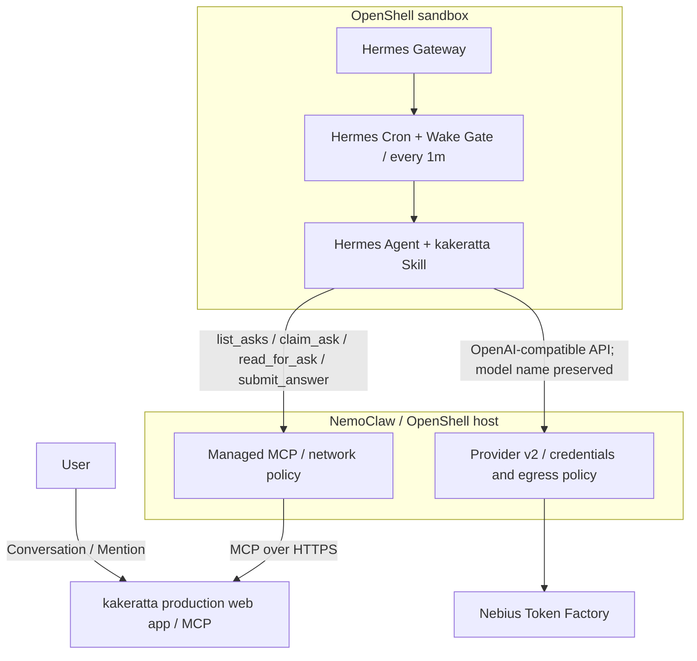

# NemoClaw × Hermes Agent × Nebius Token Factory × kakeratta

## Autonomous External Planner Integration and Verification Report

[README](../../README.md) · [日本語](nemoclaw-hermes-integration_ja.md) · [Hermes setup](../guides/hermes.md) · [Hermes-4-405B visual evaluation](hermes-4-405b-visual-evaluation.md) · [Model Comparison](nemoclaw-hermes-model-comparison.md) · [Runaway loop incident](nemoclaw-hermes-runaway-incident.md)

## Summary

The production runs confirmed that Hermes could return answers to kakeratta. In the 2026-10-16 record, a Python worker handled ask acquisition and submission without waking the Cron parent model session.

| Finding | Evidence and scope |
| --- | --- |
| External answers persisted | 30 turns recorded during 2026-09-27–2026-10-02 JST; several cross-checked against the Hermes session database |
| Worker-controlled input and submission | Python `claim_ask` / `submit_answer` path verified on 2026-10-16 |
| Lower input-token usage | 62,847 → 15,774 (~75% reduction) in the two recorded old/new sessions; not an average from repeated controlled trials |
| Model roles | Super-VL for persona asks and Ultra for direct requests as of 2026-10-16 |

This report records an evolving integration. Procedures and settings below describe their verification dates; use the [Hermes setup guide](../guides/hermes.md) for current connection instructions. Automated tests use mocked model responses and are separate from the live observations.

Reading order: [End-to-end verification](#end-to-end-verification) → [Architecture](#architecture-and-responsibilities) → [MCP operations](#mcp-and-autonomous-planning). For migration or recovery, use the [Provider v2 migration](#migration-to-openshell-provider-v2-2026-10-13) and [operational issues](#key-operational-issues-resolved).

## End-to-end verification

Verified in production on `https://kakeratta.net` with personas configured for external planning:

```text
User post → Cron (every 1m with Wake Gate) → list_asks (detects pending ask in Python)
          → direct_request_worker.py: claim_ask (fetches context in Python)
          → Nemotron-3.5-Super-VL single session in persona-hermes-home (only read_for_ask + web tools)
          → direct_request_worker.py: submit_answer (submits structured answer in Python)
          → kakeratta schedule phase / review and thread posting
```

The entire cycle completed autonomously with zero human intervention and without waking the Cron parent session (`{"wakeAgent": false}`).

### Code-driven persona ask optimization (verified 2026-10-16)

Previously, waking the Cron parent session for a persona ask loaded all 17 kakeratta MCP tools plus Hermes's full platform toolsets (`terminal`, `cronjob`, `memory`, `session_search`, `skills`, `delegation`, etc.) on every turn, and required 4–6 model calls (`list_asks` → `claim_ask` → `web_search` / `read_for_ask` → `submit_answer`). Moving `list_asks`, `claim_ask`, `submit_answer`, and `release_ask` into Python in `direct_request_worker.py` (`WORKER_VERSION = "9"`) and isolating the model in `persona-hermes-home` with `tools.include: ["read_for_ask"]` and `-t kakeratta,web` reduced input tokens by **~75%** in production:

| Metric | Old Cron Parent Flow (`20261016_052950_f3fc2b`) | New Code-Driven Worker Flow (`20261016_085734_838364`) |
| --- | --- | --- |
| **Model** | `nvidia/Nemotron-3.5-Super-VL` | `nvidia/Nemotron-3.5-Super-VL` |
| **Loaded MCP tools** | All 17 kakeratta tools + all Hermes toolsets | Only `read_for_ask` + `web` |
| **Lifecycle calls (`claim_ask`, `submit_answer`)** | LLM tool calls | Python (`direct_request_worker.py`) |
| **LLM API calls (with Web search)** | 4 calls | **2 calls** (1 search turn + 1 answer turn) |
| **Cumulative input tokens** | 62,847 tokens | **15,774 tokens (~75% reduction)** |
| **Output tokens** | 1,663 tokens | **1,435 tokens** (761 reasoning) |
| **End-to-end wall time** | ~45–60s | **~23s** |
| **Estimated cost per ask (with Web search)** | ~\$0.0205 (~¥3.2) | **~\$0.0062 (~¥0.96)** |

This table compares two recorded old/new sessions. It is not a controlled trial with repeated identical inputs; the ~75% reduction and elapsed times are observations, not general performance guarantees.

When a persona ask does not require `read_for_ask` or `web_search`, it completes in a **single LLM API call** (~6,000–7,000 input tokens, ~\$0.0025 / ~¥0.4).

### Model selection and reliability (Direct Disclosure)

Multiple models were evaluated during development:
- **`NousResearch/Hermes-4-405B`**: Highly capable, but simple prompts took ~45 seconds, adding unacceptable latency to a 1-minute scheduling cadence.
- **`nvidia/Nemotron-3_5-Lightning`**: Extremely fast (2–3 seconds), but prone to argument omission, JSON structure syntax errors during multi-step MCP operations, and getting caught in troubleshooting loops (attempting unwanted configuration changes and shell commands) upon transient network or tool hiccups.
- **`nvidia/nemotron-3-super-120b-a12b` / `nvidia/Nemotron-3.5-Super-VL`**: Balanced response speed and tool judgment for persona-ask planning (initial verification used `nvidia/nemotron-3-super-120b-a12b`, and production now runs and is verified on `nvidia/Nemotron-3.5-Super-VL`). In earlier runs on 120B, one session held on to an earlier error when the user corrected it, and another wrote an answer without submitting it (resolved in Skill v13 and eliminated structurally by code-driven submission in Worker v9).
- **`nvidia/Nemotron-3-Ultra-550b-a55b`**: Used for direct `@agent` requests through the isolated direct-request worker over Provider v2 (verified in production on `q_1792128562756350474a4600c8c`: 1 API call, 8,125 input / 2,762 output tokens, ~\$0.018). When tested earlier as the parent cron planner with reasoning parameters enabled, it emitted tool calls as plain text and hit the repetition guard; see the [model comparison](nemoclaw-hermes-model-comparison.md).

Furthermore, applying `tools.tool_search.enabled: "off"` (Direct disclosure) in Hermes allows the model to pass complex arguments as native JSON objects without double-escaping.

## Architecture and responsibilities

This report documents an integration in which Hermes Agent runs inside NVIDIA NemoClaw / OpenShell, acts as an external **planner** (thinking engine) for designated kakeratta personas, uses Nebius Token Factory for inference, and safely plans turns, formulates workflows, and keeps itself updated via kakeratta's MCP server. Credentials, workspace IDs, access tokens, and internal task IDs are intentionally omitted.

> [!NOTE]
> **Protocol change and production verification as of 2026-10-02.** The original run used `submit_workflow` (skill v11). At that point Hermes submitted only an answer through `submit_answer`; kakeratta plans, reviews, and executes schedules and actions, publishes the answer, and updates memory. See the [Hermes setup guide](../guides/hermes.md).
>
> Production records from 2026-09-27–2026-10-02 JST confirmed **30 external-answer turns saved as thread replies**, including successful schedule review, execution, and persistence. In this single-user deployment, the only configured external planner is Hermes inside NemoClaw. Cross-checks of several replies against a user-provided Hermes session-database investigation matched answer text and timing, confirming Hermes as their source. Automated tests cover the answer, schedule, and note phases with mocked model responses.

The diagram and responsibility table describe the integration boundary and earlier planner configuration. The preceding note explains the change from workflow to answer submission; the previous section shows the worker-controlled execution path verified on 2026-10-16.



| Component | Responsibility |
| --- | --- |
| kakeratta | Manages conversations, asks, MCP authentication, workflow validation and execution |
| Hermes Agent (Planner) | Interprets asks according to Skill, performs lookups, and returns persona workflows |
| NemoClaw / OpenShell | Manages the sandbox and Gateway lifecycle and composes Provider v2 credentials and destination policy |
| Nebius Token Factory | Serves the Super parent and Ultra child through an OpenAI-compatible endpoint while preserving Hermes's model choice |

kakeratta does not start the Hermes process, and Hermes does not access kakeratta's database directly. MCP (Model Context Protocol) is the boundary between them. Hermes sends inference directly to the Token Factory endpoint allowed by Provider v2, while OpenShell manages credentials and egress. The recurring Wake Gate also serves as a heartbeat: if no MCP calls arrive within the claim wait window (3 minutes by default), kakeratta's built-in model answers instead.

## MCP and autonomous planning

For the full specification of Kakeratta's current MCP tools (`list_asks`, `claim_ask`, `read_for_ask`, `submit_answer`, etc.), the answering loop, and Wake Gate's zero-token standby and self-updating mechanisms, refer to the [**Hermes Agent Setup Guide**](../guides/hermes.md#mcp-and-autonomous-planning).

Key aspects of operating MCP under NemoClaw / OpenShell include:

- **L7 Proxy and Credential Isolation**: Kakeratta does not run the Hermes process, and Hermes cannot access Kakeratta's database directly. MCP (Model Context Protocol) is the sole boundary. Tokens are kept in OpenShell's credential vault and dynamically injected by the L7 proxy using generation-scoped placeholders (`openshell:resolve:env:...`).
- **Autonomous Updates under Egress Restrictions**: Initial sandbox policies block arbitrary outbound HTTP requests. However, the Wake Gate script leverages the `get_integration` MCP tool across the already-authorized `kakeratta.net` route to self-update the Skill and itself without requiring external web access.
- **Heartbeat and Fall-through**: Every 1-minute `list_asks` call by Wake Gate acts as a liveness heartbeat. If MCP calls cease during the claim wait window (3 minutes by default), Kakeratta's built-in model answers automatically (fall-through), preventing turns from hanging even during sandbox outages.

The following sections document issues encountered during verification and long-running operation. They are not required for a normal installation; use them as troubleshooting references if the corresponding symptoms occur. For the normal connection procedure, see [Using Hermes Agent as a persona's planner](../guides/hermes.md).

**Appendix: migration and recovery record.** The remaining sections preserve configuration changes and troubleshooting procedures from their respective dates. Use the setup guide for a normal connection.

## Migration to OpenShell Provider v2 (2026-10-13)

### Why the migration was necessary

In OpenShell 0.0.116, `inference.local` replaces the model name requested by Hermes with the Gateway's configured model. Sandboxes under one Gateway also share that inference setting. It therefore cannot reliably use one model for the parent and another for delegated children. Provider v2 keeps OpenShell in charge of credentials and egress while Hermes calls Token Factory's OpenAI-compatible endpoint with its selected model name intact.

The current configuration is (originally verified on 2026-10-13 with Nemotron 3 Super 120B, and verified live in production on 2026-10-16 with both `nvidia/Nemotron-3.5-Super-VL` and `nvidia/Nemotron-3-Ultra-550b-a55b`):

| Executor | Model | Role |
| --- | --- | --- |
| Hermes parent and kakeratta cron | `nvidia/Nemotron-3.5-Super-VL` | intake, routing, routine work, and final response |
| Delegated Hermes child / direct-request worker | `nvidia/Nemotron-3-Ultra-550b-a55b` | direct `@agent` requests and delegated high-complexity research, reasoning, and execution |
| OpenShell Provider v2 | `tokenfactory-v2` | injects `TOKENFACTORY_API_KEY` and composes Token Factory egress |
| Token Factory | `https://api.tokenfactory.nebius.com/v1` | OpenAI-compatible inference endpoint |

Hermes references the injected variable rather than storing the key:

```yaml
model:
  provider: custom
  base_url: https://api.tokenfactory.nebius.com/v1
  api_key: ${TOKENFACTORY_API_KEY}
  default: nvidia/Nemotron-3.5-Super-VL

delegation:
  provider: custom
  base_url: https://api.tokenfactory.nebius.com/v1
  api_key: ${TOKENFACTORY_API_KEY}
  model: nvidia/Nemotron-3-Ultra-550b-a55b
```

Create and attach the provider after checking the profiles supported by the installed OpenShell build:

```bash
openshell provider list-profiles -g <gateway>
openshell provider create -g <gateway> \
  --name tokenfactory-v2 --type tokenfactory \
  --credential TOKENFACTORY_API_KEY
openshell sandbox provider attach -g <gateway> <sandbox> tokenfactory-v2
```

With no value after `--credential`, OpenShell reads the value from the host environment. Do not put it in shell history or documentation. Confirm `_provider_tokenfactory_v2` and the narrowly scoped `api.tokenfactory.nebius.com:443` rule in `openshell policy get --full`. The old `compatible-endpoint` / `inference.local` provider may remain attached for rollback, but normal Hermes inference does not use it.

Existing cron jobs retain their model pin. Changing global `model.default` to Super does not necessarily update a kakeratta job pinned to another model:

```bash
hermes cron edit <job-id> \
  --model nvidia/Nemotron-3.5-Super-VL \
  --provider custom
hermes cron list
```

Following the [recommended Hermes configuration](../../scripts/nemoclaw/README.md#6-hermes-推奨設定-sandboxhermesconfigyaml), align both the parent model and the kakeratta cron job to `nvidia/Nemotron-3.5-Super-VL` while preserving `nvidia/Nemotron-3-Ultra-550b-a55b` for the direct-request worker and delegation (both live inference and MCP submission were verified in production on 2026-10-16).

### Verification

The paths were verified during the initial migration and again after switching the parent/cron pin to `nvidia/Nemotron-3.5-Super-VL` on 2026-10-16: a persona-ask turn on `nvidia/Nemotron-3.5-Super-VL`; a `delegate_task` child and the direct-request worker (`direct_request_worker.py`) on `nvidia/Nemotron-3-Ultra-550b-a55b` (`reasoning_effort: high`); an OpenShell audit entry allowing Token Factory `/v1/chat/completions` through `_provider_tokenfactory_v2`; and a real kakeratta direct request completing `list_asks` → `claim_request` → Ultra inference → `reply_request` without waking the parent. The following idle tick returned `wakeAgent=false`. After switching, confirm Super in the worker/parent log and Ultra in the direct-request worker or `platform=subagent` log, and explicitly pin the kakeratta cron job to Super.

> **Since 2026-10-14 (direct requests) and 2026-10-16 (persona asks)**, neither direct requests nor persona asks wake the Cron parent: the Wake Gate runs `direct_request_worker.py` in code and returns `{"wakeAgent": false}`. For direct requests, it runs Ultra once in `hermes-home`; for persona asks, it calls `claim_ask` in Python, runs `nvidia/Nemotron-3.5-Super-VL` once in `persona-hermes-home` with only `read_for_ask` and `web` tools (all lifecycle MCP tools excluded), and calls `submit_answer` in Python. See [Direct requests](../guides/hermes.md#direct-requests) and [End-to-end verification](#end-to-end-verification).

### Temporarily connecting to a local demo server

`0.0.0.0` is a server bind address, not a client destination. Configure a LAN address or another address reachable from the sandbox:

```yaml
mcp_servers:
  kakeratta:
    url: http://<reachable-host>:8811/api/mcp/users/<workspace-id>
    headers:
      Authorization: Bearer ${KAKERATTA_MCP_TOKEN}
```

Change the existing `mcp_bridge_kakeratta` endpoint to the same host, port, and exact MCP path while retaining its managed credential binding. Do not overlap a generic `access: full` endpoint with an MCP endpoint on the same `host:port`; remove the generic rule and replace it with the MCP rule. Export both base and full policy before changing it so the Token Factory, MCP, and search policies are not lost.

On OpenShell 0.0.116, `provider update` may leave an already-running sandbox process with its old environment value. The observed signature was successful MCP initialization and `tools/list`, followed by a 401 from Wake Gate's `list_asks`. Compare only token length and SHA-256, never the value, then use a formal `openshell sandbox stop` followed by `start` so the provider environment is fetched again. If a demo token is temporarily written directly into `config.yaml`, restore the environment reference and rotate the token afterward.

### Recovery notes from the migration

- A `hermes gateway restart` racing a container restart can leave a stopped container in `Phase: Error` on OpenShell 0.0.116. Back up the DB, perform the documented phase repair, restart the Gateway, then use a formal `stop` → `start` and `nemoclaw <sandbox> recover`. See the [manual recovery procedure](#phase-error-deadlock-mechanism-and-manual-recovery-procedure).
- Restarting during a cron execution may leave `jobs.json.fire_claim` behind and produce `Fire claim lost; execution was not started.` every minute. Pause the job first, prove the owner process is gone, clear only the stale `fire_claim`, then run `hermes cron resume <job-id>` and `hermes cron run <job-id>`. Preserve the job and its execution history.
- Wake Gate fails closed on authentication, transport, and configuration errors. Therefore `wakeAgent=false` can mean either idle or failure. When kakeratta shows a pending request, run the same gate through an OpenShell-attributed exec path and inspect stderr. Network calls started by `docker exec` are unattributed and can receive 403 even for an allowed destination, so they are not a valid egress test.

After the demo, restore the production MCP URL, provider token, and `mcp_bridge_kakeratta` host, port, path, and `allowed_ips`; then recheck `list_asks`, `tools/list`, Token Factory inference, sandbox `Ready`, and the API/dashboard host forwards.

## Key operational issues resolved

<details>
<summary>Expand the observed issues and resolutions</summary>

| Observed issue | Root cause and resolution |
| --- | --- |
| Container stops on MCP registration | Hermes Gateway exits with code `75` (EX_TEMPFAIL) to request a process restart on MCP changes. Default startup scripts treat this as fatal under `set -e`. Resolved by building a custom image with a restart loop on code 75. |
| Non-interactive onboarding picks unexpected provider | Specified `NEMOCLAW_PROVIDER="custom"`, `NEMOCLAW_MODEL="nvidia/nemotron-3-super-120b-a12b"`, and `NEMOCLAW_ENDPOINT_URL="https://api.tokenfactory.nebius.com/v1"` explicitly to route through Nebius. |
| MCP tool calls fail due to JSON string escape corruption | When Progressive Tool Disclosure (`tools.tool_search.enabled: true`) is active, Hermes hides MCP tools behind a `tool_call` wrapper expecting arguments as a stringified JSON blob. Complex nested workflow schemas failed during string escaping. Resolved by disabling Progressive Tool Disclosure via `tools.tool_search.enabled: "off"` in `/sandbox/.hermes/config.yaml` to expose tools directly (Direct disclosure). |
| MCP returned `401 Unauthorized` | OpenShell's L7 proxy expects generation-scoped placeholders (e.g., `openshell:resolve:env:v<REVISION>_KAKERATTA_MCP_TOKEN`). Synchronizing the placeholder revision in `config.yaml` with the provider environment revision restored authentication. |
| NemoClaw CLI commands hang indefinitely | Orphan lock files (`~/.nemoclaw-portable-host.lock`) remained with defunct owner PIDs after interrupted operations. Pruning stale locks whose owner PIDs were dead restored responsiveness. |
| Sandbox stuck in `Phase: Error` (Reconciliation deadlock) | Abrupt container exit caused Gateway to record `Phase: Error`. OpenShell CLI `start` requires `Stopped` and `stop` requires `Ready`, creating a deadlock. Reconciled the sandbox state directly in `openshell.db` back to `Ready` (2) to recover. |
| Sandbox does not start on host reboot (`GatewayAuthorityError`) | Running the Gateway as a systemd user service drifted authority against the onboarding checkpoint (`standalone`). Resolved by configuring `~/.config/openshell/gateway.env` (`0600`), using `nemoclaw-openshell-gateway.service`, and reconciling authority to `"packaged-service"`. |
| Host shutdown / Docker stop race triggers `Phase: Error` deadlock on subsequent boot | Abrupt host shutdown or systemd stopping Docker prior to user service `ExecStop` killed the container with SIGTERM (exit code 143), recording `Phase: Error` in Gateway DB. Because CLI commands require `Stopped` or `Ready`, subsequent reboots failed into `start-limit-hit`. Resolved permanently by introducing an autonomous self-healing startup system: `nemoclaw-reconcile-sandbox.py` (automatically audits DB and reconciles protobuf payload back to `Ready`), `nemoclaw-hermes-autostart.sh` (handles Docker readiness, stale locks, and startup settling), and `nemoclaw-hermes-autostop.sh`. |
| Web search and page extraction blocked with `403 Forbidden` causing hallucinations | OpenShell's L7 proxy default egress policy blocked search backends. After failed research, the agent hallucinated confident but false answers. Resolved by whitelisting search/extraction endpoints per host. |
| Cron stops executing inference after model change | Hermes suspended execution with `global inference config drifted since this job was created`. Pinning the model explicitly in the job resolved it. This is a built-in safety feature against unintended drift and cost spikes. |
| Granted egress approvals never take effect | Approvals surfaced by OpenShell may remain pending as `draft_policy_chunk` and not merge into the active policy. Never consider an approval active until confirmed directly via `openshell policy get` or `nemoclaw policy explain`. |
| `personal-open-internet` rejected next to host-specific policies | Overlapping endpoints on port 443 with differing metadata trigger `network endpoint ambiguity validation failed`. Resolved by adding keyless endpoints individually per host via `openshell policy update --add-endpoint` instead of broad opening. |
| Applying policy preset during `Phase: Error` wipes composed policy | Running `policy add` while the sandbox is in `Phase: Error` drops composed entries (`mcp_bridge_kakeratta`, `managed_inference`), breaking token resolution. Resolved by restoring the pre-incident policy backup via `openshell policy set --policy <file> --wait`. |
| A tool added by a kakeratta deploy is invisible to Hermes | Hermes Gateway caches the MCP tool list (`tools/mcp_schema_cache.py`). After the deploy that introduced `submit_answer`, the Skill self-updated to v12 but the cached list still lacked the new tool, so Hermes claimed an ask it could not answer and the turn fell through to the built-in model at the plan wait. Clearing Hermes's MCP schema cache restored it at once. kakeratta now returns a freshness hint (`ttlMs: 300000`) in `tools/list`, so the cache is re-probed within 5 minutes of a tool change. See [below](#tool-list-cache-after-a-kakeratta-deploy). |
| Hermes wrote the answer but never submitted it | Hermes claimed an ask, researched for about 50 seconds with web search and `read_for_ask`, and wrote a good answer, then printed it to the cron console and stopped instead of calling `submit_answer`, so the ask waited until `planBy`. The cron job's common prompt tells the model that its final response is delivered for it ("Just produce your report/output as your final response and the system handles the rest"); with `submit_workflow` the deliverable was a nested JSON object and the call was never skipped, but with `submit_answer` the deliverable is plain text, and Nemotron Super took the prompt at its word. Skill v13 states that printed text never reaches kakeratta, that the answer must be submitted with `submit_answer` and confirmed `accepted` before ending with `[SILENT]`, and adds a final check for claimed asks left unsubmitted; `claim_ask`'s `next` and the MCP server instructions say the same. |
| Wake Gate Fail-Open flaw triggers multi-million token runaway loops | The Wake Gate pre-check script (`check_kakeratta_gate.py`), designed to yield 0-token idle exits (0.1s) when no asks are pending, previously fell open (`wakeAgent: true`) on network timeout, unconfigured URL, or HTTP 401/403/500 errors to prevent dropped asks. Forensic investigation revealed that adding `personal_open_internet` had evicted the base composed policy, stripping `mcp_bridge_kakeratta`'s credential binding and causing the L7 proxy to return `HTTP 500 credential_unavailable`. Woken by this HTTP 500 without usable MCP tools, Hermes Agent entered 60-turn autonomous self-debugging loops (searching GitHub and technical docs to diagnose the missing tools), consuming 1.1M to 3.4M tokens per run. Audit revealed 20 such runaway sessions by the time it was taken, and the loops continued until the model was switched off, for a final bill of 34.54M input tokens on Hermes-4-405B ($34.98 in total). Permanently resolved by converting the Wake Gate to **Fail-Closed (outputs `wakeAgent: false` on any error or missing config, ensuring 0 token expenditure)**, imposing an `agent.max_turns: 15` safety boundary in `config.yaml` (direct requests now run in the dedicated direct-request worker with their own per-request call and token limits rather than waking the parent), and restoring the composed policy with its credential binding via `openshell policy set`. |
| Function calling suppressed by reasoning parameter conflict causing repetition loops | After switching to `nvidia/Nemotron-3-Ultra-550b-a55b`, Hermes passed `reasoning_effort` or `extra_body: {'think': ...}` parameters to Nebius Token Factory. This caused the model to emit raw pseudo-tool-call text in the message body instead of structured OpenAI `tool_calls`. The agent loop failed to recognize tools, leading the model to loop degenerate thinking text until hitting the 8,192 token limit and crashing via Hermes's repetition guard (`RuntimeError: Model output entered a repetition loop...`). Consequently, asks went unanswered and fell through to kakeratta's built-in model after the 3-minute timeout, while periodic `list_asks` heartbeats by the pre-check script continued normally. Resolved permanently by rolling back to the battle-tested `nvidia/nemotron-3-super-120b-a12b` (which issues clean `tool_calls` reliably) and unsetting reasoning configuration. |

</details>

### Opening egress for web search and page extraction (preventing hallucinations)

To ensure Hermes can accurately look up external and up-to-date documentation before planning, it needs egress to keyless search and page extraction backends: Tavily (`api.tavily.com`), Exa (`mcp.exa.ai`), Parallel (`search.parallel.ai`), Firecrawl (`api.firecrawl.dev`), Keenable (`api.keenable.ai`), Brave (`api.search.brave.com`), and DuckDuckGo (`duckduckgo.com`, `html.duckduckgo.com`).

Initial sandbox policies block external egress, risking hallucinations when models guess instead of researching. Add per-host endpoints via `openshell policy update`:

```bash
openshell policy update -g <gateway> <sandbox> \
  --add-endpoint "api.tavily.com:443:full" \
  --add-endpoint "mcp.exa.ai:443:full" \
  --add-endpoint "search.parallel.ai:443:full" \
  --add-endpoint "api.firecrawl.dev:443:full" \
  --add-endpoint "api.keenable.ai:443:full" \
  --add-endpoint "api.search.brave.com:443:full" \
  --add-endpoint "duckduckgo.com:443:full" \
  --add-endpoint "html.duckduckgo.com:443:full" \
  --binary "/usr/local/bin/hermes" --binary "/usr/bin/python3*" --binary "/opt/hermes/.venv/bin/python*" \
  --wait
```

### Tool list cache after a kakeratta deploy

Hermes Gateway keeps the MCP tool list it fetched in a schema cache (`tools/mcp_schema_cache.py`) instead of calling `tools/list` on every run. The Wake Gate keeps the Skill and itself current over MCP, but it does not refresh that cache, so a deploy that **adds** an MCP tool can leave Hermes following a Skill that names a tool it cannot see.

Observed on 2026-09-27, right after the deploy that replaced `submit_workflow` with `submit_answer`:

1. The Wake Gate updated the Skill to v12, and Hermes kept calling `list_asks` every minute.
2. Hermes claimed an ask for a post and looked things up with `read_for_ask`, but `submit_answer` was not in its cached tool list, so no answer was ever submitted.
3. The ask ran out its plan wait (15 minutes after the claim) and the built-in model answered instead (`fallback: "answer timeout"` in the run log). The reply reached the user about 18 minutes after the post.
4. After Hermes's MCP schema cache was cleared, the next ask was answered through `submit_answer` without further changes.

Fix on the kakeratta side: `tools/list` now returns a freshness hint alongside the tools.

```json
{"tools": [...], "ttlMs": 300000}
```

Hermes's schema cache treats an entry older than `ttlMs` as expired and lists the tools again, so a tool added by a deploy reaches Hermes within 5 minutes without a Gateway restart. Clients that do not know the field ignore it.

If a turn still falls through with `answer timeout` right after a deploy that adds tools, check whether the tools Hermes sees include the new one; clearing the MCP schema cache or restarting the Hermes Gateway fixes it immediately.

### Restoring policy after accidental removal

`policy set` rewrites the base document entirely. Writing an incomplete base removes composed entries (`mcp_bridge_kakeratta`, `managed_inference`, etc.). To recover:

1. Return the sandbox to `Ready` first (writes during non-ready states fail with `sandbox is not ready`).
2. Extract the complete pre-incident policy from exports or backups, and restore via `openshell policy set -g <gateway> --policy <file.yaml> --wait <sandbox>`.
3. Confirm revision hashes match using `openshell policy list -g <gateway> <sandbox>`.
4. Re-add any per-host endpoints added after the backup.

Prefer `openshell policy update --add-endpoint` for delta changes on running sandboxes.

### Keep the Gateway restart fix across sandbox recreation

Hermes Gateway exits with **code 75** on configuration reloads. Standard NemoClaw startup scripts exit abruptly on code 75. Wrap the wait call in a restart loop:

```bash
# Extract and patch start.sh from container
docker cp <hermes_container_id>:/usr/local/bin/nemoclaw-start ./start.sh
chmod 755 start.sh
```

Patch `start.sh` wait loop:

```bash
while true; do
  if wait "$GATEWAY_PID"; then
    rc=0
  else
    rc=$?
  fi

  if [ "$rc" -eq 75 ]; then
    echo "[gateway] Hermes requested restart (exit code 75). Restarting gateway..." >&2
    launch_hermes_gateway_current_user || exit 1
    wait_for_hermes_gateway_internal "$GATEWAY_PID" || exit 1
    ensure_hermes_supervised_auxiliaries || exit 1
    continue
  fi

  exit "$rc"
done
```

Create a custom Dockerfile and onboard:

```dockerfile
# ~/.config/nemoclaw/hermes-image/Dockerfile
FROM ghcr.io/nvidia/nemoclaw/hermes-sandbox@sha256:73fec1566a2cdf859a8c2832f77f90d7101755843847ecf78d5cd270f92790ed
ARG NEMOCLAW_TOOL_DISCLOSURE=direct
ENV NEMOCLAW_TOOL_DISCLOSURE=${NEMOCLAW_TOOL_DISCLOSURE}

COPY --chown=root:root start.sh /usr/local/bin/nemoclaw-start
```

```bash
nemoclaw onboard --from ~/.config/nemoclaw/hermes-image/Dockerfile --tool-disclosure direct
```

### Automatic startup and deadlock avoidance on host reboot

For resilient 24/7 background operation across host reboots:

#### 1. Wait for Docker on boot
Prevent `Failure layer: docker_unreachable` by waiting for Docker in `ExecStartPre`:

```bash
# nemoclaw-wait-docker.sh
until docker info >/dev/null 2>&1; do
  sleep 1
done
```

#### 2. Authority reconciliation (`GatewayAuthorityError`)
Use managed `nemoclaw-openshell-gateway.service`, configure `~/.config/openshell/gateway.env` (`0600`), and set `checkpoint.gatewayAuthority.value.source` to `"packaged-service"` in `~/.nemoclaw/onboard-session.json`.

#### 3. Clean stop handler (`ExecStop`)
Prevent abrupt SIGTERM exits from marking `Phase: Error` during host shutdown:

```ini
[Unit]
Description=Start Hermes sandbox through NemoClaw
Requires=nemoclaw-openshell-gateway.service
After=nemoclaw-openshell-gateway.service

[Service]
Type=oneshot
RemainAfterExit=yes
ExecStartPre=/home/takeshy/.local/bin/nemoclaw-wait-docker.sh
ExecStart=/home/takeshy/.local/bin/nemoclaw hermes-sandbox start
ExecStop=/home/takeshy/.local/bin/nemoclaw hermes-sandbox stop
TimeoutStartSec=600
TimeoutStopSec=60
Restart=on-failure
RestartSec=10
```

### `Phase: Error` deadlock mechanism and manual recovery procedure

A critical operational issue encountered in OpenShell sandboxes is the **`Phase: Error` reconciliation deadlock**.

#### 1. Deadlock mechanism
OpenShell Gateway's sandbox state machine enforces strict preconditions:
- `openshell sandbox start` requires the sandbox to be in **`Stopped`** phase.
- `openshell sandbox stop` requires the sandbox to be in **`Ready`** phase.

When abrupt container termination (such as host shutdown SIGTERM / exit code 143), Docker daemon race conditions during boot, or stale locks force Gateway into **`Phase: Error`**, the system enters an unresolvable loop:
- `openshell sandbox start` fails with `sandbox must be Stopped to start (current phase: Error)`.
- `openshell sandbox stop` fails because the sandbox is not in `Ready`.
- Restarting the container via `docker restart` leaves Gateway's SQLite database state in `Error`, continuing to reject CLI operations.
- `nemoclaw recover` or `doctor --fix` call the same underlying OpenShell APIs and cannot bypass the precondition check.

#### 2. Emergency manual recovery (Gateway DB Byte-Level Repair)
During verification, the following emergency procedure was used to repair Gateway's internal SQLite database (`openshell.db`) when the sandbox was locked in `Phase: Error`:

<details>
<summary>Expand the historical manual recovery script</summary>

```bash
# 1. Stop the start service
systemctl --user stop nemoclaw-hermes-start.service

# 2. Prune orphan locks
rm -f ~/.nemoclaw-portable-host.lock
rm -f ~/.nemoclaw/state/mcp-lifecycle-locks/*

# 3. Back up Gateway DB
DB_PATH="$HOME/.local/state/nemoclaw/openshell-docker-gateway/openshell.db"
cp "$DB_PATH" "${DB_PATH}.bak.$(date +%Y%m%d%H%M%S)"

# 4. Deserialize Protobuf payload and reconcile phase to Ready (enum 2)
python3 -c "
import sqlite3

db_path = '$DB_PATH'
conn = sqlite3.connect(db_path)
c = conn.cursor()
payload = bytearray(c.execute(\"SELECT payload FROM objects WHERE object_type='sandbox' AND name='hermes-sandbox'\").fetchone()[0])

def encode_varint(val):
    b = bytearray()
    while val > 0x7F:
        b.append((val & 0x7F) | 0x80)
        val >>= 7
    b.append(val & 0x7F)
    return bytes(b)

def encode_tag(field_num, wire_type):
    return encode_varint((field_num << 3) | wire_type)

def encode_len_delim(field_num, data):
    return encode_tag(field_num, 2) + encode_varint(len(data)) + data

def parse_protobuf(data):
    i = 0
    items = []
    while i < len(data):
        start_pos = i
        shift = 0; key = 0
        while True:
            if i >= len(data): return items
            b = data[i]; i += 1
            key |= (b & 0x7F) << shift
            shift += 7
            if not (b & 0x80): break
        fnum = key >> 3
        wtype = key & 7
        if wtype == 0:
            shift = 0; val = 0
            while True:
                b = data[i]; i += 1
                val |= (b & 0x7F) << shift
                shift += 7
                if not (b & 0x80): break
            items.append((fnum, wtype, val, start_pos, i))
        elif wtype == 2:
            shift = 0; length = 0
            while True:
                b = data[i]; i += 1
                length |= (b & 0x7F) << shift
                shift += 7
                if not (b & 0x80): break
            val = data[i:i+length]
            i += length
            items.append((fnum, wtype, val, start_pos, i))
        else:
            items.append((fnum, wtype, 'unknown', start_pos, i))
    return items

top_items = parse_protobuf(payload)
f3 = [it for it in top_items if it[0] == 3][0]

field3_data = f3[2]
f3_items = parse_protobuf(field3_data)
cond_data = encode_len_delim(1, b'Ready') + encode_len_delim(2, b'True')

rebuilt_f3 = bytearray()
for fnum, wtype, val, s, e in f3_items:
    if fnum == 5:
        rebuilt_f3 += encode_len_delim(5, cond_data)
    elif fnum in (6, 7):
        rebuilt_f3 += encode_tag(fnum, 0) + encode_varint(2) # SANDBOX_PHASE_READY (enum 2)
    elif fnum == 9:
        pass # Remove exit_code 143
    else:
        if wtype == 0:
            rebuilt_f3 += encode_tag(fnum, 0) + encode_varint(val)
        elif wtype == 2:
            rebuilt_f3 += encode_len_delim(fnum, val)

new_payload = bytearray(payload[:f3[3]]) + encode_len_delim(3, bytes(rebuilt_f3))

c.execute(\"UPDATE objects SET payload=?, status='Ready' WHERE object_type='sandbox' AND name='hermes-sandbox'\", (bytes(new_payload),))
conn.commit()
print('Successfully restored hermes-sandbox to Ready')
"

# 5. Restart Gateway service
systemctl --user restart nemoclaw-openshell-gateway.service

# 6. Verify and resume service
openshell sandbox list
systemctl --user start nemoclaw-hermes-start.service
```

</details>

This was used as an emergency recovery procedure to reconcile the Gateway database back to `Ready` without recreating the sandbox. In that instance, CLI responsiveness and background automatic restarts were restored.

#### 3. Permanent Resolution: Self-Healing Autostart System
To permanently resolve Phase: Error deadlocks caused by Docker shutdown race conditions or abrupt poweroffs, an automated self-healing wrapper architecture was implemented:

1. **Pre-Shutdown Watcher Service (`nemoclaw-hermes-shutdown-watch.service`)**:
   Maintains a delay inhibitor via `systemd-inhibit --what=shutdown --mode=delay` and continuously listens for D-Bus `org.freedesktop.login1.Manager.PrepareForShutdown` signals. Upon shutdown/reboot requests, logind delays the poweroff by up to 15 seconds, executing `nemoclaw-hermes-autostop.sh` to cleanly stop the container (`Phase: Stopped` / exit 0) **before the host Docker daemon is stopped** (entirely in user space, no sudo required).
2. **Safe Autostop Wrapper (`~/.local/bin/nemoclaw-hermes-autostop.sh`)**:
   Safely terminates the sandbox when Docker is available with `flock` concurrency gating, or exits gracefully without polluting systemd unit failure state if Docker is already down.
3. **Reconciliation Script (`~/.local/bin/nemoclaw-reconcile-sandbox.py`)**:
   Audits the Gateway DB on each startup loop iteration. In the event of an abrupt power cut or crash, it automatically detects `Phase: Error` (enum 3) and forcibly rebuilds the protobuf payload back to `Ready` (enum 2), restarting the gateway daemon to release the deadlock.
4. **Autostart Wrapper (`~/.local/bin/nemoclaw-hermes-autostart.sh`)**:
   Monitors Docker readiness, waits for the Gateway, clears stale locks, invokes the reconciler before each start attempt, accounts for internal agent settlement windows, and verifies the Web Dashboard (port 18789) health in a single self-contained workflow.
5. **systemd Service Update (`~/.config/systemd/user/nemoclaw-hermes-start.service`)**:
   Configured `ExecStart` with `nemoclaw-hermes-autostart.sh` and `ExecStop` with `nemoclaw-hermes-autostop.sh`, ensuring 100% autonomous recovery across host reboots.

> [!TIP]
> **Source Code Management in Repository**:
> All scripts and systemd unit files are tracked in the repository under [`scripts/nemoclaw/`](../../scripts/nemoclaw).
> Running [`scripts/nemoclaw/install.sh`](../../scripts/nemoclaw/install.sh) symlinks them directly into `~/.local/bin` and `~/.config/systemd/user`, maintaining immediate alignment between git versioning and the running host environment.
