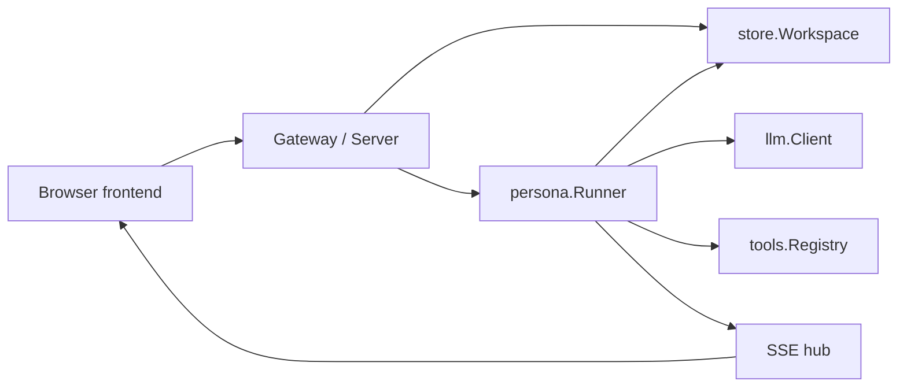

System boundaries, dependency assembly, background workers, multiple instances, and shutdown.

# System boundaries

## Overview

kakeratta stores posts, persona remarks, and user replies in a single timeline. The frontend consists of static ES modules running in a browser. The API runs independently as a Go HTTP server. Inference and search credentials, and the logic that wakes personas, stay on the API side.

## Responsibilities

| Layer | Main responsibilities | Implementation |
| --- | --- | --- |
| Frontend | Input, conversations, device storage, speech controls | `frontend/src` |
| HTTP | Authentication, input validation, persistence, event delivery | `internal/server` |
| Personas | Routing, research, answers, schedules, actions, memory | `internal/persona` |
| Persistence | Durable user state and images | `internal/store` |
| Inference and tools | Model requests and permitted external capabilities | `internal/llm`, `internal/tools`, `internal/mcp` |
| Search | Lexical and semantic timeline search, index updates | `internal/search` |

`store.Workspace` defines the persistence boundary. HTTP handlers and persona execution use the same interface, allowing file storage and Firestore to be selected. A local deployment has one `Server`; with Firebase authentication, `Gateway` holds a `Server` for each user. Nothing assumes a single process: persona work in progress, asks, trials, and locks live in the workspace, so any number of API instances can serve the same users (see [Multiple instances](#multiple-instances)).

## Implementation and verification

- [main.go](../../main.go)
- [server.go](../../internal/server/server.go): `New`
- [workspace.go](../../internal/store/workspace.go): `Workspace`
- [server_test.go](../../internal/server/server_test.go)

# Startup, background work, and shutdown

## Startup

`main` creates the tool configuration and, when configured, GCS and Firestore clients. With `KAKERATTA_FIREBASE_PROJECT_ID`, it creates a `Gateway`; with Firestore as well, the Gateway gets a `Shared` configuration for several instances. Otherwise, it opens a file workspace and creates a `Server`.

`Server.New` connects the Catalogue, Runner, and search Service, registers routes, starts the Runner, and queues a search-index pass. Unless built with `NoClock`, it also queues the periodic checks at once and every minute (`Runner.Tick`).

## The reaction queue

Persona work is kept in the workspace as `store.Reaction` records (files under `reactions/`, or `users/{key}/reactions`) until it is done. A reaction belongs to a lane:

| Lane | Work |
| --- | --- |
| `thread:{root}` | Reacting to a post, reply, or edit; a delivery approved in a routing check; carrying on a turn after an external agent's ask; telling personas about a deleted post |
| `persona:{id}` | Telling a persona about notes deleted by the user or expired by the app |
| `tick` | The periodic checks: asks past their waits, note retries, daily check-ins and monthly summaries, schedules and expired notes |
| `index` | Bringing the search index up to date |

`ClaimReaction` takes the first reaction of a lane not held by a live claim and not held back by `NotBefore`, together with the rest of its lane. The file store does this under its lock. Firestore reads the queue without a transaction and claims the candidate in a transaction on that one document, so claiming never locks the queue against reactions being written; a candidate taken meanwhile passes its lane over for this round. Writing a reaction retries transient errors twice. A lane is therefore worked one reaction at a time, in order, while different lanes run side by side. Each `Runner` dispatches up to four claims at once. A worker renews its claim every 10 seconds (`claimTTL` 30 seconds); a claim that lapses - its process died - is taken up again by anyone, and each claim counts an attempt, so a reaction is dropped after three. Delivery is at least once. Deleted notes of one persona, or deletion wakes for the same post and persona, queued one after another are folded into one wake when claimed. `tick` and `index` have fixed IDs, so at most one of each waits at a time; an index pass releases its record as it starts so changes made meanwhile queue the next pass.

Personas receiving the same post run concurrently. A persona's note keeper, a person persona's calendar reconciliation, and an external agent's reads of one ask take named locks from `Workspace.Lock`: in-process for files, and documents under `users/{key}/locks` with a 30-second renewable lease for Firestore. Routing records change through `UpdateRouting` transactions.

## Shutdown

On SIGINT or SIGTERM, the program calls HTTP server `Shutdown` and then closes the application. The local server and the Gateway call `Halt`: the reactions in hand finish and the rest stay queued for the next start or another instance. `Server.Close` and `Runner.Stop` instead work everything claimable before returning; tests use them to wait for reactions.

## Implementation and verification

- [main.go](../../main.go): `main`
- [server.go](../../internal/server/server.go): `New`, `Close`, `Halt`
- [queue.go](../../internal/persona/queue.go): `Start`, `dispatch`, `handle`, `accept`, `Tick`, `Stop`, `Halt`
- [reactions.go](../../internal/store/reactions.go): `Reaction`, `ClaimReaction`, `nextClaim`
- [runtime.go](../../internal/store/runtime.go): runtime records, `Lock`, `SetClosing`
- [runtime_test.go](../../internal/store/runtime_test.go): lane order, claims, records, and locks for both stores
- [queue_test.go](../../internal/persona/queue_test.go): restart, two runners sharing a queue, and repeated failure
- [runner_test.go](../../internal/persona/runner_test.go)

# Multiple instances

## No owners

With `Shared`, every instance answers every request it receives, and no instance owns a workspace. Work queued anywhere is claimed by whichever runner gets it first. `store.WatchReactions` follows the `reactions` collection group: an instance with the workspace open pokes its runner; one without waits about two seconds, so an instance that has the workspace open claims first, and opens the workspace only if work is still claimable. Every minute each instance also scans `ClaimableWorkspaces`, catching lapsed claims and missed events, and closes workspaces idle for 10 minutes with no open event stream, running export, or reaction in hand.

The only elected role is the scheduler: the instance holding the `scheduler` lease in `leases/` (`cluster.Coordinator`, 90-second lease renewed each minute) queues a `tick` reaction for every workspace each minute with `store.EnqueueTick`. Any instance may then work it; the tick's work claims check-ins and schedules transactionally, so a second tick cannot repeat them.

## State shared through the workspace

External-agent asks, routing and reply trials, and the agent's last call are runtime records (`asks`, `trials`, `presence`) changed by transactions, so an MCP call, a trial, and its application may each reach a different instance. Events go through `users/{key}/events`: `publishEvent` writes them, and each instance with an open event stream subscribes while it is open. Persona definitions are not kept in the process: the Catalogue reads them from the workspace on every look (see [Persona definitions and the Catalogue](./personas.md#persona-definitions-and-the-catalogue)). Events, asks, and trials carry `expireAt` for Firestore TTL policies.

## Account deletion

Deletion sets `workspaceClosures/{key}` through `SetClosing`. While it stands, no reaction is claimed and no claim is renewed, so work in hand elsewhere is cancelled at its next renewal; instances also refuse to open the workspace. The deleting instance halts its own runner, waits up to two minutes for other claims to end, destroys the data, and deletes it again after 90 seconds and after 11 minutes - after requests and the longest turn that may still have been running elsewhere - before lifting the mark. A mark older than 20 minutes is ignored.

## Implementation and verification

- [shared.go](../../internal/server/shared.go): `Shared`, `wake`, `tickShared`, `closeIdle`, `waitForClaims`, `sweepClosed`
- [gateway.go](../../internal/server/gateway.go): `closeAccount`, `restoreWorkspaces`
- [cluster.go](../../internal/cluster/cluster.go): `Coordinator`, `LeaseTTL`
- [firestore.go](../../internal/cluster/firestore.go): scheduler lease
- [events.go](../../internal/store/events.go): `Publish`, `Subscribe`
- [firestore.go](../../internal/store/firestore.go): `Skills`, `Close`
- [cluster_firestore_test.go](../../internal/store/cluster_firestore_test.go): claims, change feed, closing, and events on the emulator
- [cluster_test.go](../../internal/server/cluster_test.go): instances sharing a workspace without owners, taking up queued work, and deletion

# Related chapters

- [API and persistent state](./backend.md)
- [Persona execution and memory](./personas.md)
- [External agents, tools, and sharing](./integrations.md)
