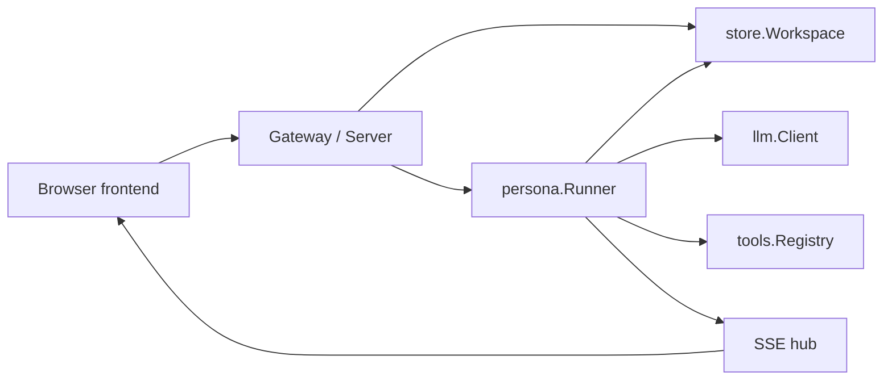

System boundaries, dependency assembly, background workers, and shutdown.

# System boundaries

## Overview

kakeratta stores posts, persona remarks, and user replies in a single timeline. The frontend consists of static ES modules running in a browser. The API runs independently as a Go HTTP server. Inference and search credentials, and the logic that wakes personas, stay on the API side.

## Responsibilities

| Layer | Main responsibilities | Implementation |
| --- | --- | --- |
| Frontend | Input, conversations, device storage, speech controls | `frontend/src` |
| HTTP | Authentication, input validation, persistence, event delivery | `internal/server` |
| Personas | Routing, research, answers, schedules, actions, memory | `internal/persona` |
| Persistence | Durable user state and images | `internal/store` |
| Inference and tools | Model requests and permitted external capabilities | `internal/llm`, `internal/tools`, `internal/mcp` |
| Search | Lexical and semantic timeline search, index updates | `internal/search` |

`store.Workspace` defines the persistence boundary. HTTP handlers and persona execution use the same interface, allowing file storage and Firestore to be selected. A local deployment has one `Server`; with Firebase authentication, `Gateway` holds a `Server` for each user.

## Implementation and verification

- [main.go](../../main.go)
- [server.go](../../internal/server/server.go): `New`
- [workspace.go](../../internal/store/workspace.go): `Workspace`
- [server_test.go](../../internal/server/server_test.go)

# Startup, background work, and shutdown

## Startup

`main` creates the tool configuration and, when configured, GCS and Firestore clients. With `KAKERATTA_FIREBASE_PROJECT_ID`, it creates a `Gateway`. Otherwise, it opens a file workspace and creates a `Server`.

`Server.New` connects the Catalogue, Runner, and search Service. It starts event delivery, the search indexing worker, route registration, and daily and schedule checks. Daily and schedule checks enqueue execution requests at startup and every minute.

## Units of execution

`Runner` manages an in-memory reaction queue using a mutex and a condition variable. It takes posts, edits, daily checks, schedules, memory cleanup after deletion, and note retries in order. Multiple personas receiving the same post run concurrently. Waiting for an external agent's answer can be detached into a separate goroutine.

The ordinary reaction queue is not persisted. Its recovery behavior differs from durable note retry jobs, schedules, and search index state. After an abnormal exit, there is no guarantee that all pending post reactions resume.

## Shutdown

On SIGINT or SIGTERM, the program calls HTTP server `Shutdown` and then closes the application. `Server.Close` stops periodic work and indexing; `Runner.Stop` drains accepted queue items before returning. It cancels turns waiting for an external agent and waits for those goroutines to end.

## Implementation and verification

- [main.go](../../main.go): `main`
- [server.go](../../internal/server/server.go): `New`, `Close`
- [runner.go](../../internal/persona/runner.go): `Start`, `Stop`, `enqueueEntry`
- [index.go](../../internal/server/index.go): `startIndexing`
- [runner_test.go](../../internal/persona/runner_test.go)

# Related chapters

- [API and persistent state](/backend.md)
- [Persona execution and memory](/personas.md)
- [External agents, tools, and sharing](/integrations.md)
