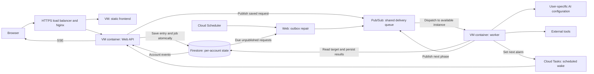

System boundaries, dependency assembly, background workers, Pub/Sub push dispatch, multiple instances, and shutdown.

# System boundaries

## Overview

kakeratta stores posts, persona remarks, and user replies in a single timeline. The frontend consists of static ES modules running in a browser. The API runs independently as a Go HTTP server. Inference and search credentials, and the logic that wakes personas, stay on the API side.

Cloud Run remains the preferred hosted deployment. Production currently runs on a shared VM to reduce the cost of keeping it unchanged through the roughly one-month judging wait after the 2026-10-31 submission deadline. This is a temporary operating arrangement. Production currently runs separate web and worker containers on the 4 GiB `shared-apps` VM alongside GemiHub and Geo MCP. Firestore and GCS remain in project `kakeratta`; the load balancer forwards authenticated internal pushes through Nginx. The shared host has fixed capacity and no automatic failover. Separate Docker networks obtain only their original runtime identity through a host metadata broker; service-account keys are not copied. See [shared VM operations](../../infra/shared-vm/README.md).

## Scaling by adding instances

Web and workers scale independently. Any Web instance can serve an account using its durable workspace; no account-to-server assignment is required. Pub/Sub delivers jobs to available worker instances. Adding workers increases parallel processing across independent accounts and conversation lanes, while Firestore preserves ordering within a lane. Business data, claims and locks belong to an account rather than one global mutable business record. AI configuration and credentials are user-specific.

Cloud Tasks holds scheduled wake times, and Pub/Sub handles delivery and redelivery. Workers need neither a server-membership registry nor a full-account scan to obtain ordinary jobs. The Cloud Run deployment can scale to zero; the shared VM production worker stays running. Firestore retains execution state and transactional outbox requests; Pub/Sub transports those requests. Shared infrastructure still includes indexes, the subscription and outbox repair, so throughput and backlog must be measured as usage grows.

The architecture supports a path toward one million daily active users through additional instances and measured improvements. This is a scaling design, not a tested capacity result. The shared VM and fixed container limits are maintained in [shared-vm](../../infra/shared-vm/README.md); [worker.tf](../../infra/worker.tf) and [variables.tf](../../infra/variables.tf) retain the Cloud Run deployment configuration.

## Responsibilities

| Layer | Main responsibilities | Implementation |
| --- | --- | --- |
| Frontend | Input, conversations, device storage, speech controls | `frontend/src` |
| HTTP | Authentication, input validation, persistence, event delivery | `internal/server` |
| Personas | Routing, research, answers, schedules, actions, memory | `internal/persona` |
| Persistence | Durable user state and images | `internal/store` |
| Inference and tools | Model requests and permitted external capabilities | `internal/llm`, `internal/tools`, `internal/mcp` |
| Search | Lexical and semantic timeline search, index updates | `internal/search` |

Scheduled utterances with their per-schedule notification preference enabled also emit an internal `reminder` event consumed by the executing Server, which delivers encrypted Web Push to registered browser endpoints. This path works without an SSE listener and is not fanned out through the event bus. Subscription state belongs to the workspace; VAPID credentials belong to the operator and are shared across instances. See [Reminder push delivery](./backend.md#reminder-push-delivery).

`store.Workspace` defines the persistence boundary. HTTP handlers and persona execution use the same interface, allowing file storage and Firestore to be selected. A local deployment has one `Server`; with Firebase authentication, `Gateway` holds a `Server` for each user. Nothing assumes a single process: persona work in progress, asks, trials, and locks live in the workspace, so any number of API instances can serve the same users (see [Multiple instances](#multiple-instances)).

## Implementation and verification

- [main.go](../../main.go)
- [server.go](../../internal/server/server.go): `New`
- [workspace.go](../../internal/store/workspace.go): `Workspace`
- [server_test.go](../../internal/server/server_test.go)

# Startup, background work, and shutdown

## Startup

`main` creates the tool configuration and, when configured, GCS and Firestore clients. With `KAKERATTA_FIREBASE_PROJECT_ID`, it creates a `Gateway`; with Firestore as well, the Gateway gets a `Shared` configuration for several instances. Otherwise, it opens a file workspace and creates a `Server`.

`Server.New` connects the Catalogue, Runner, and search Service and registers routes. Combined mode additionally starts the Runner, queues a search-index pass, and asks to be woken now (`Runner.Rearm`). Split web/worker mode sets `Options.Passive`, so dependency assembly starts no dispatcher or initial index/alarm work; push requests invoke one claimed job explicitly. There is no clock going round: see [Times and wakes](#times-and-wakes) and [Pub/Sub push deployment](#pubsub-push-deployment).

## Workspace access and locking

Gateway serializes workspace access by account key. The shared closing-state check and workspace initialization hold only that account's mutex, so slow storage calls for one account do not delay cached access or initialization for other accounts. Concurrent opens of the same account reuse one Server. The gateway-wide mutex protects only in-memory registry state; account mutex entries are released when no operation holds or waits for them.

Account deletion marks the account closing before waiting for its in-progress workspace access, then removes and destroys that same Server. Idle eviction skips accounts whose mutex is busy and holds the account mutex through shutdown and storage release, preventing a replacement from opening during teardown. Gateway shutdown stops admission and waits for admitted workspace accesses before collecting tenants to halt.

Verification: [gateway_concurrency_test.go](../../internal/server/gateway_concurrency_test.go) covers independent accounts during slow opening and shared closing checks, same-account reuse, deletion during opening, shutdown during opening, bounded startup and background wake workers, and skipping busy accounts during idle eviction. Implementation: [gateway.go](../../internal/server/gateway.go) (`workspaceLock`, `workspace`, `closeAccount`, `Close`) and [shared.go](../../internal/server/shared.go) (`closeIdle`).

## The reaction queue

The dispatcher and direct-routing behavior below describes combined mode. Production uses the push worker described in [Pub/Sub push deployment](#pubsub-push-deployment), retaining reactions, lanes, renewable claims and prepared delivery, with execution inside the push request instead of background dispatch slots.

Persona work and background enrichment are kept in the workspace as `store.Reaction` records (files under `reactions/`, or `users/{key}/reactions`) until it is done. A reaction belongs to a lane:

| Lane | Work |
| --- | --- |
| `thread:{root}` | Reacting to a post, reply, or edit; a delivery approved in a routing check; carrying on a turn after an external agent's ask; telling personas about a deleted post |
| `persona:{id}` | None queued now; reactions left from before memory was kept in fields are dropped unrun |
| `due` | Whatever has come due: asks past their waits, note retries, records past their expires day, daily check-ins and monthly summaries, schedules |
| `index` | Bringing the search index up to date |
| `place-{entryID}` | Background reverse geocoding, independently of routing and delivery |

`ClaimReaction` takes the first reaction of a lane not held by a live claim and not held back by `NotBefore`, together with the rest of its lane. The file store does this under its lock. Firestore reads the queue without a transaction and claims the candidate in a transaction on that one document, so claiming never locks the queue against reactions being written; a candidate taken meanwhile passes its lane over for this round. Writing a reaction retries transient errors twice. Delivery in a lane is worked one reaction at a time, in order, while different lanes run side by side. New posts, replies, and edits persist their routing reaction together with acceptance of the entry: Firestore uses one transaction, and the file store writes the request before the entry under the same mutex. A failed queue write cannot leave an accepted entry without its request. A process stopped between the file writes leaves an orphan or stale-text request that routing discards. The accepting runner may claim routing directly with a separate worker ID, outside its four dispatch slots; routing can run ahead of earlier work in the same conversation. Recovery dispatchers can also claim routing past an occupied lane. `PrepareReaction` checks ownership and saves the routing result and definition snapshot, then releases the same record for delivery at its original lane position. Firestore performs the transition and routing-record write in one transaction; the file store writes the routing record before the delivery phase under its mutex, so a crash between writes retries routing. Each `Runner` dispatches up to four claims at once, in addition to direct routing work. A worker renews its claim every 10 seconds (`claimTTL` 30 seconds), each renewal limited to 10 seconds, and a watchdog on its own clock cancels the work if no renewal has succeeded for 20 seconds, so a renewal that hangs cannot let the work run on after another worker may have taken the reaction. Work cut short that way - the claim lost or unrenewable - is not done, so the reaction is not finished even though the claim may still stand: `DeferReaction` holds it back for 30 seconds with its attempts spent afresh, and if that cannot be stored the claim runs out and it is taken up again, with whatever was folded into it; a claim that lapses - its process died - is taken up again by anyone, and each claim counts an attempt, so a reaction is dropped after three. Delivery is at least once. A worker lets a reaction go, with what it folded in, only while the claim is still its own (`FinishReaction` checks the holder in one transaction): if the claim lapsed and another worker took the reaction over, the first finding out at the end deletes nothing. Deletion wakes for the same post and persona queued one after another are folded into one wake when claimed. `due` and `index` have fixed IDs, so at most one of each waits at a time; an index pass retains and renews its claim until it ends. Requests received during the pass atomically mark `IndexAgain`; finishing releases the same record for one more pass instead of deleting it. Claiming clears that marker, coalescing all requests already received. Failures defer the retained record for 30 seconds, and another worker cannot index through its live claim.

Routing queues an idempotent location job for posts with coordinates and no label before completing its own phase. Location jobs use the same claim renewal and shutdown handling, but preserve their attempt counter when deferred; failed lookups wait 30 seconds and stop after three attempts. Completed location writes emit an entry event and request reindexing.

Personas receiving the same post run concurrently. A persona's note keeper, a person persona's calendar reconciliation, and an external agent's reads of one ask take named locks from `Workspace.Lock`: in-process for files, and documents under `users/{key}/locks` with a 30-second renewable lease for Firestore. `Lock` returns a context to work under, which ends if the lock is lost - another process holds it, or renewing has failed for most of the lease - so the keeper, the calendar writes, and the ask read stop rather than run beside the new holder. Writes to field summaries and records (`writeFields`, `appendRecord`, `eachRecord`, `dropRecords`, `MigrateMemory`) check that context first. The lock has a watchdog of its own too: it ends the context if no renewal has succeeded for two thirds of the lease, whether renewals fail or hang, and each renewal is limited to a third of it. Routing records change through `UpdateRouting` transactions.

## Times and wakes

A workspace is not looked at on a clock. It asks to be woken at the next time anything of its own comes due, and at no other.

## The due reaction

The `due` reaction (`Runner.due`) runs everything that has come due - `sweepAsks` closes asks past their waits, `retryNoteJobs` retries failed memory work, `expireRecords` deletes kakera records past their `expires` day, `dailyAt` runs check-ins and the month's summary, and `schedulesAt` runs schedules - and then ends by setting the alarm for the next time. That last step always runs, after a failure or a panic in the rest, retried three times; if it still fails the reaction is not finished, its claim lapses, and it is tried again (an attempt each, three in all). A due reaction out of attempts goes only once the alarm for five minutes on is set; if that cannot be, `DeferReaction` keeps it, unclaimed and held back for five minutes with its attempts spent afresh, and the minute's sweep (`sweepShared`) finds it claimable again when the time comes - so the workspace does not go quiet while the queue is down, and starts by itself when it is back. A time that could not be read is put off no further than five minutes. `nextDue` is the earliest of a schedule's time, a note job's `NextAttempt`, an open ask's claim or plan wait, the earliest `expires` day still to come (returned by `expireRecords`), and the next check-in (`nextCheckIn`, which follows `dailyAt` and `summarizeAt`: a persona's minute on each day in its window, a skipped day passed over, a monthly one on the summary's day). It is at most 29 days away - Cloud Tasks schedules no further, so a workspace with nothing sooner wakes then and sets the rest, and a far-off birthday is reached in steps - and at least 30 seconds away, so a time that cannot be cleared does not wake the workspace in a loop.

Whatever changes a time calls `Runner.Rearm`, which asks to be woken now; the due reaction that follows works the times out afresh, so a change never has to say which time it moved. Callers are settings saved (the time zone, check-ins), the room or a persona changed, and person calendars applied. A piece of work of the Runner's own asks to be looked at again 30 seconds after it ends, since a turn may have set a schedule, a note retry, or an `expires` day. An ask being opened or claimed asks for its own wait. A change forgotten costs a wake up to 29 days late, and is a bug; tests cover each caller.

## The alarm

The alarm is `Runner.SetAlarm`, and does nothing but make sure a due reaction is queued at the time:

| Where | Alarm |
| --- | --- |
| A server running alone (`Server.New`) | A timer in the process (`localAlarm`); the earliest time asked for stands, and it sets the next itself. |
| A shared deployment with `KAKERATTA_TASKS_QUEUE` | A Cloud Tasks task scheduled for the time (`alarm.Tasks.Set`), named `due-{workspace}-{time bucket of 30 seconds}` so setting one twice sets one. The task calls `POST /internal/due` with an identity token of the app's service account; `alarm.Workspace` refuses anything not issued to that account for that URL, and the gateway opens the workspace, if this instance has it closed, and queues its due reaction. Anything that stops the wake from being kept - the existence check, opening the workspace, saving the reaction - answers 503, so Cloud Tasks tries the task again; a workspace that is gone or being deleted answers 204. |
| A shared deployment without a queue | One `localAlarm` per workspace in the gateway; when it fires, the workspace is opened and woken. |

At start each instance asks every workspace to be woken now, once (`restoreWorkspaces`), so workspaces from before this design set their own next time; tasks are named, so instances starting together set one. Startup alarm registration and local workspace restoration use up to eight workers per batch, so one slow account does not serialize the whole batch. Shutdown stops admitting new keys and waits for work already admitted. After that nothing lists the workspaces again. A minute's sweep (`sweepShared`) only takes up work whose claim lapsed and closes what is idle. A workspace that is deleted has no reason to wake: the wake finds no workspace and ends.

## Implementation and verification

- [due.go](../../internal/persona/due.go): `due`, `nextDue`, `nextCheckIn`, `Rearm`, `SetAlarm`
- [schedule.go](../../internal/persona/schedule.go): `schedulesAt`
- [review.go](../../internal/persona/review.go): `expireRecords`
- [alarm.go](../../internal/server/alarm.go): `localAlarm`
- [shared.go](../../internal/server/shared.go): `setAlarm`, `fire`, `serveDue`, `sweepShared`
- [tasks.go](../../internal/alarm/tasks.go): `Tasks`, `Workspace`, `GoogleValidator`
- [due_test.go](../../internal/persona/due_test.go): the next check-in, the next due, and asking again
- [alarm_test.go](../../internal/server/alarm_test.go): local alarm timing and shutdown waiting, gateway callback retries during shutdown, a task calling back, and a wake that is not kept answering 503
- [tasks_test.go](../../internal/alarm/tasks_test.go): tasks and their verification

# Shutdown

On SIGINT or SIGTERM, the program calls HTTP server `Shutdown` and then closes the application. The local server and the Gateway call `Halt`: the reactions in hand finish and the rest stay queued for the next start or another instance. `Server.Close` and `Runner.Stop` instead work everything claimable before returning; tests use them to wait for reactions. Local alarm shutdown cancels pending timers and waits for callbacks that have already started, before stopping the Runner, so a due reaction cannot write into a workspace after shutdown returns. Gateway shutdown rejects new workspace openings and local alarm registrations, waits for its local alarm callbacks without holding the alarm registry lock, and then halts the collected tenants. This allows a callback to finish or request a retry without deadlocking or recreating a stopped alarm.

## Implementation and verification

- [main.go](../../main.go): `main`
- [server.go](../../internal/server/server.go): `New`, `Close`, `Halt`
- [queue.go](../../internal/persona/queue.go): `Start`, `dispatch`, `handle`, `accept`, `Stop`, `Halt`
- [reactions.go](../../internal/store/reactions.go): `Reaction`, `ClaimReaction`, `nextClaim`
- [reaction_routing.go](../../internal/store/reaction_routing.go): direct routing claims and prepared delivery persistence
- [runtime.go](../../internal/store/runtime.go): runtime records, `Lock`, `SetClosing`
- [runtime_test.go](../../internal/store/runtime_test.go): lane order, claims, a stale worker finishing nothing, records, and locks for both stores
- [queue_test.go](../../internal/persona/queue_test.go): restart, two runners sharing a queue, repeated failure, a worker that lost its claim, work cut short by failing renewals kept for another try, a due that cannot set the next wake or is out of attempts, and writes refused after a lost lock
- [index_queue_test.go](../../internal/persona/index_queue_test.go): indexing across lease renewals and retained retries
- [acceptance_test.go](../../internal/store/acceptance_test.go): entry/request acceptance, restart, duplicate submissions, and index coalescing for both stores
- [runner_test.go](../../internal/persona/runner_test.go)

# Multiple instances

## Pub/Sub push deployment

`KAKERATTA_MODE` defaults to `combined`, preserving the dispatcher described in this chapter. Optional `web` and `worker` modes require Firebase authentication, Firestore, GCS, Cloud Tasks, and a Pub/Sub topic. Split gateways do not restore pending workspaces, watch the reactions collection group, or run the periodic claimability sweep; tenant runners do not start their dispatcher, automatically index on opening, or rearm on opening. Web still saves reactions, queues indexing on entry changes, and requests alarms when schedules/settings change. Direct routing is disabled: a saved routing request is processed by a worker. The following subsections describe combined mode unless otherwise stated.

Firestore persists a new dispatch generation and `users/{key}/dispatchOutbox/{generation}` in the same transaction as reaction creation, deferred retries, prepared delivery, and a follow-up index pass. A broker message contains only workspace, reaction, and dispatch IDs. A best-effort publisher removes the outbox record only after Pub/Sub accepts the message. Authenticated `POST /internal/dispatch` repairs up to 100 due unpublished requests using an indexed collection-group query; failed publications are held back one minute. Deferred work remains in the outbox until `readyAt`. Repair does not scan users or reactions.

Pub/Sub calls authenticated `POST /internal/work` on the separate worker service. A worker admits one job at a time, opens an ephemeral workspace, checks existence/deletion, and transactionally claims the requested generation. Routing may bypass earlier delivery; other jobs must be first in their lane. A duplicate live claim or blocked lane returns 503 for broker retry. Deleted workspaces and obsolete generations return 204. Execution uses an eight-minute context and the existing renewable claim watchdog. Success requires durable completion or a saved successor generation. The workspace closes before responding. Delivery remains at least once. Combined mode exposes neither endpoint; worker mode exposes no user API.

Worker resources and instance limits are configurable deployment settings. Work runs within the authenticated push request and retains the execution timeout and renewable claim watchdog. Long workflows and real-provider latency need measurement as capacity grows; independent lanes can be processed by additional instances without account ownership. See [push worker operations](./operations.md#push-worker-operations).

Sources and verification: [dispatch persistence](../../internal/store/dispatch.go), [transport](../../internal/dispatch/pubsub.go), [worker runner](../../internal/persona/worker.go), [HTTP worker](../../internal/server/worker.go), [infrastructure](../../infra/worker.tf), [store tests](../../internal/store/dispatch_test.go), [transport tests](../../internal/dispatch/pubsub_test.go), [HTTP tests](../../internal/server/worker_test.go).

## No owners

With `Shared`, every instance answers every request it receives, and no instance owns a workspace. Work queued anywhere is claimed by whichever runner gets it first. `store.WatchReactions` follows the `reactions` collection group: an instance with the workspace open pokes its runner; one without waits about two seconds, so an instance that has the workspace open claims first, and opens the workspace only if work is still claimable. Every minute each instance also scans `ClaimableWorkspaces`, catching lapsed claims and missed events, and closes workspaces idle for 10 minutes with no open event stream, running export, or reaction in hand.

Background wakes coalesce by account and limit claimability checks and workspace opening to eight concurrent operations per instance. Foreground requests do not use these slots. Idle eviction also uses up to eight workers, keeping slow teardown from serializing all idle accounts.

Nothing is elected. Times are not kept by an instance: a workspace's alarm brings its due reaction, which any instance may work; check-ins and schedules are claimed transactionally, so a second due reaction cannot repeat them.

## State shared through the workspace

External-agent asks, routing and reply trials, and the agent's last call are runtime records (`asks`, `trials`, `presence`) changed by transactions, so an MCP call, a trial, and its application may each reach a different instance. Events go through `users/{key}/events`: `publishEvent` writes them, and each instance with an open event stream subscribes while it is open. Persona definitions are not kept in the process: the Catalogue reads them from the workspace on every look (see [Persona definitions and the Catalogue](./personas.md#persona-definitions-and-the-catalogue)). Events, asks, and trials carry `expireAt` for Firestore TTL policies.

## Account deletion

Deletion sets `workspaceClosures/{key}` through `SetClosing`. While it stands, no reaction is claimed and no claim is renewed, so work in hand elsewhere is cancelled at its next renewal. Gateway checks local and shared closing state before returning even an already-open workspace, for both ordinary tenant API requests and MCP requests. Requests are refused if shared closing state cannot be read. The deleting instance halts its own runner, waits up to two minutes for other claims to end, destroys the data, and deletes it again after 90 seconds and after 11 minutes - after requests and the longest turn that may still have been running elsewhere - before lifting the mark. A mark older than 20 minutes is ignored.

## Implementation and verification

- [shared.go](../../internal/server/shared.go): `Shared`, `wake`, `sweepShared`, `closeIdle`, `waitForClaims`, `sweepClosed`
- [gateway.go](../../internal/server/gateway.go): `closeAccount`, `restoreWorkspaces`
- [events.go](../../internal/store/events.go): `Publish`, `Subscribe`
- [firestore.go](../../internal/store/firestore.go): `Skills`, `Close`
- [cluster_firestore_test.go](../../internal/store/cluster_firestore_test.go): claims, change feed, closing, events, and a lost lock ending its holder's context or its renewals failing, on the emulator
- [cluster_test.go](../../internal/server/cluster_test.go): instances sharing a workspace without owners, taking up queued work, and deletion
- [hardening_test.go](../../internal/server/hardening_test.go): cached workspaces refuse ordinary API and MCP requests when closing locally or elsewhere, or when the shared closing check fails

# Related chapters

- [API and persistent state](./backend.md)
- [Persona execution and memory](./personas.md)
- [External agents, tools, and sharing](./integrations.md)
