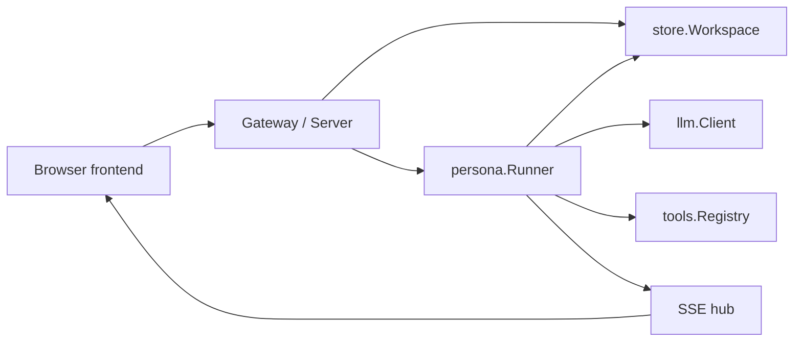

System boundaries, dependency assembly, background workers, multiple instances, and shutdown.

# System boundaries

## Overview

kakeratta stores posts, persona remarks, and user replies in a single timeline. The frontend consists of static ES modules running in a browser. The API runs independently as a Go HTTP server. Inference and search credentials, and the logic that wakes personas, stay on the API side.

## Responsibilities

| Layer | Main responsibilities | Implementation |
| --- | --- | --- |
| Frontend | Input, conversations, device storage, speech controls | `frontend/src` |
| HTTP | Authentication, input validation, persistence, event delivery | `internal/server` |
| Personas | Routing, research, answers, schedules, actions, memory | `internal/persona` |
| Persistence | Durable user state and images | `internal/store` |
| Inference and tools | Model requests and permitted external capabilities | `internal/llm`, `internal/tools`, `internal/mcp` |
| Search | Lexical and semantic timeline search, index updates | `internal/search` |

`store.Workspace` defines the persistence boundary. HTTP handlers and persona execution use the same interface, allowing file storage and Firestore to be selected. A local deployment has one `Server`; with Firebase authentication, `Gateway` holds a `Server` for each user. With Firestore, several API instances can serve the same users; `internal/cluster` divides each workspace's persona work between them (see below).

## Implementation and verification

- [main.go](../../main.go)
- [server.go](../../internal/server/server.go): `New`
- [workspace.go](../../internal/store/workspace.go): `Workspace`
- [cluster.go](../../internal/cluster/cluster.go): `Coordinator`
- [server_test.go](../../internal/server/server_test.go)

# Startup, background work, and shutdown

## Startup

`main` creates the tool configuration and, when configured, GCS and Firestore clients. With `KAKERATTA_FIREBASE_PROJECT_ID`, it creates a `Gateway`; with Firestore as well, the Gateway gets a `cluster.Firestore` coordinator. Otherwise, it opens a file workspace and creates a `Server`.

`Server.New` connects the Catalogue, Runner, and search Service and registers routes. Unless built as a follower, it then calls `Lead`, which starts the search indexing worker, the Runner, and daily and schedule checks. Daily and schedule checks enqueue execution requests at startup and every minute. A follower `Server` answers requests and keeps reactions durable, but runs no persona work until `Lead` is called.

## Units of execution

`Runner` works a reaction queue using a mutex and a condition variable. It takes posts, edits, daily checks, schedules, memory cleanup after deletion, and note retries in order. Multiple personas receiving the same post run concurrently. Waiting for an external agent's answer can be detached into a separate goroutine.

Posts, edits, and deletion wakes are durable: `acceptLocked` saves each as a `store.Reaction` (files under `reactions/`, or `users/{key}/reactions`) before queueing it, and `finish` removes the record once the work is done. Deleted notes and posts for the same persona fold into one waiting wake. `Poke` rereads the saved reactions: at `Start` (taking up what a previous process left, counting an attempt each time and dropping one after three), every minute, and when the Firestore change feed reports a new one. Delivery is at least once: a reaction interrupted by a crash runs again. Daily, schedule, and note-retry checks are periodic and not saved; each kind is queued at most once at a time.

## Shutdown

On SIGINT or SIGTERM, the program calls HTTP server `Shutdown` and then closes the application. The local server and the Gateway call `Halt`: the reaction in hand finishes and the rest of the queue stays saved for the next start or another instance. `Server.Close` and `Runner.Stop` instead drain every accepted item; tests use them to wait for reactions. Both cancel turns waiting for an external agent and wait for those goroutines to end.

## Implementation and verification

- [main.go](../../main.go): `main`
- [server.go](../../internal/server/server.go): `New`, `Lead`, `Close`, `Halt`
- [runner.go](../../internal/persona/runner.go): `Start`, `Stop`, `Halt`, `Poke`, `acceptLocked`
- [reactions.go](../../internal/store/reactions.go): `Reaction`, `WatchReactions`
- [index.go](../../internal/server/index.go): `startIndexing`
- [queue_test.go](../../internal/persona/queue_test.go): restart, follower hand-off, and repeated failure
- [runner_test.go](../../internal/persona/runner_test.go)

# Multiple instances

## Workspace ownership

Each workspace's persona work - the Runner and its queue, trials, external-agent asks, calendar locks, daily and schedule checks, and indexing - runs on exactly one instance, its owner. Ownership is a lease in `workspaceLeases/{key}`, outside the workspace document. `Acquire` takes a lease nobody holds or extends the caller's own; `LeaseTTL` is 30 seconds and the owner renews every 10 seconds in `keepLeases`. An owner that loses its lease, or cannot renew it for 20 seconds, demotes the workspace: it halts the Runner, closes the tenant, and releases the lease.

Every instance opens workspaces as followers to answer requests. `restoreCluster` runs every minute: it takes over workspaces with no live lease, so check-ins and schedules run, and closes follower tenants idle for 10 minutes with no open event stream or running export. A request that needs the runner also takes over a workspace nobody holds.

## Forwarding and events

`ownerRoute` names requests that need the owner: all `/api/mcp/` paths, routing and reply trials, `PUT /api/settings`, and persona changes. On another instance, `serveOwned` carries such a request through `Forward`: the call is written to `users/{key}/calls`, the owner's `Serve` listener runs it against its tenant with `serveCall`, and the reply is written back. Bodies over 512 KiB are split into parts; the session cookie is not carried, while an MCP bearer token is carried transiently in the call document. When the owner's lease ends before it answers, the caller takes the workspace over and retries. Posts, replies, edits, and deletions are not forwarded; they save a durable reaction the owner's change feed picks up.

Events go through `users/{key}/events`. `publishEvent` writes them; each instance with an open event stream, and the owner for indexing, subscribes while needed and feeds its local hub. Persona definitions are materialised per instance and kept current by a Firestore change feed on `skills`. Calls and events carry `expireAt` for Firestore TTL policies.

Account deletion marks the lease closing so nobody may take the workspace, waits for the owner to release it, destroys the data, and deletes it once more after 90 seconds to catch writes from requests in flight on other instances before lifting the mark. A closing mark older than 10 minutes is ignored.

## Implementation and verification

- [cluster.go](../../internal/cluster/cluster.go): `Coordinator`, `Lease`, `LeaseTTL`
- [firestore.go](../../internal/cluster/firestore.go): leases, `Forward`, `Serve`, `Publish`, `Subscribe`
- [memory.go](../../internal/cluster/memory.go): in-process coordinator for tests
- [forward.go](../../internal/server/forward.go): `ownerRoute`, `owner`, `promote`, `demote`, `serveOwned`, `keepLeases`, `restoreCluster`
- [gateway.go](../../internal/server/gateway.go): `closeAccount`, `sweepClosed`
- [firestore.go](../../internal/store/firestore.go): `watchSkills`, `Close`
- [firestore_test.go](../../internal/cluster/firestore_test.go): leases, forwarding, owner loss, and events on the emulator
- [cluster_test.go](../../internal/server/cluster_test.go): two gateways sharing one workspace, takeover, and deletion

# Related chapters

- [API and persistent state](./backend.md)
- [Persona execution and memory](./personas.md)
- [External agents, tools, and sharing](./integrations.md)
