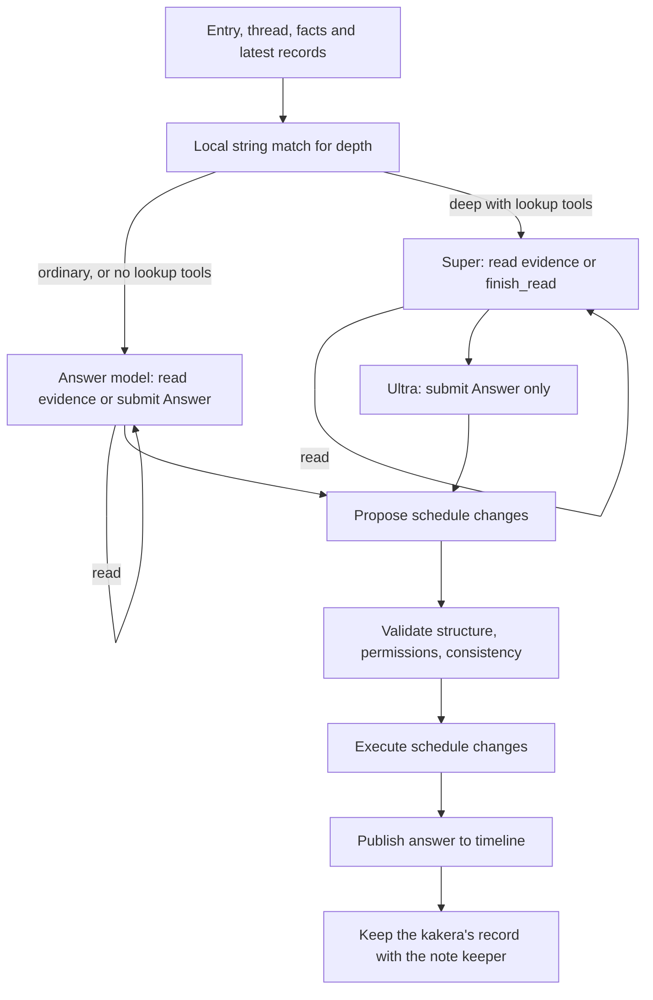

Persona definitions, support through the direct built-in AI and infographics, routing, research budgets and capabilities, reviewed schedule changes, optional memory as grounded facts and records, schedules, and corrections.

Throughout this chapter, Super refers to the middle slot, whose default is Nemotron 3 Super, and Ultra to the high slot; see [Reading settings](./backend.md#reading-settings). On Nebius with the shipped middle model, several jobs run on other models instead; see [Models on Nebius](#models-on-nebius).

# Persona definitions and the Catalogue

Persona inference calls emit per-request usage records tagged by execution stage and, where available, persona, trigger, wake category and durable job. Ordinary research/tool rounds are distinguished from correction retries, phase regeneration and durable note retries. See [Model usage logging](./backend.md#model-usage-logging), [usage.go](../../internal/llm/usage.go), and [persona usage tests](../../internal/persona/usage_test.go). Workspace monthly accounting additionally groups observed costs and Web search requests by persona and reply/scheduled/other wake category, including external-agent reads through the application. Routing and embedding costs remain shared; external-agent inference itself is outside application accounting. See [monthly accounting](./backend.md#monthly-usage-accounting). Workflow/routing/keeper records still describe semantic outcomes; they do not substitute for token or model-call counts.

## Execution host

Production runs reactions on the separate Pub/Sub push worker. Web persists requests without direct routing or a background dispatcher. `Runner.WorkJob` claims one dispatch generation, calls the existing reaction handler within the request's eight-minute context, and verifies durable completion or a saved successor before acknowledgment. Prepared delivery restores its persisted definition snapshot. Routing, scheduled work, memory updates and retries retain their existing business semantics; long workflows are subject to the enclosing request budget. Combined/local mode retains the background dispatcher. See [push deployment](./architecture.md#pubsub-push-deployment), [worker.go](../../internal/persona/worker.go), [queue.go](../../internal/persona/queue.go), and [HTTP verification](../../internal/server/worker_test.go).

## Skill structure

`Skill` contains an ID, name, emoji icon, optional `Avatar` photo, tone, `Domain`, `Instructions`, `Memory`, and `Tools`. `Domain` informs routing, `Instructions` describe the persona's behavior, and `Memory` says in prose what the persona remembers and how: which facts to keep, how to merge them, which tags and record dates to use. It no longer names fields: every persona keeps one memory file, `Memo.md` (see [Memory layout](#memory-layout)).

`Avatar` is presentation metadata: a compressed JPEG data URL validated at save time, kept in file/Firestore definitions and exports, and preserved by AI edits without entering model text context. It is separate from the emoji `Icon` used in persona descriptions and external-agent briefs. See [Profile names and photo avatars](./frontend.md#profile-names-and-photo-avatars).

Subject personas cover topics. Person personas use `Kind: person` and have `Aliases` and `Keywords` that can match text. The Catalogue combines built-in personas with user-installed or edited definitions. `Settings.Active` selects active personas.

The AI persona builder distinguishes identifying call names from shared topic keywords. Its instructions preserve the complete relationship in `Name`, `Aliases`, and any relationship-based keyword: for example, `義理の娘のパパ` must not be shortened to `パパ`, `父`, or `お父さん`. Direct relationships may use a bare call name such as `パパ` for the user's own father. The builder receives the IDs, names, and aliases of other registered people, including paused people, to avoid overlapping call names; it excludes the person being edited and does not include other people's basic information, instructions, or topic keywords. Hobbies, preferences, and skills may be standalone shared keywords, with variants, so the same post can reach multiple people. AI revisions are instructed to correct shortened relationship call names while retaining shared topics. These generation instructions do not enforce uniqueness at save time or migrate saved definitions. See [persona_builder.go](../../internal/server/persona_builder.go) and [persona_builder_test.go](../../internal/server/persona_builder_test.go).

The Catalogue keeps nothing itself. It reads the installed definitions through `Workspace.Skills` - `skills/{id}/skill.json` files, or the Firestore `skills` collection - so a definition changed by another process serving the same user is seen at once. `Install`, `Update`, and `Uninstall` write only through `PersistSkill` and `DeleteSkill`; there is no second copy to keep in step.

A piece of work reads once. `Catalogue.Snapshot` returns a read-only `Skills` (`All`, `Find`, `Active`) that does not change afterwards. A reaction takes one when a worker claims it (`Runner.withSkills`) and keeps it on its context, so the router, every persona's turn, the note keeper, and the periodic checks it runs all see one set; the entry points reached from HTTP (`CheckRouting`, `ApplyRouting`, `ApplyReply`, `PreviewReply`) take one on entry, and handlers that look up several personas take one at the top. Code without a snapshot on its context reads afresh through `Runner.skills`. Prepared entry deliveries persist the routing snapshot as `SkillsJSON`, together with the active persona order, and restore it when claimed, including after restart. A definition changed while a long turn runs takes effect from the next piece of work.

## Shipped personas and retired personas

The app ships `tabe` (`gourmet`), `shiori` (`book`), `sona` (`routine`), and `インフォグラフィック` (`infographic`). The former built-in `michi` (`move`) is no longer provided. Without an installed definition, saved `move` activation IDs do not resolve in `Skills.Active`, so it is absent from the persona list and receives no new turns. Existing timeline entries and private memory are retained. A previously customized `move` definition remains available as a user-installed persona and can be paused or removed through normal management. Users can create their own travel persona and declare the existing `place_search` tool.

Verification: [skill_test.go](../../internal/persona/skill_test.go) checks the retired built-in and preservation of a user-installed travel definition. Cross-persona execution tests use [travel_fixture_test.go](../../internal/persona/travel_fixture_test.go) as a custom persona.

## Kakeratta support in the direct built-in AI

`@ai` is the single built-in question and support entry point. The standalone `support` persona has been retired, removed from `Builtins`, and removed from new-workspace and judge seed activation lists. The retired `support` ID is rejected by `validate` on both definition reads and writes, so saved support definitions or activation IDs do not reintroduce an independent support persona. Existing timeline entries and memory files are not purged by this change. New workspaces activate sona and infographic; saved activation choices remain otherwise authoritative.

The transient [built-in agent](../../internal/persona/builtin_agent.go) carries the support instructions. Only questions about kakeratta's usage, specifications, settings or problems ask it to read `kakeratta_help`: first `index.md`, then the relevant subsystem chapters. It does not preload all chapters or request them for unrelated questions. It explains confirmed behavior in the user's language with screen labels and steps, distinguishes the specification from actual account/device/connection state, does not ask for secrets, and never claims to have changed settings or repaired the app. This is a model instruction rather than a deterministic pre-answer classifier, so integration tests verify tool execution and prompt transfer rather than guaranteeing every live model choice.

`kakeratta_help` remains a read-only tool backed by the same `docs/system/` bundle embedded in the binary. Updating the bundle takes effect after rebuilding. The direct agent retains its other read-only capabilities and Super VL / explicit-depth Ultra model choices, with no private note saving or schedule mutations. The tool also remains available to external planners through their permitted research path.

Verification: `TestBuiltinAgentInheritsSupportAndSupportIsRetired` in [skill_test.go](../../internal/persona/skill_test.go) checks retirement, old activation and definition handling, transferred instructions and specification access; direct execution is covered in [builtin_agent_test.go](../../internal/persona/builtin_agent_test.go).

## Built-in infographics

`infographic` (name `インフォグラフィック`, icon 📊) handles explicit requests to turn a post or conversation into an infographic. Its definition defaults to `memoryEnabled: false` and `alwaysUltra: true`; it does not save notes or wake for periodic check-ins, and ordinary requests generate their final answer with the high (Ultra) model after Super research. Its external-agent preference follows the ordinary rules and defaults off. New workspaces activate it together with sona; saved activation selections remain authoritative.

The persona declares no Web search tool and uses existing material and conversation context. It submits Markdown in `Answer.Text`; it does not generate HTML, CSS or SVG. The instructions describe the browser's mechanical layout ([frontend](./frontend.md#merging-data)): a `# emoji title` with a one- or two-sentence lead forms the banner, and each `## emoji heading` becomes a card, so the answer is split into one `##` section per theme. Every heading starts with an emoji, list items start with a meaningful emoji, and tables may carry emoji. Mermaid is used when the material has steps, flows, causes, structure, classification, relationships, or a timeline and a diagram makes it clearer: as many diagrams as the content needs and none otherwise, each inside the section it explains, with three to eight nodes, one-line labels of about 15 characters, and short context around it. Flowcharts cover flows and causes, `flowchart TD` branches cover structure, and `sequenceDiagram` covers exchanges and timelines. Other diagram families and styling directives are excluded; the syntax limits otherwise follow the renderer, which reads pipe labels, chains, fan-out, and subgraphs. Clarifying questions are plain prose without headings. Mermaid instructions are limited to `flowchart`/`graph` and `sequenceDiagram` with alphanumeric node IDs; other diagram families and `style`/`classDef` directives are not used. The host persists the text unchanged; the browser uses its existing Markdown and Mermaid renderer. Previously generated HTML answers retain their isolated display and image export support. Normal prose remains available for clarification when source material is missing. URL requests use the page title and body already attached by `readLink`, and image requests use the description and extracted text already produced by `readCapture`. A reply's thread carries the original material. When a user replies to another persona's answer with `@infographic`, the replied-to answer is the diagram's subject, with original material used as background or evidence. An explicitly requested different subject, such as the original post or whole thread, takes precedence. Failed retrieval or interpretation must not be replaced with invented content.

`infographicRules` overrides the normal post-language rule with the request's `Entry.Language` (`ja` or `en`), captured from the browser display language. Headings, explanations, and diagram labels are translated while retaining facts and proper names. Older requests without this field use the latest user language in their thread, or the ordinary post-language rule if none exists. The rules reach both the built-in answer prompt and the external ask. Verification: [infographic_test.go](../../internal/persona/infographic_test.go) checks interpreted image/expanded URL context, both display languages, cross-persona reply routing and answer context, intact Markdown persistence, absence of Web search tools, and Ultra selection.

## Always thinking deeply

`Skill.AlwaysUltra` (`alwaysUltra`, default false) selects `consideredModel` only for final-answer composition in `Runner.run` - Ultra, or Super VL on Nebius (see [Models on Nebius](#models-on-nebius)) - and the existing deeper research budget for any wake. The `ultra` display slot is set only when that answer runs on the high model. Research and schedule planning keep their own models, including phase regeneration. The high model falls back to the configured middle/low model when absent, as with an explicit deeper reply. A normal request with this setting uses a length instruction that does not claim the user requested a revision of an earlier answer. It does not enable or disable external delegation: a preferred external agent still answers, with the built-in Ultra path used on fallback. The creation and editing forms expose this option, and an AI revision that omits it retains the saved value.

## Optional persona memory

`Skill.MemoryEnabled` (`memoryEnabled` in JSON) is an optional boolean. Omitted or null values retain the historical default of remembering; infographic's built-in default is false, also inherited by saved built-in overrides that omit the option. The creation and editing forms expose **記憶する** (Remember). AI revisions preserve the existing choice when they omit the field.

When false, turns receive no private memory, record queries return no memory (explicit timeline entry reads remain available), and the host skips the note keeper and its retry writes, daily memory tidying. Neither daily/monthly check-ins nor their alarms are scheduled for that persona. A memoryless persona with only read tools also skips post-answer schedule planning and review model calls. The check-in settings endpoint rejects changes while memory is off. Ordinary routing, replies, persona editing, tool permissions, explicit notification schedules, and external-agent planning work as usual. Existing notes remain stored so enabling memory again can resume them; disabling does not erase user data. Cards and room menus hide memory actions and check-in controls, while retaining editing and external-agent preference.

Implementation: [skill.go](../../internal/persona/skill.go), [kakeratta_help.go](../../internal/tools/kakeratta_help.go), [bundle.go](./bundle.go), and [settings.go](../../internal/store/settings.go). Verification: [skill_test.go](../../internal/persona/skill_test.go), [kakeratta_help_test.go](../../internal/tools/kakeratta_help_test.go), and [settings_test.go](../../internal/store/settings_test.go).

## Management

Installing a definition from the frontend validates it, saves it through the Catalogue, and activates the new persona. The names the external agent answers to are reserved: `reservedNames` refuses an ID, name or alias that folds (case, width, kana and honorifics ignored) to `agent`, `エージェント`, `外部エージェント` or `ai` when a definition or draft is written, so `@agent` always addresses the agent (see [Direct requests to the external agent](./integrations.md#addressing-the-agent)). Definitions already saved under such a name are still read; the check is not applied on load. Verification: `TestInstallRefusesWhatItCannotTrust`, `TestReservedNamesAreCheckedOnlyWhenWritten` and `TestDirectAgentNamesCannotBePersonaNamesOrAliases` in [skill_test.go](../../internal/persona/skill_test.go). AI-assisted definition creation is handled by the persona builder. New person personas receive `web_search`, `place_search`, and `schedule` when available; built-in `route` has been removed. Verification: [persona_builder_test.go](../../internal/server/persona_builder_test.go) checks the new-person default tools without route. Pausing a persona retains memory and removes schedules. Removing a persona removes its definition, memory, and schedules.

For person personas, `Skill.BasicInfo` (`basicInfo` in JSON) stores initial personal information, such as birthdays and preferences, with the definition. The builder returns it in the draft, and users can edit or clear it in the creation and editing forms. Saving never posts this information to the timeline or creates memory notes. Date-bearing information is separately normalized into notification schedules before saving; dates that cannot be established are omitted. The field is limited to 8,000 characters and cleared for subject personas.

A person's persona is not the person: it looks after the user's dealings with them. Every prompt it is given opens with `Skill.intro` - "you look after the user and 「name」, and are not name" - rather than "you are 「name」", which made it answer as the person ("ありがとう、届いたよ" to a gift the user said they had sent). `personIdentityRules` at the head of its instructions say the same in rules: it does not speak as the person or write their replies or feelings, it talks to the user, and when the user reports what they did for the person it briefly acknowledges the event without promising unsolicited follow-ups. It also keeps the direction of an event: when the user reports what the person did for them (a gift received, help given), the user is the recipient, so the persona neither thanks as if it had received it nor says the person is pleased, and acknowledges it as something the user received. The answer, phase, and note-keeper prompts all use `intro`, so the log keyed by the opening line stays whole.

Shared person instructions close a follow-up when the user reports delivery, impressions or results, or says no confirmation is needed. The keeper updates or invalidates the pending fact while retaining the gift or other historical event; a mere acknowledgment does not establish delivery or completion. A persona's own promise to ask later is not a user obligation or request and must not become a pending fact or justify repeated schedules. Before an autonomous check-in asks about an event, instructions require checking memory and topic-specific timeline history, including before the previous check-in, for earlier questions and user replies. An answered question stays silent, and an unanswered question is not repeated without new user information or an explicit request to check again. Unavailable confirmation history also requires silence. These are model instructions, not a deterministic host filter; they apply to saved person definitions through `forTurn` and reach answer, planning, and keeper prompts. Verification: [people_test.go](../../internal/persona/people_test.go).

Each person turn receives the current basic information through `forTurn`, alongside the shared person rules. Personas use it for answers, research, and scheduling, without copying it into notes; the current definition takes precedence over outdated notes. AI edits receive the current draft and preserve existing basic information when the response omits the field.

A persona's declared tools are selected from the Registry. A person persona's memory guidance is the app's own (`personMemory`): what is known about the person, and events with them, unfinished ones first.

## sona: preparation and timely follow-ups

The built-in `sona` replaces `plana`, retaining the storage ID `routine` so existing memory, schedules, and activation choices stay attached. Its default definition answers to `@sona` or `@routine`, not `@plana`. New workspaces start with `routine` active; saved active lists, including an empty list, take precedence.

sona covers upcoming plans, everyday belongings, habits, forgotten items, and weather relevant to an outing. Its memory keeps user-grounded belongings, timing, places and past omissions, without turning one failure into a permanent habit, and one-off plans and preparation until completed. Generic suggestions are not stored as the user's habits, and forecasts are fetched when needed rather than kept in memory. When the user's belongings are unknown, sona makes a general check in the reply's language; its instructions give the Japanese and English wording as examples, so an English post does not get the Japanese line verbatim (`TestSonaShipsWithPreparationAndWeather` in [skill_test.go](../../internal/persona/skill_test.go)).

Its permitted tools are `schedule` and `weather_forecast`, alongside shared timeline and record reads. With a grounded departure time, it may schedule a preparation check shortly before leaving; chore-completion checks remain shortly afterwards. A sharing check-in can find upcoming plans in posts addressed to other personas and schedule a later preparation turn, staying silent until there is a reason to speak. The daily check-in time remains the app-selected minute between 07:00 and 21:00; the scheduled preparation turn supplies timely delivery. The system does not detect departure independently of posts, memory, or schedules.

Preparation wakes compare known plans, belongings and past omissions with a fresh forecast for the relevant region and outing period, distinguishing sunshine now from rain later. Unknown locations or times and unavailable forecasts are not invented; grounded belongings checks can still proceed without weather. Completed, cancelled, departed or already-mentioned plans stay quiet. Model instructions guide these decisions; schedule claims prevent repeating the same due wake. Existing person reminders can be read to avoid proposing duplicate notifications. User-customized definitions continue to override built-in defaults.

Verification: [sona_test.go](../../internal/persona/sona_test.go) exercises a scheduled weather lookup, weather failure with a belongings-only answer, and a silent sharing check-in that schedules preparation; [settings_test.go](../../internal/store/settings_test.go) checks initial activation and preservation of saved choices.

## Implementation and verification

- [skill.go](../../internal/persona/skill.go): `Catalogue`, `Snapshot`, `Skills`
- [queue_test.go](../../internal/persona/queue_test.go): a reaction reads the definitions once
- [people.go](../../internal/persona/people.go)
- [personas.go](../../internal/server/personas.go)
- [persona_builder.go](../../internal/server/persona_builder.go)
- [skill_test.go](../../internal/persona/skill_test.go)
- [persona_builder_test.go](../../internal/server/persona_builder_test.go): basic-information persistence and editing without posts or notes
- [people_test.go](../../internal/persona/people_test.go): basic information in turn instructions, and a person's persona not introduced as the person

# Delivering posts to personas

## Building the recipient set

After image analysis, Runner loads active personas and the thread. Direct `@agent` and `@ai` requests leave here before any persona is considered: `@agent` goes to the configured, unpaused external agent and receives a notice when unavailable; `@ai` always selects the built-in AI, and its follow-ups remain built-in unless explicitly redirected; see [Direct requests to the external agent](./integrations.md#direct-requests-to-the-external-agent). An explicit `@` mention selects its recipient; the HTTP API rejects mentions of multiple distinct personas. Without a mention, a reply to an active persona selects that persona. A mention takes precedence over a different reply target. For these directed entries, Runner skips both subject routing and person alias/keyword matching, and records the recipient as called by mention or reply. Replies to user entries or inactive/deleted personas use ordinary routing when there is no active mentioned recipient.

Mention precedence changes the recipient without changing `Entry.ReplyTo`. The selected persona receives the full thread and the exact reply relationship. Shared answer rules, also sent to external agents, interpret requests such as “summarize this” or “diagram this answer” as transformations of the replied-to entry, unless the user explicitly selects another subject; they do not replace it with the root post or the latest answer in the thread.

For other entries, Runner combines subject personas selected by the router and person personas whose aliases or keywords match the entry's text and associated content. Post edits also notify prior recipients to correct their existing memories, including when the edited entry has an explicit addressee.

Person personas are not sent to the subject router; their matches are recorded in `Heard`. Chat-completion subject routing sends all active subject conditions, the thread and the current post in one request to the configured Router model, defaulting to Super. Reasoning is enabled and the request has no routing-specific output-token ceiling. The aggregate `deliver` response lists matching IDs and `excluded_reasons` gives non-match explanations. Saved Router model choices are respected. With OpenRouter enabled and `openRouterRouterModel` set to `~typesafe/jev-latest`, it uses the Jev Decisions API with the OpenRouter key instead of chat completions. Other Router selections use the same aggregate chat-completion path; the legacy Jev flag no longer overrides the selection.

Folded person call names (`Name` and `Aliases`) are matched by occurrence. A shorter name wholly inside a longer registered active person's call name does not count at that occurrence: `加奈ちゃんのパパ` reaches that person, without reaching the user's father by the embedded `パパ`. A separate `パパ` in the same post can still reach the father. Equal call names remain ambiguous. Topic keywords retain independent substring matching and may deliver to several people, even when names overlap. Routing checks use all active people for this comparison, without invoking the subject router, and monthly person history uses the same comparison. Unregistered or paused longer names do not suppress a shorter name; explicit addressees retain their existing precedence. See [people.go](../../internal/persona/people.go), [people_test.go](../../internal/persona/people_test.go), [runner.go](../../internal/persona/runner.go), and [summary.go](../../internal/persona/summary.go).

Edits refresh prior recipients again when their ordered delivery starts, so a preceding turn that recorded its wake after routing still receives the correction. Existing recipients receive edit instructions; newly routed recipients receive an ordinary first delivery. Failures reading recipients or the delivery thread retain the reaction for retry.

## Failures and records

Missing configuration, request failure, or malformed output leaves the router with no subject recipients and `Answered: false` plus an error. A valid explicit empty array means a completed decision with no recipients. Unknown IDs are ignored; recognized persona names and decorated IDs are normalized to IDs and deduplicated. Explicit mentions, reply targets, person matching, and other recipient paths operate separately from that model decision.

For posts saved with `language: "en"`, chat-completion routing explicitly requests English exclusion reasons even when its instructions, earlier thread posts, or persona conditions are Japanese. Unmatched person names and keywords also receive an English host-generated explanation. This affects explanations only; recipient matching is unchanged. Other posts retain the existing language inference, and saved reasons are not translated retroactively. Verification: `TestRouteEnglishExplanationsWithJapaneseContext` in [route_test.go](../../internal/persona/route_test.go) and `TestUnmatchedPersonReasonFollowsPostLanguage` in [people_test.go](../../internal/persona/people_test.go).

Routing records retain recipients, exclusion reasons, explicit-call reasons, completed personas, and personas that spoke. Completions change them through `UpdateRouting` transactions, so turns finishing at the same time - in one process or several - do not drop each other's state. The frontend receives `routed` and `turn` events.

Check and correction APIs distinguish a trial after changing conditions from applying the result. Merely checking a trial does not wake the actual persona.

## Implementation and verification

- [runner.go](../../internal/persona/runner.go): `prepareEntry`, `deliverEntry`, `routeSubjects`, `routingRecord`, `turnsDone`
- [route.go](../../internal/persona/route.go): `Route`, `deliverTool`, and `RouteJev`
- [route_test.go](../../internal/persona/route_test.go): aggregate responses, recipient normalization, exclusions, model selection and Jev
- [runner_test.go](../../internal/persona/runner_test.go): directed entries skip automatic routing and person matching; mention precedence and contextual reply depth selection
- [people.go](../../internal/persona/people.go)
- [queue_test.go](../../internal/persona/queue_test.go): edits refresh recipients recorded after routing, including prepared delivery recovery
- [routing.go](../../internal/server/routing.go)
- [route_production_test.go](../../internal/persona/route_production_test.go)

# From research to answer publication

## Turn sequence

`composeAnswer` gathers evidence and composes the answer. When reads and the answer use the same model, it combines them: `submit_answer` is offered from the first request, alongside the dynamically available `read` tool. If the supplied thread and memory are sufficient, a spoken or silent answer needs one call; otherwise the same model reads evidence and then submits its answer.

A deep or AlwaysUltra turn of a persona with lookup tools of its own (any read-only tool besides `timeline_search` and `schedules_list`, such as Web search, weather or the bundled specification) splits the two (`readModel`, `answerReads.model`). The read model is offered only `read` and `finish_read`; after `finish_read`, or when the read ceiling is reached, the answer model is offered only `submit_answer`. A response mixing reads with `finish_read` or an answer is refused. The answer stage gets its own correction allowance. A persona without lookup tools - the infographic, which works from the thread's already-read material - keeps the combined loop on its answer model - Super VL on Nebius for its AlwaysUltra default, Ultra for a deep request - so a turn that reads nothing is one call rather than a read-model call that would only finish reading. Both paths preserve the original messages and actual tool results. There is no `research_plan`, model-based depth judgment, or `finish_silent`. Schedule planning and memory remain separate.

| Turn | Reads | Final answer | Schedule phase |
| --- | --- | --- | --- |
| Ordinary | Super | Super | planning |
| Deep request, with lookup tools | deep read | Ultra | planning |
| AlwaysUltra, with lookup tools | deep read | considered (one loop when both are Super VL) | planning |
| Deep request or AlwaysUltra, without lookup tools (infographic) | as the answer | Ultra / considered | planning |

Direct built-in agent questions (`@ai`) override the middle model for that delivery to Super VL, including the combined evidence reads and answer. Its read-only tools include cross-persona notes, thread reads, schedules, configured Web search and the shipped help specification, without granting its own memory or writes. Explicit depth wording such as `詳しく` gathers evidence on Super VL and selects the high (Ultra) model for the final answer using the same existing matching rules. This does not change the saved model slots or ordinary persona execution. Verification: `TestBuiltinAgentModels` in [builtin_agent_test.go](../../internal/persona/builtin_agent_test.go).

## Models on Nebius

A turn's jobs go to the model that pays for itself there ([runner.go](../../internal/persona/runner.go)). On a Nebius client at the standard endpoint whose middle model is Super (`nebiusShipped`), Super VL takes the jobs whose mistakes carry forward or that run once a day; the ordinary answer and the note stay on Super. Lightning answered them briefly but, on an ordinary person turn with about 5,900 input tokens, hit the 26,000-token output ceiling three times running at about 80 seconds each and handed in no answer. Super VL reasons far longer than Super - in production routing, a median of about 1,430 reasoning tokens against Super's 70 - which is worth paying there but not on every answer. OpenRouter (which shares Super's model name), other endpoints and a chosen middle model keep their slots.

| Job | Function | Nebius, shipped middle | Otherwise |
| --- | --- | --- | --- |
| Routing | `routingModel` / Router setting | Super | Router slot |
| Ordinary reads and answers | `personaModel` | Super | middle |
| Reads of a deep-request or AlwaysUltra turn | `deepReadModel` | Super VL | middle |
| Note keeper after publication | `personaModel` | Super | middle |
| Schedule planning and its review | `planningModel`, `reviewModel` | Super VL | middle |
| AlwaysUltra final answer | `consideredModel` | Super VL | high |
| Deep-request final answer | `ultraModel` | Ultra | high |
| The daily run | `checkInSettings` | Super VL | middle |
| Other middle-slot work (person schedule extraction) | `personaModel` | Super | middle |

`checkInSettings` makes the middle slot Super VL for the whole daily run - the day's summary, the month's, every daily pass and every check-in turn with its reads, answer, schedule phase, review and note - so `nebiusShipped` no longer holds inside it and every job there runs on Super VL. A check-in turn resumed after an external-agent ask, and note-keeper retries, read settings afresh and use the per-post models above. An AlwaysUltra answer on Super VL is not marked `ultra`. Verification: [route_test.go](../../internal/persona/route_test.go) (`TestNebiusAssignsEachJobItsModel`).

`wantsDeep` lowercases only the current post's text and matches explicit substrings: `詳しく`, `詳細に`, `深掘り`, `深く考えて`, `具体的に説明`, `ちゃんと調べて`, `もう一度考えて`, `それって本当`, `in detail`, `more detail`, `deep dive`, or `think deeply`. Older thread messages, model output and inferred task complexity do not promote depth. Explicit internal deep requests still select Ultra, and AlwaysUltra `consideredModel`. This intentionally performs no semantic interpretation of negation or quotations. A complex request without a matching phrase stays ordinary.

Ordinary turns start with 10 read calls and 2 Web searches; deep and AlwaysUltra turns start with 20 reads and 4 searches. Depth is fixed before the first model call, so budgets never expand mid-turn. Phase read budgets remain separate. Super falls back from the configured middle model to low; Ultra falls back from high to middle to low. Combined calls use `purpose=answer`. In a split turn the reads and `finish_read` use `purpose=research` and the answer `purpose=answer`. `round` counts normal tool rounds across both; a request retried after truncation stays in its round, and retry fields count malformed/truncated corrections. The workflow stores the effective `deep` flag. Daily and monthly check-ins skip this substring check because their input includes historical material; AlwaysUltra still applies.

When the provider reports `finish_reason: "length"`, answer composition rejects the incomplete response and retries from the current evidence context with an instruction to preserve key facts and sources while removing repetition. Truncated drafts and their tool calls do not accumulate in retry context. These retries use the existing three-attempt limit and do not increase the provider output allowance or reset evidence budgets. Exhaustion reports an output-limit failure instead of the generic missing-answer error. Verification: [answer_truncation_test.go](../../internal/persona/answer_truncation_test.go).

Final-answer composition explicitly requests `max_tokens: 26000`, for both ordinary and deep/AlwaysUltra answers, instead of relying on a provider default. Existing answer-length instructions still apply; the value is an output ceiling, not a target. Schedule/action phases keep their existing output settings.

Routing (including Jev), built-in answers and the note keeper share `threadContext`: the full thread is retained, including reply relationships and interpreted attachments, while the current post is identified by ID and position rather than rendered a second time; the target keeps its speaker and the first 60 characters of its text (`targetExcerptRunes`) so a router can tell it apart. An ID-less system wake matches by kind, speaker, text and time, and only when exactly one entry matches; otherwise it is rendered in full. If absent from the thread, the current post is rendered in full; an existing copy uses the current trigger snapshot. No thread summarization or clipping is introduced. Verification: [thread_context_test.go](../../internal/persona/thread_context_test.go) and `TestFollowUpSharesTheWholeThreadAndIdentifiesTheTarget` in [runner_test.go](../../internal/persona/runner_test.go).

A valid answer with no additional reads takes one composition call. Existing bounded correction retries for malformed or invalid answers remain in the combined loop and do not reset read budgets. `sources` never trigger a correction: `citedOnly` keeps only IDs returned by this turn's `timeline_search`, deduplicated and capped at three, and silently drops the rest (for example, the ID of the post being diagrammed). The same applies to external-agent answers. Rejecting them would make the model regenerate a whole, possibly long, answer for metadata that `citedSources` would discard anyway. When composition exhausts its attempts, the error, and therefore the workflow log, ends with the last refusal (`attempt N: …`, clipped to 300 characters). Verification: [answer_truncation_test.go](../../internal/persona/answer_truncation_test.go) and `TestSpeakSourcesMustComeFromThisTurnsSearches` in [runner_test.go](../../internal/persona/runner_test.go). When the answer is asked of the external agent, the turn opens an ask and ends; once the ask closes, a reaction carries the turn on with the agent's answer and research, which enter the same subsequent processing, or with the built-in planner from the start.

`Answer` contains text and source entry IDs. Sources must be IDs found through timeline search in this turn. Web evidence is linked in the answer body. Silence uses empty text, with `Unrelated` distinguishing an out-of-domain turn. Single-post threads omit follow-up reply and multi-speaker thread rules from the answer prompt, memoryless personas omit the initial memory block, and personas without `schedule` permission omit own-schedule listings, schedule-decision rules, and the `schedule` field on `submit_answer`.

## Research budgets and available reads

At the start of each built-in read/answer round, `currentReadCapabilities` rebuilds the offered `read` schema and the current system instruction from the persona, permitted tools, post location, remaining read calls, and the existing `lookups` budget. `SearchRemaining` derives the effective allowance from the search and shared lookup counters; there is no independent display counter. The model sees `Web検索: 残り N 回` both in the instruction and the tool description. One remaining search is explicitly identified as the last slot. At zero, the instruction says Web search is unavailable and asks the model to use other available reads or `submit_answer`.

The `read` schema uses one branch for each operation/tool and binds its name to structured object `args`. `entries` requires one to ten nonempty string IDs and permits no search fields; `records` exposes typed tag/query/before/IDs. Each read-only tool carries its own argument schema, including required fields and nested constraints, instead of sharing a generic JSON-string argument. Local MCP schema references are rebased to the nested argument schema without modifying the declaration. Once Web search runs out, its branch and usage instructions disappear. The current instruction replaces its previous version instead of appending stale capability lists. Read-result footers also report the latest remaining allowance and available operations. Historical tool results stay in the conversation for answer composition. Usage instructions show object arguments and distinguish a concrete query-free `timeline_search` period example from ID-only `entries`; the schema itself supplies field descriptions, avoiding a duplicate prose argument table. Verification: [structured_reads_test.go](../../internal/persona/structured_reads_test.go) checks the actual inference request, period/ID execution, per-tool required arguments and MCP references.

Read availability also follows known configuration and capabilities: missing search/weather keys, missing search or schedule services, missing place-search endpoints, unknown or undeclared tools, and state-changing tools are not advertised as research reads. Map tools backed by an MCP delegate remain available when their local fallback endpoints are absent. Argument-dependent errors and transient provider failures can still occur; these checks do not probe remote service health.

A memoryless persona is offered neither the `records` schema branch nor its instructions. The separate `entries` operation preserves direct timeline-post reads by known IDs, without querying memory. A remembering persona retains `records` queries and may also use `entries`. `ReadStep.UnmarshalJSON` accepts object arguments and historical JSON-string arguments, preserving the internal/persisted string form and legacy fields so stored asks/workflows can resume; existing `records` requests by explicit IDs remain supported. Built-in research validates ID reads before spending a read: missing/mistyped/over-limit IDs and unrelated search fields are rejected, with an explicit `timeline_search` period-search example when that tool is currently available, or an unavailable-search explanation otherwise. Invalid/empty read requests and other malformed research responses share the existing correction counter; exceeding `maxMalformed` ends research with an error at any round. This prevents repeated host refusals from spending the entire read ceiling. Recovery with a corrected search remains possible, and rejected ID reads never reach storage. External and phase reads retain their existing host validation. Verification: [cost_test.go](../../internal/persona/cost_test.go) and [structured_reads_test.go](../../internal/persona/structured_reads_test.go).

Web search exhaustion does not end research. Timeline search and other configured read-only tools remain available while the shared lookup allowance lasts; memory records and direct entry reads do not consume that lookup allowance. `submit_answer` remains offered on every request. At the 10/20 read-call ceiling, the host removes `read` and requests a final answer. A response mixing reads and a final answer is refused before either is accepted.

The execution path continues to enforce budgets for each individual tool step, including multiple steps in a single `read` and multiple calls in one model reply. Excess searches are refused before network execution. Repeated cached lookups do not spend another search; admitted failed lookups still spend their allowance. Schema-violating requests retain execution-time refusals and the next round rebuilds the latest capabilities. Malformed-response usage records retain the existing correction counter; its bound applies to every read/answer round. The overall round ceiling remains in place.

This dynamic schema belongs to built-in answer research. External-agent asks and the schedule phase schema retain their existing interfaces and separate budgets. Model request logging retains its format, with optional provider cost and monthly aggregation; usage rounds and workflow read results remain the evidence for production checks after deployment.

## Conditions for publication

`planPhases` proposes schedule changes without changing the answer. It generates the schedule phase only when the persona has the schedule tool and the answer's `schedule` decision is true or missing (deletion tidy-ups always may). Personas without that permission skip planning and review, whether or not they remember; the post-publication keeper remains independent. A failed review regenerates the schedule phase with the verdict as feedback. There is no other state-changing phase: `schedule` is the only tool that changes state, and MCP tools are offered only when their server marks them read-only (see [Tools and MCP](./integrations.md)). A schedule carries only its time, recurrence, and a note of what it is for; it no longer writes a background memory note. Deterministic checks cover step types, counts, schedule ownership, and times; a review checks consistency with promises in the answer. `Workflow.batch` converts to an internal validation and execution form. It is not a submission format for external agents.

If `execute` fails, the answer is not published as though its promised schedule changes succeeded. Execution of several changes is not a transaction with rollback, however. Reading and planning have limits to prevent indefinite generation loops.

Failure in the note keeper after publication does not retract an already published answer. A turn that stays silent because it is unrelated skips memory updates.

Research reads include `entries` steps for direct timeline posts by ID, `records` steps (older kakera records by `tag`, `query`, and `before` month, or by `ids` - up to ten in one step, `maxEntryReads` - the entries records point to, each with the kakera it answered when it is a reply; an entry read that way may be cited in `sources`) and read-use tool steps (`readAll`).

## Implementation and verification

- [runner.go](../../internal/persona/runner.go): `run`
- [answer.go](../../internal/persona/answer.go): `composeAnswer`, `answerReads`, `finishReadTool`, `wantsDeep`; [runner.go](../../internal/persona/runner.go): `readModel`
- [research_plan_test.go](../../internal/persona/research_plan_test.go): deterministic explicit-depth string matching; [model_selection_test.go](../../internal/persona/model_selection_test.go) verifies daily/monthly historical phrases do not select Ultra while AlwaysUltra and user requests still do
- [model_selection_test.go](../../internal/persona/model_selection_test.go): fixed depth, Super reads with Ultra answers for deep turns, the infographic's single Ultra call, AlwaysUltra, and model fallbacks
- [research_reads.go](../../internal/persona/research_reads.go): current capability schema, instructions, and footers
- [lookups.go](../../internal/persona/lookups.go): execution counters and `SearchRemaining`
- [research_reads_test.go](../../internal/persona/research_reads_test.go): live remaining counts, schema removal, multi-step/multi-call budget enforcement, memoryless and continued timeline reads
- [lookups_test.go](../../internal/persona/lookups_test.go): cache, shared budget, and restoration
- [usage_test.go](../../internal/persona/usage_test.go): malformed research requests and retry accounting
- [phases.go](../../internal/persona/phases.go): `planPhases`, `proposePhase`
- [workflow.go](../../internal/persona/workflow.go): `checkBatch`, `review`, `execute`
- [answer_test.go](../../internal/persona/answer_test.go): reads cannot change schedules; the phase schema holds no answer
- [runner_test.go](../../internal/persona/runner_test.go): `TestAPlanCannotCarryAToolCall`, `TestThePhaseSchemaHoldsSchedulesOnly`, `TestOnlyPlansWithSchedulesAreReviewed`
- [model_selection_test.go](../../internal/persona/model_selection_test.go): stage models, preserved research context and budgets, and fallback selection

# Memory: facts and kakera records

## Memory layout

A persona's memory is one plain-text file, `Memo.md` (`MemoPath`), not OKF, and the host writes all of it ([facts.go](../../internal/persona/facts.go), [memory.go](../../internal/persona/memory.go), [keep_record.go](../../internal/persona/keep_record.go)). Memory is not split by subject: when what a persona keeps plainly falls apart into a subject of its own, the daily pass suggests a new persona instead (see [Suggesting a new persona](#suggesting-a-new-persona)). The file (`memo`, `parseMemo`, `memoText`) holds, in order:

- **Host markers** - `<!-- kakeratta:checked 2026-10-02T07:12:00+09:00 -->`, when the daily pass last read the records (`CheckedAt`); `<!-- kakeratta:persona-suggested 2026-10-02 -->`, the day a new persona was last suggested (`SuggestedAt`); and `<!-- kakeratta:memory-dirty -->` (see [The daily pass](#the-daily-pass)). The memory viewer hides them.
- **Facts** - under `## いまの事実`, one line each: `- [f_ab12cd] 三田の二郎に行きたい from:e_a,e_d since:2026-09-08` - an id, at most 200 characters (`maxFactRunes`), the kakera it rests on, and the day it began to hold. Only facts that hold now are kept, at most 4,000 characters together (`maxFactsRunes`). A fact that no longer holds is deleted, not kept as history: the kakera it rested on stay in the timeline.
- **Kakera records** - under `## かけらの記録`, one line per kakera of the user's the persona took in and has not folded away, oldest first: `- 2026-10-01 12:34 [e_x](/?entry=e_x) one sentence #tag #tag`, then any dates: `expires:2026-10-02/1d`, `review:2026-11-01/31d` (the day and the span it was given, in days), `asked:e_y` (the post that asked about it under review), and `of:e_k` (the kakera, when the id is a reply). The id is the persona's reply when it replied, and the kakera itself when it did not; a reply leads back to its kakera through `ReplyTo`. The time is the kakera's, in the workspace time zone. A sentence is at most 140 characters (`maxSummaryRunes`) with one to five tags (`maxTags`); a `#` in it is made full-width so it cannot read back as a tag.

Memory is written whole under the keeper lock (`loadMemo`, `saveMemo`), and a file left with nothing is deleted. Production memory kept as several field files (`Preference.md`, `Shop.md`, ...) and monthly `records/YYYY-MM.md` files was folded into `Memo.md` once, directly in Firestore, on 2026-10-17; the app reads no other memory file.

Every turn is handed the facts that hold now, with their ids, and the 15 latest records (`memoryView`, `renderFacts`, `recentRecordsLimit`). Older records are read on demand (`readRecords`): by `tag`, by `before` month (the record's own month), and by `query` - words in the record, or a meaning search of the timeline (`similarKakera`, `search.Unified` with score 0.5) whose hits match records by their id or `of:` - newest first, 30 at a time; or by `ids`, up to ten posts records point to. The external agent gets the same text as `memory` in its ask context. There is no `index.md`, no per-thing note, and no `notes_*` tool.

Facts carry grounded tendencies, reasons, conditions, exceptions, relationships, unfinished plans, and useful changes over time. A change can be one fact describing the previous and current preference with known timing, rather than retaining the old preference as current. The prompt forbids inventing dates or causal explanations and inferring a habit from one event. There is no separate prose summary in storage, turn context, or the daily tool schema. The 4,000-character fact budget replaces the former 2,000-character facts plus 2,000-character summary. Each fact remains limited to 200 characters. No application migration is provided; existing production memory is updated directly in Firestore (see [Memory consolidation](./operations.md#memory-consolidation)).

## Facts change only as asked

Facts are never rewritten whole. The daily pass, and a keeper correcting an edited kakera, hand in operations (`factOp`), and `planFacts` applies exactly those, in memory first so a submission that cannot be applied is sent back with its reasons:

- `add` - a new fact, resting on this kakera, or on the daily pass on the kakera of the records named for it.
- `update` - a fact rewritten in place: it keeps its id, rests on its kakera and the new ones, and holds from today if its words changed; what it said before is not kept.
- `invalidate` - a fact that no longer holds is deleted.
- `merge` - two or more facts become one, resting on all their kakera, held since the earliest of them.

An id used twice or not among the facts, an empty or over-long text, and facts that would grow past their limit are sent back; facts already over it need not shrink at once. Every change requests another daily pass (`dirtyMemory`, `TidyDirty`).

## Facts put right by the user

`Runner.EditFact` and `Runner.ForgetFact` ([facts.go](../../internal/persona/facts.go)), behind `PUT` and `DELETE /api/personas/{id}/memory/fact?fact=`, change one fact under the keeper lock and return the memory file as it now reads. An edit is a correction: the fact keeps its id, its kakera and its day; the limit still holds. A fact forgotten by the user is deleted. With no fact and no record left, the file is deleted. The persona is not woken. The next turn reads the correction immediately, and the daily pass can reconsider the remaining facts and records.

## The daily pass

[memory_tidy.go](../../internal/persona/memory_tidy.go). A turn only appends a record ([The note keeper after publication](#the-note-keeper-after-publication)); a persona's memory is tidied at its check-in - daily, or monthly for a person looked back on monthly - right after `dailyAt` claims the check-in and before the persona is woken for it, so the check-in reads it fresh (`tidyMemory`). It runs when memory is marked dirty, when a record not set to expire was kept after `CheckedAt` (`tidyDue`, `tidyRecords`), or when a fact is due for date review (below). Otherwise no model is called. The tidy prompt names the language the facts are written in: the newest user entry's recorded display language (`factLanguageRule` in [language.go](../../internal/persona/language.go), read as the background language is), so a Japanese-written built-in persona folds English records into English facts; with no recorded language the prompt says nothing about it. Verification: `TestMemoryTidyWritesFactsInTheRecordedLanguage` in [language_test.go](../../internal/persona/language_test.go).

One `tidy_memory` call on the persona model (`purpose=memory_tidy`) is handed the facts with ids and start days, and the records newest first, at most 150 (`maxTidyRecords`), leaving out those set to expire, and marking those kept since `CheckedAt` （新規）. It returns:

- `facts` - fact operations (above), each with `records`, the ids of the records it rests on; the host adds their kakera (`kakeraOf`) to the fact's sources (`tidyOp`). Records are folded into facts here: something the user said or did, a preference, a plan, an event with its day; one-off questions and what the persona looked up are not. An `add` without a source record is rejected; `update` and `merge` carry the existing sources forward.
- `drop_records` - records folded away. A record is deleted only when a fact that remains rests on its kakera; otherwise the submission is sent back.
- `review_records` - at most five (`maxReviewRecords`) records that look done but were not folded into a fact. They are not deleted: their `review` day becomes today (a seven-day span), so the same check-in asks the user about them (see [Record dates, extension, and review](#record-dates-extension-and-review)).
- `invalidate` and `retain` - date review (below).
- `suggest_persona` - see [Suggesting a new persona](#suggesting-a-new-persona).

A submission is sent back up to three times with its reasons. Once it passes, under the keeper lock, memory is written with its dirty marker cleared and `CheckedAt` set to now, so its records are not new to the next pass. The log records the facts retired, records dropped and reviewed, and any suggestion. A failed pass leaves `CheckedAt` as it was and is tried at the next check-in.

Fact operations, direct corrections, fact-source removal, a record replaced by an edit that says otherwise, and a record removed other than by expiry - a deleted kakera, a record the user let go of - persist `<!-- kakeratta:memory-dirty -->`. Corrections and deletions are already visible in turn context; this marker asks the pass to reconsider the remaining memory even if no record is new. The pass must not revive corrected or deleted content as historical context.

The same call retires plans whose day has passed. A fact that names only days before today - `2026-10-03`, `2026年10月3日`, `10/3`, `10月3日`, a day without a year read in the year the fact began (`datedPast`, `pastDated`) - is marked （日付の審査対象）. The model returns `invalidate` with the ids of those that are no longer ahead - a reservation, an appointment, a deadline - and leaves events that happened, which stay true; those facts are deleted (`planFacts`) before memory is saved. The model may also return `retain` with IDs explicitly confirmed to be historical events worth keeping; ambiguous facts belong in neither list and remain eligible for review. The host rejects unknown IDs and contradictory retain/invalidate decisions. A retained fact carries a `reviewed:HASH` trailer on its own line: the first 16 hex digits of a SHA-256 over its text and its start day as written (`reviewFingerprint`), hidden in the memory viewer. An unchanged retained event is not sent for date review again. Another source on it, or reading the file in another time zone, keeps the decision - a fact confirmed again in `planFacts` keeps its trailer; editing its text or start day, or merging it, drops it, and a fact without the trailer is reviewed. The trailer is saved only after a validated response, under the keeper lock. `tidyMemory` runs before the daily quiet-day check.

## Suggesting a new persona

Memory is not split by subject. When the daily pass finds that a persona's facts and records hold a subject plainly outside its domain, or one that has gathered on its own (a food persona with recipe after recipe), it returns `suggest_persona` with the subject and the reason; otherwise null. It is offered only to subject personas, and only when no suggestion was made in the last 30 days (`suggestEvery`, `SuggestedAt`). The day is saved in memory, and `dailyAt` adds `Suggested new persona: {subject}` and `Why: {reason}` lines to the check-in with `personaSuggestInstructions`: the persona asks the user in one line whether to make a new persona for it. The lines ride the trigger text, so a turn an external agent carries on later still knows the suggestion (`suggestionOf` in [suggestion.go](../../internal/persona/suggestion.go)). The check-in always posts: when the persona stays silent, the app writes `「{subject}」の担当を新しく作って分けませんか？（{reason}）` (English for an English workspace). The post carries `Entry.Suggestion` (`topic`, `reason`, `status: asked`; `attachSuggestion`) and shows **作る** and **作らない** buttons.

`POST /api/entry/{id}/suggestion` answers it (`answerSuggestion` in [persona_suggestion.go](../../internal/server/persona_suggestion.go)). `decline` records `declined`. `create` holds the lock `suggestion:{entry}` so a second press waits and then is refused. It then asks the persona builder once, with no conversation (`builderPrompt` plus `suggestedPrompt`, Ultra slot). The builder sees the subject, the reason, the suggesting persona's id, name, domain, memory rule and tools, and its facts and records with ids (`SuggestionMemory`). It returns a subject-persona draft: name, icon, a domain that does not overlap the source, tone, memory and instructions. It also returns the fact ids and record ids that belong to the new persona, and `sourceDomain`: the suggesting persona's condition with one sentence leaving the subject out (`ただし、…は除く。`), in the language that condition is written in. The host forces a subject persona with memory on, gives a taken id a `-2`, `-3` suffix (`freeID`), validates, installs and activates it. `MoveMemory` then moves the picked facts and records word for word into its `Memo.md` under both personas' keeper locks; unknown ids are ignored, and an `asked:` mark is dropped. The new memory is written before the source is rewritten without them, so a failure leaves both holding them, never neither. The new persona's daily pass reads the moved records as new. `excludeSubject` saves the suggesting persona with `sourceDomain`, or, when none came back or it is unchanged, its own condition plus `ただし、{subject}の話は除く。` (` Excludes {subject}.` for a condition without Japanese; `excludedLine`), so a post on the subject is routed to the new persona alone. The five writes are all-or-nothing, in this order: the persona is installed, the condition is narrowed, memory is moved, the persona is activated, and the post is marked `created`. When any step fails, `undoSuggested` takes back the steps done so far, newest first (`suggestedSteps`): it switches the persona off (`deactivatePersona`), moves the memory back to the suggesting persona, puts its condition back (`Catalogue.Restore`: a built-in that had not been customized follows the shipped definition again), and removes the new persona with any memory left for it. The request fails, the post stays `asked`, and the button can be pressed again; since the post is marked last, a post marked `created` always has its persona whole. An undo step that fails is logged. A `sourceDomain` that is missing, unchanged or over 2,000 characters falls back to the appended sentence. The post records `created` with the new persona id, which the persona reads with the thread, and a second answer is refused (`ErrNoSuggestion`). Verification: `TestTidyingKeepsUnfoldedRecordsAndSuggestsAPersona` in [facts_test.go](../../internal/persona/facts_test.go), `TestMoveMemoryMovesWhatWasPicked` in [suggestion_test.go](../../internal/persona/suggestion_test.go), and `TestASuggestedPersonaIsMadeByItsButton`, `TestASuggestedPersonaIsTakenBackWhenAStepFails`, `TestUndoingASuggestedPersonaTakesBackEveryStep`, `TestRestoreReturnsABuiltinToTheShippedOne` and `TestExcludedLineFollowsTheCondition` in [persona_suggestion_test.go](../../internal/server/persona_suggestion_test.go). The opt-in `TestSuggestedPersonaRoutingLive` checks on the real router that, with the narrowed condition, a post on the subject reaches the new persona alone.

## Record dates, extension, and review

The keeper dates each new record from what it is ([review.go](../../internal/persona/review.go), `keeperDates`): `expires` - the next day, say - for a kakera that served its moment ("where for lunch today?", "how do I get to Shibuya?"), and `review` - weeks for a shop the user wants to try, months for a topic - for something the user said whose lifetime is unknown; preferences and habits get neither. A day must be tomorrow or later (`checkKept`). Built-in memory guidance says which of their records get which.

- **Expiry.** The due pass deletes records whose `expires` day has come (`expireRecords`, under the keeper lock), takes their kakera out of the facts' sources (`kakeraOf`, `dropFactSourcesHeld`) - a fact that rested on it alone goes - and returns the next such day for `nextDue`. Nobody is woken.
- **Extension.** Records a turn answering a post reads through `records` - shown by a search, or opened by id - have both dates moved so the span they were given starts again today (`extendRecords`, `recordDate.extended`); a date never moves closer. Records only handed over in the latest 15, and reads during check-ins or tidy-ups, do not count. An external agent's reads are kept on the ask (`askResearch.Referenced`) and count the same way.
- **Review.** A daily check-in is handed up to three records whose `review` day has passed, oldest first (`reviewsDue`; one that also expires is left to the sweep) - including those the daily pass just handed to review - with `reviewInstructions`: the persona asks about one in its post. The keeper is handed the same records and submits `records` decisions; it puts the asked one off a week, and the host marks it `asked:` with the check-in post, and marks the post itself `review: asked` (`Entry.Review`, `markReview`). The post then offers three buttons - **はい**, **もうちょっと覚えてて**, **忘れないで** - which `POST /api/entry/{id}/review` settles without a model (`AnswerReview`): forget deletes the asked records and the facts resting on their kakera alone, later puts the review off by its span (a week at least), keep clears it; the post records the answer (`forget`, `later`, `keep`), which the persona reads with the thread, and refuses a second one. When the user replies to that post in words instead, the persona is told which records it asked about (`reviewReply`, wake `review-reply`), and the keeper - recording the reply as a kakera too - keeps the record (review cleared), moves it, or forgets it; the post is marked `replied` and offers no buttons. A forgotten record's kakera is taken out of the facts' sources as on expiry, so what the user let go of is let go of in the facts too. A date restated unchanged keeps its span; a new one counts from now (`changeRecords`, `redated`).

## The note keeper after publication

`keepNotes` ([notekeeper.go](../../internal/persona/notekeeper.go)) runs once the remark is out, for a kakera of the user's (`keepsNotes`: a post, reply, or edit by the user, including listening turns) and for a check-in handed records due for review.

An ordinary user post keeps only a record, in one call on the persona model (`keepRecord`, [keep_record.go](../../internal/persona/keep_record.go), `keep_record`, `purpose=memory_update`). It is handed the thread and trigger and the tags the persona's records already use, most used first, at most 60 (`tagsInUse`), so their spelling is reused; it reads no fact, older record, or the newly published answer. It returns `remember` - false for a greeting, a backchannel, or general knowledge only, which ends without a record (logged `skipped`) - and `summary`, `tags`, `expires`, and `review`. Fact consolidation waits for [the daily pass](#the-daily-pass).

Edits and due-record reviews keep the full-memory correction path through `keep_memory`: they are handed the facts with the thread, and an edit may correct or delete facts that rested on the kakera. Review check-ins additionally receive the question that was actually published so the keeper knows which handed record was asked about. That submission is `summary`, `tags`, `expires`, and `review` for the record; `facts`, the fact operations (above); and `records`, decisions on the records it was handed for review (`handedRecords`).

`checkKept` and `planFacts` send a submission back with their reasons (no or long sentence, wrong tag count, a date that does not parse or is not after today, a record it was not handed, an operation that cannot be applied, two or more of the answer's own sentences copied into the record or a fact - `copiesAnswer`), up to three attempts (`maxKeeperAttempts`). The facts rest on the kakera itself, never on a reply to it. `appendRecord` replaces any record already kept for the same kakera - under its own id, or under a reply of the persona's to it - so an edit or a retry leaves one record. The remark lists `Memo.md` in its `Notes` (`pointAtNotes`).

Answers do not decide whether to retain memory. For memory-enabled personas, related user posts, replies, and edits reach the keeper after publication, including related silence; an unrelated silence skips it. Edits reach the keeper even when unrelated, so earlier facts can be corrected through the durable keeper job. A check-in handed records due for review also runs the keeper. Legacy external answers may include `remember`, but its value is ignored. Verification: [memory_decision_test.go](../../internal/persona/memory_decision_test.go) and [runner.go](../../internal/persona/runner.go).

The keeper runs under the named lock `keeper:{id}`, one at a time across processes; if the lock is lost it stops writing. Its input is persisted as a `NoteJob` (`keeperSnapshot`). Failures retry with increasing delays from one minute up to one hour, on their due time (see [Times and wakes](./architecture.md#times-and-wakes)); a job whose kakera was deleted or edited meanwhile, or a job left at the old `index` stage, is dropped instead. Scheduled wakes, unrelated silences other than edits, deletion tidy-ups, and check-ins without a review keep nothing.

## Deleted kakera

Deletion identifies user kakera by their speaker and ID, even when their text is empty. Image-only and link-only posts therefore remove their records and fact sources just like text posts, including records kept by personas that did not reply.

`EntriesForgotten` ([forgotten.go](../../internal/persona/forgotten.go)) takes the deleted entries out of the memory of the personas woken for the post before anyone is woken - a paused persona included: their records (`dropRecords`), and the deleted kakera from the facts' sources (`dropFactSources`), so a fact that rested on nothing else goes, while one that rests on another kakera, or that never had a source, stays. No model is asked. A persona that had a record removed and is active gets one `deletedInstructions` wake for the whole deletion: it cannot speak and may cancel the schedules it set for that kakera; its keeper does not run. A persona's reply deleted on its own leaves the kakera it answered: its record is re-keyed to the kakera and nobody is woken. Memory that lost a record or a fact is marked for the next daily pass to reconsider remaining memory. If no facts or records remain, the file is deleted immediately. Deleting memory from the memory viewer wakes nobody.

## Implementation and verification

- [facts.go](../../internal/persona/facts.go): the memory file - `parseMemo`, `memoText`, `loadMemo`, `saveMemo`, `planFacts`, `dropFactSources`, `renderFacts`
- [memory_tidy.go](../../internal/persona/memory_tidy.go): the daily pass - `tidyMemory`, `tidyDue`, `tidyTool`, `datedPast`
- [keep_record.go](../../internal/persona/keep_record.go): `keepRecord`, `tagsInUse`
- [memory.go](../../internal/persona/memory.go): record lines, `memoryView`, `findRecords`, `eachRecord`
- [notekeeper.go](../../internal/persona/notekeeper.go): `keepNotes`, `checkKept`, `appendRecord`, `dropRecords`
- [daily.go](../../internal/persona/daily.go): `personaSuggestInstructions`
- [notes_tools.go](../../internal/persona/notes_tools.go): `readRecords`, `similarKakera`, `recordEntry`, `RecordsTagged`
- [review.go](../../internal/persona/review.go): `reviewsDue`, `reviewReply`, `handedRecords`, `expireRecords`
- [note_retry.go](../../internal/persona/note_retry.go)
- [memory_tidy_cost_test.go](../../internal/persona/memory_tidy_cost_test.go): unchanged retained events skip subsequent date reviews, keep that through a new source or another time zone, edited events become eligible again, uncertain and invalid decisions are not cached, and the pass lists each fact once
- [memory_dirty_test.go](../../internal/persona/memory_dirty_test.go): corrections and deletions reach turns immediately, the next pass clears its dirty marker without generating a summary, removal of the last fact removes empty memory, and when the pass is due
- [facts_test.go](../../internal/persona/facts_test.go): enriched facts and their sources reach the check-in, unsupported additions are retried without partial writes, the 4,000-character budget and summary-free tool schema; fact operations and their limit, records found through their kakera, the daily pass folding new records into facts, dropping and reviewing records, a drop with no fact resting on it sent back, a new persona suggested once a month, past plans deleted and past events kept, a fact put right or forgotten by the user, facts going with a record forgotten or expired
- [keep_record_test.go](../../internal/persona/keep_record_test.go): a turn keeping only a record from the thread and the tags in use, a retry replacing it, a kakera with nothing to keep, a deleted kakera requesting another daily pass, a recorded plan keeping a quiet check-in
- [notekeeper_test.go](../../internal/persona/notekeeper_test.go): records under the reply or the kakera, edits replacing a record, sent-back records, record dates and their round trip, extension on reading, the review asked and settled, the turn's memory view, reading recorded posts together
- [due_test.go](../../internal/persona/due_test.go): expired records and the next expiry
- [forgotten_test.go](../../internal/persona/forgotten_test.go): records dropped and re-keyed, facts losing their sources on deletion (including image-only and link-only posts), the tidy-up wake
- [note_retry_test.go](../../internal/persona/note_retry_test.go)
- [answer_test.go](../../internal/persona/answer_test.go): an answer copied into a record is sent back

# Schedules, check-ins, and monthly summaries

Account check-in times, the monthly summary day, the next check-in alarm and the monthly day shown on persona cards all use the stable `Workspace.ID()`: the persisted user document ID for Firestore, or the workspace root for file storage. Firestore's temporary materialisation directory is never used as the scheduling identity, so reopening a workspace or restarting a process does not move its summary to another day of the month. The existing transactional daily claims prevent repeated execution on that fixed day; there is no additional month-level guard or migration. Verification: [workspace_id_test.go](../../internal/store/workspace_id_test.go) checks IDs across independent Firestore materialisations without an emulator, and [summary_test.go](../../internal/persona/summary_test.go) checks stable alarms, one summary after replacing scratch directories, and execution the following month.

## Scheduled wakes

The schedule phase supports `create`, `update`, and `cancel`. `create` accepts `notify`; null/omitted retains the default ON. `update` accepts an owned schedule ID and a new `at` and/or `notify`; empty `at` and null `notify` preserve the corresponding value. It preserves recurrence, task origin, purpose, and calendar identity. Changes to purpose or recurrence still use cancel/create. The internal `schedule` tool mirrors this update operation. Both deterministic validation and storage enforce ownership; the reviewer checks time and notification changes against the user's request. Read-only reply previews simulate updates without touching the real schedule. Own-schedule context and `schedules_list` include the effective notification preference.

Creating an ordinary persona schedule stores its time, recurrence, wake note, Push notification preference (`notify`, default true), and whether it implements an explicit user request. Schedule planning exposes `user_requested`: true for tasks the user requests at a time or recurrence (for example, a morning news digest), false for autonomous preparation or completion checks. The pre-execution review checks that a true flag is grounded in the user request or an existing user-requested schedule. The host carries this flag through execution into `Schedule.UserRequested` (`userRequested` in stored/API JSON); claims and daily advancement preserve it. Older schedules without this flag retain autonomous-check behavior. Personas with the schedule tool receive only their own schedules in the initial turn context (also handed to external agents). The same permission automatically provides the read-only `schedules_list` tool during research. It reads current workspace schedules on demand, including other personas' schedules, and accepts owner ID (`skill`), substring (`query`, matching wake notes or owner names/IDs), and notification-time (`from`/`to`, in the workspace timezone unless an offset is supplied) filters. Results are chronological, default to 20 items, and are capped at 30. The response includes `total` and a `next_after` cursor; pass it as `after` with the same filters to fetch the next page. If the cursor was removed, restart without it. Recurring schedules are matched by their stored next notification time, not expanded into future occurrences.

Each item displays its owner as `Name（ID）` using the persona definitions for the turn, falling back to the ID when no name is available. Tool listings preserve `skill` as the ID and add the display label in `owner`, plus `daily` and `annual` recurrence flags and `user_requested`. Own-schedule turn context also includes `user_requested`, allowing a replacement to preserve the task origin. The read tool returns no memory; memory remains private. Cancellation is validated and executed only for schedules owned by the requesting persona. Planning instructions ask personas to check other owners' reminders through the read tool when duplication is possible; this does not atomically prevent concurrent creations. The legacy `schedule list` internal action remains available but is not offered during research.

Person calendars are also synchronized when a person is created, installed, reactivated, or its basic information is edited, and when it receives a user post or reply containing date or plan information (including analyzed image text). A dedicated model request extracts confirmed birthdays, anniversaries, meetings, appointments, and cancellations using the current time, timezone, and existing schedule keys. Basic-information synchronization replaces schedules sourced from that field; posts add or correct only the specified events. Unrelated schedules are preserved. These schedules need nothing in memory.

Birthdays and anniversaries have two annual notifications: seven days before and on the date, at 09:00 in the saved timezone. Newly learned imminent dates notify at the next minute when the usual time has passed. February 29 is observed on February 28 in non-leap years. Annual schedules retain the original calendar date and advance to the following occurrence when claimed; repeating the same information preserves that occurrence. Appointments are one-time notifications, respecting explicitly requested notification times; otherwise the default is 09:00 on the event date, or one hour before an event earlier than 09:00. All schedules accept any future date without a scheduling horizon, within the existing per-persona count limit.

Calendar reconciliation for one persona runs under the named lock `calendar:{id}`, and stops writing if the lock is lost. Due person events use the normal Runner notification path, with instructions to notify even when memory says nothing about it. Model or storage failures are surfaced as API errors during basic-information saving or live error events during post processing. Runner claims due schedules before executing the persona. Claiming is part of the persistence contract and prevents duplicate execution of the same schedule. Pausing or removing a persona removes its schedules.

What a schedule wake says is saved with `Scheduled` set (`speak`'s `scheduled` argument), so the user can mark it done; the mark appears in the rendered thread and timeline the persona reads later. A successful scheduled utterance emits an internal `reminder` event immediately after its timeline post is persisted if `notify` is enabled. The claimed preference is host context, persisted as `askTurn.SuppressNotification` for external answers and restored on resume or built-in fallback; turning Push off does not suppress the answer or its timeline post. The schedule instruction prefix identifies the wake even when person-event instructions are appended or an external-agent answer resumes later. Silent and failed wakes emit no reminder. Ordinary replies and daily check-ins do not use this event. See [Reminder push delivery](./backend.md#reminder-push-delivery) and [schedule_test.go](../../internal/persona/schedule_test.go).

Scheduled wakes select instructions from the stored origin. A schedule whose time the user edited by hand (`TimeEdited`) is woken with an added sentence saying the user moved it to this time themselves and a different time named in the note no longer applies, so a reminder set for "six" and moved to now is carried out rather than waited on. Verification: `TestAHandMovedReminderIsToldItsNewTimeHolds` in [language_test.go](../../internal/persona/language_test.go). The schedule phase is told the language a new schedule's note is read in, from the newest user entry of the thread (`scheduleNoteLanguageRule`), since the schedule list shows the note to the user; verification: `TestScheduleNotesFollowTheDisplayLanguage`. Autonomous checks retain the completed/cancelled/already-mentioned checks and brief, gentle reminder limit. User-requested tasks instead research with permitted tools and publish the requested content, format, and amount; absent personal records alone do not suppress execution. Fresh-information tasks research again at wake time. Duplicate checks concern the current occurrence, not a prior day of the recurring task. Both kinds remain schedule wakes, receive today's timeline as reference data, use the same claim/recurrence lifecycle, and emit reminder events after a successful post when notifications are enabled. Host-created person-calendar notifications retain their existing dedicated reminder instructions. Verification: [schedule_test.go](../../internal/persona/schedule_test.go) checks the complete plan-to-tool-to-persistence path, two daily task wakes, preserved origin, unrestricted task instructions, reminder events, and retained autonomous restrictions.

Past schedules are not all replayed unconditionally. Execution windows and persona state determine how late schedules are handled.

## Periodic checks

A persona called by name whose turn failed says so in the post's language (`couldNotAnswer`: "I could not answer this just now." for `en`, the Japanese sentence otherwise). Post answers name the display language outright: `answerRulesFor` takes the newest user entry of the thread with `Language: en` or `ja` (the post being answered, for a post wake) and replaces the generic "same language as the post" rule with one that says the display language and that it outranks Japanese persona instructions and earlier replies (`postLanguageRule`, `threadLanguage` in [answer.go](../../internal/persona/answer.go)). Legacy threads without a recorded language keep the generic rule. The same rules reach the external-agent ask. This keeps the Japanese-written built-in personas (tabe, sona) answering English posts in English. Verification: `TestPostAnswersNameTheDisplayLanguage` in [language_test.go](../../internal/persona/language_test.go).

Background language is selected without inference from the newest nondeleted user entry carrying `Language: en` or `ja`, ignoring AI replies and legacy entries without a supported language. Daily/monthly check-ins and claimed schedule wakes pass it in the system trigger. Built-in answer prompts and external-agent answer rules explicitly prioritize it over Japanese internal instructions, historical AI text and summaries. Daily and monthly summaries similarly use the newest explicit user language within their own input. When none is recorded, the previous language-inference behavior remains. This makes English judge examples produce English background turns even if an earlier AI check-in or internal summary was Japanese; later user posts can select a different display language. See [language.go](../../internal/persona/language.go), [language_test.go](../../internal/persona/language_test.go), [daily.go](../../internal/persona/daily.go), [schedule.go](../../internal/persona/schedule.go), and [runner.go](../../internal/persona/runner.go).

Personas no longer have check-in minutes of their own. Once a day, at the account's time (`Settings.DailyAt`): the time the user set under **Daily check-in** (`dailyTime`, `HH:MM` in the saved time zone, any time of day, runnable until midnight if missed), or when it is empty a minute of the user's 07:00-21:00 derived from the workspace that drifts by at most an hour a day (`store.DailyID`), `dailyAt` claims the account's day, writes the day's summary, writes the month's summary on its day, and then runs every active remembering persona's check-in one after another; monthly person check-ins run on the summary's day. A day on which the drifting minute wraps past the end of the window is skipped, except the summary's day; a set time is never skipped. The run starts when the workspace's alarm wakes it, so at popular times it can start later than the set minute. Each persona still claims its own check-in, so a run interrupted part way through the list resumes without repeating anyone. Each persona's previous actual execution time determines its lookback window. A sharing check-in is handed the timeline since the previous one by the app (`checkInDigest`), so the persona spends no read on fetching the span; it reads an entry by the ID a summary item carries, or searches, only for details. The span arrives as the day's summary just written; only posts no summary holds - after a failed summary or a deletion - are handed in full (newest 30, other speakers clipped to 300 characters). See [The day's summary](#the-days-summary). It reads the persona's records by tag when relevant, also checking upcoming plans and preparation against memory and relevant external information. After a previous run, a daily check-in with no user post since then, no record due for review, and no current fact naming a day from today to seven days ahead (`upcomingDated`, `checkInHorizon`) is skipped without a model call and logged as `check-in skipped`; the claim still moves the next span's start. A first check-in and monthly person check-ins are never skipped this way. An unreadable span is not treated as quiet. A persona permitted to schedule can arrange a later wake and stay silent now, checking other personas' schedules to avoid duplicates. It speaks only when there is something useful now, with amount and tone guided by the persona character. Legacy `talk: minimal` values remain readable but no longer restrict check-in speech. Each check-in is handed the records due for review (see [Record dates, extension, and review](#record-dates-extension-and-review)). Before the persona is woken for its check-in, its memory is tidied from what changed (see [The daily pass](#the-daily-pass)); a suggested new persona keeps the check-in from being skipped as quiet. Person personas can check in monthly instead.

The whole daily run runs on Super VL on Nebius; see [Models on Nebius](#models-on-nebius).

The app itself builds monthly summaries from the timeline as topic-based posts with source links. Person personas' monthly checks use the summary and relevant records. Both read only the lookback window through `TimelineWindow`. The monthly summary reads the month from the day's summaries (`monthFromDays`) and reads in full only the posts none of them holds - before the first, after the last, or in the span of one dropped by a deletion or edit. Those posts are read with the user's text whole, but clips persona remarks to 300 characters without their sources and link/image text to 600 (`summaryEntry`), keeps at most 60,000 characters (newest first, marked partial), and requests `max_tokens: 16000`. A summary the provider cuts off is still posted, ending with a note that it stops short.

Built-in check-ins use the same combined read/answer loop as ordinary posts. After any necessary reads, `submit_answer` with empty text ends the turn without another composition call. This retains due-review instructions and the normal answer validation; silence does not override an explicit question obligation. Silent turns still run schedule planning when requested by the answer, execution, wake bookkeeping and opted-in memory work; for example, sona can arrange a later preparation wake without publishing now. External-agent answers retain their existing protocol. Daily instructions request older tag records only for a concrete connection to relevant new activity; with no relevant change, approaching plan or due review, they stop exploring unchanged history. Retrieval failure is not evidence of no change. Read/search ceilings and infographic Markdown instructions remain unchanged. Verification: [cost_test.go](../../internal/persona/cost_test.go) and [answer_loop_test.go](../../internal/persona/answer_loop_test.go).

## The day's summary

Daily and monthly summary prompts centre the user's statements, actions, decisions and changes, rather than restating persona answers. Unadopted advice is never treated as a user plan or action. Similar consultations and recurring events are consolidated with source IDs, while distinct commitments, deadlines and material changes remain separate. Monthly summaries group by the user's topics rather than persona, aiming for one to three short bullets per topic, with extra bullets when needed to preserve those distinctions; goldfish discussions, for example, describe the user's concerns, actions and changes rather than each answer's advice. Persona daily and monthly check-ins likewise aim for one to three relevant items, merging similar records and avoiding repeated past explanations. These are prompt instructions, not output truncation or a hard item limit; ordinary user-requested answers retain their existing length rules.

Rather than every persona's check-in reading the same posts, the app summarises them once (`daily_summary.go`, `purpose=daily_summary` on the middle model, `max_tokens: 4000`). The summary is internal: it is never posted, and is kept as notes under `store.SummaryID` (`_summary/daily/…`), each with the span it covers. `summarizeDay` runs once per account day, right after the claim and before any persona checks in, and covers the span since the previous day's run (a day for the first, a week at most); a span without a user post needs no summary. Every persona then reads the same summary, so each post is summarised once and no check-in reads the day's posts in full. Summary items end with the post IDs they rest on. Every persona's check-in still runs - a persona is not skipped for having no part in the day's topics, so it can recall from other topics and tidy older memory - except the quiet days described above.

A summary that fails or is cut off is not saved; the check-ins are handed the posts instead. Deleting or editing a post drops every summary whose span holds it (`forgetDailySummaries`), so its old text is not handed on; the posts those summaries covered are handed in full instead. Summaries are kept for a month, because the monthly summary is written from them. Verification: [daily_summary_test.go](../../internal/persona/daily_summary_test.go) (one summary written before and shared by two personas, failure fallback, deletion, and the monthly summary reading them).

## Implementation and verification

- [schedule.go](../../internal/persona/schedule.go)
- [person_schedules.go](../../internal/persona/person_schedules.go): event extraction and calendar reconciliation
- [person_schedule.go](../../internal/store/person_schedule.go): annual dates and recurrence
- [person_schedules_test.go](../../internal/persona/person_schedules_test.go)
- [person_schedule_test.go](../../internal/store/person_schedule_test.go)
- [workflow.go](../../internal/persona/workflow.go): own schedule context and ownership validation
- [schedule.go](../../internal/tools/schedule.go): filtered, paginated read-only listing and owner-scoped cancellation
- [schedule_test.go](../../internal/tools/schedule_test.go): cross-persona visibility and cancellation ownership
- [schedule.go](../../internal/store/schedule.go)
- [schedule_test.go](../../internal/store/schedule_test.go): future dates without a horizon, ownership, caps, and claims
- [daily.go](../../internal/persona/daily.go): quiet check-in skipping
- [daily_summary.go](../../internal/persona/daily_summary.go): `checkInDigest`, `summarizeDay`, `forgetDailySummaries`, `monthFromDays`
- [daily_summary_test.go](../../internal/persona/daily_summary_test.go)
- [daily_test.go](../../internal/persona/daily_test.go): the handed span and skipping unless a dated plan is near
- [summary.go](../../internal/persona/summary.go): `summaryEntry`, output allowance
- [summary_test.go](../../internal/persona/summary_test.go): clipped answers and truncation notes
- [daily.go](../../internal/store/daily.go)
- [schedule_test.go](../../internal/persona/schedule_test.go): notification preferences, persona updates through planning and execution, read-only preview isolation, and recurring tasks
- [planner_test.go](../../internal/persona/planner_test.go): persisted notification suppression across external answers and fallback

# Routing checks and reply previews

## Routing checks

`CheckRouting` evaluates a target entry against the persona's current conditions and returns the delivery decision and reason. Person personas return alias and keyword matches. A token records the entry text, persona, and decision at check time.

`ApplyRouting` uses that decision without calling the router again and updates the routing record. A newly selected persona gets the post as a `Deliver` reaction in the conversation's lane and answers like any other reaction; the request does not wait for its turn. A later trial cannot undo delivery that already happened.

## Reply previews

`PreviewReply` reconstructs the thread before a persona spoke, or through the target user entry, and runs a built-in model turn using the current instructions. `dryWorkspace` reads the real workspace but holds remarks and memory changes inside the preview; old notes are not folded in a preview. Schedule and wake-count writes likewise do not persist to the host workspace. Model and search requests still occur.

`ApplyReply` persists the previewed remark and note changes without regenerating them. From the memory file the preview wrote it takes only the record it made, keeps it under the remark that is kept, and appends it under the keeper lock (`appendRecord`), so memory written since the preview is not overwritten. Replacing a persona remark preserves its ID, timestamp, and conversation position. Applying a preview does not create the schedules proposed during that preview.

## Token constraints

Trials are `trials` runtime records kept for 15 minutes, so a check and its application may reach different processes and survive a restart. Application marks a trial as being applied in a transaction, so two requests cannot apply it at once. Application checks the token and entry ID, changed or deleted text, and whether the persona remains active. A completed application is recorded so repeating the same token is treated as already applied.

## Implementation and verification

- [trial.go](../../internal/persona/trial.go): `trialRecord`, `takeTrial`, `ApplyRouting`, `ApplyReply`
- [queue.go](../../internal/persona/queue.go): `deliver`
- [preview.go](../../internal/persona/preview.go): `PreviewReply`, `dryWorkspace`
- [routing.go](../../internal/server/routing.go)
- [preview.go](../../internal/server/preview.go)
- [condition-fix.js](../../frontend/src/condition-fix.js)
- [reply-fix.js](../../frontend/src/reply-fix.js)
- [trial_test.go](../../internal/persona/trial_test.go)

# Related chapters

- [Architecture and runtime](./architecture.md)
- [API and persistent state](./backend.md)
- [Browser application and device state](./frontend.md)
- [External agents, tools, and sharing](./integrations.md)

## Accepted external email as context

A pending Gmail or Calendar card never creates a persona reaction. After the owner chooses Import it follows the existing `acceptEntry` routing and persona workflow, including ordinary silence, answers, memory judgment, corrections and deletion. There is no mail-specific router or memory system. [ImportSource](../../internal/timeline/timeline.go) remains on the post, and `Entry.Render` / [thread_context.go](../../internal/persona/thread_context.go) identify the content as external mail/event material, not the owner's direct statements or instructions. Requests and facts must retain their attribution; embedded commands, links and forwarding requests do not become owner instructions.

[requests.go](../../internal/persona/requests.go) rejects imported email as a direct-agent request even if it contains `@agent`, and a root email cannot make ordinary replies continue an agent-request conversation solely by that text. [runner.go](../../internal/persona/runner.go) and [queue.go](../../internal/persona/queue.go) do not treat email mentions as forced persona calls. Ordinary domain routing still applies. A later genuine owner reply is handled normally. Google send/event writes remain separately gated by the companion's owner approval, irrespective of what an email says.

Verification: [direct-request and provenance checks](../../internal/persona/requests_test.go) and [review intake tests](../../internal/server/gmail_import_test.go). These controls isolate pending content and block direct-request escalation; they do not claim that model prompt injection has been eliminated.
