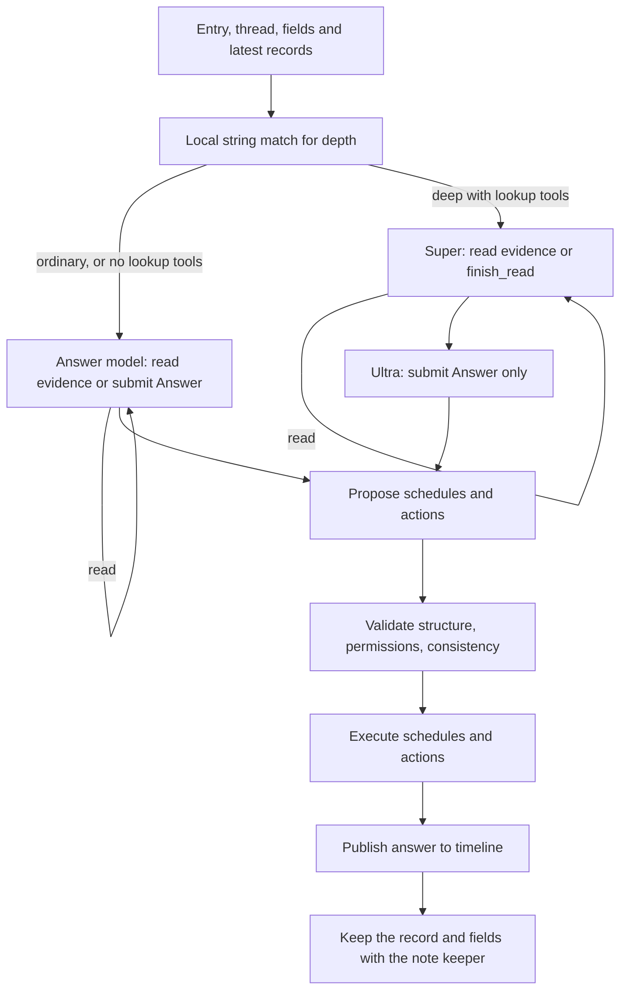

Persona definitions, built-in support and infographics, routing, research budgets and capabilities, reviewed actions, optional memory, schedules, and corrections.

# Persona definitions and the Catalogue

Persona inference calls emit per-request usage records tagged by execution stage and, where available, persona, trigger, wake category and durable job. Ordinary research/tool rounds are distinguished from correction retries, phase regeneration and durable note retries. See [Model usage logging](./backend.md#model-usage-logging), [usage.go](../../internal/llm/usage.go), and [persona usage tests](../../internal/persona/usage_test.go). Workflow/routing/keeper records still describe semantic outcomes; they do not substitute for token or model-call counts.

## Execution host

Production runs reactions on the separate Pub/Sub push worker. Web persists requests without direct routing or a background dispatcher. `Runner.WorkJob` claims one dispatch generation, calls the existing reaction handler within the request's eight-minute context, and verifies durable completion or a saved successor before acknowledgment. Prepared delivery restores its persisted definition snapshot. Routing, scheduled work, memory updates and retries retain their existing business semantics; long workflows are subject to the enclosing request budget. Combined/local mode retains the background dispatcher. See [push deployment](./architecture.md#pubsub-push-deployment), [worker.go](../../internal/persona/worker.go), [queue.go](../../internal/persona/queue.go), and [HTTP verification](../../internal/server/worker_test.go).

## Skill structure

`Skill` contains an ID, name, emoji icon, optional `Avatar` photo, tone, `Domain`, `Instructions`, `Memory`, and `Tools`. `Domain` informs routing, `Instructions` describe the persona's behavior, and `Memory` names its memory fields (分野) - the capitalised words in it, such as `Preference` and `Shop` (`allowedTypes`) - and says what each field's summary keeps. A persona whose `Memory` names none keeps one field, `Memo`.

`Avatar` is presentation metadata: a compressed JPEG data URL validated at save time, kept in file/Firestore definitions and exports, and preserved by AI edits without entering model text context. It is separate from the emoji `Icon` used in persona descriptions and external-agent briefs. See [Profile names and photo avatars](./frontend.md#profile-names-and-photo-avatars).

Subject personas cover topics. Person personas use `Kind: person` and have `Aliases` and `Keywords` that can match text. The Catalogue combines built-in personas with user-installed or edited definitions. `Settings.Active` selects active personas.

The Catalogue keeps nothing itself. It reads the installed definitions through `Workspace.Skills` - `skills/{id}/skill.json` files, or the Firestore `skills` collection - so a definition changed by another process serving the same user is seen at once. `Install`, `Update`, and `Uninstall` write only through `PersistSkill` and `DeleteSkill`; there is no second copy to keep in step.

A piece of work reads once. `Catalogue.Snapshot` returns a read-only `Skills` (`All`, `Find`, `Active`) that does not change afterwards. A reaction takes one when a worker claims it (`Runner.withSkills`) and keeps it on its context, so the router, every persona's turn, the note keeper, and the periodic checks it runs all see one set; the entry points reached from HTTP (`CheckRouting`, `ApplyRouting`, `ApplyReply`, `PreviewReply`) take one on entry, and handlers that look up several personas take one at the top. Code without a snapshot on its context reads afresh through `Runner.skills`. Prepared entry deliveries persist the routing snapshot as `SkillsJSON`, together with the active persona order, and restore it when claimed, including after restart. A definition changed while a long turn runs takes effect from the next piece of work.

## Shipped personas and retired travel persona

The app ships `tabe` (`gourmet`), `shiori` (`book`), `sona` (`routine`), `support` (`support`), and `インフォグラフィック` (`infographic`). The former built-in `michi` (`move`) is no longer provided. Without an installed definition, saved `move` activation IDs do not resolve in `Skills.Active`, so it is absent from the persona list and receives no new turns. Existing timeline entries and private memory are retained. A previously customized `move` definition remains available as a user-installed persona and can be paused or removed through normal management. Users can create their own travel persona and declare the existing `place_search` tool.

Verification: [skill_test.go](../../internal/persona/skill_test.go) checks the retired built-in and preservation of a user-installed travel definition. Cross-persona execution tests use [travel_fixture_test.go](../../internal/persona/travel_fixture_test.go) as a custom persona.

## Built-in kakeratta support

The subject persona `support` (name `support`, icon 🛟) answers questions about kakeratta's usage, specifications, settings, personas, memory, notifications, search, and integrations. Its domain excludes general technical questions and posts that merely mention the app. Users can call it directly with `@support`; ordinary questions reach it through the subject router.

It declares only the read-only `kakeratta_help` tool, reads the OKF bundle's index and relevant chapters before answering, and explains confirmed behavior in the user's language. The specification is the same `docs/system/` bundle developers maintain, embedded in the binary at build time; updating it takes effect in support after rebuilding. It is shared product knowledge. The tool is also available to an external planner through the ordinary permitted research path.

Support defaults to `memoryEnabled: false`: it answers without keeping private notes or checking in. Its definition can be edited and it uses the same optional external-agent preference as other personas, off by default. It distinguishes documented behavior from the user's actual configuration and runtime state, asks for missing error/operation details, and never claims to have changed settings or repaired the app. New workspaces activate it alongside sona; saved activation choices remain authoritative.

## Built-in infographics

`infographic` (name `インフォグラフィック`, icon 📊) handles explicit requests to turn a post or conversation into an infographic. Its definition defaults to `memoryEnabled: false` and `alwaysUltra: true`; it does not save notes or wake for periodic check-ins, and ordinary requests generate their final answer with the high (Ultra) model after Super research. Its external-agent preference follows the ordinary rules and defaults off. New workspaces activate it together with sona and support; saved activation selections remain authoritative.

The persona declares no Web search tool and uses existing material and conversation context. It submits Markdown in `Answer.Text`; it does not generate HTML, CSS or SVG. The instructions describe the browser's mechanical layout ([frontend](./frontend.md#merging-data)): a `# emoji title` with a one- or two-sentence lead forms the banner, and each `## emoji heading` becomes a card, so the answer is split into one `##` section per theme. Every heading starts with an emoji, list items start with a meaningful emoji, and tables may carry emoji. Mermaid is used when the material has steps, flows, causes, structure, classification, relationships, or a timeline and a diagram makes it clearer: as many diagrams as the content needs and none otherwise, each inside the section it explains, with three to eight nodes, one-line labels of about 15 characters, and short context around it. Flowcharts cover flows and causes, `flowchart TD` branches cover structure, and `sequenceDiagram` covers exchanges and timelines. Other diagram families and styling directives are excluded; the syntax limits otherwise follow the renderer, which reads pipe labels, chains, fan-out, and subgraphs. Clarifying questions are plain prose without headings. Mermaid instructions are limited to `flowchart`/`graph` and `sequenceDiagram` with alphanumeric node IDs; other diagram families and `style`/`classDef` directives are not used. The host persists the text unchanged; the browser uses its existing Markdown and Mermaid renderer. Previously generated HTML answers retain their isolated display and image export support. Normal prose remains available for clarification when source material is missing. URL requests use the page title and body already attached by `readLink`, and image requests use the description and extracted text already produced by `readCapture`. A reply's thread carries the original material. When a user replies to another persona's answer with `@infographic`, the replied-to answer is the diagram's subject, with original material used as background or evidence. An explicitly requested different subject, such as the original post or whole thread, takes precedence. Failed retrieval or interpretation must not be replaced with invented content.

`infographicRules` overrides the normal post-language rule with the request's `Entry.Language` (`ja` or `en`), captured from the browser display language. Headings, explanations, and diagram labels are translated while retaining facts and proper names. Older requests without this field use the latest user language in their thread, or the ordinary post-language rule if none exists. The rules reach both the built-in answer prompt and the external ask. Verification: [infographic_test.go](../../internal/persona/infographic_test.go) checks interpreted image/expanded URL context, both display languages, cross-persona reply routing and answer context, intact Markdown persistence, absence of Web search tools, and Ultra selection.

## Always thinking deeply

`Skill.AlwaysUltra` (`alwaysUltra`, default false) selects `ultraModel` only for final-answer composition in `Runner.run`, the `ultra` display slot, and the existing deeper research budget for any wake. Research and schedule/action planning use `personaModel` (Super), including phase regeneration. The high model falls back to the configured middle/low model when absent, as with an explicit deeper reply. A normal request with this setting uses a length instruction that does not claim the user requested a revision of an earlier answer. It does not enable or disable external delegation: a preferred external agent still answers, with the built-in Ultra path used on fallback. The creation and editing forms expose this option, and an AI revision that omits it retains the saved value.

## Optional persona memory

`Skill.MemoryEnabled` (`memoryEnabled` in JSON) is an optional boolean. Omitted or null values retain the historical default of remembering; support's built-in default is false, also inherited by saved built-in overrides that omit the option. The creation and editing forms expose **記憶する** (Remember). AI revisions preserve the existing choice when they omit the field.

When false, turns receive no private memory, record queries return no memory (explicit timeline entry reads remain available), and the host skips the note keeper and its retry writes, summary rewrites, and memory migration. Neither daily/monthly check-ins nor their alarms are scheduled for that persona. A memoryless persona with only read tools also skips post-answer schedule/action planning and review model calls. The check-in settings endpoint rejects changes while memory is off. Ordinary routing, replies, persona editing, tool permissions, explicit notification schedules, and external-agent planning work as usual. Existing notes remain stored so enabling memory again can resume them; disabling does not erase user data. Cards and room menus hide memory actions and check-in controls, while retaining editing and external-agent preference.

Implementation: [skill.go](../../internal/persona/skill.go), [kakeratta_help.go](../../internal/tools/kakeratta_help.go), [bundle.go](./bundle.go), and [settings.go](../../internal/store/settings.go). Verification: [skill_test.go](../../internal/persona/skill_test.go), [kakeratta_help_test.go](../../internal/tools/kakeratta_help_test.go), and [settings_test.go](../../internal/store/settings_test.go).

## Management

Installing a definition from the frontend validates it, saves it through the Catalogue, and activates the new persona. AI-assisted definition creation is handled by the persona builder. New person personas receive `web_search`, `place_search`, and `schedule` when available; built-in `route` has been removed. Verification: [persona_builder_test.go](../../internal/server/persona_builder_test.go) checks the new-person default tools without route. Pausing a persona retains memory and removes schedules. Removing a persona removes its definition, memory, and schedules.

For person personas, `Skill.BasicInfo` (`basicInfo` in JSON) stores initial personal information, such as birthdays and preferences, with the definition. The builder returns it in the draft, and users can edit or clear it in the creation and editing forms. Saving never posts this information to the timeline or creates memory notes. Date-bearing information is separately normalized into notification schedules before saving; dates that cannot be established are omitted. The field is limited to 8,000 characters and cleared for subject personas.

A person's persona is not the person: it looks after the user's dealings with them. Every prompt it is given opens with `Skill.intro` - "you look after the user and 「name」, and are not name" - rather than "you are 「name」", which made it answer as the person ("ありがとう、届いたよ" to a gift the user said they had sent). `personIdentityRules` at the head of its instructions say the same in rules: it does not speak as the person or write their replies or feelings, it talks to the user, and when the user reports what they did for the person it briefly acknowledges the event without promising unsolicited follow-ups. The answer, phase, and note-keeper prompts all use `intro`, so the log keyed by the opening line stays whole.

Shared person instructions close a follow-up when the user reports delivery, impressions or results, or says no confirmation is needed. The keeper updates or invalidates the pending fact while retaining the gift or other historical event; a mere acknowledgment does not establish delivery or completion. A persona's own promise to ask later is not a user obligation or request and must not become a pending fact or justify repeated schedules. Before an autonomous check-in asks about an event, instructions require checking memory and topic-specific timeline history, including before the previous check-in, for earlier questions and user replies. An answered question stays silent, and an unanswered question is not repeated without new user information or an explicit request to check again. Unavailable confirmation history also requires silence. These are model instructions, not a deterministic host filter; they apply to saved person definitions through `forTurn` and reach answer, planning, and keeper prompts. Verification: [people_test.go](../../internal/persona/people_test.go).

Each person turn receives the current basic information through `forTurn`, alongside the shared person rules. Personas use it for answers, research, and scheduling, without copying it into notes; the current definition takes precedence over outdated notes. AI edits receive the current draft and preserve existing basic information when the response omits the field.

A persona's declared tools are selected from the Registry. A person persona's fields are always `Fact` and `Event` (`personMemory`).

## sona: preparation and timely follow-ups

The built-in `sona` replaces `plana`, retaining the storage ID `routine` so existing memory, schedules, and activation choices stay attached. Its default definition answers to `@sona` or `@routine`, not `@plana`. New workspaces start with `routine` active; saved active lists, including an empty list, take precedence.

sona covers upcoming plans, everyday belongings, habits, forgotten items, and weather relevant to an outing. `Routine` holds user-grounded belongings, timing, places and past omissions, without turning one failure into a permanent habit; `Errand` holds one-off plans and preparation until completed. Generic suggestions are not stored as the user's habits, and forecasts are fetched when needed rather than kept in fields. Existing `Routine` and `Errand` fields remain usable.

Its permitted tools are `schedule` and `weather_forecast`, alongside shared timeline and record reads. With a grounded departure time, it may schedule a preparation check shortly before leaving; chore-completion checks remain shortly afterwards. A sharing check-in can find upcoming plans in posts addressed to other personas and schedule a later preparation turn, staying silent until there is a reason to speak. The daily check-in time remains the app-selected minute between 07:00 and 21:00; the scheduled preparation turn supplies timely delivery. The system does not detect departure independently of posts, memory, or schedules.

Preparation wakes compare known plans, belongings and past omissions with a fresh forecast for the relevant region and outing period, distinguishing sunshine now from rain later. Unknown locations or times and unavailable forecasts are not invented; grounded belongings checks can still proceed without weather. Completed, cancelled, departed or already-mentioned plans stay quiet. Model instructions guide these decisions; schedule claims prevent repeating the same due wake. Existing person reminders can be read to avoid proposing duplicate notifications. User-customized definitions continue to override built-in defaults.

Verification: [sona_test.go](../../internal/persona/sona_test.go) exercises a scheduled weather lookup, weather failure with a belongings-only answer, and a silent sharing check-in that schedules preparation; [settings_test.go](../../internal/store/settings_test.go) checks initial activation and preservation of saved choices.

## Implementation and verification

- [skill.go](../../internal/persona/skill.go): `Catalogue`, `Snapshot`, `Skills`
- [queue_test.go](../../internal/persona/queue_test.go): a reaction reads the definitions once
- [people.go](../../internal/persona/people.go)
- [personas.go](../../internal/server/personas.go)
- [persona_builder.go](../../internal/server/persona_builder.go)
- [types.go](../../internal/persona/types.go)
- [skill_test.go](../../internal/persona/skill_test.go)
- [types_test.go](../../internal/persona/types_test.go): the fields each built-in and person persona keeps
- [persona_builder_test.go](../../internal/server/persona_builder_test.go): basic-information persistence and editing without posts or notes
- [people_test.go](../../internal/persona/people_test.go): basic information in turn instructions, and a person's persona not introduced as the person

# Delivering posts to personas

## Building the recipient set

After image analysis, Runner loads active personas and the thread. An explicit `@` mention selects its recipient; the HTTP API rejects mentions of multiple distinct personas. Without a mention, a reply to an active persona selects that persona. A mention takes precedence over a different reply target. For these directed entries, Runner skips both subject routing and person alias/keyword matching, and records the recipient as called by mention or reply. Replies to user entries or inactive/deleted personas use ordinary routing when there is no active mentioned recipient.

Mention precedence changes the recipient without changing `Entry.ReplyTo`. The selected persona receives the full thread and the exact reply relationship. Shared answer rules, also sent to external agents, interpret requests such as “summarize this” or “diagram this answer” as transformations of the replied-to entry, unless the user explicitly selects another subject; they do not replace it with the root post or the latest answer in the thread.

For other entries, Runner combines subject personas selected by the router and person personas whose aliases or keywords match the entry's text and associated content. Post edits also notify prior recipients to correct their existing memories, including when the edited entry has an explicit addressee.

Person personas are not sent to the subject router; their matches are recorded in `Heard`. Chat-completion subject routing evaluates each persona independently with the configured Router model, defaulting to Lightning. Each request contains only that persona's condition plus the thread and current post, and returns `submit_match` with a boolean `match` and a short `reason`. Up to eight requests run concurrently; results are collected in the original persona order. Model reasoning is disabled and each response is capped at 512 output tokens. Per-call usage retains the target persona ID, trigger and `purpose=routing`. Saved Router model choices are respected. With OpenRouter enabled and `openRouterRouterModel` set to `~typesafe/jev-latest`, it uses the Jev Decisions API with the OpenRouter key instead of chat completions. Other Router selections use the independent parallel chat-completion path; the legacy Jev flag no longer overrides the selection.

Edits refresh prior recipients again when their ordered delivery starts, so a preceding turn that recorded its wake after routing still receives the correction. Existing recipients receive edit instructions; newly routed recipients receive an ordinary first delivery. Failures reading recipients or the delivery thread retain the reaction for retry.

## Failures and records

Missing configuration, request failure, or malformed output leaves the router with no subject recipients and `Answered: false` plus an error. A valid false match for every persona means a completed decision with no recipients. Missing boolean matches or blank reasons, truncated responses, transport errors and cancellation invalidate the complete aggregate; successful partial choices are not published. Requests cannot nominate other persona IDs. An empty subject set needs no model call. Jev retains its single Decisions request and existing complete-response validation. Explicit mentions, reply targets, person matching, and other recipient paths operate separately from that model decision.

Routing records retain recipients, exclusion reasons, explicit-call reasons, completed personas, and personas that spoke. Completions change them through `UpdateRouting` transactions, so turns finishing at the same time - in one process or several - do not drop each other's state. The frontend receives `routed` and `turn` events.

Check and correction APIs distinguish a trial after changing conditions from applying the result. Merely checking a trial does not wake the actual persona.

## Implementation and verification

- [runner.go](../../internal/persona/runner.go): `prepareEntry`, `deliverEntry`, `routeSubjects`, `routingRecord`, `turnsDone`
- [route.go](../../internal/persona/route.go): `Route`, `matchTool`, and `RouteJev`
- [parallel_route_test.go](../../internal/persona/parallel_route_test.go): isolated conditions, eight concurrent calls, deterministic order, per-persona usage, failure and cancellation
- [runner_test.go](../../internal/persona/runner_test.go): directed entries skip automatic routing and person matching; mention precedence and contextual reply depth selection
- [people.go](../../internal/persona/people.go)
- [queue_test.go](../../internal/persona/queue_test.go): edits refresh recipients recorded after routing, including prepared delivery recovery
- [routing.go](../../internal/server/routing.go)
- [route_production_test.go](../../internal/persona/route_production_test.go)

# From research to answer publication

## Turn sequence

`composeAnswer` gathers evidence and composes the answer. When reads and the answer use the same model, it combines them: `submit_answer` is offered from the first request, alongside the dynamically available `read` tool. If the supplied thread and memory are sufficient, a spoken or silent answer needs one call; otherwise the same model reads evidence and then submits its answer.

A deep or AlwaysUltra turn of a persona with lookup tools of its own (any read-only tool besides `timeline_search` and `schedules_list`, such as Web search, weather or the bundled specification) splits the two (`readModel`, `answerReads.model`). Super is offered only `read` and `finish_read`; after `finish_read`, or when the read ceiling is reached, Ultra is offered only `submit_answer`. A response mixing reads with `finish_read` or an answer is refused. The answer stage gets its own correction allowance. A persona without lookup tools - the infographic, which works from the thread's already-read material - keeps the combined loop on Ultra, so a turn that reads nothing is one Ultra call rather than a Super call that would only finish reading. Both paths preserve the original messages and actual tool results. There is no `research_plan`, model-based depth judgment, or `finish_silent`. Schedule/action planning and memory remain separate.

| Turn | Reads | Final answer | Schedule/action phases |
| --- | --- | --- | --- |
| Ordinary | Super | Super | Super |
| Deep request or AlwaysUltra, with lookup tools | Super | Ultra | Super |
| Deep request or AlwaysUltra, without lookup tools (infographic) | Ultra | Ultra | Super |

`wantsDeep` lowercases only the current post's text and matches explicit substrings: `詳しく`, `詳細に`, `深掘り`, `深く考えて`, `具体的に説明`, `ちゃんと調べて`, `もう一度考えて`, `それって本当`, `in detail`, `more detail`, `deep dive`, or `think deeply`. Older thread messages, model output and inferred task complexity do not promote depth. Explicit internal deep requests and AlwaysUltra still select Ultra. This intentionally performs no semantic interpretation of negation or quotations. A complex request without a matching phrase stays ordinary.

Ordinary turns start with 10 read calls and 2 Web searches; deep and AlwaysUltra turns start with 20 reads and 4 searches. Depth is fixed before the first model call, so budgets never expand mid-turn. Phase read budgets remain separate. Super falls back from the configured middle model to low; Ultra falls back from high to middle to low. Combined calls use `purpose=answer`. In a split turn the Super reads and `finish_read` use `purpose=research` and the Ultra answer `purpose=answer`. `round` counts normal tool rounds across both; a request retried after truncation stays in its round, and retry fields count malformed/truncated corrections. The workflow stores the effective `deep` flag.

When the provider reports `finish_reason: "length"`, answer composition rejects the incomplete response and retries from the current evidence context with an instruction to preserve key facts and sources while removing repetition. Truncated drafts and their tool calls do not accumulate in retry context. These retries use the existing three-attempt limit and do not increase the provider output allowance or reset evidence budgets. Exhaustion reports an output-limit failure instead of the generic missing-answer error. Verification: [answer_truncation_test.go](../../internal/persona/answer_truncation_test.go).

Final-answer composition explicitly requests `max_tokens: 26000`, for both ordinary and deep/AlwaysUltra answers, instead of relying on a provider default. Existing answer-length instructions still apply; the value is an output ceiling, not a target. Schedule/action phases keep their existing output settings.

A valid answer with no additional reads takes one composition call. Existing bounded correction retries for malformed or invalid answers remain in the combined loop and do not reset read budgets. `sources` never trigger a correction: `citedOnly` keeps only IDs returned by this turn's `timeline_search`, deduplicated and capped at three, and silently drops the rest (for example, the ID of the post being diagrammed). The same applies to external-agent answers. Rejecting them would make the model regenerate a whole, possibly long, answer for metadata that `citedSources` would discard anyway. When composition exhausts its attempts, the error, and therefore the workflow log, ends with the last refusal (`attempt N: …`, clipped to 300 characters). Verification: [answer_truncation_test.go](../../internal/persona/answer_truncation_test.go) and `TestSpeakSourcesMustComeFromThisTurnsSearches` in [runner_test.go](../../internal/persona/runner_test.go). When the answer is asked of the external agent, the turn opens an ask and ends; once the ask closes, a reaction carries the turn on with the agent's answer and research, which enter the same subsequent processing, or with the built-in planner from the start.

`Answer` contains text and source entry IDs. Sources must be IDs found through timeline search in this turn. Web evidence is linked in the answer body. Silence uses empty text, with `Unrelated` distinguishing an out-of-domain turn.

## Research budgets and available reads

At the start of each built-in read/answer round, `currentReadCapabilities` rebuilds the offered `read` schema and the current system instruction from the persona, permitted tools, post location, remaining read calls, and the existing `lookups` budget. `SearchRemaining` derives the effective allowance from the search and shared lookup counters; there is no independent display counter. The model sees `Web検索: 残り N 回` both in the instruction and the tool description. One remaining search is explicitly identified as the last slot. At zero, the instruction says Web search is unavailable and asks the model to use other available reads or `submit_answer`.

The `read` schema uses one branch for each operation/tool and binds its name to structured object `args`. `entries` requires one to ten nonempty string IDs and permits no search fields; `records` exposes typed tag/query/before/IDs. Each read-only tool carries its own argument schema, including required fields and nested constraints, instead of sharing a generic JSON-string argument. Local MCP schema references are rebased to the nested argument schema without modifying the declaration. Once Web search runs out, its branch and usage instructions disappear. The current instruction replaces its previous version instead of appending stale capability lists. Read-result footers also report the latest remaining allowance and available operations. Historical tool results stay in the conversation for answer composition. Usage instructions show object arguments and distinguish a concrete query-free `timeline_search` period example from ID-only `entries`; the schema itself supplies field descriptions, avoiding a duplicate prose argument table. Verification: [structured_reads_test.go](../../internal/persona/structured_reads_test.go) checks the actual inference request, period/ID execution, per-tool required arguments and MCP references.

Read availability also follows known configuration and capabilities: missing search/weather keys, missing search or schedule services, missing place-search endpoints, unknown or undeclared tools, and state-changing tools are not advertised as research reads. Map tools backed by an MCP delegate remain available when their local fallback endpoints are absent. Argument-dependent errors and transient provider failures can still occur; these checks do not probe remote service health.

A memoryless persona is offered neither the `records` schema branch nor its instructions. The separate `entries` operation preserves direct timeline-post reads by known IDs, without querying memory. A remembering persona retains `records` queries and may also use `entries`. `ReadStep.UnmarshalJSON` accepts object arguments and historical JSON-string arguments, preserving the internal/persisted string form and legacy fields so stored asks/workflows can resume; existing `records` requests by explicit IDs remain supported. Built-in research validates ID reads before spending a read: missing/mistyped/over-limit IDs and unrelated search fields are rejected, with an explicit `timeline_search` period-search example when that tool is currently available, or an unavailable-search explanation otherwise. Invalid/empty read requests and other malformed research responses share the existing correction counter; exceeding `maxMalformed` ends research with an error at any round. This prevents repeated host refusals from spending the entire read ceiling. Recovery with a corrected search remains possible, and rejected ID reads never reach storage. External and phase reads retain their existing host validation. Verification: [cost_test.go](../../internal/persona/cost_test.go) and [structured_reads_test.go](../../internal/persona/structured_reads_test.go).

Web search exhaustion does not end research. Timeline search and other configured read-only tools remain available while the shared lookup allowance lasts; memory records and direct entry reads do not consume that lookup allowance. `submit_answer` remains offered on every request. At the 10/20 read-call ceiling, the host removes `read` and requests a final answer. A response mixing reads and a final answer is refused before either is accepted.

The execution path continues to enforce budgets for each individual tool step, including multiple steps in a single `read` and multiple calls in one model reply. Excess searches are refused before network execution. Repeated cached lookups do not spend another search; admitted failed lookups still spend their allowance. Schema-violating requests retain execution-time refusals and the next round rebuilds the latest capabilities. Malformed-response usage records retain the existing correction counter; its bound applies to every read/answer round. The overall round ceiling remains in place.

This dynamic schema belongs to built-in answer research. External-agent asks and schedule/action phase schemas retain their existing interfaces and separate budgets. Model usage logging is unchanged; usage rounds and workflow read results remain the evidence for production checks after deployment.

## Conditions for publication

`planPhases` proposes schedules and actions without changing the answer. It generates the schedule phase only when the persona has the schedule tool and the answer's `schedule` decision is true or missing (deletion tidy-ups always may), and the action phase only when it has permitted actions (except deletion cleanup). Personas with neither permission skip both planning and review, whether or not they remember; the post-publication keeper remains independent. Review retries also regenerate only permitted phases. A schedule carries only its time, recurrence, and a note of what it is for; it no longer writes a background memory note. Deterministic checks cover types, counts, permissions, and arguments; a review checks consistency with promises in the answer. `Workflow.batch` converts to an internal validation and execution form. It is not a submission format for external agents.

If `execute` fails, the answer is not published as though its promised operations succeeded. Execution of all side effects is not a transaction with rollback, however. Reading and planning have limits to prevent indefinite generation loops.

Failure in the note keeper after publication does not retract an already published answer. A turn that stays silent because it is unrelated skips memory updates.

Research reads include `entries` steps for direct timeline posts by ID, `records` steps (older kakera records by `tag`, `query`, and `before` month, or by `ids` - up to ten in one step, `maxEntryReads` - the entries records point to, each with the kakera it answered when it is a reply; an entry read that way may be cited in `sources`) and read-use tool steps (`readAll`).

## Implementation and verification

- [runner.go](../../internal/persona/runner.go): `run`
- [answer.go](../../internal/persona/answer.go): `composeAnswer`, `answerReads`, `finishReadTool`, `wantsDeep`; [runner.go](../../internal/persona/runner.go): `readModel`
- [research_plan_test.go](../../internal/persona/research_plan_test.go): deterministic explicit-depth string matching
- [model_selection_test.go](../../internal/persona/model_selection_test.go): fixed depth, Super reads with Ultra answers for deep turns, the infographic's single Ultra call, AlwaysUltra, and model fallbacks
- [research_reads.go](../../internal/persona/research_reads.go): current capability schema, instructions, and footers
- [lookups.go](../../internal/persona/lookups.go): execution counters and `SearchRemaining`
- [research_reads_test.go](../../internal/persona/research_reads_test.go): live remaining counts, schema removal, multi-step/multi-call budget enforcement, memoryless and continued timeline reads
- [lookups_test.go](../../internal/persona/lookups_test.go): cache, shared budget, and restoration
- [usage_test.go](../../internal/persona/usage_test.go): malformed research requests and retry accounting
- [phases.go](../../internal/persona/phases.go): `planPhases`
- [workflow.go](../../internal/persona/workflow.go)
- [answer_test.go](../../internal/persona/answer_test.go)
- [model_selection_test.go](../../internal/persona/model_selection_test.go): stage models, preserved research context and budgets, and fallback selection

# Memory: facts, summaries, and kakera records

## Memory layout

A persona's memory is plain text, not OKF, and the host writes all of it ([facts.go](../../internal/persona/facts.go), [memory.go](../../internal/persona/memory.go)):

- **Facts, by field** - one file per field, `{Field}.md` (for example `Preference.md`, `Shop.md`). Each fact is one line: `- [f_ab12cd] 三田の二郎に行きたい from:e_a,e_d since:2026-09-08` - an id, at most 200 characters (`maxFactRunes`), the kakera it rests on, and the day it began to hold. The facts that hold now sit under `## いまの事実`; those that no longer do move under `## 以前のこと` with `until:` and, if a newer fact replaced them, `by:` (at most 50 per field, `maxPastFacts`). The facts that hold now are at most 2,000 characters per field together (`maxFieldRunes`).
- **A summary, by field** - at the top of the same file, `## まとめ（2026-10-02 更新）` and the persona's prose over the facts (the day is the last day it was looked over - rewritten, or handed to the rewrite with nothing to change), at most 2,000 characters. It is not rewritten with every kakera; see [Field summaries](#field-summaries).
- **Kakera records** - one line per kakera of the user's the persona took in, in monthly files `records/YYYY-MM.md`: `- 2026-10-01 12:34 [e_x](/?entry=e_x) one sentence #tag #tag`, then any dates: `expires:2026-10-02/1d`, `review:2026-11-01/31d` (the day and the span it was given, in days), `asked:e_y` (the post that asked about it under review), and `of:e_k` (the kakera, when the id is a reply). A record is what a line of the old `index.md` was. The id is the persona's reply when it replied, and the kakera itself when it did not; a reply leads back to its kakera through `ReplyTo`. The time is the kakera's, in the workspace time zone. A sentence is at most 140 characters (`maxSummaryRunes`) with one to five tags (`maxTags`); a `#` in it is made full-width so it cannot read back as a tag.

Every turn is handed each field's summary and the facts that hold now, with their ids, and the 15 latest records (`memoryView`, `renderFacts`, `recentRecordsLimit`). A field file whose field the persona's layout no longer names is still shown, marked so, and its facts can be moved into a named field by `update` (`memoryFacts.Orphans`). Older records are read on demand (`readRecords`): by `tag`, by `before` month, and by `query` - words in the record, or a meaning search of the timeline (`similarKakera`, `search.Unified` with score 0.5) whose hits match records by their id or `of:` - newest first, 30 at a time; or by `ids`, up to ten posts records point to. The external agent gets the same text as `memory` in its ask context. There is no `index.md`, no per-thing note, and no `notes_*` tool.

## Facts change only as asked

The keeper never rewrites a field. It hands in operations (`factOp`), and `planFacts` applies exactly those, in memory first so a submission that cannot be applied is sent back with its reasons:

- `add` - a new fact in a named field, resting on this kakera.
- `update` - a fact that holds now, replaced by a new one resting on its kakera and this one; the old one moves to the past with `by:` the new one. The same text with a `field` only moves it (a field the layout no longer names must be moved this way).
- `invalidate` - a fact that holds now moves to the past.
- `merge` - two or more facts that hold now become one, resting on all their kakera, held since the earliest of them; the merged ones are dropped, not kept in the past.

An id used twice, an id that does not hold now, an unknown field, an empty or over-long text, and a field whose facts would run over its limit are sent back. Nothing is lost except by `invalidate` or `merge`, and the past keeps what was replaced and when.

## Facts put right by the user

`Runner.EditFact` and `Runner.ForgetFact` ([facts.go](../../internal/persona/facts.go)), behind `PUT` and `DELETE /api/personas/{id}/memory/fact?field=&fact=`, change one fact under the keeper lock. An edit is a correction: the fact keeps its id, its kakera and its day, and nothing moves to the past; the field's limit still holds. A fact forgotten by the user is dropped, from the facts that hold or from the past. Removing the last current or past fact deletes the field and its now-unsupported summary immediately. The persona is not woken; the summary takes the change in at the next check-in.

## Field summaries

[summaries.go](../../internal/persona/summaries.go). A field's summary is rewritten at the persona's check-in - daily, or monthly for a person looked back on monthly - right after `dailyAt` claims the check-in and before the persona is woken for it, so the check-in reads it fresh (`rewriteSummaries`). Only fields with a persisted `SummaryDirty` marker or something new since the summary's day are rewritten (`staleFields`, `changedSince`: facts held since, or ended, on or after that day; a summary never written takes everything in), and a field is not rewritten twice in a day. One `write_summaries` call on the persona model is handed, per field, the summary as it is, the facts added or changed, those that stopped holding, and all that hold now, and returns the new prose (sent back up to three times if a field is unknown, empty, or over 2,000 characters). Fact operations, direct corrections, and fact-source removal persist `<!-- kakeratta:summary-dirty -->` in the field file, independently of historical fact dates; the memory viewer hides this host marker. Dirty fields, including retained fields no longer named by the layout, receive the complete surviving current and past facts and instructions to remove unsupported old prose. They require an explicit replacement summary: omitting it is rejected and retried, and the marker clears only when that replacement is saved. Unmarked due fields may still be marked with today's day without replacement, as before. A failed rewrite is tried at the next check-in. Facts are dated by day, so a fact added on a summary's own day is taken in again the next time.

The same call retires plans whose day has passed. A fact that holds now and names only days before today - `2026-10-03`, `2026年10月3日`, `10/3`, `10月3日`, a day without a year read in the year the fact began (`datedPast`, `pastDated`) - is handed with its id, and its field is handed even if nothing else in it changed. The model returns `invalidate` with the ids of those that are no longer ahead - a reservation, an appointment, a deadline - and leaves events that happened, which stay true; those ids move to the past (`planFacts`) before the summaries are written, and the summary may be rewritten for them. With no changed field and no past-dated fact, no model is called.

## Record dates, extension, and review

The keeper dates each new record from what it is ([review.go](../../internal/persona/review.go), `keeperDates`): `expires` - the next day, say - for a kakera that served its moment ("where for lunch today?", "how do I get to Shibuya?"), and `review` - weeks for a shop the user wants to try, months for a topic - for something the user said whose lifetime is unknown; preferences and habits get neither. A day must be tomorrow or later (`checkKept`). Built-in layouts say which of their records get which.

- **Expiry.** The due pass deletes records whose `expires` day has come (`expireRecords`, under the keeper lock), takes their kakera out of the facts' sources (`kakeraOf`, `dropFactSourcesHeld`) - a fact that rested on it alone goes - and returns the next such day for `nextDue`. Nobody is woken.
- **Extension.** Records a turn answering a post reads through `records` - shown by a search, or opened by id - have both dates moved so the span they were given starts again today (`extendRecords`, `recordDate.extended`); a date never moves closer. Records only handed over in the latest 15, and reads during check-ins or tidy-ups, do not count. An external agent's reads are kept on the ask (`askResearch.Referenced`) and count the same way.
- **Review.** A daily check-in is handed up to three records whose `review` day has passed, oldest first (`reviewsDue`; one that also expires is left to the sweep), with `reviewInstructions`: the persona asks about one in its post. The keeper is handed the same records and submits `records` decisions; it puts the asked one off a week, and the host marks it `asked:` with the check-in post. When the user replies to that post, the persona is told which records it asked about (`reviewReply`, wake `review-reply`), and the keeper - recording the reply as a kakera too - keeps the record (review cleared), moves it, or forgets it. A forgotten record's kakera is taken out of the facts' sources as on expiry, so what the user let go of is let go of in the facts too. A date restated unchanged keeps its span; a new one counts from now (`changeRecords`, `redated`).

## The note keeper after publication

`keepNotes` ([notekeeper.go](../../internal/persona/notekeeper.go)) runs once the remark is out, for a kakera of the user's (`keepsNotes`: a post, reply, or edit by the user, including listening turns) and for a check-in handed records due for review. It makes one `keep_memory` call on the persona model, in the persona's voice, with the summaries and facts, the latest records, the thread, the trigger, and the published answer, and no way to read more. The submission is `summary`, `tags`, `expires`, and `review` for the record; `facts`, the fact operations (above); and `records`, decisions on the records it was handed for review (`handedRecords`). `checkKept` and `planFacts` send a submission back with their reasons (no or long sentence, wrong tag count, a date that does not parse or is not after today, a record it was not handed, an operation that cannot be applied, two or more of the answer's own sentences copied into a fact - `copiesAnswer`), up to three attempts (`maxKeeperAttempts`). The facts rest on the kakera itself, never on a reply to it. The keeper writes the changed fields (`writeFacts`) and appends the record (`appendRecord`), replacing any record already kept for the same kakera - under its own id, or under a reply of the persona's to it - so an edit or a retry leaves one record. The remark lists the fields written in its `Notes` (`pointAtNotes`).

Built-in answers and external-agent answers decide `remember` in the same `submit_answer` call. `remember=false` (greetings, general questions, unrelated posts, system wakes) skips the keeper and its model call; `remember=true`, or an answer without the decision, keeps the post as below. A check-in handed records due for review always runs the keeper whatever the answer said, so the asked record is put off and the same review is not repeated. An edited post answered with `remember=false` has its records and fact sources taken out without a model (`dropRecords`, `dropFactSources`), so nothing kept of the earlier text stays. Verification: [memory_decision_test.go](../../internal/persona/memory_decision_test.go) and [runner.go](../../internal/persona/runner.go).

The keeper runs under the named lock `keeper:{id}`, one at a time across processes; if the lock is lost it stops writing. Its input is persisted as a `NoteJob` (`keeperSnapshot`). Failures retry with increasing delays from one minute up to one hour, on their due time (see [Times and wakes](./architecture.md#times-and-wakes)); a job whose kakera was deleted or edited meanwhile, or a job left at the old `index` stage, is dropped instead. Scheduled wakes, unrelated silences, deletion tidy-ups, and check-ins without a review keep nothing.

## Deleted kakera

Deletion identifies user kakera by their speaker and ID, even when their text is empty. Image-only and link-only posts therefore remove their records and fact sources just like text posts, including records kept by personas that did not reply.

`EntriesForgotten` ([forgotten.go](../../internal/persona/forgotten.go)) takes the deleted entries out of the memory of the personas woken for the post before anyone is woken - a paused persona included: their records (`dropRecords`, in the months of the deleted entries), and the deleted kakera from the facts' sources (`dropFactSources`), so a fact that rested on nothing else goes, now or in the past, while one that rests on another kakera, or that never had a source, stays. No model is asked. A persona that had a record removed and is active gets one `deletedInstructions` wake for the whole deletion: it cannot speak and may cancel the schedules it set for that kakera; its keeper does not run. A persona's reply deleted on its own leaves the kakera it answered: its record is re-keyed to the kakera and nobody is woken. A surviving field is marked for summary refresh at the next check-in. If no current or past facts remain, its unsupported summary and field are deleted immediately. Deleting a field or a month of records from the memory viewer wakes nobody.

## Splitting prose into facts

Fields were once prose, rewritten whole by the keeper. A field-shaped file with text and no fact line or section heading is prose (`proseText`, `proseFields`); the running app reads it as the field's summary, so a fact the keeper adds before it is split keeps the prose instead of writing over it. `Runner.MigrateMemory` ([migrate.go](../../internal/persona/migrate.go)), run from [cmd/migrate-memory](../../cmd/migrate-memory/main.go) after the deploy (see [Memory migration](./operations.md#memory-migration)), hands one persona's prose fields to the persona model, which returns facts through `keep_memory` (`add` only, checked by `planFacts`). A dry run only reports them and saves a plan; `Runner.ApplyMigration` writes the plan as it is, or as a person edited it: the facts, with no source, and the prose kept as each named field's summary, dated today. A prose field the layout no longer names has its facts moved into a named one and its file deleted. It runs under the keeper lock and refuses when the prose changed since the dry run - the files, or their text (`Migration.Prose`). Every defined persona is run, paused ones included; one with no prose costs no model call.

## Implementation and verification

- [facts.go](../../internal/persona/facts.go): fact lines, `planFacts`, `writeFacts`, `dropFactSources`, `renderFacts`
- [summaries.go](../../internal/persona/summaries.go): `rewriteSummaries`, `staleFields`, `datedPast`
- [memory.go](../../internal/persona/memory.go): record lines, `memoryView`, `findRecords`
- [notekeeper.go](../../internal/persona/notekeeper.go): `keepNotes`, `checkKept`, `appendRecord`, `dropRecords`
- [notes_tools.go](../../internal/persona/notes_tools.go): `readRecords`, `similarKakera`, `recordEntry`, `RecordsTagged`
- [migrate.go](../../internal/persona/migrate.go): `MigrateMemory`, `ApplyMigration`
- [review.go](../../internal/persona/review.go): `reviewsDue`, `reviewReply`, `handedRecords`, `expireRecords`
- [note_retry.go](../../internal/persona/note_retry.go)
- [summary_dirty_test.go](../../internal/persona/summary_dirty_test.go): corrections and deletions of old facts refresh summaries, omitted rewrites are rejected, and removal of the last fact removes its summary
- [facts_test.go](../../internal/persona/facts_test.go): fact operations and their history, the field limit, records found through their kakera, summaries rewritten at the check-in, past plans retired there and past events kept, a fact put right or forgotten by the user, facts going with a record forgotten or expired
- [notekeeper_test.go](../../internal/persona/notekeeper_test.go): records under the reply or the kakera, edits replacing a record, sent-back submissions, record dates and their round trip, extension on reading, the review asked and settled, the turn's memory view, reading recorded posts together, splitting prose into facts
- [due_test.go](../../internal/persona/due_test.go): expired records and the next expiry
- [forgotten_test.go](../../internal/persona/forgotten_test.go): records dropped and re-keyed, facts losing their sources on deletion (including image-only and link-only posts), the tidy-up wake
- [note_retry_test.go](../../internal/persona/note_retry_test.go)
- [answer_test.go](../../internal/persona/answer_test.go): an answer copied into a fact is sent back

# Schedules, check-ins, and monthly summaries

## Scheduled wakes

The schedule phase supports `create`, `update`, and `cancel`. `create` accepts `notify`; null/omitted retains the default ON. `update` accepts an owned schedule ID and a new `at` and/or `notify`; empty `at` and null `notify` preserve the corresponding value. It preserves recurrence, task origin, purpose, and calendar identity. Changes to purpose or recurrence still use cancel/create. The internal `schedule` tool mirrors this update operation. Both deterministic validation and storage enforce ownership; the reviewer checks time and notification changes against the user's request. Read-only reply previews simulate updates without touching the real schedule. Own-schedule context and `schedules_list` include the effective notification preference.

Creating an ordinary persona schedule stores its time, recurrence, wake note, Push notification preference (`notify`, default true), and whether it implements an explicit user request. Schedule planning exposes `user_requested`: true for tasks the user requests at a time or recurrence (for example, a morning news digest), false for autonomous preparation or completion checks. The pre-execution review checks that a true flag is grounded in the user request or an existing user-requested schedule. The host carries this flag through execution into `Schedule.UserRequested` (`userRequested` in stored/API JSON); claims and daily advancement preserve it. Older schedules without this flag retain autonomous-check behavior. Personas with the schedule tool receive only their own schedules in the initial turn context (also handed to external agents). The same permission automatically provides the read-only `schedules_list` tool during research. It reads current workspace schedules on demand, including other personas' schedules, and accepts owner ID (`skill`), substring (`query`, matching wake notes or owner names/IDs), and notification-time (`from`/`to`, in the workspace timezone unless an offset is supplied) filters. Results are chronological, default to 20 items, and are capped at 30. The response includes `total` and a `next_after` cursor; pass it as `after` with the same filters to fetch the next page. If the cursor was removed, restart without it. Recurring schedules are matched by their stored next notification time, not expanded into future occurrences.

Each item displays its owner as `Name（ID）` using the persona definitions for the turn, falling back to the ID when no name is available. Tool listings preserve `skill` as the ID and add the display label in `owner`, plus `daily` and `annual` recurrence flags and `user_requested`. Own-schedule turn context also includes `user_requested`, allowing a replacement to preserve the task origin. The read tool returns no memory; memory remains private. Cancellation is validated and executed only for schedules owned by the requesting persona. Planning instructions ask personas to check other owners' reminders through the read tool when duplication is possible; this does not atomically prevent concurrent creations. The legacy `schedule list` internal action remains available but is not offered during research.

Person calendars are also synchronized when a person is created, installed, reactivated, or its basic information is edited, and when it receives a user post or reply containing date or plan information (including analyzed image text). A dedicated model request extracts confirmed birthdays, anniversaries, meetings, appointments, and cancellations using the current time, timezone, and existing schedule keys. Basic-information synchronization replaces schedules sourced from that field; posts add or correct only the specified events. Unrelated schedules are preserved. These schedules need nothing in memory.

Birthdays and anniversaries have two annual notifications: seven days before and on the date, at 09:00 in the saved timezone. Newly learned imminent dates notify at the next minute when the usual time has passed. February 29 is observed on February 28 in non-leap years. Annual schedules retain the original calendar date and advance to the following occurrence when claimed; repeating the same information preserves that occurrence. Appointments are one-time notifications, respecting explicitly requested notification times; otherwise the default is 09:00 on the event date, or one hour before an event earlier than 09:00. All schedules accept any future date without a scheduling horizon, within the existing per-persona count limit.

Calendar reconciliation for one persona runs under the named lock `calendar:{id}`, and stops writing if the lock is lost. Due person events use the normal Runner notification path, with instructions to notify even when memory says nothing about it. Model or storage failures are surfaced as API errors during basic-information saving or live error events during post processing. Runner claims due schedules before executing the persona. Claiming is part of the persistence contract and prevents duplicate execution of the same schedule. Pausing or removing a persona removes its schedules.

A successful scheduled utterance emits an internal `reminder` event immediately after its timeline post is persisted if `notify` is enabled. The claimed preference is host context, persisted as `askTurn.SuppressNotification` for external answers and restored on resume or built-in fallback; turning Push off does not suppress the answer or its timeline post. The schedule instruction prefix identifies the wake even when person-event instructions are appended or an external-agent answer resumes later. Silent and failed wakes emit no reminder. Ordinary replies and daily check-ins do not use this event. See [Reminder push delivery](./backend.md#reminder-push-delivery) and [schedule_test.go](../../internal/persona/schedule_test.go).

Scheduled wakes select instructions from the stored origin. Autonomous checks retain the completed/cancelled/already-mentioned checks and brief, gentle reminder limit. User-requested tasks instead research with permitted tools and publish the requested content, format, and amount; absent personal records alone do not suppress execution. Fresh-information tasks research again at wake time. Duplicate checks concern the current occurrence, not a prior day of the recurring task. Both kinds remain schedule wakes, receive today's timeline as reference data, use the same claim/recurrence lifecycle, and emit reminder events after a successful post when notifications are enabled. Host-created person-calendar notifications retain their existing dedicated reminder instructions. Verification: [schedule_test.go](../../internal/persona/schedule_test.go) checks the complete plan-to-tool-to-persistence path, two daily task wakes, preserved origin, unrestricted task instructions, reminder events, and retained autonomous restrictions.

Past schedules are not all replayed unconditionally. Execution windows and persona state determine how late schedules are handled.

## Periodic checks

Daily checks use the user's time zone and times derived from the workspace and persona. The previous actual execution time determines the lookback window, and execution is claimed first. A sharing check-in reads the timeline since the previous one and the persona's records by tag, also checking upcoming plans and preparation against memory and relevant external information. A persona permitted to schedule can arrange a later wake and stay silent now, checking other personas' schedules to avoid duplicates. It speaks only when there is something useful now, with amount and tone guided by the persona character. Legacy `talk: minimal` values remain readable but no longer restrict check-in speech. Each check-in is handed the records due for review (see [Record dates, extension, and review](#record-dates-extension-and-review)). Before the persona is woken for its check-in, its field summaries are rewritten from what changed (see [Field summaries](#field-summaries)). Person personas can check in monthly instead.

The app itself builds monthly summaries from the timeline as topic-based posts with source links. Person personas' monthly checks use the summary and relevant records. Both read only the lookback window through `TimelineWindow`, and summaries have an input length limit.

Built-in check-ins use the same combined read/answer loop as ordinary posts. After any necessary reads, `submit_answer` with empty text ends the turn without another composition call. This retains due-review instructions and the normal answer validation; silence does not override an explicit question obligation. Silent turns still run schedule planning when requested by the answer, permitted action planning, execution, wake bookkeeping and opted-in memory work; for example, sona can arrange a later preparation wake without publishing now. External-agent answers retain their existing protocol. Daily instructions request older tag records only for a concrete connection to relevant new activity; with no relevant change, approaching plan or due review, they stop exploring unchanged history. Retrieval failure is not evidence of no change. Read/search ceilings and infographic Markdown instructions remain unchanged. Verification: [cost_test.go](../../internal/persona/cost_test.go) and [parallel_route_test.go](../../internal/persona/parallel_route_test.go).

## Implementation and verification

- [schedule.go](../../internal/persona/schedule.go)
- [person_schedules.go](../../internal/persona/person_schedules.go): event extraction and calendar reconciliation
- [person_schedule.go](../../internal/store/person_schedule.go): annual dates and recurrence
- [person_schedules_test.go](../../internal/persona/person_schedules_test.go)
- [person_schedule_test.go](../../internal/store/person_schedule_test.go)
- [workflow.go](../../internal/persona/workflow.go): own schedule context and ownership validation
- [schedule.go](../../internal/tools/schedule.go): filtered, paginated read-only listing and owner-scoped cancellation
- [schedule_test.go](../../internal/tools/schedule_test.go): cross-persona visibility and cancellation ownership
- [schedule.go](../../internal/store/schedule.go)
- [schedule_test.go](../../internal/store/schedule_test.go): future dates without a horizon, ownership, caps, and claims
- [daily.go](../../internal/persona/daily.go)
- [summary.go](../../internal/persona/summary.go)
- [daily.go](../../internal/store/daily.go)
- [schedule_test.go](../../internal/persona/schedule_test.go): notification preferences, persona updates through planning and execution, read-only preview isolation, and recurring tasks
- [planner_test.go](../../internal/persona/planner_test.go): persisted notification suppression across external answers and fallback

# Routing checks and reply previews

## Routing checks

`CheckRouting` evaluates a target entry against the persona's current conditions and returns the delivery decision and reason. Person personas return alias and keyword matches. A token records the entry text, persona, and decision at check time.

`ApplyRouting` uses that decision without calling the router again and updates the routing record. A newly selected persona gets the post as a `Deliver` reaction in the conversation's lane and answers like any other reaction; the request does not wait for its turn. A later trial cannot undo delivery that already happened.

## Reply previews

`PreviewReply` reconstructs the thread before a persona spoke, or through the target user entry, and runs a built-in model turn using the current instructions. `dryWorkspace` reads the real workspace but holds remarks and memory changes inside the preview; old notes are not folded in a preview. Schedule and wake-count writes likewise do not persist to the host workspace. Model and search requests still occur.

`ApplyReply` persists the previewed remark and field changes without regenerating them. From the records file the preview wrote it takes only the record it made, keeps it under the remark that is kept, and appends it under the keeper lock (`keepRecord`), so records written since the preview are not overwritten. Replacing a persona remark preserves its ID, timestamp, and conversation position. Applying a preview does not create the schedules proposed during that preview.

## Token constraints

Trials are `trials` runtime records kept for 15 minutes, so a check and its application may reach different processes and survive a restart. Application marks a trial as being applied in a transaction, so two requests cannot apply it at once. Application checks the token and entry ID, changed or deleted text, and whether the persona remains active. A completed application is recorded so repeating the same token is treated as already applied.

## Implementation and verification

- [trial.go](../../internal/persona/trial.go): `trialRecord`, `takeTrial`, `ApplyRouting`, `ApplyReply`
- [queue.go](../../internal/persona/queue.go): `deliver`
- [preview.go](../../internal/persona/preview.go): `PreviewReply`, `dryWorkspace`
- [routing.go](../../internal/server/routing.go)
- [preview.go](../../internal/server/preview.go)
- [condition-fix.js](../../frontend/src/condition-fix.js)
- [reply-fix.js](../../frontend/src/reply-fix.js)
- [trial_test.go](../../internal/persona/trial_test.go)

# Related chapters

- [Architecture and runtime](./architecture.md)
- [API and persistent state](./backend.md)
- [Browser application and device state](./frontend.md)
- [External agents, tools, and sharing](./integrations.md)
