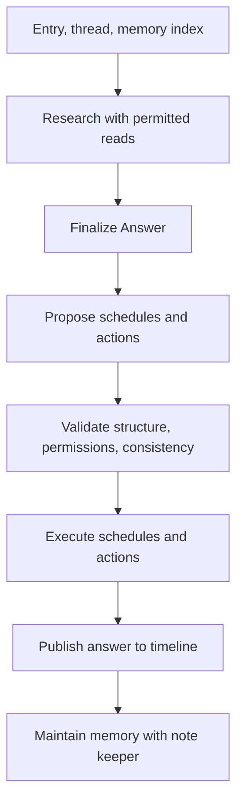

Persona definitions, routing, research, reviewed actions, memory maintenance, schedules, and corrections.

# Persona definitions and the Catalogue

## Skill structure

`Skill` contains an ID, name, icon, tone, `Domain`, `Instructions`, `Memory`, and `Tools`. `Domain` informs routing, `Instructions` describe the persona's behavior, and `Memory` defines its memory categories and organization policy.

Subject personas cover topics. Person personas use `Kind: person` and have `Aliases` and `Keywords` that can match text. The Catalogue combines built-in personas with user-installed or edited definitions. `Settings.Active` selects active personas.

## Management

Installing a definition from the frontend validates and installs it in the Catalogue, persists it through Workspace, and activates the new persona. AI-assisted definition creation is handled by the persona builder. Pausing a persona retains memory and removes schedules. Removing a persona removes its definition, memory, and schedules.

For person personas, `Skill.BasicInfo` (`basicInfo` in JSON) stores initial personal information, such as birthdays and preferences, with the definition. The builder returns it in the draft, and users can edit or clear it in the creation and editing forms. Saving never posts this information to the timeline or creates memory notes. Date-bearing information is separately normalized into notification schedules before saving; dates that cannot be established are omitted. The field is limited to 8,000 characters and cleared for subject personas.

Each person turn receives the current basic information through `forTurn`, alongside the shared person rules. Personas use it for answers, research, and scheduling, without copying it into notes; the current definition takes precedence over outdated notes. AI edits receive the current draft and preserve existing basic information when the response omits the field.

A persona's declared tools are selected from the Registry. When its memory layout names types, generated notes are checked against those categories. This is not general YAML schema validation of every note body.

## Implementation and verification

- [skill.go](../../internal/persona/skill.go)
- [people.go](../../internal/persona/people.go)
- [personas.go](../../internal/server/personas.go)
- [persona_builder.go](../../internal/server/persona_builder.go)
- [types.go](../../internal/persona/types.go)
- [skill_test.go](../../internal/persona/skill_test.go)
- [persona_builder_test.go](../../internal/server/persona_builder_test.go): basic-information persistence and editing without posts or notes
- [people_test.go](../../internal/persona/people_test.go): basic information in turn instructions

# Delivering posts to personas

## Building the recipient set

After image analysis, Runner loads active personas and the thread, then combines:

- Personas explicitly mentioned with `@`.
- The persona receiving a reply to its entry.
- Personas that received the conversation before a post edit.
- Subject personas selected by the router.
- Person personas whose aliases or keywords match the entry's text and associated content.

Person personas are not sent to the subject router; their matches are recorded in `Heard`. Subject routing uses the configured model or the configured Jev Decisions API.

## Failures and records

Missing configuration, request failure, or malformed output leaves the router with no subject recipients and `Answered: false` plus an error. A valid explicit empty array means a completed decision with no recipients. Unknown IDs are ignored. Explicit mentions, reply targets, person matching, and other recipient paths operate separately from that model decision.

Routing records retain recipients, exclusion reasons, explicit-call reasons, completed personas, and personas that spoke. `routingMu` protects updates by asynchronous completions and ordinary turns from dropping each other's state. The frontend receives `routed` and `turn` events.

Check and correction APIs distinguish a trial after changing conditions from applying the result. Merely checking a trial does not wake the actual persona.

## Implementation and verification

- [runner.go](../../internal/persona/runner.go): `reactEntry`, `routeSubjects`, `keepRouting`, `turnsDone`
- [route.go](../../internal/persona/route.go)
- [people.go](../../internal/persona/people.go)
- [routing.go](../../internal/server/routing.go)
- [route_production_test.go](../../internal/persona/route_production_test.go)

# From research to answer publication

## Turn sequence

The built-in model researches through `research`, calls `finish_read` to move to answering, and submits an `Answer` with `submit_answer`. External-agent answers enter the same subsequent processing.

`Answer` contains text and source entry IDs. Sources must be IDs found through timeline search in this turn. Web evidence is linked in the answer body. Silence uses empty text, with `Unrelated` distinguishing an out-of-domain turn.

## Conditions for publication

`planPhases` proposes schedules and actions without changing the answer. Deterministic checks cover types, counts, permissions, and arguments; a review checks consistency with promises in the answer. `Workflow.batch` converts to an internal validation and execution form. It is not a submission format for external agents.

If `execute` fails, the answer is not published as though its promised operations succeeded. Execution of all side effects is not a transaction with rollback, however. Reading and planning have limits to prevent indefinite generation loops.

Failure in the note keeper after publication does not retract an already published answer. A turn that stays silent because it is unrelated skips memory updates.

## Implementation and verification

- [runner.go](../../internal/persona/runner.go): `run`
- [answer.go](../../internal/persona/answer.go): `research`, `composeAnswer`
- [phases.go](../../internal/persona/phases.go): `planPhases`
- [workflow.go](../../internal/persona/workflow.go)
- [answer_test.go](../../internal/persona/answer_test.go)

# OKF memory and the note keeper

## Memory format

Each persona has `index.md` and Markdown files for individual concepts. Concepts follow OKF v0.2 with YAML frontmatter such as `type`, `title`, `description`, and `tags`. Relationships may use bundle-relative or file-relative Markdown links; the host-generated index uses bundle-relative links. The optional provenance, trust, and lifecycle fields are not required. `expires` and `review` are application extensions with the scheduling behavior described below. The persona's `Memory` and instructions define its categories and content.

When woken, the persona receives its index and note count and reads the bodies it needs. `notes_tools.go` handles listing, reading, writing, and forgetting notes and repairs some malformed line breaks and frontmatter. Research reads and later note-keeper changes are separate stages.

## The note keeper after publication

The note keeper selects existing notes using `choose_notes`, receives their full contents, and then proposes changes. The basic selection limit is four; notes already read during the turn and notes the host knows are needed are also handed over. A lock per persona serializes note keepers.

The host checks unread overwrites, duplicates, types outside the memory layout, copying answer text, and other constraints. It uses `section` to add a title and description under an index heading, removes index lines when notes are deleted, and repairs the index. These checks do not fully validate the meaning of the body.

## Provenance and recovery

Persistence attaches links to source posts and carries provenance forward when read notes are consolidated. A reverse index finds notes citing an entry. Deleting posts or notes asks the persona to tidy the remaining memory.

The keeper's input is persisted as a `NoteJob`. Failures retry with increasing delays from one minute up to one hour. Note updates and index repair are separate stages, so completed memory generation is not needlessly repeated. This durability is separate from the ordinary post reaction queue.

## Implementation and verification

- [SKILL.md](../../internal/persona/skills/okf/SKILL.md)
- [notekeeper.go](../../internal/persona/notekeeper.go)
- [notes_tools.go](../../internal/persona/notes_tools.go)
- [note_retry.go](../../internal/persona/note_retry.go)
- [note_sources.go](../../internal/store/note_sources.go)
- [notekeeper_test.go](../../internal/persona/notekeeper_test.go)
- [note_retry_test.go](../../internal/persona/note_retry_test.go)

# Schedules, check-ins, and monthly summaries

## Scheduled wakes

Creating an ordinary persona schedule stores its time, recurrence, wake note, and background memory.

Person calendars are also synchronized when a person is created, installed, reactivated, or its basic information is edited, and when it receives a user post or reply containing date or plan information (including analyzed image text). A dedicated model request extracts confirmed birthdays, anniversaries, meetings, appointments, and cancellations using the current time, timezone, and existing schedule keys. Basic-information synchronization replaces schedules sourced from that field; posts add or correct only the specified events. Unrelated schedules are preserved. These schedules require no memory note.

Birthdays and anniversaries have two annual notifications: seven days before and on the date, at 09:00 in the saved timezone. Newly learned imminent dates notify at the next minute when the usual time has passed. February 29 is observed on February 28 in non-leap years. Annual schedules retain the original calendar date and advance to the following occurrence when claimed; repeating the same information preserves that occurrence. Appointments are one-time notifications, respecting explicitly requested notification times; otherwise the default is 09:00 on the event date, or one hour before an event earlier than 09:00. All schedules accept any future date without a scheduling horizon, within the existing per-persona count limit.

Due person events use the normal Runner notification path, with instructions to notify even when no memory note exists. Model or storage failures are surfaced as API errors during basic-information saving or live error events during post processing. Runner claims due schedules before executing the persona. Claiming is part of the persistence contract and prevents duplicate execution of the same schedule. Pausing or removing a persona removes its schedules.

Past schedules are not all replayed unconditionally. Execution windows and persona state determine how late schedules are handled.

## Periodic checks

Daily checks use the user's time zone and times derived from the workspace and persona. The previous actual execution time determines the lookback window, and execution is claimed first. Users can choose minimal check-ins or sharing. Person personas can check in monthly instead.

The app itself builds monthly summaries from the timeline as topic-based posts with source links. Person personas' monthly checks use the summary and relevant records. Summaries have lookback and input length limits.

## Memory dates

`expires` triggers removal of expired notes; `review` triggers a memory review. Automatic expiry and manual user deletion are reported to personas with distinct reasons. Review requests can accompany daily check-ins. Notes that continue to be read also have date-extension logic.

## Implementation and verification

- [schedule.go](../../internal/persona/schedule.go)
- [person_schedules.go](../../internal/persona/person_schedules.go): event extraction and calendar reconciliation
- [person_schedule.go](../../internal/store/person_schedule.go): annual dates and recurrence
- [person_schedules_test.go](../../internal/persona/person_schedules_test.go)
- [person_schedule_test.go](../../internal/store/person_schedule_test.go)
- [schedule.go](../../internal/store/schedule.go)
- [schedule_test.go](../../internal/store/schedule_test.go): future dates without a horizon, ownership, caps, and claims
- [daily.go](../../internal/persona/daily.go)
- [summary.go](../../internal/persona/summary.go)
- [daily.go](../../internal/store/daily.go)
- [expires.go](../../internal/persona/expires.go)
- [schedule_test.go](../../internal/persona/schedule_test.go)

# Routing checks and reply previews

## Routing checks

`CheckRouting` evaluates a target entry against the persona's current conditions and returns the delivery decision and reason. Person personas return alias and keyword matches. A token records the entry text, persona, and decision at check time.

`ApplyRouting` uses that decision without calling the router again and updates the routing record. A newly selected persona runs an ordinary turn. A later trial cannot undo delivery that already happened.

## Reply previews

`PreviewReply` reconstructs the thread before a persona spoke, or through the target user entry, and runs a built-in model turn using the current instructions. `dryWorkspace` reads the real workspace but holds remarks and note changes inside the preview. Schedule and wake-count writes likewise do not persist to the host workspace. Model and search requests still occur.

`ApplyReply` persists the previewed remark and note changes without regenerating them. Replacing a persona remark preserves its ID, timestamp, and conversation position. Applying a preview does not create the schedules proposed during that preview.

## Token constraints

Trials live in Runner memory and expire after 15 minutes; they do not survive restarts. Application checks the token and entry ID, changed or deleted text, and whether the persona remains active. A completed application is recorded so repeating the same token is treated as already applied.

## Implementation and verification

- [trial.go](../../internal/persona/trial.go): `ApplyRouting`, `ApplyReply`
- [preview.go](../../internal/persona/preview.go): `PreviewReply`, `dryWorkspace`
- [routing.go](../../internal/server/routing.go)
- [preview.go](../../internal/server/preview.go)
- [condition-fix.js](../../frontend/src/condition-fix.js)
- [reply-fix.js](../../frontend/src/reply-fix.js)
- [trial_test.go](../../internal/persona/trial_test.go)

# Related chapters

- [Architecture and runtime](./architecture.md)
- [API and persistent state](./backend.md)
- [Browser application and device state](./frontend.md)
- [External agents, tools, and sharing](./integrations.md)
