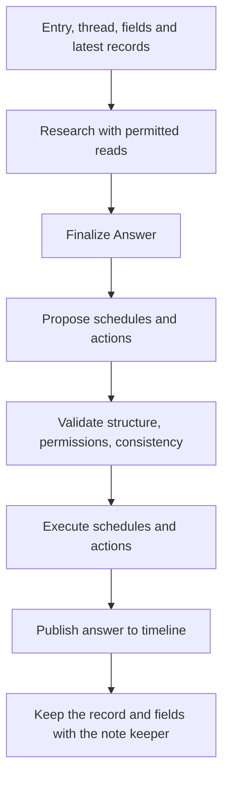

Persona definitions, routing, research, reviewed actions, memory maintenance, schedules, and corrections.

# Persona definitions and the Catalogue

## Skill structure

`Skill` contains an ID, name, icon, tone, `Domain`, `Instructions`, `Memory`, and `Tools`. `Domain` informs routing, `Instructions` describe the persona's behavior, and `Memory` names its memory fields (分野) - the capitalised words in it, such as `Preference` and `Shop` (`allowedTypes`) - and says what each field's summary keeps. A persona whose `Memory` names none keeps one field, `Memo`.

Subject personas cover topics. Person personas use `Kind: person` and have `Aliases` and `Keywords` that can match text. The Catalogue combines built-in personas with user-installed or edited definitions. `Settings.Active` selects active personas.

The Catalogue keeps nothing itself. It reads the installed definitions through `Workspace.Skills` - `skills/{id}/skill.json` files, or the Firestore `skills` collection - so a definition changed by another process serving the same user is seen at once. `Install`, `Update`, and `Uninstall` write only through `PersistSkill` and `DeleteSkill`; there is no second copy to keep in step.

A piece of work reads once. `Catalogue.Snapshot` returns a read-only `Skills` (`All`, `Find`, `Active`) that does not change afterwards. A reaction takes one when a worker claims it (`Runner.withSkills`) and keeps it on its context, so the router, every persona's turn, the note keeper, and the periodic checks it runs all see one set; the entry points reached from HTTP (`CheckRouting`, `ApplyRouting`, `ApplyReply`, `PreviewReply`) take one on entry, and handlers that look up several personas take one at the top. Code without a snapshot on its context reads afresh through `Runner.skills`. Prepared entry deliveries persist the routing snapshot as `SkillsJSON`, together with the active persona order, and restore it when claimed, including after restart. A definition changed while a long turn runs takes effect from the next piece of work.

## Management

Installing a definition from the frontend validates it, saves it through the Catalogue, and activates the new persona. AI-assisted definition creation is handled by the persona builder. Pausing a persona retains memory and removes schedules. Removing a persona removes its definition, memory, and schedules.

For person personas, `Skill.BasicInfo` (`basicInfo` in JSON) stores initial personal information, such as birthdays and preferences, with the definition. The builder returns it in the draft, and users can edit or clear it in the creation and editing forms. Saving never posts this information to the timeline or creates memory notes. Date-bearing information is separately normalized into notification schedules before saving; dates that cannot be established are omitted. The field is limited to 8,000 characters and cleared for subject personas.

A person's persona is not the person: it looks after the user's dealings with them. Every prompt it is given opens with `Skill.intro` - "you look after the user and 「name」, and are not name" - rather than "you are 「name」", which made it answer as the person ("ありがとう、届いたよ" to a gift the user said they had sent). `personIdentityRules` at the head of its instructions say the same in rules: it does not speak as the person or write their replies or feelings, it talks to the user, and when the user reports what they did for the person it answers the user with what it noted and what it can check later. The answer, phase, and note-keeper prompts all use `intro`, so the log keyed by the opening line stays whole.

Each person turn receives the current basic information through `forTurn`, alongside the shared person rules. Personas use it for answers, research, and scheduling, without copying it into notes; the current definition takes precedence over outdated notes. AI edits receive the current draft and preserve existing basic information when the response omits the field.

A persona's declared tools are selected from the Registry. A person persona's fields are always `Fact` and `Event` (`personMemory`).

## Implementation and verification

- [skill.go](../../internal/persona/skill.go): `Catalogue`, `Snapshot`, `Skills`
- [queue_test.go](../../internal/persona/queue_test.go): a reaction reads the definitions once
- [people.go](../../internal/persona/people.go)
- [personas.go](../../internal/server/personas.go)
- [persona_builder.go](../../internal/server/persona_builder.go)
- [types.go](../../internal/persona/types.go)
- [skill_test.go](../../internal/persona/skill_test.go)
- [types_test.go](../../internal/persona/types_test.go): the fields each built-in and person persona keeps
- [persona_builder_test.go](../../internal/server/persona_builder_test.go): basic-information persistence and editing without posts or notes
- [people_test.go](../../internal/persona/people_test.go): basic information in turn instructions, and a person's persona not introduced as the person

# Delivering posts to personas

## Building the recipient set

After image analysis, Runner loads active personas and the thread, then combines:

- Personas explicitly mentioned with `@`.
- The persona receiving a reply to its entry.
- Personas that received the conversation before a post edit.
- Subject personas selected by the router.
- Person personas whose aliases or keywords match the entry's text and associated content.

Person personas are not sent to the subject router; their matches are recorded in `Heard`. Subject routing uses the configured model or the configured Jev Decisions API.

Edits refresh prior recipients again when their ordered delivery starts, so a preceding turn that recorded its wake after routing still receives the correction. Existing recipients receive edit instructions; newly routed recipients receive an ordinary first delivery. Failures reading recipients or the delivery thread retain the reaction for retry.

## Failures and records

Missing configuration, request failure, or malformed output leaves the router with no subject recipients and `Answered: false` plus an error. A valid explicit empty array means a completed decision with no recipients. Unknown IDs are ignored. Explicit mentions, reply targets, person matching, and other recipient paths operate separately from that model decision.

Routing records retain recipients, exclusion reasons, explicit-call reasons, completed personas, and personas that spoke. Completions change them through `UpdateRouting` transactions, so turns finishing at the same time - in one process or several - do not drop each other's state. The frontend receives `routed` and `turn` events.

Check and correction APIs distinguish a trial after changing conditions from applying the result. Merely checking a trial does not wake the actual persona.

## Implementation and verification

- [runner.go](../../internal/persona/runner.go): `prepareEntry`, `deliverEntry`, `routeSubjects`, `routingRecord`, `turnsDone`
- [route.go](../../internal/persona/route.go)
- [people.go](../../internal/persona/people.go)
- [queue_test.go](../../internal/persona/queue_test.go): edits refresh recipients recorded after routing, including prepared delivery recovery
- [routing.go](../../internal/server/routing.go)
- [route_production_test.go](../../internal/persona/route_production_test.go)

# From research to answer publication

## Turn sequence

The built-in model researches through `research`, calls `finish_read` to move to answering, and submits an `Answer` with `submit_answer`. When the answer is asked of the external agent, the turn opens an ask and ends; once the ask closes, a reaction carries the turn on with the agent's answer and research, which enter the same subsequent processing, or with the built-in planner from the start.

`Answer` contains text and source entry IDs. Sources must be IDs found through timeline search in this turn. Web evidence is linked in the answer body. Silence uses empty text, with `Unrelated` distinguishing an out-of-domain turn.

## Conditions for publication

`planPhases` proposes schedules and actions without changing the answer. A schedule carries only its time, recurrence, and a note of what it is for; it no longer writes a background memory note. Deterministic checks cover types, counts, permissions, and arguments; a review checks consistency with promises in the answer. `Workflow.batch` converts to an internal validation and execution form. It is not a submission format for external agents.

If `execute` fails, the answer is not published as though its promised operations succeeded. Execution of all side effects is not a transaction with rollback, however. Reading and planning have limits to prevent indefinite generation loops.

Failure in the note keeper after publication does not retract an already published answer. A turn that stays silent because it is unrelated skips memory updates.

Research reads are `records` steps (older kakera records by `tag`, `query`, and `before` month, or by `ids` - up to ten in one step, `maxEntryReads` - the entries records point to, each with the kakera it answered when it is a reply; an entry read that way may be cited in `sources`) and read-use tool steps (`readAll`).

## Implementation and verification

- [runner.go](../../internal/persona/runner.go): `run`
- [answer.go](../../internal/persona/answer.go): `research`, `composeAnswer`
- [phases.go](../../internal/persona/phases.go): `planPhases`
- [workflow.go](../../internal/persona/workflow.go)
- [answer_test.go](../../internal/persona/answer_test.go)

# Memory: fields and kakera records

## Memory layout

A persona's memory is plain text, not OKF, and the host writes all of it ([memory.go](../../internal/persona/memory.go)):

- **Field summaries** - one file per field, `{Field}.md` (for example `Preference.md`, `Shop.md`), holding everything learned in that field so far, at most 2,000 characters (`maxFieldRunes`). Each is rewritten whole when a kakera changes it, and may be left as it is.
- **Kakera records** - one line per kakera of the user's the persona took in, in monthly files `records/YYYY-MM.md`: `- 2026-10-01 12:34 [e_x](/?entry=e_x) one sentence #tag #tag`, then any dates: `expires:2026-10-02/1d`, `review:2026-11-01/31d` (the day and the span it was given, in days), and `asked:e_y` (the post that asked about it under review). A record is what a line of the old `index.md` was. The id is the persona's reply when it replied, and the kakera itself when it did not; a reply leads back to its kakera through `ReplyTo`. The time is the kakera's, in the workspace time zone. A summary is at most 140 characters (`maxSummaryRunes`) with one to five tags (`maxTags`); a `#` in a summary is made full-width so it cannot read back as a tag.

Every turn is handed the fields whole and the 15 latest records (`memoryView`, `recentRecordsLimit`); older records are read on demand (`readRecords`, `findRecords`: newest first, 30 at a time). The external agent gets the same text as `memory` in its ask context. There is no `index.md`, no per-thing note, and no `notes_*` tool.

## Record dates, extension, and review

The keeper dates each new record from what it is ([review.go](../../internal/persona/review.go), `keeperDates`): `expires` - the next day, say - for a kakera that served its moment ("where for lunch today?", "how do I get to Shibuya?"), and `review` - weeks for a shop the user wants to try, months for a topic - for something the user said whose lifetime is unknown; preferences and habits get neither. A day must be tomorrow or later (`checkKept`). Built-in layouts say which of their records get which.

- **Expiry.** The due pass deletes records whose `expires` day has come (`expireRecords`, under the keeper lock) and returns the next such day for `nextDue`. Nobody is woken; the fields are not touched.
- **Extension.** Records a turn answering a post reads through `records` - shown by a search, or opened by id - have both dates moved so the span they were given starts again today (`extendRecords`, `recordDate.extended`); a date never moves closer. Records only handed over in the latest 15, and reads during check-ins or tidy-ups, do not count. An external agent's reads are kept on the ask (`askResearch.Referenced`) and count the same way.
- **Review.** A daily check-in is handed up to three records whose `review` day has passed, oldest first (`reviewsDue`; one that also expires is left to the sweep), with `reviewInstructions`: the persona asks about one in its post. The keeper is handed the same records and submits `records` decisions; it puts the asked one off a week, and the host marks it `asked:` with the check-in post. When the user replies to that post, the persona is told which records it asked about (`reviewReply`, wake `review-reply`), and the keeper - recording the reply as a kakera too - keeps the record (review cleared), moves it, or forgets it. A date restated unchanged keeps its span; a new one counts from now (`changeRecords`, `redated`).

## The note keeper after publication

`keepNotes` ([notekeeper.go](../../internal/persona/notekeeper.go)) runs once the remark is out, for a kakera of the user's (`keepsNotes`: a post, reply, or edit by the user, including listening turns), for a deletion tidy-up, and for a check-in handed records due for review. It makes one `keep_memory` call on the persona model, in the persona's voice, with the current fields, the latest records, the thread, the trigger, and the published answer. The submission is `summary`, `tags`, `expires`, `review`, and `fields` - only the fields the kakera changes, each with its new full text - plus `records`, decisions on the records it was handed for review (`handedRecords`); a tidy-up submits `fields` only. `checkKept` sends a submission back with its reasons (no or long summary, wrong tag count, a date that does not parse or is not after today, a record it was not handed, unknown or repeated field, empty or over-long body, two or more of the answer's own sentences copied - `copiesAnswer`), up to three attempts (`maxKeeperAttempts`). The keeper writes the changed fields (`writeFields`) and appends the record (`appendRecord`), replacing any record already kept for the same kakera - under its own id, or under a reply of the persona's to it - so an edit or a retry leaves one record. The remark lists the fields written in its `Notes` (`pointAtNotes`).

The keeper runs under the named lock `keeper:{id}`, one at a time across processes; if the lock is lost it stops writing. Its input is persisted as a `NoteJob` (`keeperSnapshot`). Failures retry with increasing delays from one minute up to one hour, on their due time (see [Times and wakes](./architecture.md#times-and-wakes)); a job whose kakera was deleted or edited meanwhile, or a job left at the old `index` stage, is dropped instead. Scheduled wakes, unrelated silences, and check-ins without a review keep nothing.

## Deleted kakera

`EntriesForgotten` ([forgotten.go](../../internal/persona/forgotten.go)) takes the deleted entries' records out of the personas woken for the post (`dropRecords`, in the months of the deleted entries) before anyone is woken. A persona that had a record removed and is active gets one `deletedInstructions` wake for the whole deletion: it cannot speak, may cancel the schedules it set for that kakera, and its keeper rewrites the fields without what rested on the deleted kakera, making no record. A persona's reply deleted on its own leaves the kakera it answered: its record is re-keyed to the kakera and nobody is woken. Deleting a field or a month of records from the memory viewer wakes nobody; a field deleted starts again from the next kakera.

## Folding old notes

Notes kept the old way - one per thing with `index.md` - are anything at a path that is neither a field nor a records file (`legacyNotes`). The running app never reads or migrates them; they stay in the memory viewer until folded by hand. `Runner.MigrateMemory` ([migrate.go](../../internal/persona/migrate.go)), run from [cmd/migrate-memory](../../cmd/migrate-memory/main.go) after the deploy (see [Memory migration](./operations.md#memory-migration)), hands up to 60,000 characters of one persona's old notes, newest first and without their source-link blocks, to the persona model with the current fields, and takes back field summaries through the same `keep_memory` check. A dry run only reports them; `Runner.ApplyMigration` writes a dry run's summaries as they are, or as a person edited them, and deletes every old note, under the keeper lock, refusing when the old notes changed meanwhile. No records are made from old notes. Every defined persona is run, paused ones included; one with no old notes costs no model call.

## Implementation and verification

- [memory.go](../../internal/persona/memory.go): fields, record lines, `memoryView`, `findRecords`
- [notekeeper.go](../../internal/persona/notekeeper.go): `keepNotes`, `checkKept`, `appendRecord`, `dropRecords`
- [notes_tools.go](../../internal/persona/notes_tools.go): `readRecords`, `recordEntry`, `RecordsTagged`
- [migrate.go](../../internal/persona/migrate.go)
- [review.go](../../internal/persona/review.go): `reviewsDue`, `reviewReply`, `handedRecords`, `expireRecords`
- [note_retry.go](../../internal/persona/note_retry.go)
- [notekeeper_test.go](../../internal/persona/notekeeper_test.go): records under the reply or the kakera, edits replacing a record, sent-back submissions, record dates and their round trip, extension on reading, the review asked and settled, the turn's memory view, folding old notes
- [due_test.go](../../internal/persona/due_test.go): expired records and the next expiry
- [forgotten_test.go](../../internal/persona/forgotten_test.go): records dropped and re-keyed on deletion, the tidy-up wake
- [note_retry_test.go](../../internal/persona/note_retry_test.go)
- [answer_test.go](../../internal/persona/answer_test.go): an answer copied into a field is sent back

# Schedules, check-ins, and monthly summaries

## Scheduled wakes

Creating an ordinary persona schedule stores its time, recurrence, and wake note. Personas with the schedule tool receive only their own schedules in the initial turn context (also handed to external agents). The same permission automatically provides the read-only `schedules_list` tool during research. It reads current workspace schedules on demand, including other personas' schedules, and accepts owner ID (`skill`), substring (`query`, matching wake notes or owner names/IDs), and notification-time (`from`/`to`, in the workspace timezone unless an offset is supplied) filters. Results are chronological, default to 20 items, and are capped at 30. The response includes `total` and a `next_after` cursor; pass it as `after` with the same filters to fetch the next page. If the cursor was removed, restart without it. Recurring schedules are matched by their stored next notification time, not expanded into future occurrences.

Each item displays its owner as `Name（ID）` using the persona definitions for the turn, falling back to the ID when no name is available. Tool listings preserve `skill` as the ID and add the display label in `owner`, plus `daily` and `annual` recurrence flags. The read tool returns no memory; memory remains private. Cancellation is validated and executed only for schedules owned by the requesting persona. Planning instructions ask personas to check other owners' reminders through the read tool when duplication is possible; this does not atomically prevent concurrent creations. The legacy `schedule list` internal action remains available but is not offered during research.

Person calendars are also synchronized when a person is created, installed, reactivated, or its basic information is edited, and when it receives a user post or reply containing date or plan information (including analyzed image text). A dedicated model request extracts confirmed birthdays, anniversaries, meetings, appointments, and cancellations using the current time, timezone, and existing schedule keys. Basic-information synchronization replaces schedules sourced from that field; posts add or correct only the specified events. Unrelated schedules are preserved. These schedules need nothing in memory.

Birthdays and anniversaries have two annual notifications: seven days before and on the date, at 09:00 in the saved timezone. Newly learned imminent dates notify at the next minute when the usual time has passed. February 29 is observed on February 28 in non-leap years. Annual schedules retain the original calendar date and advance to the following occurrence when claimed; repeating the same information preserves that occurrence. Appointments are one-time notifications, respecting explicitly requested notification times; otherwise the default is 09:00 on the event date, or one hour before an event earlier than 09:00. All schedules accept any future date without a scheduling horizon, within the existing per-persona count limit.

Calendar reconciliation for one persona runs under the named lock `calendar:{id}`, and stops writing if the lock is lost. Due person events use the normal Runner notification path, with instructions to notify even when memory says nothing about it. Model or storage failures are surfaced as API errors during basic-information saving or live error events during post processing. Runner claims due schedules before executing the persona. Claiming is part of the persistence contract and prevents duplicate execution of the same schedule. Pausing or removing a persona removes its schedules.

A successful scheduled utterance emits an internal `reminder` event immediately after its timeline post is persisted. The schedule instruction prefix identifies the wake even when person-event instructions are appended or an external-agent answer resumes later. Silent and failed wakes emit no reminder. Ordinary replies and daily check-ins do not use this event. See [Reminder push delivery](./backend.md#reminder-push-delivery) and [schedule_test.go](../../internal/persona/schedule_test.go).

Past schedules are not all replayed unconditionally. Execution windows and persona state determine how late schedules are handled.

## Periodic checks

Daily checks use the user's time zone and times derived from the workspace and persona. The previous actual execution time determines the lookback window, and execution is claimed first. A sharing check-in reads the timeline since the previous one and the persona's records by tag, and speaks only when it finds something worth sharing; a minimal one speaks only about what needs the user's decision - records due for review. Either is handed the records due for review (see [Record dates, extension, and review](#record-dates-extension-and-review)). Person personas can check in monthly instead.

The app itself builds monthly summaries from the timeline as topic-based posts with source links. Person personas' monthly checks use the summary and relevant records. Both read only the lookback window through `TimelineWindow`, and summaries have an input length limit.

## Implementation and verification

- [schedule.go](../../internal/persona/schedule.go)
- [person_schedules.go](../../internal/persona/person_schedules.go): event extraction and calendar reconciliation
- [person_schedule.go](../../internal/store/person_schedule.go): annual dates and recurrence
- [person_schedules_test.go](../../internal/persona/person_schedules_test.go)
- [person_schedule_test.go](../../internal/store/person_schedule_test.go)
- [workflow.go](../../internal/persona/workflow.go): own schedule context and ownership validation
- [schedule.go](../../internal/tools/schedule.go): filtered, paginated read-only listing and owner-scoped cancellation
- [schedule_test.go](../../internal/tools/schedule_test.go): cross-persona visibility and cancellation ownership
- [schedule.go](../../internal/store/schedule.go)
- [schedule_test.go](../../internal/store/schedule_test.go): future dates without a horizon, ownership, caps, and claims
- [daily.go](../../internal/persona/daily.go)
- [summary.go](../../internal/persona/summary.go)
- [daily.go](../../internal/store/daily.go)
- [schedule_test.go](../../internal/persona/schedule_test.go)

# Routing checks and reply previews

## Routing checks

`CheckRouting` evaluates a target entry against the persona's current conditions and returns the delivery decision and reason. Person personas return alias and keyword matches. A token records the entry text, persona, and decision at check time.

`ApplyRouting` uses that decision without calling the router again and updates the routing record. A newly selected persona gets the post as a `Deliver` reaction in the conversation's lane and answers like any other reaction; the request does not wait for its turn. A later trial cannot undo delivery that already happened.

## Reply previews

`PreviewReply` reconstructs the thread before a persona spoke, or through the target user entry, and runs a built-in model turn using the current instructions. `dryWorkspace` reads the real workspace but holds remarks and memory changes inside the preview; old notes are not folded in a preview. Schedule and wake-count writes likewise do not persist to the host workspace. Model and search requests still occur.

`ApplyReply` persists the previewed remark and field changes without regenerating them. From the records file the preview wrote it takes only the record it made, keeps it under the remark that is kept, and appends it under the keeper lock (`keepRecord`), so records written since the preview are not overwritten. Replacing a persona remark preserves its ID, timestamp, and conversation position. Applying a preview does not create the schedules proposed during that preview.

## Token constraints

Trials are `trials` runtime records kept for 15 minutes, so a check and its application may reach different processes and survive a restart. Application marks a trial as being applied in a transaction, so two requests cannot apply it at once. Application checks the token and entry ID, changed or deleted text, and whether the persona remains active. A completed application is recorded so repeating the same token is treated as already applied.

## Implementation and verification

- [trial.go](../../internal/persona/trial.go): `trialRecord`, `takeTrial`, `ApplyRouting`, `ApplyReply`
- [queue.go](../../internal/persona/queue.go): `deliver`
- [preview.go](../../internal/persona/preview.go): `PreviewReply`, `dryWorkspace`
- [routing.go](../../internal/server/routing.go)
- [preview.go](../../internal/server/preview.go)
- [condition-fix.js](../../frontend/src/condition-fix.js)
- [reply-fix.js](../../frontend/src/reply-fix.js)
- [trial_test.go](../../internal/persona/trial_test.go)

# Related chapters

- [Architecture and runtime](./architecture.md)
- [API and persistent state](./backend.md)
- [Browser application and device state](./frontend.md)
- [External agents, tools, and sharing](./integrations.md)
