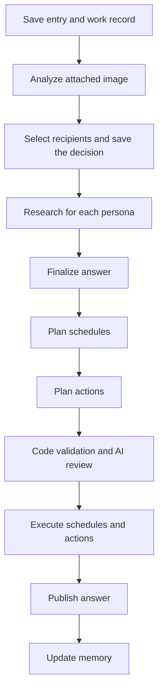

# Under the hood

[README](../README.md) · [日本語](technical_ja.md)

Implementation reference: 2026-10-04. The [system bundle](system/index.md) documents subsystem behavior with source and test references.

The English and Japanese editions cover the same implementation, in the same section order. Update both when changing a behavior, limit, example, or source reference.

You do not need this document to use kakeratta.

The user-facing idea is deliberately small: post what you are thinking, and
tell a persona in plain words what you would like it to do.

This page describes what runs underneath to make that possible: routing,
persona execution, memory, model selection, scheduled wakes, tools, storage,
offline behavior, external agents, and the choices made by whoever runs the
server.

## The flow

The main flow is:

**fragments of the day → personas for people and interests → a separate memory for each → recall when it matters**

In code both kinds are personas (`skill.json`); the user sees them as **People**
and **Interests**. For a fragment without a direct addressee, a person's persona is reached if
the fragment contains one of their names or keywords, and the router checks it
against each interest persona's routing condition and wakes only the ones that
match.

Each selected persona then decides what to do:

* read its memory - per field a short summary and the facts that hold, and its latest records
* look further back through its records, the current thread or older fragments
* call one of the tools allowed for that persona
* schedule a later follow-up
* speak in the timeline
* or stay silent

With memory enabled, the app then keeps what the fragment leaves behind: the persona sums the
fragment up in one sentence with tags, and says which facts it adds, replaces
or retires. Once a day, at its check-in, the persona rewrites the summary of
each field whose facts changed. Memory is split by persona, then by the fields
its skill names.

A persona therefore does not receive one ever-growing personal-history prompt.
Each field's summary and facts stay under 2,000 characters each; the details
live in one-line records it can search, and in the timeline itself.

Everything else still remains in the timeline, including fragments that no
persona chose to remember. Keyword and embedding-based meaning search can bring
those fragments back later.

Inference is primarily provided through **Nebius Token Factory**, with different
models assigned according to task difficulty and frequency.

Personas can also use tools such as:

* Tavily web search
* place lookup
* walking and driving routes
* remote MCP servers

The browser keeps recent state locally and supports offline posting, while
server-side check-ins and schedules can continue when the browser is closed.

The complexity stays below the surface. None of MCP, RAG, model selection,
or workflow validation needs to be understood by the person using the app.

## Design principles

**Memory is divided by subject.** The point of the split is not to hide
anything — it is to **keep the concentration**.

**The app routes, reviews and runs.** Who gets a post is decided centrally.
Whether to speak, what to remember and when to compress it are each persona's
own — but a persona hands in its answer and each kind of change apart, the app
assembles them into a workflow, and checks that workflow before running it and
publishing the answer. The app does not decide what a persona says; it stops a
persona saying what did not happen, or promising what it did not arrange.

**Silence is fine.** Not everything gets a reaction. This is not an app for
having things explained to you, and being reacted to every time you just wanted
to look at something is an imposition. A post nobody answers is a normal post.

**Not speaking and not remembering are different things.** A post a persona
said nothing about is still recorded if it is its subject and memory is enabled.

**Name it with @ and it always answers.** Because the subjects are separate,
there is something to choose between. A direct request is answered at the
length needed, without an instruction to keep it short.

**Asynchronous by default.** A post is stored and shown immediately; reactions
arrive afterwards.

## Routing is condition matching, not open-ended judgement

Routing happens on every post, so it needs to be both inexpensive and
predictable.

Each persona has a short **routing condition** describing the fragments it
should receive. The router's job is not to decide what that persona ought to do
with the post. It only decides whether the post matches that condition.

That separation was learned the hard way.

Early versions gave the router broader persona descriptions containing both the
subject and what the persona was expected to accomplish. Smaller models missed
personas that should have reacted, and some prompts became too open-ended.

Routing was moved to a larger model while the prompt was being debugged. That
made the problems easier to see, but usage data exposed a more important design
issue: routing runs for every fragment, while one post may already trigger
several later AI calls.

A personal AI should not make the user hesitate before saving a small thought
because every fragment is expensive.

The useful lesson was:

**If a high-end model gets a routing task right and a smaller model gets it
wrong, the routing task may be too ambiguous.**

So the problem was changed instead of simply keeping the larger model.

What the router sees became a short routing condition rather than a description
of what the persona is responsible for achieving. Concrete examples that pulled
the model toward particular cases were removed.

For models that support explanations, the output also requires an
`excluded_reasons` entry for every persona that was not selected.

This did two things at once:

1. it forced the router to explicitly consider every persona;
2. it created a reason that could be shown to the user.

That second effect became a product feature.

When the user says **Should have been called** or that a persona should not have
been called, kakeratta can use the correction to rewrite the persona's routing
condition and try the same post again before saving it.

### How routing behaves

**A post goes only where it belongs** (`internal/persona/route.go`). A place, a
time or a food named in passing is not a reason: "明日9:10に神谷町に着きたい"
goes to the travel persona and not to the wine one. Nobody is an ordinary
answer, and so is a routing call that fails. Every decision is logged with a
one-line reason per persona.

**The decision is kept.** What the router said about a post — whom it chose,
whom it passed over and why — is stored per post (`routing.json`, or a
`routing` collection on Firestore) and shown from the timeline. A persona
reached by an @ mention is left out, since that was not the router's call, and
a router that had no answer leaves no record. Disputing a row rewrites the
persona's condition as above, and saving has the router try the same post
again without delivering it (`Runner.CheckRouting`). The condition is the only
thing that changes; nothing is learned silently.

**A remark can be disputed the same way**, for the persona's tone and
instructions. After they are rewritten and saved, the persona takes the same
turn again (`Runner.PreviewReply`): the ordinary run, over a workspace wrapper
that reads from the real one and writes nowhere. No remark is appended, no note
or schedule is written and no wake is counted. What it would have said comes
back for the person to judge.

**Direct requests select one recipient.** An explicit `@` mention of an active
persona skips both interest routing and person name/keyword matching. Without
a mention, a reply to an active persona selects that persona alone. A mention
wins over a different reply target, while preserving the reply relationship.
The HTTP API rejects mentions of multiple distinct personas. Post edits also
notify previous recipients so they can correct their memory.

**Other replies use ordinary routing**, with the thread as context. This
includes replies to user posts or inactive/deleted personas with no active
mentioned recipient. A direct recipient must answer at the length needed.
When a reply says “summarize this” or “diagram this answer”, the replied-to
entry is its subject, including when `@` selects a different persona; an
explicitly chosen original post or whole thread takes precedence.

The current default router is **Nemotron 3 Super through Nebius Token Factory**.

Advanced settings offer **Use OpenRouter**, with separate Router, High, Middle,
and Low model choices. Selecting **Jev** (`~typesafe/jev-latest`) in the Router
slot uses OpenRouter's Decisions API for persona selection; the other slots
use the selected OpenRouter models. Jev can be faster and cheaper for routing,
but does not provide the exclusion reasons used by the normal routing-inspection
UI.

### People are matched by words, not routed

A persona can keep one person instead of a subject (`"kind": "person"`). A
person is never put to the router: asked about 佐藤さん, it would hand over
every post with a 佐藤 in it, a politician's included. A post reaches a person
when it contains the persona's name, one of its `aliases` or one of its
`keywords` (`internal/persona/people.go`). Width, case, hiragana against
katakana, spacing and a trailing honorific (さん, くん, 様...) are folded away,
so 佐藤 matches 佐藤くん and さとうさん; near words are listed as keywords of
their own. Names also answer an `@`. Text read from a photo counts.

A word can match by accident - 母 is in 母校. The persona is told that a word
is all it was, and one whose post is not about the person ends its turn with
no reply and no note. The word matched is kept on the routing record and shown
in ⚖. There, **Should have been called** has the persona builder propose
keywords from the post and their near words, and the saved words are checked
against the same post without the router; **Should not have been called**
lists every one of the person's words found in the post and lets the user
remove the ones they choose (never the persona's own name). A person heard in
a post is delivered even when the subjects' router fails.

### Measurements behind the routing design

The measurements are kept in separate experiment documents because they are
snapshots of particular prompts, personas, models, and production states rather
than specifications of the current architecture.

The first controlled comparison used 12 synthetic routing cases with expected
recipients fixed before execution. Both Lightning and Ultra matched all 12
cases. At the prices and exchange rate used for that experiment, the measured
routing call averaged about **0.0465 yen with Lightning** and **0.3385 yen with
Ultra**. Lightning was cheaper but slower in that run.

See
[Routing model comparison — 2026-09-17](routing-cost-experiment.md)
for the full method, token counts, latency, cost assumptions, and reproduction
command.

A later read-only replay used the latest 20 production posts and the six active
production persona conditions at that time. It compared Lightning, Nano, Super,
Ultra, Jev, and GPT Luna without waking personas or writing anything back to
production.

Among the Nemotron models in that run, **Super averaged 1.91 seconds and about
0.098 yen per route**, while Lightning averaged 6.55 seconds / 0.070 yen and
Ultra 2.28 seconds / 0.449 yen. The optional Jev Decisions path averaged
0.37 seconds / 0.026 yen.

That replay did **not** have a pre-established human ground-truth label for all
20 posts, so those figures should not be read as an accuracy leaderboard.

See
[Routing model comparison — 2026-09-19](routing-model-comparison-2026-09-19.md)
for the complete measurements and limitations.

The architecture described in this document remains the source of truth for the
current configuration; the experiment documents explain why that configuration
changed.

## Who answers, and on which model

**Selected personas run in parallel, normally on Nemotron 3 Super.** Each takes
one turn. On the timeline, only the user's own posts and replies wake anyone;
a persona's remark never wakes another persona, so the timeline cannot fill
with AI-to-AI conversation. (Check-ins and schedules wake a persona on their
own clock, described below.) The remarks already under a post are part of what each persona
is given, so a later reply can pick up on them.

**A reply that asks for a better answer is answered on Nemotron 3 Ultra.** When
the user replies to a persona's remark, Nemotron 3.5 Lightning is shown that
remark and the reply and answers one question
(`internal/persona/escalate.go`): is the user explicitly asking for a
correction, a rethink, more detail or a deeper look ("違う", "本当？",
"もう一度考えて", "もっと詳しく", "深掘りして")?

* If so, and that persona is among the selected recipients, it researches on Super and composes the final answer on Ultra. Its
  prompt drops "keep it short" and asks for a thorough answer in Markdown.
* Thanks, ordinary follow-up questions, new topics, and failed classification use
  the ordinary model choice (Super by default, Ultra when Always think deeply is on).
* A reply to the user's own post, or to an inactive/deleted persona, is not
  judged. Mentioning another persona selects that one instead of the reply author;
  escalation does not add the original author back to the recipients.

The judgement runs after recipient selection, so it adds its own time to such a reply. In
a live measurement on 2026-09-22 (15 synthetic replies,
`TestEscalateLiveLatency`), Lightning judged all 15 correctly in 0.67 seconds
on average (1.52 at most, about 0.006 yen per call); Super was also 15/15 but
took 1.30 seconds on average at about five times the cost.

Lightning is not asked whether Super would be good enough — only whether the
user said, in so many words, that they want more. That keeps the small model's
task narrow, and it makes the difference between the models visible: Super is
the everyday voice, Ultra is what the user reaches for.

**Always think deeply** (`alwaysUltra`) selects the high model only for final-answer composition, and keeps the deeper research budget for every wake, including ordinary requests. Research and schedule/action planning, including regeneration, use Super. It does not
change external delegation; Ultra is used when the built-in planner takes
over. Infographic ships with this on. Other personas default to off; ordinary
thanks and follow-ups use Super only while it is off.

**Each remark records its model slot** (`model: "super"`, `"ultra"`, or `"agent"`
for an external answer; nothing for a turn that failed). These are role labels,
not provider model IDs. The timeline marks an Ultra answer with a badge beside
the time.

```text
post / reply
 ↓ the image is read once
 ↓ direct recipient selection, or ordinary routing
 ↓ a reply to a persona's remark: Lightning → {"escalate": true|false}
selected recipients run in parallel
 ↓ research on Super, choosing read or finish_read each round
 ↓ final answer on Ultra when escalated or alwaysUltra is on; otherwise Super
 ↓ schedule/action planning on Super
```

## A workflow assembled phase by phase, not written in one call

A persona does not directly mutate application state from whatever text the
model happens to produce, and it does not write its answer and its changes in
one breath either.

An earlier shape asked one model call for everything at once: the remark, the
notes to keep, the schedules and the tool calls, as one workflow. It carried a
cost the answer paid for. The model spent its attention on the note format and
the step schema, shortened the remark to leave room for a note it was required
to write, and a reviewer that could not see what had been researched sent good
answers back. When the answering was handed to an external agent, the quality
dropped visibly.

The workflow stays - `Workflow{answer, schedules, actions}` is still what
kakeratta checks, reviews and runs - but no model writes it whole any more, and
memory is kept apart, after the answer is out.
A turn is split by responsibility, each phase fills one typed part, and the
host assembles the workflow:

```text
Built-in: Read → Answer        External agent: Read + Answer → submit_answer
                     ↓
            Schedule phase → schedules
                     ↓
            Action phase   → actions      (only if the persona holds one)
                     ↓
            Code checks (every time)
                     ↓
            Review (only when there is a schedule or an action)
                     ↓
            Execute → publish the answer
                     ↓
            Note keeper    → record of the fragment, fact changes
            (at the check-in: summaries rewritten from what changed)
```

### From accepting a fragment to keeping memory

Processing has two levels: acceptance and recipient selection happen once for the fragment; research and the later stages run separately for each selected persona.



| Stage | Responsibility |
| --- | --- |
| Acceptance | Save the post, reply, or edit together with its routing work record. Production uses a Firestore transaction, so acceptance requires both writes to succeed. |
| Image analysis | Analyze an attached image once and share the result with the recipient personas. |
| Recipient selection | Match interest-persona conditions and person-persona names/keywords. An explicit @ mention or reply to an active persona selects that recipient directly. Persist the selected recipients and persona-definition snapshot for delivery. |
| Per-persona processing | Research, finalize the answer, plan schedules and actions, validate/review, execute, publish, then keep memory. The detailed stages below follow this execution order. |

Different recipients can run concurrently, while delivery order within the same conversation is preserved. Persisted work records allow pending work to resume after a restart; they do not preserve an AI request's in-progress reasoning, and interrupted steps may run again.

Memoryless personas with only read tools skip schedule/action planning and review, as well as memory updates. Review is needed only when a plan contains schedules or actions. External agents provide research and an answer; kakeratta retains control of all subsequent stages. A memory-update failure after publication leaves the answer available and is retried separately through a persisted note job.

See [persona execution](./system/personas.md#from-research-to-answer-publication) and [background work](./system/architecture.md) for the implementation details.

### Research budgets and available reads

Built-in research uses up to 10 read calls and 2 Web searches normally, or 20 reads and 4 Web searches for deep replies and AlwaysUltra. At each round, the host rebuilds the read schema and current instruction from the execution budget. It reports the remaining Web searches, highlights the last slot, and removes `web_search` from the permitted tool enum and usage instructions at zero. Each step is budget-checked, including several searches in one read or several read calls in one reply.

Zero Web searches does not stop research: available timeline, memory, and other reads can continue, and `finish_read` remains offered. Unknown, undeclared, unconfigured, and otherwise unavailable reads are filtered out. Memoryless personas receive no `records` branch or instructions; `entries` preserves direct post reads by known IDs. The host replaces the live instruction each round and keeps all tool results for the answer. External-agent interfaces and phase budgets remain separate.

See [Research budgets and available reads](./system/personas.md#research-budgets-and-available-reads) for execution details and tests. The [production usage report](./production-model-usage-2026-10-05.md) records the earlier Ultra loop and estimates the effect of model separation; it is not a post-deployment measurement.

### A turn, phase by phase

The following describes a memory-enabled turn; memoryless read-only turns
skip post-answer action phases, and memory-off turns skip the note keeper.
Personas otherwise use the same phases, whatever tools they hold
(`internal/persona/answer.go`, `phases.go`, `workflow.go`). The reading and the
answer can be done by the built-in model or, for a persona whose planner is set
to it, by an external agent over MCP (see
[External agents through MCP](#external-agents-through-mcp)); everything after
the answer is the same either way.

1. **Read.** Its field summaries, the facts that hold now, and its latest 15
   records are handed over at the start of every turn. It may then ask, up to ten times (twenty in
   a deep or AlwaysUltra turn), to look at things: older records by tag,
   words, meaning or month, the posts records point to (up to ten at once), a timeline search, a web
   search, a place or route lookup. Only read-only tools run here; an MCP tool
   counts as read-only only when its server marks it `readOnlyHint`. Reading
   writes nothing, so the app just does it and hands the results back.
2. **Answer.** With the reading done, the complete conversation and tool results pass directly to answer composition: Super normally, Ultra for deep replies or AlwaysUltra. Only `submit_answer` is offered, so Ultra does not run research. A valid submission needs one composition call; existing correction retries remain. The persona hands in only
   `{text, sources}`. Its prompt holds no note format, memory layout or
   change schema, and it is not told to keep notes. It is told what the later
   phases can do for it (`capabilities`), so it does not promise a reminder or
   an action the persona cannot make. An empty text is silence; a named turn
   must answer, a listening turn must not. The answer is fixed from here on:
   no later phase can change it.
3. **Schedule phase.** A separate call on Super sees the finished
   answer and the schedules already placed, and hands in `submit_schedule`:
   create, update, and cancel operations. Updates change time or Push preference;
   purpose and recurrence changes use cancel/create. Each
   create with a short note of what it is for. It also states whether every promise the
   answer makes about time is backed by an operation or an existing schedule
   (`consistent`, with a `reason`). "I cancelled it" with no cancel, or "I'll
   ask you at 22:30" with nothing placed, is sent back; if it cannot be made
   consistent, the turn stops and the answer is not published.
4. **Action phase.** Only for a persona that holds a tool that acts. Super hands
   in `submit_action` — the tool calls and their arguments — with the same
   consistency statement about what the answer promised.
5. **Checked by code, every time.** Known operation types, declared tools and no
   lookup used as an action, schedule ids that exist and are the persona's own
   to cancel, times that parse. A proposal that fails is sent back to its own
   phase with the reasons.
6. **Reviewed, only when it reaches further.** A plan holding a schedule or an
   action is reviewed by Nemotron 3 Super against a narrow list: the answer's
   promises and the schedules' times, Push preferences, creates, updates and cancels agree; schedules and
   actions do not contradict or depend on each other unmet; an action's target
   and arguments fit the user's request and the persona's permissions; an
   answer that says a change is done has something behind it. The answer's
   quality, its length and its research are not reviewed, and a missing
   internal read is never a reason to reject research done elsewhere. A plain
   answer costs no review. A failed review
   regenerates only the phases it blamed (`schedule`, `action` or `both`); the
   answer stays as it was. After two reviews, the turn stops.
7. **Run, then publish.** Schedules and actions run in order; **the first step
   that fails stops the rest**, and the answer is published only when
   everything ran. An external action is not a transaction: what already ran is recorded, and
   an answer promising success is withheld.

8. **Memory comes after the answer.** It is not a phase of the turn: memory
   that fails to come out must not take a finished answer with it. Once the
   remark is out, the persona's **note keeper** keeps it (see
   [The note keeper](#the-note-keeper)).

Each turn is logged as one structured entry: what was read, the answer, each
phase with its rounds, reads and what it had sent back and why, each review and
which phases it regenerated, the assembled workflow, each step as it ran, and what
was said. The note keeper logs its own entry (`notes <persona>`): what it handed
in and how many submissions it took.

### The note keeper

`internal/persona/notekeeper.go`. After the remark is published, the persona
keeps what the turn should leave behind, on the middle model (Super by default,
even when Ultra composes the answer), in its own voice. It runs for a fragment of the user's - a post,
a reply, an edit, also when the persona stayed quiet or could not speak - for a
check-in handed records due for review. Schedule wakes, deletion tidy-ups, and
out-of-domain silence do not run it. On deletion, the host removes the records
and their unsupported facts directly; the persona can revisit its schedules.
See [keepsNotes](../internal/persona/runner.go) and [the note keeper](../internal/persona/notekeeper.go).

It uses `keep_memory`, with the current summaries and facts, the latest
records, the thread and the published answer in front of it, and **no way to
read more**. It hands in:

* `summary` - the fragment in one sentence, in the user's words (140 characters at most);
* `tags` - one to five words to find it by later;
* `expires` / `review` - the record's dates, if any (see below);
* `facts` - changes to the facts, never a rewrite: `add` a fact to a field,
  `update` one that changed (the old one is kept as past, with what replaced
  it), `invalidate` one that no longer holds, `merge` several into one;
* `records` - when it was handed records due for review, what becomes of them.

The app applies the changes in memory first and sends the submission back with
the reasons, with at most three submissions in total: no sentence, too many tags, a date that is not
after today, a fact id that does not hold now, a field the skill does not name,
a fact over 200 characters, a field whose facts would run over 2,000, two or
more of the answer's own sentences copied. Then **the app writes it**: the
changed fields (`{Field}.md`), each fact resting on this fragment, and one
record line in the month's file (`records/YYYY-MM.md`):

```text
- 2026-10-01 12:34 [e_x](/?entry=e_x) Wants to try Jiro in Mita #ramen #Mita review:2026-10-22/21d
```

The id is the persona's reply when it replied - which leads back to the
fragment it answered - and the fragment itself when it did not. An edited
fragment, or a retry, replaces its record rather than adding a second.

**The summary is not the keeper's.** Before a persona's daily or monthly
check-in, one call rewrites summaries whose facts changed since the summary's
day or whose persisted `SummaryDirty` marker requires a refresh. Fact changes,
direct corrections, and removal of fact sources set this marker, so edits to
old facts are picked up regardless of their original dates. A field is not
rewritten twice in one day; a failed rewrite is retried at the next check-in.

For marked fields, the model receives the surviving current and past facts
and must explicitly replace the summary, removing unsupported prose. Omitting
a replacement is rejected; the marker clears only after the replacement is
saved. The internal marker is hidden in the memory viewer. The same call can
retire past-dated plans, such as reservations or appointments, while retaining
facts about events that happened. With no changed or marked fields and no
past-dated facts to review, no model call is needed. See
[Field summaries](system/personas.md#field-summaries).

If the keeper cannot finish, the answer is already out. Its input is saved as a
note job before it runs, and failed memory work is retried after one minute,
with backoff up to one hour, on the workspace's due passes. A deleted or edited
fragment's old input is not replayed. Two turns of one persona finishing
together take turns under a lock, so they do not rewrite the same summary or
month from what each saw. The remark is updated afterwards to point at the
summaries that were written. If the job itself cannot be saved, the keeper
still makes one immediate attempt; that attempt has no durable retry.

## Models

kakeratta uses multiple models through **Nebius Token Factory** rather than
sending all work to one large model.

| Model                      | Role                                                                  |
| -------------------------- | --------------------------------------------------------------------- |
| **Nemotron 3 Super**       | All built-in research, ordinary answers, schedule/action phases, routing, and workflow review      |
| **Nemotron 3 Ultra**       | Final answers for deep replies and AlwaysUltra, plus persona drafting |
| **Nemotron 3.5 Lightning** | Judging whether a reply asks for a better answer; dictation polishing |
| **GLM-5.3-Flash**          | Reading screenshots and photos, once per post                         |
| **Qwen3-Embedding-8B**     | Meaning search over past fragments                                    |

The settings keep three slots — `lowModel` (Lightning), `middleModel` (Super)
and `highModel` (Ultra) — and any OpenAI-compatible model name can go in each.

Persona execution, routing, and workflow review use native tool calling where
appropriate.

Image reading, persona drafting, dictation cleanup, structured generation, and
embeddings use the provider's structured-output or embedding interfaces rather
than pretending every operation is the same kind of chat request.

One of the advantages of Token Factory during development was that the model
roles could be changed without rebuilding the surrounding provider integration.

Usage data also made the cost of those choices visible while the routing design
was being changed.

Advanced settings can enable **Use OpenRouter** with its own API key and
Router, High, Middle, and Low model selections. Jev is an option in the Router
picker, rather than an independent switch. Legacy `jevEnabled` settings migrate
to OpenRouter enabled with `~typesafe/jev-latest` selected as Router. Token
Factory remains the default provider.

OpenRouter tool calls use Exacto routing. See
[Settings and model requests](system/backend.md#settings-and-model-requests).

## Image understanding happens once per post

A photo or screenshot is sent to **GLM-5.3-Flash once when the post is
processed**.

The resulting textual interpretation is attached to the fragment and shared
with the relevant personas (`internal/capture`): what is in it, the text on
it, where it seems to come from, and how it looks — colour, shape, count,
layout, the things a persona might otherwise want to ask about.

The picture itself is never handed to a persona. None of the persona models
take image input, and a live run lost a wine label's remark to a picture sent
to one. A persona that asks for the original is told to use the reading it
already has.

The image is not independently sent through vision once for every persona.

This is deliberate.

If three personas receive the same photo, repeated vision calls would multiply
both latency and cost while often extracting the same basic facts. A single
interpretation also gives the personas a consistent description of what was
seen.

There is a trade-off.

Different personas can care about different visual details. A food persona may
want the ingredients, while a travel persona may care about the restaurant sign
in the background.

If the initial image interpretation did not extract a detail, a later persona
cannot recover it simply by asking a different question: the original vision
model is not run again from that persona's point of view.

For kakeratta, the current choice is:

**one predictable image-understanding step per post → shared textual context for
all relevant personas**

rather than:

**one vision request per persona → potentially richer persona-specific details
at multiplied cost and latency**.

That limit is intentional and documented rather than hidden as if every persona
had independently seen the original pixels.

## Memory and search

Each persona owns its own memory, and **only the app writes it**. A food
persona cannot touch the travel persona's memory, and no persona - nor an
external agent - writes files of its own: the persona's note keeper hands in
what to keep, and the app checks and stores it.

A persona keeps three things:

* **Facts, by field.** The fields are the capitalised words of its skill's
  `memory` - `Preference` and `Shop` for the food persona, `Book` and `Theme`
  for the reading one; a persona that names none keeps `Memo`. Each fact is a
  line with an id, the fragment it rests on, and since when it holds. The
  keeper changes facts one by one, so nothing is lost to a rewrite; a replaced
  fact stays below, with when it stopped and what replaced it.
* **A summary, by field,** at the top of the same file - the persona's own
  reading of the facts, rewritten at its check-in from what changed.
* **One record per fragment.** A sentence, its tags, the post to go back to,
  and possibly a date. Records are grouped by month and may be updated or removed; a persona is
  handed the latest 15 and searches the rest, by tag, words, or the meaning
  of the fragment they came from.

```text
=== Preference.md ===
# Preference

## まとめ（2026-09-20 更新）

Picks tonkotsu when there is a choice; strong sesame puts them off.

## いまの事実

- [f_ab12cd] Picks tonkotsu over shoyu from:e_b since:2026-09-08
- [f_cd34ef] Finds strong sesame too much in tantanmen from:e_a since:2026-09-01

=== records/2026-09.md ===
# 2026-09 のかけら

- 2026-09-01 20:14 [e_a](/?entry=e_a) Said the tantanmen had too much sesame #tantanmen #sesame
- 2026-09-08 12:30 [e_b](/?entry=e_b) Chose tonkotsu over shoyu #ramen #tonkotsu
- 2026-09-12 12:02 [e_c](/?entry=e_c) Asked where to eat lunch near Kanda today #lunch #Kanda expires:2026-09-13/1d
```

The user can read all of it directly from the interface: the fields first, then
the records month by month. A fact's source and a record's id open the post, and
a tag narrows the view to the months holding it. A field or a month of records
can be edited or deleted without deleting any post; nothing is woken for it. In local storage
they are plain files that can be read with `cat`.

**Records are what a line of an index used to be, and some are set to go.**
The keeper dates a record from what it is. A fragment that served its moment -
"where for lunch today?", "how do I get to Shibuya?" - gets `expires`, the next
day; the app deletes the record when the day comes, without waking anyone. A
thing the user said whose lifetime nobody knows - a shop they want to try, a
topic they are into - gets `review`, weeks or months ahead; preferences and
habits get neither, and a record without dates is never aged out.

**A record in use keeps longer.** When a persona reads a record through a
search or by its id while answering a post, both its dates move: the span it
was given starts again from that day. Reading never brings a date closer, and
reading at a check-in or any other wake that is not a post does not count, so
a record read in order to ask about it is not put off again and again.

**What has come up for review is asked about, and the app never deletes it.**
When the review day has passed, the persona's next daily check-in is handed at
most three due records, oldest first. The persona asks about one in a short
post; its keeper puts that record off a week and marks it with the post that
asked. A reply under that post reaches the persona with the records it asked
about, and its keeper keeps the record for good, moves the date, or forgets it.

Deleting a post is different. The app takes out the records kept under it - the
fragment's own, or the reply that answered it - and takes the fragment out of
the facts' sources: a fact that rested on it alone goes, without asking any
model. Each persona that had a record is woken, but cannot speak and has
nothing to answer: it may cancel the schedules it set for that fragment. The
surviving field is marked for summary refresh at the next check-in. Removing
the final current or past fact deletes the field and its unsupported summary
immediately. Direct fact corrections and deletions use the same refresh rule
without waking the persona. If only a persona's reply is deleted, its record
is kept under the fragment instead.

### What a persona is given

* the post it was routed, and what the app read out of its image;
* **the remarks under that post** - other personas' and the user's replies;
* its field summaries, the facts that hold now, and its latest records;
* its own pending schedules, if it can schedule.

**Not the whole timeline.** Hand that over and every persona sees everything
again, which is exactly what dividing by subject was for. Anything older is in
its records, or found with a timeline search.

**Memory comes from the user.** The keeper is told to keep what the user said
and did - facts, preferences, plans, changes, what they asked to be remembered
- and not what an answer researched or recommended: a list of candidates, a
figure looked up, an explanation. Those can be looked up again when needed,
and kept as memory they would be read back as something known about the user
long after they went stale. How an answer went may be kept as a word or two.

**The format is the app's; the policy belongs to the skill.** Which fields a
persona keeps, which facts each prefers, which records get which date - those
are in each skill's `memory`, written in plain words. The app holds no
threshold for when to compress; it only holds the sizes.

Earlier memory formats included individual OKF notes with an `index.md`, then
prose field files rewritten with each fragment. The current runtime expects
field files and monthly records, but still reads an unmigrated prose field as
its summary. Adding a fact preserves that prose. `cmd/migrate-memory` can draft
a split of prose fields into facts for a person to review before applying it;
the prose is retained as the field summary. This compatibility path is distinct
from the older individual OKF-note format. See
[Memory migration](system/operations.md#memory-migration).

### Favorites

Favorites preserve the user's choice of an entry to revisit, independently of
persona memory. Posts, persona answers and user replies remain current timeline
entries; a favorite stores the entry ID and when it was added, not a separate
copy of its content. Repeated saves keep the timestamp, while removing and
saving again gives it a new timestamp.

The recent-favorites API pages by favorite timestamp and supports a speaker
filter. Browser search can restrict lexical and semantic candidates to saved
IDs before ranking and pagination. A blank filtered query lists favorites by
post date. Favorite records persist in `favorites/{entry-id}.json` locally and
in `users/{key}/favorites` in Firestore, and travel with workspace exports.
Deleting an entry removes its favorite; merely removing a favorite keeps the
entry. See [API and persistent state](system/backend.md#favorites).

### Timeline, speaker, and search filters

The browser has no separate Favorites panel. Timeline, speaker lists, and search
share a **Filters** disclosure, initially closed, with **Favorites only**, **From**,
**To**, and **Clear filters**. Closing it preserves conditions and shows **Filters active**
when conditions are applied. Every favorite removal asks for confirmation.
The persona badges below the composer also offer a speaker list from their
right-click or long-press menu.

Date inputs use the device timezone and include the whole final day. The HTTP
APIs accept inclusive RFC3339 `from`/`to` timestamps and reject invalid or reversed
ranges. Ordinary timeline filtering tests the parent post's date; favorites-only
tests each saved entry's date and retains its parent conversation, ordered by
parent-post date. Speaker lists test the utterance's own date and saved state,
then include the conversation for context. Search applies date and saved-ID
conditions before ranking and pagination; a date range or favorites-only permits
an empty query, listing entries newest first.

Changing conditions resets paging and ignores stale responses. Only unfiltered
timeline data is written to the offline cache; offline filtering uses cached
entries and known favorite IDs. See [listing filters](system/backend.md#listing-filters)
and [browser behavior](system/frontend.md#favorites-and-saved-entry-search).

### Meaning search

A fragment does not need to have been intentionally remembered by a persona to
remain useful.

Timeline text, persona conversations, and text extracted from images can be
searched later.

Meaning search uses **Qwen3-Embedding-8B** embeddings. A query such as "a light
red that was easy to drink" can therefore find a past post without requiring
the user to remember the exact word "Pinot".

This is deliberately separate from long-term persona memory:

* memory is what a persona chose to retain;
* search can recover what remained only in the timeline.

### Post locations and regional search

Valid coordinates are stored immediately with a browser post; reverse geocoding
does not delay acceptance or persona delivery. Routing queues a durable
`place-{entryID}` job, which calls the operator-configured `reverse_geocode` MCP
tool with `lat`, `lng`, and the post's `language`. Each attempt has a 60-second
budget, with initial tool discovery limited to 15 seconds. Retryable failures
wait 30 seconds, with at most three claimed attempts; a valid no-match ends the job.
Custom labels are retained. A conditional location-only write preserves concurrent
text edits and does not recreate deleted posts. Success emits an entry event to
update browsers and reindex the search text.

The display uses administrative levels 2–4 and the nearest settlement, omitting
country and level 1. Localized `Country`, `CountryCode`, and level-1 `Region` are
stored separately and included in keyword text and RAG embeddings. They describe
the nearest settlement, not guaranteed coordinate containment. A region term
such as Akita can be combined with a last-week time window through search filters
or `timeline_search`. Coordinates remain the fallback when lookup cannot produce
a label. The UI adds no map link; GeoNames attribution appears in the feed footer.

Existing Firestore posts can be enriched with `cmd/backfill-places -metadata-only`,
preserving existing display labels. It uses a reviewable plan and separate apply
and verify steps; see [backfilling locations](system/operations.md#backfilling-post-locations).
Implementation: [location jobs](../internal/server/place.go),
[location formatting](../internal/geocode/place.go), and [search text](../internal/search/search.go).

## Skills

A persona is a `skill.json`:

| Field | |
| --- | --- |
| `name`, `icon`, `tone` | How it shows up and how it talks |
| `domain` | The routing condition: what it reacts to and remembers. **The router reads this** |
| `memory` | Its fields (1–4 capitalised words such as `Wine`, `Preference`), what each summary keeps, which records get which date. Each field is one summary |
| `instructions` | What to separate and mark as a guess, when to speak. **Only the persona reads these** |
| `tools` | Only what is declared can be called |

Five ship with the app — tabe (food), support (kakeratta help), shiori (reading),
sona (preparation, weather and small follow-ups), and infographic (HTML diagrams).
sona, support and infographic are active by default in new workspaces; saved
activation choices are preserved. More can be
added from the UI, written by hand or drafted with the persona builder
(Nemotron 3 Ultra).

```json
{
  "id": "wine",
  "name": "ぶどう",
  "icon": "🍷",
  "domain": "ワイン。銘柄、産地、ラベルの写真、飲んだ記録。",
  "tone": "控えめ。おすすめを押しつけない。",
  "memory": "分野は Wine（飲んだ銘柄）と Preference（好みの傾向）の2つ。好みは重なったらまとめる。",
  "instructions": "引用と本人の意見を分け、推測は推測と書く。",
  "tools": ["web_search", "place_search"]
}
```

**There is no ceiling on how many.** Because routing is central, only the few
that matter wake for a given post, and routing runs once per post. **Without
separate subjects, @ means nothing** — if there is nothing to choose between,
naming someone is pointless.

### Optional memory and HTML infographics

`memoryEnabled` defaults to true when omitted or null. Support and infographic
ship with it false. Memory-off turns do not receive private notes; record
queries return no memory, but explicit timeline reads remain available. The
host skips note keeping, summary rewrites, memory migration and daily/monthly
check-ins. Existing notes remain stored, and explicit notification schedules
and external-agent planning remain available. The UI hides memory and check-in
controls. Read-only memoryless turns also skip post-answer action planning and
review calls. See [optional persona memory](system/personas.md#optional-persona-memory).

Infographic defaults to `alwaysUltra: true` and submits a complete HTML document
with inline CSS/SVG. It uses expanded URL articles, interpreted image contents
and the selected reply target as material. `Entry.Language`, captured at
submission (including in the offline outbox), selects Japanese or English for
the diagram; older entries fall back to the latest user language in the thread.

The host stores HTML unchanged. The frontend recognizes whole HTML documents
from personas and renders them in a sandboxed iframe with CSP blocking scripts,
external resources, forms, popups and navigation. Ordinary prose and partial
HTML remain Markdown; read-aloud extracts text without scripts or styles.
See [HTML rendering](system/frontend.md#merging-data) and
[infographic verification](../internal/persona/infographic_test.go).

### A person's persona

A person's `skill.json` adds `kind`, `aliases` and `keywords`, and its
`domain` is the relationship (恋人, 母, a friend from university) rather than a
routing condition. It has no `tone` or `memory` of its own, and its
`instructions` are only what is particular to this one person, if anything.
How a person's persona speaks, its two fields (Fact and Event) and its
rules - keep loans and promises until settled, wake on the morning of a
meeting, wake a week before and on a birthday or an anniversary - are held by the app
and given to every person at the start of a turn (`forTurn` in
`internal/persona/people.go`), so a better rule reaches every person at once.

Birthdays, preferences and other details supplied when creating a person or using **Edit with AI** are saved as editable **Basic information** in the persona definition. Saving does not post a fragment or copy them into notes. You can also change them in the regular editor.

The definition stores `basicInfo` (up to 8,000 characters), supplied on each `forTurn`. `internal/persona/person_schedules.go` extracts calendar events before saving basic information, then reconciles schedules after persistence. Fragments use the same extraction and reconciliation.

Saving or editing basic information, and fragments delivered to the person, automatically register birthdays, anniversaries and appointments with known dates. Birthdays and anniversaries notify annually, one week before and on the day at 09:00 in the saved timezone. Appointments use an explicitly requested notification time, otherwise 09:00 on the day (one hour before appointments earlier than 09:00). Notifications arrive as persona posts. Future dates have no scheduling horizon; unknown dates are not guessed. Changes and cancellations are reconciled.

## Tools belong to the persona and the operator

A persona does not automatically receive every tool available to the server.

Its skill declares the tool names it may use.

The server operator determines where those tool names actually point.

Built-in integrations include:

* `web_search`
* `weather_forecast`
* `kakeratta_help`
* `place_search`
* `route`

* `schedule` — wake times a persona asks the app for; nothing leaves the app
  (`schedules.json` / Firestore)

Every persona also gets `timeline_search` — keyword and meaning search over the
user's own timeline — without declaring it.

The `schedule` permission also grants read-only `schedules_list`. It can read
other personas' schedules to avoid duplicates, filter by owner, text, and time,
and paginate 20 at a time (maximum 30). Updates and cancellations remain limited
to the caller's own schedules. `kakeratta_help` reads the embedded system bundle;
support declares it, while other personas need the same declaration to use it.

Remote MCP servers can extend the tool list.

The application performs the actual calls and holds the relevant credentials.

### Web search

`web_search` uses **Tavily**.

The Tavily API key is supplied by the user in Settings rather than embedded in
the application.

A persona receives web search only when its configured skill declares that
tool.

### Weather forecasts

`weather_forecast` uses the operator's WeatherAPI key and accepts a region or
coordinates, defaulting to the post's coordinates when omitted. It distinguishes
current conditions from forecasts and supports 1–14 days (default 3), a date,
and an optional local hour; provider plans may limit the available days. Results
include the actual location, dates, update time, and WeatherAPI attribution.
Unavailable forecasts are not invented. See [weather forecasts](system/integrations.md#weather-forecasts).

### Place search

`place_search` uses OpenStreetMap services.

When a post carries a location, nearby-place search uses Overpass through
`KAKERATTA_OVERPASS_URL`.

When no current position is available and the persona searches by place name,
Nominatim is used through `KAKERATTA_NOMINATIM_URL`.

Opening hours are returned only when OpenStreetMap contains them. They are not a
live guarantee that a business is open now.

Temporary Overpass failure is retried once and then reported as unavailable
rather than being converted into a false "no places found" result.

### Routes

`route` requires a position attached to the post.

Driving and walking use separate OSRM-compatible endpoints:

* `KAKERATTA_OSRM_CAR_URL`
* `KAKERATTA_OSRM_FOOT_URL`

The defaults use public OpenStreetMap-based routing services.

These are road-network estimates. They do not contain live traffic or public
transport timetables.

Changing only an OSRM URL's profile token is not sufficient to change travel
mode; a custom routing server must be built with the corresponding routing
data.

### MCP tools

`KAKERATTA_MCP_SERVERS` is a JSON array of remote Streamable HTTP MCP servers.

For example:

```json
[
  {
    "name": "geo",
    "url": "https://geo.example.com/mcp",
    "headers": {
      "Authorization": "Bearer …"
    }
  }
]
```

Their tools appear alongside built-in tools using a qualified name such as:

```text
geo.compute_commute
```

A persona's skill can then declare that exact tool.

Tool discovery is cached for a few minutes. If a remote server temporarily
stops answering, its last known tool list can remain available, while an actual
tool call failure is surfaced to the persona instead of silently disappearing.

When an MCP server provides `route` or `place_search`-equivalent functionality
that accepts `lat` and `lng`, kakeratta can route those operations through that
server and fill in the post's position automatically.

If the remote server itself cannot be reached, the built-in OpenStreetMap
implementation can be used as fallback.

An explicit error returned by the remote server is not hidden as a fallback
success.

An MCP tool's text result goes back as the answer to that call, and its
resource links become sources under the remark. A timeline search is the
exception: what it finds is offered for citing, the persona names in its
answer's `sources` the posts it rests on, and only those are linked.

## Check-ins and scheduled wakes

Every active persona with memory enabled has a **Daily check-in** once a day,
or, for a person, a monthly lookback (see the month's summary below). Users
choose “Look back often” (daily) or “Look back occasionally” (monthly) for people; turning memory off disables both kinds of periodic
check-in. Explicit notification schedules still work without memory.

When it runs is the app's choice: a minute between 07:00 and 21:00 in the
user's time zone (the one the page last saved) that drifts by at most an hour
from one day to the next. The window is a ring - after 21:00 comes 07:00. Every 7
days a fixed point is chosen by a hash of the workspace, the persona and the
point, and the days between move the shorter way round from one point to the
next in equal steps; two points are at most half the ring (7 hours) apart, so
that is at most 60 minutes a day. Walking straight between points would crowd
the minutes toward midday; the ring uses the edges of the window as much as the
middle. A day on which the minute moves forward past 21:00 and wraps to
the morning (20:50 yesterday, 07:10 today) has no check-in, so that two do not
come about ten hours apart; the day after a skip never wraps again, so no two
days in a row are skipped. The minute is computed, not remembered: the same day always gives the same
minute, so a restart does not move it, and check-ins spread across the day
rather than every persona of every user waking at once. A check-in not run by 21:00 - the
server was down - is skipped rather than run at night.

The amount and tone of speech follow the persona's character. Legacy
`talk: minimal` settings no longer restrict speech. The persona reads the timeline since the
previous check-in actually ran - recorded with the day's claim - and older records
sharing tags with recent ones, and speaks when it finds a connection worth
bringing back. "The last 24 hours" would leave stretches unread when the minute
moves later, or a day is skipped or missed; reading from the previous run makes
the spans meet end to end. With no previous run on record it reads a day, and
it reads a week at most.

Silence produces no empty system post and no empty conversation thread.

A persisted claim limits a persona to one check-in attempt per local calendar
day, including silent or failed attempts.

Firestore claims are transactional across server instances.

Local file storage assumes one server process for a workspace.

Forgetting memory does not reset an already-used daily claim.

After downtime, only today's due check-in can run. Missed previous days are not
replayed.

A crash after claiming a check-in can therefore skip that day's run rather
than risk duplicating it.

### Reviews ride on the same claim

A record whose `review` date has passed is appended to the check-in trigger, at
most three at a time, oldest first. The persona asks about one of them and
posts once; its keeper puts that record off a week and marks it with the post.

A reply under a post a persona started on its own - a check-in, a schedule,
a review - selects that active persona alone when there is no explicit mention.
Mentioning another persona takes precedence. When the original persona receives
the reply, it is told which records it asked about, and its keeper settles them.

### The month's summary, and people looked back on monthly

Once a month the app reads the timeline since its previous summary (32 days at
most, the newest 120,000 characters of it) and posts **This month** under its
own name (`timeline.App`, `internal/persona/summary.go`): headings by topic,
one line per item, each ending in a link to the post it came from. People's
events, plans and anything still open are always kept. The day is picked by a
hash of the workspace (1st to 28th, so every month has it) and the minute like
a check-in's; the run is claimed like one, so it is written once. A month with
no posts gets no summary. The user can edit the summary like their own post;
editing it routes nothing.

A person's persona can be looked back on **monthly** instead of daily (a
subject always checks in daily). Such a person checks in on the summary's day,
after it, and is handed the summary - as the user may have corrected it - and
the posts since its previous check-in that contain its names or keywords (the
newest 40), instead of reading the whole timeline. However many people there
are, the month is read once. Calendar notifications execute from saved schedules independently of check-in frequency.

### Schedules created by personas

A persona that has the `schedule` tool can ask kakeratta to wake it later.

Current limits are:

* up to 20 pending schedules per persona;
* any future time, without a scheduling horizon;
* one-time or daily recurrence.

A schedule carries a short note of what it is for; nothing is written to memory for it. Host-managed person events need nothing in memory either; birthdays and anniversaries recur annually and share the 20-schedule limit.

For example, sona may hear about buying flowers and schedule a later wake to
ask whether they were bought.

Preparation checks can run shortly before departure, using current forecasts when the outing region and date are known. Chore follow-ups run shortly after the relevant moment. Both require grounded timing and suppress repeated or completed checks.

Schedules also record whether they implement an explicit user request
(`userRequested`, submitted by the model as `user_requested`). A requested task,
such as a morning news digest, researches again with permitted tools at wake
time and produces the requested content, format, and amount. Missing private
memory alone does not suppress it. Autonomous preparation and completion checks
retain brief reminder instructions. Review checks the flag against the user's
request, and recurring schedules preserve it. Both kinds work with memory off
when the persona has scheduling permission.

A schedule is claimed before the model executes so a failed or silent wake is
not run repeatedly.

A wake more than 10 minutes late is dropped rather than replayed at an
unexpected time.

Deleting the fragment gives the persona a chance to revisit the schedules it
set for it.

Forgetting all of a persona's memory, pausing it, or removing it drops its
pending schedules.

Schedules have a `notify` preference, defaulting to ON for existing data. A persona can update its own schedule's time or Push preference without replacing its ID or recurrence. Users can make the same changes from persona/speaker cards or **Schedules** in the header, which lists all owners' schedules in time order. Turning notifications off preserves task execution and timeline posts. The preference is captured when claimed and survives external-agent waits and fallback. Daily and annual repeats preserve edited clock times in the schedule timezone; an annual date edit affects only the next occurrence. See [Schedule editing](system/backend.md#schedule-editing).

### Reminder delivery via Web Push

After a successful scheduled post with notifications enabled is saved, the executing server sends an
encrypted Web Push notification to the workspace's registered devices. The
title contains the reminder text with whitespace collapsed and a limit of
120 Unicode characters. Silent or failed wakes, ordinary replies, and daily
check-ins do not trigger this notification.

Users enable notifications per device; browser permission alone is not a
subscription. The operator must configure VAPID keys, and the device needs
HTTPS and browser support. Delivery is best effort, with no durable push queue
or automatic retry. A failed notification does not remove the saved timeline
post. See [Reminder push delivery](system/backend.md#reminder-push-delivery)
and [Web Push configuration](system/operations.md#web-push-configuration).

### The browser does not need to stay open

Check-ins and schedules are server-side.

The browser can be closed.

The reference Cloud Run deployment has `min_instance_count = 0`, so it can
scale to zero. Cloud Tasks calls the authenticated due endpoint at the next
scheduled wake and can start an instance to handle it. CPU remains allocated
outside requests while an instance is running. With multiple instances,
checks, schedules and reactions are taken by whichever instance claims them
in Firestore first; interrupted queued work can be recovered after its lease
expires. A local deployment, or one without Cloud Tasks, relies on in-process
timers and needs the server running to wake on time. See
[Times and wakes](system/architecture.md#times-and-wakes).

Configured workspaces are restored after a restart, including Firestore-backed
users.

There is no clock going round every workspace. A workspace asks to be woken at
the next time anything of its comes due - a schedule, a check-in, a retry, an
`expires` date - through a Cloud Tasks task (a timer where there is no queue),
and the wake uses the same execution queue as ordinary persona work, so a busy
queue can delay it.

## Durable acceptance and indexing

User posts, replies, and text edits save their routing request together with
acceptance of the entry. Firestore uses a transaction. Local file storage
writes the request before the entry under the same mutex; a failed queue write
rejects acceptance. A process stopped between file writes can leave an orphan
or stale request, which routing discards. After acceptance, routing can start
immediately, and queued work remains recoverable if the process stops first.
This is at-least-once processing, not an exactly-once guarantee. See
[The reaction queue](system/architecture.md#the-reaction-queue).

Search-index work retains and renews its claim until the pass completes.
Changes arriving during a pass persist an `IndexAgain` marker so completion
releases the same record for another pass. Failures defer the retained work
for 30 seconds. This keeps another queue worker from indexing through a live
claim and preserves updates received while indexing. See
[API and persistent state](system/backend.md#timeline-search-and-indexing).

## Offline posting

A passing thought should not depend on having a network connection at that
moment.

The browser therefore keeps recent conversations locally for fast startup and
registers a **Service Worker** after the application has been used online.

Text, images, URLs, and replies created while offline are stored as pending
operations in **IndexedDB**.

They appear locally as pending rather than being discarded.

When connectivity returns, they are sent to the server and enter the same
routing and persona-execution path as ordinary posts.

Offline support therefore changes when a post reaches the server, not what the
post means once it arrives.

The browser cache is not the authoritative long-term data store.

## Storage, privacy, and account deletion

kakeratta can run as a local single-user application or as a hosted multi-user
service.

### Local mode

Local runs:

* require no login;
* listen on loopback by default;
* use filesystem storage by default.

`KAKERATTA_STORE=file` stores user state under `KAKERATTA_HOME`.

This includes posts, settings, persona definitions, and persona memory
(per field a summary and facts, and monthly records).

Images are stored locally unless a Cloud Storage bucket is configured.

### Hosted mode

Public deployments can enable Firebase Authentication by setting:

* `KAKERATTA_FIREBASE_PROJECT_ID`
* `KAKERATTA_FIREBASE_API_KEY`
* `KAKERATTA_FIREBASE_AUTH_DOMAIN`

Authenticated user data is isolated under a user-specific hashed namespace.

With:

```text
KAKERATTA_STORE=firestore
```

posts, settings, persona definitions, and persona memory are stored in Firestore
under:

```text
users/<uid-hash>/
```

With `KAKERATTA_GCS_BUCKET` configured, images are stored privately under:

```text
users/<uid-hash>/blobs/
```

### Backup and portability

Settings → **Backup** creates a zip containing the user's:

* posts
* personas
* persona memory
* favorites
* images

The layout is deliberately usable by a self-hosted kakeratta instance.

Provider API keys and external-service connections are excluded.

### Account deletion

The hosted application provides a complete account-deletion path.

The user is directed to Backup first if they want to keep a copy.

Deleting the account removes the user's:

* posts and conversations;
* persona definitions and persona memories;
* uploaded images;
* settings;
* stored credentials;
* Bluesky and other external connection state;
* MCP credentials and connection state;
* server-side backup data;
* kakeratta login account itself.

The goal is not to leave a personal-memory archive behind after the user has
left the service.

## Running it

kakeratta is a browser application in two pieces:

1. a static web application;
2. a Go API server.

During development, Vite serves the page.

The deployed reference setup uses Firebase Hosting for the static site and
Cloud Run for the Go API.

The Go binary itself is only the API and can also run on a user's own machine.

### Requirements

* Go 1.26 or later
* Node.js
* Task (`task`)
* Nebius Token Factory API key

With [mise](https://mise.jdx.dev):

```sh
mise install
```

uses `mise.toml` to install Go, Node.js, and Task.

Otherwise install Task manually:

```sh
go install github.com/go-task/task/v3/cmd/task@latest
```

Then from the repository root:

```sh
task setup  # once: install the page's development dependencies
task dev    # API on :8787 and Vite page on :5173
```

Open:

```text
http://127.0.0.1:5173
```

A new workspace starts with sona, support, and infographic active. Existing
workspaces retain their saved activation choices, including an explicitly
empty list. Other built-in personas can be activated, and custom personas can
be created from the UI.

Enter a Nebius Token Factory API key in Settings.

Lightning, Super, and Ultra are configured for the low, middle, and high model
slots by default.

Other development commands include:

```sh
task run      # API only
task build    # build bin/kakeratta
task stories  # Storybook
task test     # tests
```

To refresh README screenshots in both languages, run `task captures` after a
visible change. This starts Storybook and saves the images under
`docs/captures/`. Run `python3 frontend/capture-sizes.py` if their display
sizes have changed, then `task frontend` to rebuild `frontend/dist`.

To check offline startup, posting, and delivery after reconnecting in a real
browser, run `npm --prefix frontend run test:offline` after `task frontend`.
This check also refreshes the offline screenshots. It requires Node.js 22 or
later and Chromium (`CHROMIUM` can select its executable). Rebuild the frontend
afterward to include the refreshed images.

### Environment variables

| Variable                         | Default                                                         | Purpose                                                                 |
| -------------------------------- | --------------------------------------------------------------- | ----------------------------------------------------------------------- |
| `KAKERATTA_PUBLIC_URL`           | empty                                                           | Public HTTPS origin used by features such as Bluesky OAuth              |
| `KAKERATTA_BLUESKY_KEY`          | empty                                                           | Secret used for Bluesky signing and encryption                          |
| `KAKERATTA_ADDR`                 | `127.0.0.1:8787` (`:8787` in the reference Firebase deployment) | API listen address                                                      |
| `KAKERATTA_HOME`                 | OS config directory                                             | Base directory for local state                                          |
| `KAKERATTA_FIREBASE_PROJECT_ID`  | empty                                                           | Enables multi-user Firebase Authentication                              |
| `KAKERATTA_FIREBASE_API_KEY`     | empty                                                           | Firebase Web API key                                                    |
| `KAKERATTA_FIREBASE_AUTH_DOMAIN` | empty                                                           | Firebase Auth domain                                                    |
| `KAKERATTA_GCS_BUCKET`           | empty                                                           | Private Cloud Storage bucket for images                                 |
| `KAKERATTA_STORE`                | `file`                                                          | Storage backend; use `firestore` for the reference Cloud Run deployment |
| `KAKERATTA_FIRESTORE_PROJECT_ID` | Firebase project                                                | Firestore project                                                       |
| `KAKERATTA_MCP_SERVERS`          | empty                                                           | Remote MCP servers whose tools may be assigned to personas              |
| `KAKERATTA_NOMINATIM_URL`        | public service                                                  | Nominatim endpoint                                                      |
| `KAKERATTA_OVERPASS_URL`         | public service                                                  | Overpass endpoint                                                       |
| `KAKERATTA_OSRM_CAR_URL`         | public service                                                  | Driving route endpoint                                                  |
| `KAKERATTA_OSRM_FOOT_URL`        | public service                                                  | Walking route endpoint                                                  |
| `KAKERATTA_WEATHERAPI_KEY` | empty | Server-side WeatherAPI key |
| `KAKERATTA_WEATHERAPI_KEY_FILE` | optional `tmp/weatherapi.key` | Fallback WeatherAPI key file |
| `KAKERATTA_WEATHERAPI_URL` | `https://api.weatherapi.com/v1` | WeatherAPI endpoint |
| `KAKERATTA_PUSH_PUBLIC_KEY` | empty | Web Push public VAPID key |
| `KAKERATTA_PUSH_PRIVATE_KEY` | empty | Web Push private VAPID key |
| `KAKERATTA_PUSH_SUBJECT` | empty | Operator contact for VAPID |
| `KAKERATTA_TASKS_QUEUE` | empty | Cloud Tasks queue resource name |
| `KAKERATTA_TASKS_URL` | empty | Authenticated due callback URL |
| `KAKERATTA_TASKS_ACCOUNT` | empty | Service account for task identity tokens |

For Bluesky operator setup, see
[social-sharing.md](social-sharing.md).

## External agents through MCP

Of a persona's turn, the research and the answer — reading the context, looking
things up, and writing what the persona says — can be handed to an external
agent such as **Hermes Agent**. Each persona chooses its planner: the built-in model
(the default) or the external agent. kakeratta exposes the user's workspace as
an authenticated **Streamable HTTP MCP server** for this.

When a persona planned externally wakes — for a post, a check-in, a schedule, a
reply to a review question — kakeratta builds the context the built-in model would get to answer
and opens an **ask**. The agent claims it, reads the context, may look things up
with the persona's own records and read-only tools or with its own, and submits
only the answer. kakeratta checks its shape and the turn's rules, then plans the
schedule and action phases on the persona's model, checks and reviews
them as for any turn, runs them as the persona, publishes the answer, and then
has the persona's note keeper keep the memory. The
agent never writes memory, a schedule or a remark itself, and its answer is not
reviewed: the app's reviewer cannot see what the agent researched.

```text
persona wakes
→ ask opened (pending, claimBy)
→ agent: claim_ask → context
→ agent: read_for_ask / own research (optional) → submit_answer
→ kakeratta: check the answer → accepted
→ kakeratta: schedule → action phases, checks, review if needed
→ kakeratta runs the changes, publishes the answer as the persona, then keeps memory
```

Waiting on an agent must not stall everything else, so an externally planned
turn releases its reaction while the ask waits in storage. Closing the ask
queues a continuation in the conversation lane; completion then updates the
routing sheet. Waiting does not occupy a queue worker. See
[the ask lifecycle](system/integrations.md#ask-lifecycle).

### Fall-through

The built-in model takes the turn back when:

* no agent claims the ask within the claim wait (3 minutes by default);
* no answer is accepted within the plan wait after the claim (15 minutes by
  default);
* the agent's answer is sent back more than the allowed number of times;
* the agent calls `release_ask`;
* the agent has made no MCP call for the claim wait and holds no unfinished
  claimed ask (away). No ask is opened then, and the agent comes back on its
  next call. A claimed ask uses its own answer deadline instead.

Both waits are set under Settings → Advanced options → Integrations. An ask
is kept in the workspace and survives a restart; the turn that opened it ends
and is carried on once the ask closes, and a late answer is refused. An accepted answer is not taken back: if the later phases
cannot back up what it promised, or a change fails, it is withheld. A preview a person is waiting on is always planned
in-process.

### MCP credential

The user issues an MCP key from Settings.

The raw key is shown only at creation time.

The server stores a hash rather than the original credential.

Reissuing the key invalidates the previous one.

Disconnecting MCP removes the stored hash and makes the credential unusable.

The key can access only the workspace for which it was issued.

It can read:

* the timeline;
* persona definitions;
* persona memories.

It can claim, research, answer, and release asks, which update ask lifecycle
state. It cannot directly edit timeline entries, persona definitions, or memory.
kakeratta decides, checks, and executes changes before publishing an accepted
answer as that persona.

Revoking the key cannot erase data the agent already retrieved into its own
external memory. That boundary is made explicit rather than pretending an
external agent can be remotely un-told what it already received.

### Exposed MCP tools

```text
list_personas
get_timeline
get_thread
list_notes
read_note
list_asks
claim_ask
read_for_ask
submit_answer
release_ask
get_integration
list_tasks
```

`claim_ask` takes an `askId` and a caller-generated `claimId`. Repeated calls
with the same `claimId` are retries of the same claim; a different claim ID
cannot take a claimed ask.

The context a claim returns holds the persona's identity and instructions,
what it can change (`capabilities`), why it woke, the trigger and its thread,
the persona's memory (field summaries and facts, and latest records), its schedules, the
answer's JSON Schema, its read-only tools (`records` among them), the turn's
read limits and answering rules, current time, post location, and whether the
turn requires an answer or silence. Full system/user prompts and a second
rendering of the thread are omitted to avoid repeating the same context, and
how memory is kept and the change schemas are left out: they belong to the later phases, not the answer.

`get_integration` returns the distributed skill and Wake Gate script with their versions;
`list_asks` advertises the current versions for updates.

`list_tasks` remains as a compatibility tool returning only pending asks, for
Wake Gate scripts installed before asks replaced tasks.

Detailed semantics are in
[Hermes Agent setup](hermes.md)
([日本語](hermes_ja.md)).

## NemoClaw and OpenShell

For the hackathon integration, Hermes was also tested inside an
**NVIDIA NemoClaw / OpenShell** environment.

The tested stack was:

```text
NVIDIA NemoClaw
    ↓
OpenShell sandbox
    ↓
Hermes Agent v0.20.6
    ↓
Nebius Token Factory
    ↓
kakeratta production MCP server
```

NemoClaw provides the higher-level setup, orchestration, lifecycle, and policy
configuration for the agent runtime.

OpenShell provides the sandbox and policy-enforcement boundary.

The tested `hermes-sandbox` used filesystem and network restrictions including
Landlock-based filesystem isolation and controlled outbound network access.

Inference credentials were kept outside Hermes's own configuration. Requests
left the sandbox through the OpenShell gateway and were proxied to Nebius Token
Factory.

Hermes-4-405B, Nemotron 3.5 Lightning, and Nemotron 3 Super were tested during
development. Super was used after Lightning produced unreliable multistep
tool calls. The current planner model recorded in the integration report is
Nemotron 3 Ultra; its planner performance has not been measured against the
other models in a controlled comparison.

The sandboxed Hermes instance successfully connected to:

```text
https://kakeratta.net/api/mcp/...
```

over Streamable HTTP MCP and discovered all 11 production MCP tools of the
earlier, task-based integration in which Hermes was a persona of its own; the
planning tools above have since replaced them.

The current answer-only protocol has also been verified in production. The
October 2 review found 30 external-answer turns saved as thread replies between
September 27 and October 2 JST, including successful schedule review, execution,
and persistence. Hermes inside NemoClaw was the only external planner configured
in that single-user deployment. Several replies were cross-checked against a
user-provided Hermes session-database investigation by answer text and timing.
The [integration report](nemoclaw-hermes-integration.md) distinguishes these
results from the earlier protocols. kakeratta itself does not depend on NemoClaw.

A Hermes installation can connect directly to the same MCP interface, while
NemoClaw/OpenShell provides the tested sandboxed configuration used for the
hackathon work.

## Why the external agent only answers

A normal kakeratta persona is intentionally constrained: its changes go through
phases that kakeratta checks before execution.

Handing the answer to an external agent keeps that constraint. The agent may
research with any tools and skills it has, but every change that reaches the
user's memory is decided by the app's own phases, checked, reviewed where it
reaches further, and run by the app itself.
"External agent" does not become an invisible bypass of kakeratta's ownership
model, and a persona whose agent is asleep still answers, only later.

## Design trade-offs

Several choices in kakeratta deliberately favor understandable behavior over
maximum automation.

### Silence is a valid result

A persona can write memory without speaking.

A check-in can finish without creating a thread.

An external agent answering a turn can hand in an empty answer.

The system is not optimized for producing a visible AI response to every event.

### Memory is inspectable

Long-term memory is represented as facts, short summaries over them and
one-line records the user can read and correct, each fact and record leading
back to its post.

It is not only a hidden vector store or conversation summary.

Embeddings help retrieve fragments, but they are not treated as the source of
truth for what the system "remembers".

A record's lifetime is visible too: the reader shows the day the app will
delete a record of a fragment that served its moment, and the day the persona
will ask whether to keep a record of something the user said.

### Stronger models are not used everywhere

The most capable model is not automatically the best model for a frequent,
narrow task. Smaller models can reduce both inference cost and response time.
Model selection therefore considers speed as well as cost and accuracy; the
reply-escalation measurement above shows Lightning answering the narrow
judgement faster than Super.

The routing redesign is the clearest example.

Making the task simpler reduced both model requirements and ambiguity.

The measured routing experiments are kept alongside the repository rather than
embedded as timeless claims in this architecture document, because prices,
prompts, active personas, and model behavior can all change.

### Vision is shared, not repeated per persona

The original image is interpreted once and the resulting text is shared.

That keeps vision cost and latency bounded as the number of personas grows, but
it also means a persona cannot later ask the vision model to recover a detail
that was omitted from the original interpretation.

That is an explicit trade-off rather than an assumption that all personas need
the same visual information.

### External autonomy gets a harder boundary

An external agent only answers. Every change still goes through the same
phases, checks and review as for the built-in model, and kakeratta alone
executes it. Authentication, the MCP tool surface, and sandbox policy bound what
the agent can read and do on its own side.

## Read more

| Document                                                                                     | Contents                                                                                                                          |
| -------------------------------------------------------------------------------------------- | --------------------------------------------------------------------------------------------------------------------------------- |
| [README](../README.md)                                                                       | Overview, built-in personas, local setup, and documentation links |
| [Routing model comparison — 2026-09-17](routing-cost-experiment.md)                          | Controlled Lightning vs Ultra routing experiment with expected recipients, token counts, cost, and latency                        |
| [Routing model comparison — 2026-09-19](routing-model-comparison-2026-09-19.md) | Read-only replay of 20 production posts across Nemotron models, Jev, and GPT Luna                                                 |
| [Usage and configuration](usage.md)                                                          | Android and iOS sharing, location, speech, model settings, and stored data                                                        |
| [What was hard about the AI](ai-lessons.md)                                                  | Failures seen with Nemotron personas and what changed to make them dependable                                                     |
| [Hermes Agent](hermes.md) ([日本語](hermes_ja.md))                                              | MCP authentication, the ask lifecycle, the planning context, and fall-through                                                     |
| [Google Cloud deployment](../infra/README.md)                                                | Terraform deployment with Firebase Hosting, Cloud Run, Firestore, and related infrastructure                                      |

[MIT licensed](../LICENSE).
