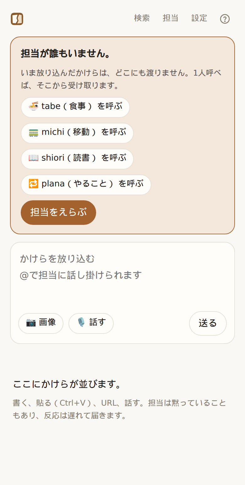

# 中で起きていること

[README](../README_ja.md) · [English](technical.md)

kakeratta を使うのに、この文書を読む必要はありません。

使う人がすることは意図的に小さくしてあります。思ったことを投稿することと、
自然な言葉で担当に「こうしてほしい」と伝えること。

このページには、それを成り立たせるために中で動いているものをまとめます。振り分け、担当の実行、記憶、
モデルの選択、予定された起動、道具、保存先、オフラインでの動作、外部エージェント、
そしてサーバーを運用する人が決めることです。

## 全体の流れ

投稿は、大きく3つの層を通ります。

**日常のかけら → 人や関心ごとの担当 → それぞれ独立した記憶 → 必要なときに想起**

コード上はどちらも担当（`skill.json`）で、使う人には**人物**と**関心ごと**として見せます。かけらが届くと、
人物の担当にはその人の呼び名かキーワードが含まれていれば届き、関心ごとの担当は振り分け役（ルーター）が
担当条件と照合して、一致した担当だけを起こします。

選ばれた担当は、次のどれをするかを自分で決めます。

* 自分の記憶（分野ごとの短いまとめと、最近の記録）を読む
* 前の記録、今のスレッド、過去のかけらをさかのぼって見る
* その担当に許された道具を呼ぶ
* あとで確認する予定を入れる
* タイムラインで発言する
* あるいは黙る

そのあと、かけらが残すものを本体が保存します。担当がかけらを1文とタグにまとめ、かけらで変わる分野のまとめを書き直します。
記憶は担当ごと、さらに担当のスキルが決めた分野ごとに分かれます。

そのため担当は、膨らみ続ける個人史のプロンプトを毎回受け取るわけではありません。
まとめは1つ2000字以内で、細部は検索できる1行の記録と、タイムラインそのものに残ります。

どの担当も覚えなかったかけらも含め、それ以外はタイムラインに残ります。
キーワード検索と embedding による意味検索が、あとからそのかけらを連れ戻せます。

推論は主に **Nebius Token Factory** 経由で、タスクの難しさと頻度に応じてモデルを割り当てます。

担当は次のような道具も使えます。

* Tavily の Web 検索
* 場所の検索
* 徒歩・自転車・車の経路
* リモートの MCP サーバー

ブラウザは直近の状態を手元に保持してオフライン投稿に対応し、
サーバー側のチェックインと予定は、ブラウザを閉じていても動き続けます。

複雑さは表に出しません。MCP、RAG、モデルの選択、workflow の検証。
どれも、アプリを使う人が理解する必要はありません。

## 設計原則

**記憶は担当領域ごとに分かれる。** 分離の目的は隠すことではなく、**濃度を保つこと**です。

**本体は振り分けて、確認して、実行する。** 誰に渡すかは中央が決めます。発言するか、何を覚えるか、いつ圧縮するかは
各担当が決めますが、担当は回答と変更の種類ごとに分けて出し、本体がそれを workflow に組み立て、確認して実行してから回答を公開します。
本体は何を言うかを決めません。起きていないことを書く・置いていない予定を約束する、といったことを止めるだけです。

**黙っていい。** 全部には反応しません。解説してもらうためのアプリではなく、ただ眺めていたいだけのときに
毎回反応されるのは押し付けです。誰も反応しない投稿があってよい。

**喋らないことと覚えないことは別。** 発言しなかった投稿も、自分の領域のものなら記憶には記録されます。

**@で呼べば必ず答える。** 領域が分かれているから、誰を呼ぶか迷えます。直接聞かれているので「短く」とは言わず、聞かれたことに必要な長さで答えます。

**非同期が既定。** 投稿はすぐ保存されて表示され、反応はそのあとに届きます。

## 振り分けは「判断」ではなく「条件との照合」

振り分けは投稿のたびに走ります。だから、安くて予測しやすいものでなければなりません。

各担当は、自分が受け取るべきかけらを説明する短い **担当条件** を持ちます。
ルーターの仕事は、その担当が投稿に対して何をすべきかを決めることではありません。
投稿がその条件に一致するかどうかだけを決めます。

この分離は、苦労して学んだものです。

初期のバージョンでは、ルーターに渡す担当の説明に、分野だけでなく「その担当に実現してほしいこと」まで含めていました。
小さなモデルは反応すべき担当を見落とし、プロンプトのいくつかは開かれすぎたものになりました。

プロンプトを直している間、振り分けは大きなモデルに移しました。おかげで問題は見えやすくなりましたが、
使用量のデータがより重要な設計上の問題を明らかにしました。
振り分けはかけらごとに走る一方、ひとつの投稿はすでに複数のAI処理を呼びます。

Personal AI は、かけらごとに高くつくからといって、小さな思いつきを残すのをためらわせてはいけません。

役に立った教訓はこれでした。

**ハイエンドのモデルなら振り分けに成功し、小さなモデルが間違えるなら、その振り分けのタスクのほうが曖昧すぎるのかもしれない。**

だから、大きなモデルを使い続けるのではなく、問題のほうを変えました。

ルーターが見るものは、「担当して実現すること」の説明ではなく、短い担当条件になりました。
判断を特定のケースに引っ張っていた具体例は、プロンプトから削除しました。

説明を返せるモデルでは、選ばなかったすべての担当について `excluded_reasons` を返すことも必須にしました。

これは同時に2つのことをしました。

1. ルーターにすべての担当を明示的に検討させる。
2. ユーザーに見せられる理由を作る。

2つめの効果は、そのまま製品の機能になりました。

ユーザーが **「呼んでほしかった」**、あるいは呼ばれるべきでなかったと伝えると、
kakeratta はその指摘から担当条件を書き直し、保存する前に同じ投稿でもう一度試せます。

### 振り分けのふるまい

**投稿は、本当にその領域に属する担当にだけ渡ります**（`internal/persona/route.go`）。
地名・時刻・食べものの名前が出てきただけでは渡しません。「明日9:10に神谷町に着きたい」は移動の担当にだけ渡り、
ワインの担当には渡りません。誰にも渡さないのは普通の答えで、判定に失敗したときも誰にも渡しません。
判定は、担当ごとの一行の理由とともにログに出ます。

**判定は残ります。** 振り分けが投稿について言ったこと（誰を選び、誰を選ばず、その理由）は投稿ごとに
保存され（`routing.json`、Firestore では `routing` コレクション）、タイムラインから見えます。@指名で届いた
担当は振り分けの判断ではないので含めず、判定できなかったときは記録を残しません。判定に異を唱えると上のとおり
担当条件を書き直し、保存すると同じ投稿で振り分けだけを試します（`Runner.CheckRouting`。配送はしません）。
変わるのは担当条件だけで、裏で何かを学習することはありません。

**担当の発言にも同じように異を唱えられます。** こちらは口調と指示が対象です。書き直して保存したあと、同じ一手を
もう一度取らせます（`Runner.PreviewReply`）。通常の実行を、本物から読んでどこにも書かないワークスペースの
包みの上で動かします。発言は追記されず、メモも予定も書かれず、起きた回数も増えません。
何を言ったはずかが返り、判断するのは人です。

**@指名は振り分けを飛ばします。** 指名された担当には必ず渡り、必ず答えます。他の担当への振り分けは
通常どおり行います。

**返信も投稿と同じように振り分けます。** スレッド全体を見て振り分け、選ばれた担当と @指名された担当が答えます。
担当の発言や投稿への返信は、振り分けで選ばれなくても、必ずその担当に届きます。

現在の既定のルーターは **Nebius Token Factory 経由の Nemotron 3 Super** です。

上級設定では、振り分けだけを **Jev** に移せます。Jev は判定向けのモデルで、この狭いタスクなら速く安くできますが、
通常の振り分け確認UIが使う「呼ばれなかった理由」を返しません。

### 人物は語で照合し、振り分けに渡さない

担当は分野の代わりに一人の人物を覚えることもできます（`"kind": "person"`）。人物は振り分けに渡しません。
「佐藤さん」を振り分けに任せると、政治家の話も含め「佐藤」が出る投稿をすべて渡してしまうからです。
投稿に担当の名前、`aliases`（呼び名）、`keywords` のどれかが含まれていれば届きます（`internal/persona/people.go`）。
全角半角、大文字小文字、ひらがなとカタカナ、空白、末尾の敬称（さん・くん・様など）は区別しないので、
「佐藤」で「佐藤くん」「さとうさん」にも届きます。言い換えは別のキーワードとして並べます。呼び名は `@` にも答えます。
写真から読み取った文字も対象です。

「母」が「母校」に含まれるように、語は偶然一致します。担当には「語が一致しただけ」と伝え、その人の話でなければ
発言もメモもせずに終えさせます。一致した語は振り分けの記録に残り、⚖ に出ます。⚖ の**「呼んでほしかった」**は、
担当を作る AI が投稿の語と類似語から足すキーワードを提案し、保存後に振り分けを通さず同じ投稿で照合し直します。
**「呼んでほしくなかった」**は、その人の語のうち投稿に一致したものをすべて並べ、外す語をユーザーが選びます
（担当の名前そのものは外せません）。分野の振り分けが失敗しても、投稿に出た人物には届けます。

### 振り分けの設計を支えた実測

実測は別の実験文書に置いてあります。あるときのプロンプト・担当・モデル・本番状態のスナップショットであって、
現在のアーキテクチャの仕様ではないからです。

最初の統制された比較では、想定される受け取り手を実行前に固定した12件の合成ケースを使いました。
Lightning と Ultra はどちらも12件すべてで一致しました。その実験で使った価格と為替では、
振り分け1回あたりの実測は **Lightning で約0.0465円**、**Ultra で約0.3385円** でした。
その回では、Lightning のほうが安く、遅いという結果でした。

方法、トークン数、レイテンシ、費用の前提、再現コマンドは
[Routing model comparison — 2026-09-17](routing-cost-experiment.md)
にあります。

のちに行った読み取り専用のリプレイでは、直近20件の本番投稿と、そのときの本番で有効だった担当6人の条件を使いました。
担当を起こさず、本番へ何も書き戻さずに、Lightning・Nano・Super・Ultra・Jev・GPT Luna を比較しました。

その回の Nemotron 系では、**Super が1回あたり平均1.91秒・約0.098円**、
Lightning が6.55秒 / 0.070円、Ultra が2.28秒 / 0.449円でした。
任意で選べる Jev Decisions の経路は0.37秒 / 0.026円でした。

このリプレイには、20件すべてについて人が事前に用意した正解ラベルが **ありません**。
そのため、これらの数字を精度のランキングとして読まないでください。

測定の全体と限界は
[振り分けモデル比較 — 2026-09-19](routing-model-comparison-2026-09-19_ja.md)
にあります。

現在の構成について正しいのは、この文書に書かれたアーキテクチャです。
実験文書は、その構成がなぜ変わったのかを説明するものです。

## 誰が、どのモデルで答えるか

**投稿が届いた担当は、全員並列に Nemotron 3 Super で動きます。** 1人1回です。
タイムライン上で担当を起こすのは、ユーザー自身の投稿と返信だけです。担当の発言が別の担当を起こすことはないので、
タイムラインがAI同士の会話で埋まることはありません（チェックインと予定は、後述のとおり時刻で担当を起こします）。投稿にすでに付いている発言は各担当に渡すので、あとの返信でそれを拾えます。

**より良い回答を求める返信には Nemotron 3 Ultra で答えます。** ユーザーが担当の発言に返信したとき、
Nemotron 3.5 Lightning にその発言と返信を渡し、ひとつだけ判定させます（`internal/persona/escalate.go`）。
「訂正・再検討・詳細化・深掘りを明示的に求めているか」（「違う」「本当？」「もう一度考えて」「もっと詳しく」「深掘りして」など）。

* true なら、返信先の担当が Ultra で1回だけ答えます。
  プロンプトからは「短く」を外し、Markdown で詳しく答えるよう指示します。
* 返信が届くほかの担当は、ふだんどおり Super で答えます。
* お礼、普通の追加質問、話題の変更は Super のままです。Lightning が判定に失敗したときも同じです。どちらでも返信先の担当は答えます。
* 自分の投稿への返信、外された担当への返信は、判定自体をしません。

判定は振り分けのあとに走るので、その分だけ返信への反応が遅れます。2026-09-22 の実測（合成の返信15件、
`TestEscalateLiveLatency`）では、Lightning は15件すべて正しく判定し、平均0.67秒（最大1.52秒、1回約0.006円）でした。
Super も15/15でしたが、平均1.30秒で費用は約5倍でした。

Lightning に「Super で足りるか」は判断させません。ユーザーがはっきり「もっと」と言ったかどうかだけです。
小さなモデルの仕事を狭く保てるうえ、モデルの差が体験として見えます。Super はふだんの担当、
Ultra はユーザーが一段上を求めたときの担当です。

**発言には、どちらのモデルで答えたかが残ります**（`model: "super"` か `"ultra"`。失敗したターンの発言には付けません）。
タイムラインでは Ultra の回答にだけ、時刻の横にバッジを付けます。

```text
投稿 / 返信
 ↓ 画像を一度だけ解析
 ↓ 振り分け
 ↓ 担当の発言への返信なら Lightning → {"escalate": true|false}
届け先を並列に Super で実行 — escalate なら返信先の担当だけ Ultra
```

## workflow は1回で書かせず、フェーズごとに組み立てる

担当は、モデルが出した文章のままアプリの状態を書き換えるわけではありません。回答と変更を一度に書かせることもしません。

以前の形では、1回のモデル呼び出しに、発言・残すメモ・予定・道具の呼び出しをまとめて1つの workflow として書かせていました。
その代償を回答が払っていました。モデルの注意がメモの書式とステップのスキーマに取られ、必須だったメモのために発言を短くし、
調べた内容を見られないレビューが良い回答を差し戻しました。回答を外部エージェントに任せると、質の低下がはっきり見えました。

workflow は残ります。本体が検査・レビュー・実行するのは今も `Workflow{answer, schedules, actions}` ですが、
どのモデルにも丸ごとは書かせず、記憶は回答が出たあとに別に扱います。ターンを責任ごとに分け、各フェーズが型の決まった1部分だけを埋め、本体が workflow に組み立てます。

```text
内蔵モデル: 読む → 回答        外部エージェント: 読む＋回答 → submit_answer
                     ↓
            Schedule フェーズ → schedules
                     ↓
            Action フェーズ   → actions      （行動する道具を持つ担当だけ）
                     ↓
            コードによる検査（毎回）
                     ↓
            レビュー（予定か操作があるときだけ）
                     ↓
            実行 → 回答を公開
                     ↓
            メモ係 → かけらの記録、分野ごとのまとめ
```

### 1ターンの流れ

担当は、持っている道具にかかわらず全員この流れで動きます（`internal/persona/answer.go`、`phases.go`、`workflow.go`）。
読んで答える部分は内蔵モデルが行うか、「考える役」を外部エージェントにした担当では MCP 越しの外部エージェントが行います
（[MCP による外部エージェント](#mcp-による外部エージェント)）。回答より後はどちらでも同じです。

1. **読む。** ターンの最初に、分野ごとのまとめの全文と最近の記録15件を必ず渡します。そのうえで、タグ・語句・月で探す前の記録、
   記録がたどる投稿そのもの、タイムライン検索、Web 検索、場所や経路の検索を、10回まで（より深い回答を求められた Ultra のターンでは20回まで）頼めます。
   ここで動くのは読み取り専用の道具だけで、MCP の道具はサーバーが `readOnlyHint` を付けたものだけが読み取り専用です。
   何も書き換えないので、本体はそのまま実行して結果を返します。
2. **答える。** 読み終えたら、担当は `{text, sources}` だけを出します。このプロンプトには記憶の残し方や変更のスキーマを載せず、
   何かを覚えろとも言いません。後のフェーズで何ができるか（`capabilities`）は伝えるので、できない通知や操作を約束しません。
   空の text は沈黙です。名指しなら必ず答え、傾聴なら黙ります。回答はここで確定し、後のフェーズは変えられません。
3. **Schedule フェーズ。** 別の呼び出し（同じモデル）が、確定した回答と置いてある予定を見て `submit_schedule` を出します。
   作成と取消の操作（変更は取消＋作成）で、作成には何のための予定かを書いた短い一言が付きます。あわせて、回答の時刻に関する約束がすべて
   操作か既存の予定で裏付けられているか（`consistent` と `reason`）を申告します。取消していないのに「取り消したよ」、
   何も置いていないのに「22:30ごろに聞くね」は差し戻しです。整合できなければターンを止め、回答は公開しません。
4. **Action フェーズ。** 行動する道具を持つ担当だけです。`submit_action` で道具の呼び出しと引数を出し、回答の約束との整合も同じく申告します。
5. **記憶は回答のあと。** 記憶はターンのフェーズではありません。記憶が残せなかったことで、できあがった回答まで
   失われないようにするためです。発言が出たあとに、担当の**メモ係**が残します（[メモ係](#メモ係)）。
6. **コードで毎回検査する。** 操作の種類、宣言した道具か（調べる道具を操作に使っていないか）、実在して取り消せる自分の schedule id か、
   読める時刻か。
   通らない提案は、理由を付けてそのフェーズに差し戻します。
7. **より遠くまで届くものだけレビューする。** 予定か操作を含む workflow は、Nemotron 3 Super が狭い項目だけを見ます:
   回答の約束と予定の時刻・作成・取消が一致しているか、予定や操作どうしが矛盾・未充足の依存をしていないか、
   操作の対象と引数がユーザーの依頼と担当の権限に合っているか、変更を済ませたという回答に裏付けがあるか。
   回答の質・長さ・調べた内容はレビューしません。本体の read に無いからといって、よそで調べた内容を却下することもありません。
   回答だけならレビューはかかりません。レビューに落ちたら、指摘されたフェーズ
   （`schedule`・`action`・`both`）だけを作り直し、回答はそのままです。レビュー2回で通らなければターンを止めます。
8. **実行して、公開する。** 予定・操作を順に実行し、**失敗したステップで止まります**。すべて実行できたときだけ回答を公開します。
   外部の操作はトランザクションではないので、実行済みのものは記録し、
   成功を約束する回答は出しません。

1ターンは構造化ログ1件に残ります: 読んだもの、回答、各フェーズの往復回数・読み取り・差し戻しとその理由、各レビューと作り直したフェーズ、
組み立てた workflow、実行した各ステップ、発言。メモ係は別のログ1件（`notes <persona>`）を残します: 提出した内容と、何回目で通ったか。

### メモ係

`internal/persona/notekeeper.go`。発言が公開されたあとに、担当が、そのターンが残すべきことを決めます。
モデルは担当のモデル（Ultra のターンでも Super）、声は担当自身です。
動くのは、ユーザーのかけら（投稿・返信・編集。担当が黙ったときや発言できなかったときも）、見直しの日が来た記録を渡されたチェックイン、
かけらが削除されたあとの整理です。予定による起床と、自分の担当ではないとして黙ったターンでは動きません。

呼び出しは `keep_memory` の1回だけで、いまのまとめ、最近の記録、スレッド、公開した回答を見せます。**それ以上は読めません。** 出すのは次のものです。

* `summary` — かけらを1文で、ユーザーの言葉に沿って（140字以内）
* `tags` — あとで探す手がかりの語を1〜5つ
* `expires` / `review` — 記録の日付（あれば。後述）
* `fields` — かけらで変わる分野のまとめだけを、全文で（2000字以内）
* `records` — 見直しのために渡された記録をどうするか

本体が確かめ、通らなければ理由を付けて3回まで差し戻します: 1文がない、タグが多すぎる、日付が明日以降でない、スキルにない分野、
本文が長すぎる、回答の文を2文以上そのまま写している。通れば**書くのは本体**です。変わったまとめ（`{分野}.md`）と、
その月のファイル（`records/YYYY-MM.md`）に記録を1行書きます。

```text
- 2026-10-01 12:34 [e_x](/?entry=e_x) 三田の二郎に行きたい #ラーメン #三田 review:2026-10-22/21d
```

ID は、担当が返事をしたならその返事（返事から元のかけらへたどれます）、しなかったならかけら自身です。
かけらを編集したときや再試行のときは、同じかけらの記録を置き換え、2行にはしません。

メモ係が終えられなくても、回答はすでに出ています。メモ係への入力は実行前に保存され、失敗した処理は1分後から最大1時間の間隔で、
その時刻に起こされたときに再試行します。削除・編集された投稿の古い入力は再生しません。
同じ担当の2つのターンが同時に終わっても、ロックで順番に動くので、それぞれが見た内容から同じまとめや同じ月の記録を書き換え合うことはありません。
書いたあと、発言は書き換えたまとめを指すように更新されます。作業項目自体を保存できない場合も、その場で一度は試しますが、その試行には永続的な再試行はありません。

## モデル

kakeratta は、すべての仕事をひとつの大きなモデルに送るのではなく、
**Nebius Token Factory** 経由で複数のモデルを使います。

| モデル                     | 役割                                                     |
| -------------------------- | -------------------------------------------------------- |
| **Nemotron 3 Super**       | すべての担当の回答と各フェーズ、振り分け、workflow のレビュー |
| **Nemotron 3 Ultra**       | より良い・深い回答を求める返信を受けた、返信先の担当の回答と、担当の下書き |
| **Nemotron 3.5 Lightning** | 返信がより良い回答を求めているかの判定と、音声入力の整文 |
| **GLM-5.3-Flash**          | スクリーンショットや写真を、投稿ごとに一度読む           |
| **Qwen3-Embedding-8B**     | 過去のかけらの意味検索                                   |

設定は `lowModel`（Lightning）・`middleModel`（Super）・`highModel`（Ultra）の3枠で、
どれにも OpenAI 互換のモデル名を入れられます。

担当の実行、振り分け、workflow のレビューは、適切な場面でネイティブのツール呼び出しを使います。

画像の読み取り、担当の下書き、音声入力の整形、構造化生成、embedding は、
すべてを同じ種類のチャット要求であるかのように扱うのではなく、
提供元の構造化出力や embedding のインターフェースを使います。

開発中の Token Factory の利点のひとつは、周りの提供元連携を作り直さずに、
モデルの役割を変えられたことでした。

振り分けの設計を変えている間、使用量のデータがその選択のコストを見えるようにしてくれました。

上級設定では、次ができます。

* 振り分けだけを Jev の Decisions API に移す。
* high・middle・low の枠を、選んだ OpenRouter のモデルに移す。

OpenRouter のツール呼び出しは Exacto を経由します。

## 画像の読み取りは投稿ごとに一度

写真やスクリーンショットは、**投稿を処理するときに一度だけ GLM-5.3-Flash に送ります**。

その結果のテキストによる解釈がかけらに添えられ、関係する担当で共有されます（`internal/capture`）。
写っているもの・文字・出典の手がかり、そして見た目（色・形・数・配置など、あとで聞かれそうな特徴）です。

画像そのものは担当に渡しません。担当のモデルはどれも画像入力に対応しておらず、実機では画像を渡した turn が
ワインのラベルへの発言ごと失われました。原画像を求めた担当には、すでに持っている読み取り結果を使うよう伝えます。

画像を、担当ごとに1回ずつ独立して vision に送ることはしません。

これは意図的です。

3人の担当が同じ写真を受け取ったとき、vision を繰り返し呼べばレイテンシも費用も倍になり、
しかも取り出せるのは同じ基本的な事実であることが多い。
解釈がひとつなら、担当たちは見たものについて一貫した説明を共有できます。

トレードオフがあります。

担当によって、気になる視覚的な細部は違います。食事の担当は食材を知りたいかもしれず、
移動の担当は背景に写った店の看板を気にするかもしれません。

最初の画像解釈がある細部を取り出さなかった場合、あとの担当は質問を変えるだけでは取り戻せません。
その担当の視点で、元の vision モデルをもう一度動かすことはしないからです。

kakeratta の現在の選択はこうです。

**投稿ごとに予測しやすい画像理解を一度 → 関係するすべての担当が同じテキストの文脈を共有する**

こちらではありません。

**担当ごとに vision を1回 → 担当ごとにより豊かな細部が得られるかもしれないが、費用とレイテンシは倍増する**

この限界は、担当それぞれが元のピクセルを独立して見たかのように隠すのではなく、
意図的なものとして文書に書いてあります。

## 記憶と検索

記憶は担当ごとのもので、**書くのは本体だけです。** 食事の担当が移動の担当の記憶に触れることはできず、
担当も外部エージェントも自分でファイルを書きません。何を残すかは担当のメモ係が出し、本体が確かめて保存します。

担当が持つ記憶は2つです。

* **分野ごとのまとめ1つずつ。** 分野は、スキルの `memory` に書いた大文字始まりの語です（tabe なら `Preference` と `Shop`、
  shiori なら `Book` と `Theme`。何も書いていない担当は `Memo` の1つ）。まとめにはその分野でこれまでに分かったことを2000字以内で書き、
  かけらで変わるたびに全文を書き直します。収まらないときは傾向を残し、個々の出来事は記録に任せます。
* **かけらごとの記録1行ずつ。** 1文、タグ、たどれる投稿、ときに日付。記録は月ごとのファイルに増えていき、担当には最新15件を渡し、残りは検索させます。

```text
=== Preference.md ===
選べるときは豚骨に寄る。担々麺のごま強めは苦手。

=== records/2026-09.md ===
# 2026-09 のかけら

- 2026-09-01 20:14 [e_a](/?entry=e_a) 担々麺のごまが強すぎたと言った #担々麺 #ごま
- 2026-09-08 12:30 [e_b](/?entry=e_b) 醤油と豚骨なら豚骨を選んだ #ラーメン #豚骨
- 2026-09-12 12:02 [e_c](/?entry=e_c) 神田で今日のランチをどこにするか聞いた #ランチ #神田 expires:2026-09-13/1d
```

ユーザーは両方を画面から直接読めます。まとめが先に、記録が月ごとに並びます。記録の ID から投稿を開け、タグを押すと
そのタグの記録がある月だけに絞れます。まとめや1か月分の記録は、投稿を消さずに直したり消したりでき、そのとき担当は起こしません。
ローカル保存では普通のファイルなので `cat` で読めます。

**記録は、かつての索引の1行にあたり、寿命を持つものもあります。** 日付はメモ係が内容から決めます。
「今日のランチどこがいい？」「渋谷までの行き方」のような、その場で用が済むかけらには翌日の `expires` を付け、その日が来たら本体が記録を消します（誰も起こしません）。
行きたい店や関心のある話題のように、いつまで要るか分からないユーザーの話には、数週間〜数か月先の `review` を付けます。
好みや習慣には付けず、日付のない記録を本体が古さで消すことはありません。

**使われている記録は期限が延びます。** 担当が投稿に答えるターンで検索や ID 指定によって読んだ記録は、
`expires` も `review` も、付けたときの日数をその日から数え直した日付になります。期限が手前に縮むことはありません。
チェックインなど投稿以外の起床で読んだだけでは延びません。見直しのために読んだ記録の質問が先送りされ続けないようにするためです。

**見直しの日が来た記録は聞いてから扱い、本体は消しません。** その日を過ぎると、次の毎日のチェックインで古い順に最大3件を渡します。
担当はそのうち1件について短い投稿で「そろそろ忘れていい？」と聞き、メモ係がその記録を1週間先に送って、聞いた投稿を記録に印として残します。
その投稿への返事は、聞いた記録とともに担当に届き、メモ係が残す（日付を外す）・延ばす・忘れるのどれかを行います。

投稿を消す場合は別です。本体はその投稿のもとに残した記録（かけら自身の ID のものも、答えた返事の ID のものも）を消し、
記録を持っていた担当を起こします。その起床では発言も回答もせず、そのかけらのために置いた予定を取り消せ、
メモ係がまとめからそのかけらに由来する記述を外します。担当の返事だけが消された場合は、記録をかけらの ID に付け替えます。

### 担当に渡すもの

* 振り分けられた投稿と、その画像の読み取り結果
* **その投稿に付いた発言**（他の担当のものと、ユーザーの返信）
* 分野ごとのまとめの全文と、最近の記録
* 予定を持てる担当なら、自分の未実行の予定

**タイムライン全体は渡しません。** 渡せば結局すべての担当がすべてを見ることになり、領域ごとに分けた
意味が消えます。それより前のことは、自分の記録かタイムライン検索で見つけます。

**記憶の一次情報源はユーザーです。** メモ係には、ユーザーが言ったこと・したこと（事実・好み・予定・変化・覚えてと頼まれたこと）を残し、
回答で調べたことや勧めたこと（候補の一覧、調べた数値、解説）は残さないよう伝えています。それらは必要になれば調べ直せますし、
記憶に残すと、古くなってからもユーザーについて知っていることとして読み返されてしまいます。どう答えたかは一言で残してかまいません。

**形式は本体のもの、方針はスキルのもの。** どんな分野を持つか、まとめに何を優先して残すか、どの記録にどの日付を付けるかは、
各スキルの `memory` に普通の言葉で書きます。本体はいつ圧縮するかの閾値を持たず、大きさの上限だけを持ちます。

以前の形の記憶（1つのものに1つの OKF メモと `index.md`）はもう読みません。一度だけ手作業で分野ごとのまとめに移しました
（`cmd/migrate-memory`）。担当のモデルが下書きを作り、人が確かめて直してから書き込み、古いメモを消します。

### 意味検索

かけらは、担当が意識して覚えていなくても、後から役に立ちます。

タイムラインの文章、担当との会話、画像から取り出した文字は、あとから検索できます。

意味検索には **Qwen3-Embedding-8B** の embedding を使います。
「軽くて飲みやすかった赤ワイン」のような問い合わせで、
「ピノ」という正確な語を思い出せなくても過去の投稿を見つけられます。

これは、担当の長期記憶とは意図的に分けてあります。

* 記憶は、担当が残すと決めたもの。
* 検索は、タイムラインにだけ残ったものを取り戻せる。

## スキル

担当は `skill.json` ひとつです。

| 項目 | 内容 |
| --- | --- |
| `name`・`icon`・`tone` | 表示と話し方 |
| `domain` | 担当条件。何に反応し、何を覚えるか。**振り分けがこれを読む** |
| `memory` | 記憶の分野（`Wine`、`Preference` など大文字始まりの語を1〜4つ）と、それぞれのまとめに何を残すか、どの記録にどの日付を付けるか。分野1つにまとめ1つ |
| `instructions` | 何を区別し推測と明記するか、いつ発言するか。**担当本人だけが読む** |
| `tools` | 宣言したものだけが呼べる |

内蔵は4人（tabe 食事 / michi 移動 / shiori 読書 / plana 繰り返し）です。
画面から追加でき、手で書くことも、担当を作る AI（Nemotron 3 Ultra）に下書きさせることもできます。

```json
{
  "id": "wine",
  "name": "ぶどう",
  "icon": "🍷",
  "domain": "ワイン。銘柄、産地、ラベルの写真、飲んだ記録。",
  "tone": "控えめ。おすすめを押しつけない。",
  "memory": "型は Wine（銘柄）と Preference（好み）の2つ。同じ好みが3回出たら Preference に統合する。",
  "instructions": "引用と本人の意見を分け、推測は推測と書く。",
  "tools": ["web_search", "place_search"]
}
```

**人数に上限はありません。** 振り分けが中央にあるので、投稿ごとに動くのは関係する数人だけで、
振り分けは投稿ごとに一度です。**領域が分かれていなければ @ に意味はありません。** 誰を呼ぶか迷えなければ、指名は要りません。

### 人物の担当

人物の `skill.json` には `kind`、`aliases`、`keywords` が加わり、`domain` は振り分け条件ではなく関係性
（恋人、母、大学時代の友人など）です。`tone` と `memory` は持たず、`instructions` はその人に特有のことがあるときだけ書きます。
話し方、2つの分野（Fact と Event）、決まりごと（貸し借りや約束は済むまで忘れない、会う日の朝に起きる、
誕生日や記念日の1週間前と当日に起きる）は本体が持ち、一手の始めにすべての人物に渡します
（`internal/persona/people.go` の `forTurn`）。決まりを直せば、すべての人物にすぐ届きます。

人物の作成時や「AIで修正」で伝えた誕生日・好み・出来事などは、編集できる**基本情報**として担当の設定に保存されます。かけらの投稿やメモへの転記は行いません。基本情報は通常の編集画面でも修正できます。

`skill.json` の `basicInfo`（最大8,000文字）を `forTurn` で毎回渡します。日付情報は `internal/persona/person_schedules.go` で抽出し、基本情報の保存前に検証、保存後に予定を反映します。かけらからの登録も同じ処理を使います。

基本情報の保存・編集や、その人物に届いたかけらから、日付の分かる誕生日・記念日・会う予定を自動で登録します。誕生日・記念日は毎年、1週間前と当日の午前9時に知らせます。会う予定は指定された通知時刻を優先し、指定がなければ当日午前9時（午前9時より早い予定は1時間前）に知らせます。通知は担当の投稿として届きます。未来の予定に日数の上限はなく、日付の分からない情報は推測で登録しません。予定の変更や中止も反映します。

## 道具は担当と運用者のもの

担当は、サーバーで使えるすべての道具を自動で受け取るわけではありません。

使ってよい道具の名前は、担当のスキルが宣言します。

その名前が実際にどこを指すかは、サーバーを運用する人が決めます。

内蔵の連携には次があります。

* `web_search`
* `place_search`
* `route`

* `schedule` — 担当が自分を起こす時刻を本体に預ける。外には出ない（`schedules.json` / Firestore）

これとは別に、ユーザー自身のタイムラインのキーワード検索と意味検索（`timeline_search`）は、宣言しなくても全担当が使えます。

リモートの MCP サーバーで道具を増やせます。

実際に呼ぶのは本体で、関係する認証情報を持つのも本体です。

### Web検索

`web_search` は **Tavily** を使います。

Tavily の API キーはアプリに埋め込まず、ユーザーが設定画面で入力します。

担当が Web 検索を受け取るのは、そのスキルがこの道具を宣言しているときだけです。

### 場所の検索

`place_search` は OpenStreetMap のサービスを使います。

投稿に位置情報があるときは、`KAKERATTA_OVERPASS_URL` の Overpass で周辺を検索します。

現在地が取れず、担当が名前で検索するときは、`KAKERATTA_NOMINATIM_URL` の Nominatim を使います。

営業時間は OpenStreetMap に登録がある場合だけ返ります。いま営業している保証ではありません。

Overpass の一時的な障害は一度再試行し、そのうえで取得不能として伝えます。
「店が見つからない」という誤った結果には変えません。

### 経路

`route` は、投稿に付いた位置情報を必要とします。

車・徒歩・自転車は、OSRM 互換の別々の接続先を使います。

* `KAKERATTA_OSRM_CAR_URL`
* `KAKERATTA_OSRM_FOOT_URL`
* `KAKERATTA_OSRM_BIKE_URL`

既定は OpenStreetMap ベースの公開経路サービスです。

これらは道路網から出した目安です。リアルタイムの渋滞も、公共交通の時刻表も含みません。

OSRM の URL の移動手段名を書き換えるだけでは移動手段は変わりません。
自前の経路サーバーを、対応する経路データで構築する必要があります。

### MCP の道具

`KAKERATTA_MCP_SERVERS` は、リモートの Streamable HTTP MCP サーバーを並べた JSON の配列です。

たとえば次のようになります。

```json
[
  {
    "name": "geo",
    "url": "https://geo.example.com/mcp",
    "headers": {
      "Authorization": "Bearer …"
    }
  }
]
```

各サーバーの道具は、次のような修飾された名前で内蔵の道具と並びます。

```text
geo.compute_commute
```

担当のスキルは、その名前をそのまま宣言できます。

道具の一覧は数分キャッシュします。リモートのサーバーが一時的に応答しなくなっても、
最後に取得した一覧は残ります。一方、実際の呼び出しの失敗は黙って消さず、担当にそのまま伝えます。

MCP サーバーが `lat` と `lng` を受け取る `route` や `place_search` 相当の機能を持つ場合、
kakeratta はその操作をそのサーバーに回し、投稿の位置を自動で補えます。

リモートのサーバー自体に繋がらないときは、内蔵の OpenStreetMap 実装をフォールバックとして使えます。

リモートのサーバーが明示的に返したエラーは、フォールバックの成功として隠しません。

MCP の道具の結果のテキストはその呼び出しへの返事として戻り、resource link は発言の下の出典になります。
timeline_search だけは例外で、見つけた投稿はそのままでは出典にならず、担当が回答の `sources` で根拠にした投稿を申告し、
それだけがリンクになります。

## チェックインと予定された起動

有効な担当はすべて、1日1回 **毎日のチェックイン** をします。切ることはできず、選べるのはどこまで話すかと、人物なら月1回の振り返りにするか（下の「今月のまとめ」）だけです。

いつ起きるかは本体が決めます。ユーザーの時刻帯（画面が最後に保存したもの）の 07:00〜21:00 の中の1分で、
日ごとに最大1時間ずつゆるやかにずれていきます。枠は輪として扱い、21:00 の次は 07:00 です。
7日おきの節目の時刻をワークスペース・担当・節目のハッシュで決め、その間の日は輪の上で近い方へ日割りで動かします。
節目どうしは最大でも半周（7時間）なので、1日の変化は最大60分です。まっすぐ動かすと時刻が昼に寄りますが、
輪にすることで枠の端も真ん中も均等に使われます。
時刻が前に進んで 21:00 を越え、朝に回り込む日（前日 20:50 → 当日 07:10 など）は、その日のチェックインを飛ばします。
10時間ほどの間隔で2回続けて起きないようにするためです。飛ばした翌日は回り込まないので、2日続けて飛ぶことはありません。
時刻は保存せず計算で決まるので、同じ日なら必ず同じ時刻で再起動しても動かず、
すべてのユーザーのすべての担当が同時に起きることなく、1日の中に散らばります。サーバーの停止などで
21:00 までに動けなかった日は、夜中に動かさずに見送ります。

**「チェックインでは最低限のことだけ話す」（既定OFF）** をONにした担当が話してよいのは、ユーザーの判断が必要なことだけです。
いまそれに当たるのは、見直しの日が来た記録（忘れてよいかの確認）です。発見・提案・近況の報告・挨拶はしません。
何も無い日も担当は起きますが、黙って終わります。

OFFの担当（既定）は、前回のチェックインを実際に実行した時刻から今までのタイムラインと、最近の記録と同じタグを持つ
前の記録を見直し、今伝える価値のあるつながりを見つけたときにも話します。実行した時刻は、その日の実行権と一緒に記録します。
読む範囲を「直近24時間」にすると、時刻が後ろにずれた日や、飛ばした日・見送った日の分がどのチェックインにも読まれずに
残ります。前回の実行時刻から読めば、範囲は隙間なくつながります。前回の記録が無ければ直近24時間、前回が1週間より前なら
直近1週間を読みます。

黙った場合は、空のシステム投稿も、空の会話スレッドも残りません。

実行権を保存することで、沈黙や失敗も含めて、現地の暦日ごとに1回までに制限します。

Firestore の実行権は、複数のサーバーインスタンスをまたいでトランザクションで扱います。

ローカルのファイル保存は、ワークスペースごとに1つのサーバープロセスを前提とします。

記憶を削除しても、その日に使った実行権は戻りません。

停止期間のあとは、今日の分だけが動きます。過ぎた日の分はまとめて実行しません。

そのため、実行権を取った直後にクラッシュすると、重複の危険を冒すよりも、その日の分をスキップします。

### 見直しは同じ実行権に乗る

`review` の日付が過ぎた記録は、古い順に最大3件をチェックインの trigger に足して渡します。
担当はそのうち1件について聞き、1回だけ投稿します。メモ係はその記録を1週間先に送り、聞いた投稿を印として残します。

担当が自分で立てた投稿（チェックイン・予定・見直し）への返事は、振り分けの判断に関わらず必ずその担当に
届きます。担当には、どの記録について聞いたかを添え、メモ係が返事のとおりに扱います。

### 今月のまとめと、月1回振り返る人物

月に1回、本体が前回のまとめからのタイムライン（最長32日、そのうち新しい方の12万字まで）を読み、
**今月のまとめ**を本体の名前で投稿します（`timeline.App`、`internal/persona/summary.go`）。話題ごとの見出しと
1行ずつの箇条書きで、各項目の末尾に元の投稿へのリンクが付きます。人の出来事、これからの予定、済んでいないことは必ず残します。
日付はワークスペースのハッシュで決め（どの月にもある1〜28日）、時刻はチェックインと同じ決め方です。チェックインと同じく
実行権を取るので、1回だけ書かれます。投稿のない月は書きません。まとめはユーザーが自分の投稿と同じように直せ、直しても振り分けは行いません。

人物の担当は、毎日の代わりに**月1回**振り返ることができます（分野の担当は常に毎日です）。月1回の人物は、
まとめが書かれた日のまとめの後に起き、（ユーザーが直した後の）まとめと、前回のチェックインからその人の呼び名やキーワードが
出た投稿（新しい方から40件）を受け取り、タイムライン全体は読み直しません。人物がいくら増えても、月を読むのは1回です。
人物の日付通知はチェックインの頻度に依存せず、保存済みの予定から実行します。

### 担当が作る予定

`schedule` の道具を持つ担当は、あとで自分を起こすよう kakeratta に預けられます。

現在の制限は次のとおりです。

* 担当ごとに未実行の予定20件まで
* 未来の時刻（日数の上限なし）
* 1回きりか、毎日

道具で作る予定には、何のための予定かを書いた短い一言が付き、記憶には何も書きません。基本情報やかけらから本体が登録する人物の予定も記憶は不要です。誕生日・記念日は年次で繰り返し、担当ごとの20件上限を共有します。

たとえば plana は、花を買うという話を聞いて、買ったかどうか尋ねるために後の起動を予定できます。

設計としては、前もって急かすカレンダーのアラームではなく、その時刻の *あと* に確認するほうを選んでいます。

予定はモデルが動く前に実行権を取るので、失敗や沈黙の回を繰り返し実行しません。

10分以上遅れた起動は、予期しない時刻に鳴らすのではなく捨てます。

かけらを消すと、担当はそのかけらのために置いた予定を見直す機会を得ます。

担当の記憶をすべて忘れさせたとき、停止したとき、削除したときは、未実行の予定も消えます。

### ブラウザは開いたままでなくてよい

チェックインと予定は、サーバー側のものです。

ブラウザは閉じて構いません。

ただしサーバー自体は動いている必要があります。

同梱の Cloud Run 構成は、インスタンスを1台確保し、リクエスト処理の外でもCPUを割り当てるので、
サーバーはこの定期的な確認を行えます。
負荷に応じて複数インスタンスに増えることもあり、確認・予定・反応はどのインスタンスでも、Firestore で先に取得したインスタンスが実行します。インスタンスが止まっても、残った仕事は別のインスタンスが引き継ぎます。

設定済みのワークスペースは、Firestore を使うユーザーも含め、再起動後に復元されます。

全ワークスペースを見回る時計はありません。ワークスペースは、自分の予定・チェックイン・再試行・`expires` の日付のうち最も早い時刻に起こしてもらうよう、Cloud Tasks のタスク（キューがなければプロセス内のタイマー）に頼みます。起こされたあとの仕事は、通常の担当の仕事と同じ実行キューを使うので、キューが混んでいると起動は遅れます。

## オフライン投稿

ふと浮かんだ思いつきが、その瞬間のネットワーク接続に左右されてはいけません。

そこでブラウザは、素早い表示のために直近の会話を手元に保持し、
一度オンラインで使ったあとは **Service Worker** を登録します。

オフラインで作った文章・画像・URL・返信は、**IndexedDB** に未処理の操作として保存されます。

捨てられるのではなく、手元では送信待ちとして表示されます。

接続が戻ると、それらはサーバーへ送られ、通常の投稿と同じ振り分けと担当の実行の経路に入ります。

つまりオフライン対応が変えるのは、投稿がいつサーバーに届くかであって、
届いたあとに投稿が意味するものではありません。

ブラウザのキャッシュは、長期保存の正本ではありません。

## 保存先、プライバシー、アカウント削除

kakeratta は、ローカルの単一ユーザーアプリとしても、ホスト型のマルチユーザーサービスとしても動きます。

### ローカルで動かす場合

ローカル実行では、

* ログインが要りません
* 既定でループバックに待ち受けます
* 既定でファイルシステムに保存します

`KAKERATTA_STORE=file` は、ユーザーの状態を `KAKERATTA_HOME` の下に保存します。

これには投稿、設定、担当の定義、担当の記憶（分野ごとのまとめと月ごとの記録）が含まれます。

Cloud Storage のバケットを設定しない限り、画像もローカルに保存します。

### ホスト型で動かす場合

公開するデプロイでは、次を設定して Firebase Authentication を有効にできます。

* `KAKERATTA_FIREBASE_PROJECT_ID`
* `KAKERATTA_FIREBASE_API_KEY`
* `KAKERATTA_FIREBASE_AUTH_DOMAIN`

認証済みユーザーのデータは、ユーザーごとのハッシュ化された名前空間の下に分離されます。

次を設定すると、

```text
KAKERATTA_STORE=firestore
```

投稿、設定、担当の定義、担当の記憶を Firestore の次の下に保存します。

```text
users/<uidのハッシュ>/
```

`KAKERATTA_GCS_BUCKET` を設定すると、画像は非公開で次の下に保存されます。

```text
users/<uidのハッシュ>/blobs/
```

### バックアップと持ち出し

「設定 → **バックアップ**」は、次を含む zip を作ります。

* 投稿
* 担当
* 担当の記憶
* 画像

その構成は、セルフホストの kakeratta がそのまま読めるようにしてあります。

提供元の API キーと外部サービスとの接続は含みません。

### アカウントの削除

ホスト版には、アカウントを完全に削除する導線があります。

控えを残したい場合のために、先にバックアップへ案内します。

アカウントを削除すると、次のものが消えます。

* 投稿と会話
* 担当の定義と担当の記憶
* アップロードした画像
* 設定
* 保存済みの認証情報
* Bluesky などの外部接続の状態
* MCP の認証情報と接続の状態
* サーバー側のバックアップデータ
* kakeratta のログインアカウント自体

サービスを離れたあとに、個人的な記憶の保管庫を残さないことが目的です。

## 動かす

kakeratta は、2つに分かれたブラウザ用のアプリです。

1. 静的なWebアプリケーション
2. Go の API サーバー

開発中は、画面を Vite が配信します。

参照構成のデプロイでは、静的なサイトを Firebase Hosting が、Go の API を Cloud Run が受け持ちます。

Go のバイナリ自体は API だけで、ユーザー自身のマシンでも動きます。

### 必要なもの

* Go 1.26 以降
* Node.js
* Task（`task`）
* Nebius Token Factory の API キー

[mise](https://mise.jdx.dev) があれば、

```sh
mise install
```

が `mise.toml` を使って Go と Task を入れます。

無ければ、Task を手動で入れてください。

```sh
go install github.com/go-task/task/v3/cmd/task@latest
```

続けて、リポジトリのルートで実行します。

```sh
task setup  # 初回のみ。画面側の開発依存を入れる
task dev    # API（:8787）と Vite の画面（:5173）
```

ブラウザで開きます。

```text
http://127.0.0.1:5173
```

新しいワークスペースには有効な担当がまだ誰もいないので、画面が最初の1人を呼ぶところまで案内します。



「設定」で Nebius Token Factory の API キーを入力します。

low・middle・high のモデルの枠には、既定で Lightning・Super・Ultra が設定されています。

開発用のコマンドには、ほかに次があります。

```sh
task run      # APIのみ
task build    # bin/kakeratta をビルド
task stories  # Storybook
task test     # テスト
```

画面の見た目を変えたら `task captures` で README の日英キャプチャを撮り直します。
Storybook から `docs/captures/` に保存されます。表示サイズが変わった場合は
`python3 frontend/capture-sizes.py` を実行し、最後に `task frontend` で
`frontend/dist` を作り直します。

オフラインでの起動・投稿・再接続後の送信を実ブラウザで確認するには、`task frontend` のあと
`npm --prefix frontend run test:offline` を実行します。この検証ではオフラインの
キャプチャも更新されます。Node.js 22以降とChromiumが必要で、実行ファイルは
`CHROMIUM` で指定できます。更新した画像を含めるため、最後に画面を再ビルドします。

### 環境変数

| 環境変数                         | 既定                                                | 用途                                                       |
| -------------------------------- | --------------------------------------------------- | ---------------------------------------------------------- |
| `KAKERATTA_PUBLIC_URL`           | 空                                                  | Bluesky OAuth などが使う公開HTTPSオリジン                  |
| `KAKERATTA_BLUESKY_KEY`          | 空                                                  | Bluesky接続の署名・暗号化に使う秘密鍵                      |
| `KAKERATTA_ADDR`                 | `127.0.0.1:8787`（参照構成のFirebaseでは `:8787`）  | APIの待ち受けアドレス                                      |
| `KAKERATTA_HOME`                 | OSの設定ディレクトリ                                | ローカルの保存先の基準ディレクトリ                         |
| `KAKERATTA_FIREBASE_PROJECT_ID`  | 空                                                  | Firebaseによるマルチユーザー認証を有効化                   |
| `KAKERATTA_FIREBASE_API_KEY`     | 空                                                  | Firebase Web APIキー                                       |
| `KAKERATTA_FIREBASE_AUTH_DOMAIN` | 空                                                  | Firebase Authドメイン                                      |
| `KAKERATTA_GCS_BUCKET`           | 空                                                  | 画像を保存する非公開Cloud Storageバケット                  |
| `KAKERATTA_STORE`                | `file`                                              | 保存先。参照構成のCloud Runでは `firestore`                |
| `KAKERATTA_FIRESTORE_PROJECT_ID` | Firebaseプロジェクト                                | Firestoreのプロジェクト                                    |
| `KAKERATTA_MCP_SERVERS`          | 空                                                  | 担当に割り当てられるリモートMCPサーバー                    |
| `KAKERATTA_NOMINATIM_URL`        | 公開サービス                                        | Nominatimの接続先                                          |
| `KAKERATTA_OVERPASS_URL`         | 公開サービス                                        | Overpassの接続先                                           |
| `KAKERATTA_OSRM_CAR_URL`         | 公開サービス                                        | 車の経路の接続先                                           |
| `KAKERATTA_OSRM_FOOT_URL`        | 公開サービス                                        | 徒歩の経路の接続先                                         |
| `KAKERATTA_OSRM_BIKE_URL`        | 公開サービス                                        | 自転車の経路の接続先                                       |

Bluesky の運営側の設定は [social-sharing_ja.md](social-sharing_ja.md) を参照してください。

## MCP による外部エージェント

担当の1ターンのうち、調べものと回答 ― 文脈を読み、調べ、担当として言うことを書く部分 ― を、
**Hermes Agent** などの外部エージェントに任せられます。担当ごとに「考える役」を、内蔵モデル（既定）か外部エージェントから選びます。
kakeratta はそのために、ユーザーのワークスペースを認証付きの **Streamable HTTP の MCP サーバー** として公開します。

外部エージェントの担当が起きると（投稿・チェックイン・予定・見直しの問いへの返事など）、kakeratta は内蔵モデルが答えるときと同じ文脈を組み立て、
**ask** を出します。エージェントは ask を取得して文脈を読み、必要なら担当自身の記録と読み取り専用の道具、あるいは自分の道具で調べ、回答だけを提出します。
kakeratta は回答の形とターンの規則を確かめたあと、担当のモデルで Schedule・Action のフェーズを進め、どのターンとも同じように検査・レビューして担当として実行し、回答を公開し、そのあと担当のメモ係に記憶を残させます。
エージェントが自分で記憶・予定・発言を書くことはなく、回答のレビューもしません（本体のレビューからは、エージェントが調べた内容が見えないためです）。

```text
担当が起きる
→ ask を出す（pending、claimBy）
→ エージェント: claim_ask → context
→ エージェント: read_for_ask・自前の調査（任意）→ submit_answer
→ kakeratta: 回答を確認 → 受理
→ kakeratta: Schedule → Action フェーズ、検査、必要ならレビュー
→ kakeratta が変更を実行し、担当として回答を公開し、メモ係が記憶を残す
```

エージェントを待つ間に他の処理を止めないよう、外部エージェントの担当のターンは反応のキューとは別に動き、
本当に終わった時点で振り分けシートに知らせます。

### フォールスルー

次の場合は、内蔵モデルがターンを引き取ります。

* 取得の待ち時間（既定3分）以内に ask が取得されない
* 取得後、回答の待ち時間（既定15分）以内に回答が受理されない
* 回答の差し戻しが上限を超えた
* エージェントが `release_ask` を呼んだ
* 取得の待ち時間のあいだ、エージェントから MCP の呼び出しが一度もない（応答なし）。このときは ask を出さずにすぐ引き取り、次に呼び出しが来た時点で自動的に元に戻る

待ち時間は「設定 → 上級オプション → 外部連携」で変えられます。ask はワークスペースに保存されて再起動後も残ります。
ask を出したターンはいったん終わり、ask が閉じた時点で再開します。遅れて届いた回答は拒否されます。受理した回答は取り消しません。後のフェーズが回答の約束を裏付けられない場合や変更に失敗した場合は、公開せずに止めます。人が待っている試し直し（プレビュー）は、常に内蔵モデルで考えます。

### MCP の認証情報

利用者は「設定」から MCP のキーを発行します。

生のキーは、発行したときにだけ表示します。

サーバーは元の認証情報ではなく、そのハッシュを保存します。

キーを再発行すると、前のキーは無効になります。

MCP を解除すると保存したハッシュを消し、その認証情報は使えなくなります。

キーは、発行したワークスペースにしかアクセスできません。

読めるもの:

* タイムライン
* 担当の定義
* 担当の記憶

書けるのは、取得した ask への回答の提出だけです。変更は kakeratta が自分で決め、検査して実行してから、その担当として回答を公開します。

キーを失効させても、エージェントが自分の外部記憶に取り込み済みのデータは消せません。
外部エージェントが受け取ったものを遠隔で忘れさせられるふりはせず、その境界を明示しています。

### 公開している MCP の道具

```text
list_personas
get_timeline
get_thread
list_notes
read_note
list_asks
claim_ask
read_for_ask
submit_answer
release_ask
```

`claim_ask` は `askId` と、呼び出し側が作る `claimId` を受け取ります。同じ `claimId` での再呼び出しは同じ取得の再試行として扱い、
別の claim ID では取得済みの ask を取れません。

取得で返す文脈には、担当の人格・指示、担当にできる変更（`capabilities`）、起きた理由、対象発言とスレッド、担当の記憶（分野ごとのまとめと最近の記録）、置いている予定、
回答の JSON Schema、読み取り専用の道具（`records` を含む）、読み取りの上限と答え方の規則、現在時刻、投稿の位置情報、名指しや傾聴による発言条件が入っています。
同じ文脈を繰り返さないよう、system / user プロンプト全文とスレッドの二重表現は省いています。記憶の残し方と変更のスキーマも、回答ではなく後のフェーズのものなので含めません。

`list_tasks` は、依頼（task）が ask に置き換わる前に配置された Wake Gate スクリプトのため、未取得の ask だけを返す互換用の道具として残しています。

詳しい意味は
[Hermes Agent の設定](hermes_ja.md)
（[English](hermes.md)）にあります。

## NemoClaw と OpenShell

ハッカソンの連携では、Hermes を **NVIDIA NemoClaw / OpenShell** の環境の中でも検証しました。

検証した構成はこうです。

```text
NVIDIA NemoClaw
    ↓
OpenShell サンドボックス
    ↓
Hermes Agent v0.20.6
    ↓
Nebius Token Factory
    ↓
kakeratta 本番の MCP サーバー
```

NemoClaw は、エージェントのランタイムに対して、上位のセットアップ、オーケストレーション、
ライフサイクル、ポリシーの設定を提供します。

OpenShell は、サンドボックスとポリシー適用の境界を提供します。

検証した `hermes-sandbox` は、Landlock によるファイルシステムの分離と、
外向き通信の制御を含む、ファイルシステムとネットワークの制限を使いました。

推論の認証情報は Hermes 自身の設定の外に置きました。
リクエストは OpenShell のゲートウェイを通ってサンドボックスの外に出て、Nebius Token Factory へ中継されました。

開発中には Hermes-4-405B と Nemotron 3.5 Lightning を検証しました。
Lightning は多段のタスクで信頼できないツール呼び出しを行ったため、最終的な運用構成では
Nemotron 3 Super 120B を使用しました。

サンドボックス内の Hermes は、次への接続に成功しました。

```text
https://kakeratta.net/api/mcp/...
```

Streamable HTTP の MCP で接続し、Hermes が独立した担当だった以前の依頼方式の、本番の MCP ツール11個をすべて検出しました。
これらは現在、上記の計画用ツールに置き換わっています。

これは実行経路と道具の境界についての結合検証です。
kakeratta 自体が NemoClaw に依存するという意味ではありません。

Hermes のインストールは同じ MCP インターフェースに直接つなげます。
NemoClaw/OpenShell は、ハッカソンの作業で使った、検証済みのサンドボックス構成です。

## 外部エージェントが答えるだけである理由

kakeratta の通常の担当は、意図して制約されています。変更は、実行前に kakeratta が検査するフェーズを通ります。

回答を外部エージェントに任せても、この制約は残ります。エージェントはどんな道具やスキルで調べてもよいのですが、
ユーザーの記憶に届く変更は、アプリ自身のフェーズが決め、検査し、遠くまで届くものはレビューして、アプリ自身が実行したものだけです。
「外部エージェント」が kakeratta の所有権モデルを見えないところで迂回する抜け道にはならず、
エージェントが眠っていても担当は（少し遅れて）答えます。

## 設計上のトレードオフ

kakeratta のいくつかの選択は、自動化の最大化よりも、理解できるふるまいを意図的に優先しています。

### 沈黙は正しい結果

担当は、発言せずに記憶だけ書けます。

チェックインは、スレッドを作らずに終われます。

ターンに答える外部エージェントも、空の回答を出せます。

このシステムは、あらゆる出来事に目に見えるAIの返事を出すことを目指していません。

### 記憶は覗ける

長期記憶は、ユーザーが読んで直せる短いまとめと1行の記録として表され、記録は元の投稿へたどれます。

隠れたベクトルストアや会話の要約だけではありません。

embedding はかけらを取り出す助けにはなりますが、
システムが「覚えていること」の正本としては扱いません。

記録の寿命も見えます。その場限りのかけらの記録を本体が消す日と、ユーザーが言ったことの記録について
担当が「まだ要る？」と聞く日を、メモ画面に出します。

### 強いモデルをどこにでも使うわけではない

最も高性能なモデルが、頻繁で狭いタスクにとって自動的に最良のモデルであるとは限りません。

振り分けの設計変更が、いちばん分かりやすい例です。

タスクを単純にしたことで、必要なモデルの性能も、曖昧さも減りました。

振り分けの実測は、このアーキテクチャ文書に時代を超えた主張として埋め込むのではなく、
リポジトリの別文書に置いています。価格、プロンプト、有効な担当、モデルのふるまいは、どれも変わり得るからです。

### vision は共有し、担当ごとに繰り返さない

元の画像は一度だけ解釈し、その結果のテキストを共有します。

担当が増えても vision の費用とレイテンシは抑えられますが、
最初の解釈で省かれた細部を、あとから担当が vision モデルに取り戻させることはできません。

すべての担当が同じ視覚情報を必要とするという想定ではなく、明示的なトレードオフです。

### 外部の自律性には、より硬い境界を

外部エージェントは答えるだけです。変更はすべて内蔵モデルのときと同じフェーズ・検査・レビューを通り、
実行するのは kakeratta だけです。エージェントが自分の側で読めること・できることは、
認証、MCP の道具、サンドボックスのポリシーで区切ります。

## さらに詳しく

| 文書 | 内容 |
| --- | --- |
| [README](../README_ja.md) | kakeratta とは何か、使う人にできること、プライバシー、常時稼働のふるまい、Nemotron と Token Factory、検証した NemoClaw 連携 |
| [Routing model comparison — 2026-09-17](routing-cost-experiment.md) | 想定される受け取り手・トークン数・費用・レイテンシを揃えた Lightning と Ultra の統制比較 |
| [振り分けモデル比較 — 2026-09-19](routing-model-comparison-2026-09-19_ja.md) | 本番20投稿を Nemotron 各モデル・Jev・GPT Luna で読み取り専用に再実行した比較 |
| [使い方と設定](usage_ja.md) | Android・iOSからの共有、位置情報、音声、モデル設定、保存データ |
| [AIまわりで苦労したこと](ai-lessons_ja.md) | Nemotron の担当で起きた失敗と、頼れるようにするために変えたこと |
| [Hermes Agent](hermes_ja.md)（[English](hermes.md)） | MCPの認証、ask のライフサイクル、計画に渡す文脈、フォールスルー |
| [Google Cloudへのデプロイ](../infra/README_ja.md) | Terraformでの構築。Firebase Hosting、Cloud Run、Firestore ほか |

[MITライセンス](../LICENSE)。
