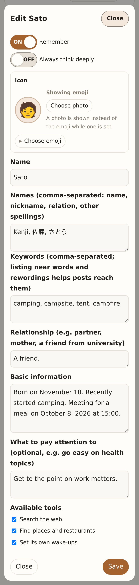
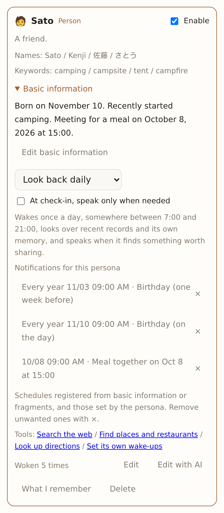
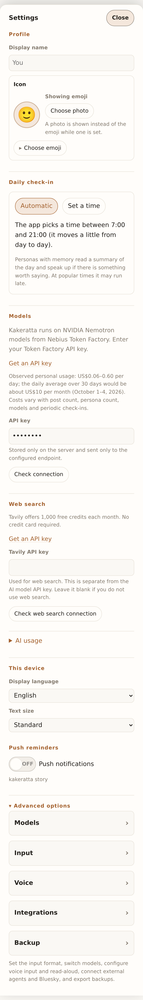
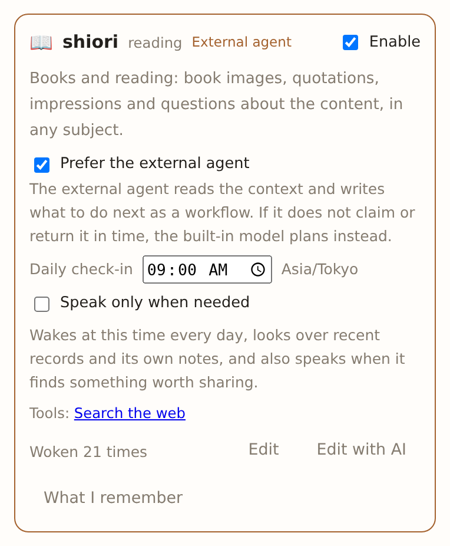

# Usage and configuration

[README](../README.md) · [日本語](usage_ja.md)

## Running it

```sh
task setup      # once: npm ci for the page's dev tools
task dev        # API (http://127.0.0.1:8787) and page (http://127.0.0.1:5173) together
task run        # API only
task build      # API only (bin/kakeratta)
task stories    # Storybook (http://127.0.0.1:6006)
task test       # go test ./internal/... and node --test tests/*.test.js
```

| Variable | Default | |
| --- | --- | --- |
| `KAKERATTA_PUBLIC_URL` | empty | Public HTTPS origin for Bluesky OAuth |
| `KAKERATTA_BLUESKY_KEY` | empty | Secret for Bluesky signing and encryption (64 hexadecimal characters); see [operator setup](social-sharing.md) |
| `KAKERATTA_ADDR` | `127.0.0.1:8787` (Firebase: `:8787`) | Listen address |
| `KAKERATTA_HOME` | OS config directory | Where posts, notes and images are kept |
| `KAKERATTA_FIREBASE_PROJECT_ID` | empty | Enable Google sign-in and per-user workspaces |
| `KAKERATTA_FIREBASE_API_KEY` | empty | Firebase Web API key |
| `KAKERATTA_FIREBASE_AUTH_DOMAIN` | empty | Firebase Auth domain |
| `KAKERATTA_MCP_SERVERS` | empty | JSON list of MCP servers: `[{"name":"geo","url":"https://…/mcp","headers":{…}}]`. Their tools appear as `name.tool` |
| `KAKERATTA_WEATHERAPI_KEY` | empty | Server-side WeatherAPI key; takes precedence over a key file |
| `KAKERATTA_WEATHERAPI_KEY_FILE` | optional `tmp/weatherapi.key` | File containing the server-side WeatherAPI key |
| `KAKERATTA_WEATHERAPI_URL` | `https://api.weatherapi.com/v1` | WeatherAPI endpoint for `weather_forecast` |
| `KAKERATTA_NOMINATIM_URL`, `KAKERATTA_OVERPASS_URL`, `KAKERATTA_OSRM_CAR_URL`, `KAKERATTA_OSRM_FOOT_URL`, `KAKERATTA_OSRM_BIKE_URL` | public OpenStreetMap services | Where `place_search` and `route` go |

Tool endpoints and MCP servers are the operator's configuration and the same
for every user. The Tavily key for `web_search` is the user's own, in Settings.

Local runs require no login and listen on loopback by default.
Configure Firebase authentication for public deployments.
Images are limited to 20 MiB per post, including paste and multipart shares;
oversized shares are rejected rather than saved as truncated images.

When all Firebase variables are set, Google sign-in is enabled. The server exchanges a Firebase ID token for a signed,
HttpOnly session cookie and gives every Firebase `uid` a separate store,
reaction queue and event stream.

## Landing page and manual

Two pages sit beside the app on the same host: `/lp/` introduces it and
`/manual/` explains how to use it, with screenshots from `docs/captures/`. Both carry
Japanese and English in one document and a switch in the header; the choice is
kept under the same browser key as the app's display language, so the app, the
landing page and the manual agree. A `?lang=ja` or `?lang=en` in the URL wins,
so a link can carry a language. The **?** icon in the app header opens the
manual in a new tab, in the app's current language.

The pages are plain HTML in `frontend/lp/`, `frontend/manual/` and
`frontend/site/` (shared stylesheet and language switch). `node build.mjs`
copies them to `frontend/dist` along with `docs/captures` as `/captures/`;
in development Vite serves the captures from `docs/` directly.

## Ways in

A thought is fastest written; something on screen is fastest shot. They all go
through the same single box.

| Way in | What it is |
| --- | --- |
| Write | A line. For a thought this is the quickest |
| Shoot / paste | An image (paste with Ctrl+V, pick a file, or take a photo on a phone) |
| URL | The body of a public page is fetched |
| Speak | A transcript. The send phrase commits it |

What makes an image strong is that it **does not care whether you were signed in
or which app it was**. Kindle, a paywalled article, a social feed — if it is on
screen it can be shot. No API and no DRM in the way. Shooting a passage that
caught your eye mid-read and adding a line only works this way.

On a PC, paste the screenshot with Ctrl+V. On a phone, pick the screenshot with
the image button or take a photo with the camera there and then. Nothing needs
setting up.

## What travels with a post

**Only where you are and what time it is.** Where you are going and when you
want to be there is in what you wrote ("I want to be in Shibuya by 8"), and the
persona reads that off the text.

**The place is optional.** A post from a desktop has no meaningful position. It
has to work without one.

When a position is available, it is kept with the post and used for reactions.

## Personas and direct requests

Five built-in personas are available: tabe (food), shiori (reading), sona
(preparation and weather), support (kakeratta help), and infographic (HTML
diagrams). New workspaces activate sona, support and infographic. Existing
workspaces keep their saved choices; enable new personas in the Personas panel.
The former built-in travel persona michi has been retired; a customized travel
persona remains available, and you can create one with place and route tools.

Use `@support` to ask about kakeratta. It reads the system specification and
answers without keeping private memory by default.

An `@` mention selects one active persona. Without a mention, a reply to an
active persona reaches that persona alone. A mention of a different persona
wins over the reply target. Other posts and replies use normal interest routing
and person name/keyword matching. Editing a post also lets its previous
recipients correct their memory.

Creation and editing offer **Remember** and **Always think deeply**. Memory
is enabled unless explicitly disabled; support and infographic default to off.
Turning it off stops private memory reads and updates and daily/monthly
check-ins. Existing notes stay stored for when you enable it again. Memory
controls disappear, while explicit reminders and external-agent preferences
remain available. Always thinking deeply uses the high (Ultra) model and its
deeper research budget even for ordinary requests; an external-agent preference
still works, with Ultra used if kakeratta takes the turn back.

### Turn a post or answer into an infographic

Reply to the material with `@infographic turn this into an infographic`.
If you reply to another persona's answer, that answer is the subject; you can
explicitly ask for the original post or the whole thread instead. URLs use the
expanded article and images use the extracted text and description. Missing
source material can lead to a clarification rather than a diagram.

The result is a complete HTML diagram displayed within the timeline. Its labels
and explanations use the browser display language at submission, including
requests queued offline. Scripts and external resources are blocked. The
infographic persona defaults to memory off and always Ultra on.

## Timeline

Your posts and lines, the personas' remarks, and your replies to them, in the
order they happened. A post that got a reaction looks exactly like one that did
not. No unread count, and no "an AI is thinking".

It starts with the latest 20 posts and loads 20 more as you scroll. Remarks and
replies fold under **N replies**; **Add a comment** or **Reply** opens that
thread, and a persona's remark arriving while the timeline is showing opens
its thread by itself. Reactions normally arrive over the live channel, but in case one is
missed, the timeline is re-read every 10 seconds for five minutes after you post
or reply (not while the tab is in the background).

**Read-aloud mode** reads the backlog while you are moving (the browser's own
Web Speech API).

Deleting a post deletes the remarks and your replies under it as well (the log
is append-only, so each gets its own tombstone line). Notes that cited the
post or those replies lose their links. Notes left with no source are removed
automatically, except the index and update log. Personas that were woken for
or cited the post are woken once to tidy surviving notes and references. A
remark or a reply can be deleted with its ×. It takes the lines answering it,
directly or further down, and nothing else in the thread: a wrong answer, and
the replies that repeated it, then no longer turn up in searches or as context
in the thread. The notes written with it
stay; correct them in the persona's memory if they are wrong too.

**⚖ Router's call**, on your own posts and replies, opens a dialog with what the
app decided about that post: the personas it chose, and for each one it passed over, the
router's one-line reason. A persona you called with `@`, or by replying to its
remark or post, is listed too, with "Called with @" or "Called by your reply"
as the reason; it has no *Should not have been called*, since you called it
yourself. A post the router could not judge (no model configured, the call failed) reads as
"no record", which is different from a post it sent to nobody. For each
persona that was called you see whether its turn has finished (`done` in
`routing.json`), whether it replied, and whether one of its notes cites this
post. **A reply was wanted** opens the reply dialog
below; the trial then runs from the post itself and also lists the notes it
would write.

From each row you can correct the persona's condition. **Should have been
called** and **Should not have been called** open the same dialog: say why, the
persona builder rewrites the condition (only the condition), and the result is
shown as text you can edit. **Ask the AI to change it** sends a new request
that works from whatever is in the box. **OK** saves the condition and then has
the router try the same post again. If a previously missed persona is selected,
it takes its normal turn on the original post. If the decision is still wrong, the router's reason is shown and you are
asked again. The save is not rolled back.

**Change how it replies**, on a persona's remark, does the same for the persona's
tone and instructions. Say how the reply missed; the persona builder rewrites
the tone and the instructions and nothing else, both shown as text you can
edit. **OK** saves them and then has the persona take the same turn again on
the same post (`POST /api/entry/{id}/reply/preview`). The turn is the real
thing - it reads its notes and may use its lookup tools - but runs over a
workspace that keeps nothing while previewing. The reply it would give is shown;
**That's it** applies that exact reply and its note changes to the original
thread, replacing the old remark or adding a new one. **Still not it** asks
again with that reply quoted. This call can
take a few minutes, since a persona's turn may be planned and reviewed.

### People

A persona that keeps one person - your mother, a friend - can be made a
**person's persona** when creating it, or ask the persona builder to
"remember things about Sato". A person is never handed to
the router. A post reaches it only when the post - including text read from or
described in a photo - contains one of its **names** or **keywords** as
written. Direct `@` mentions and replies to the persona take precedence over word
matching; check-ins run while its memory is enabled. A person reached by a
word is told that a word is all it was: a post about 母校 (alma mater) reaches
母 (mother), and if the post is not about them the persona ends its turn
without a reply or a note.

Birthdays, preferences and other details supplied when creating a person or using **Edit with AI** are saved as editable **Basic information** in the persona definition. Saving does not post a fragment or copy them into notes. You can also change them in the regular editor.





In place of a condition, a person's persona has a **relationship** (partner,
mother, a friend from university). The persona is told it keeps the person
and what happens with them, with the relationship alongside. Whether a persona is
a person is settled when it is made and cannot be switched later; the editor has no
switch for it.

In the Personas panel, people and interests are on tabs of their own, each with
a search over names, conditions, names of a person and keywords (kana and
width do not matter). The People tab can be put in name order; a name in kanji
sorts by the kana among its names.

### This month's summary, and people looked back on monthly

Once a month the app reads the month's timeline (since the previous summary,
32 days at most) and posts **This month** under its own name: a list by topic,
each line ending in a link to the post it came from. The app picks the day for
the account (from the 1st to the 28th) and, like a check-in, a minute between
7:00 and 21:00. The summary can be edited with ✎ like your own post; editing
it routes nothing.

A person's card offers **Look back daily** or **Look back monthly**. A person
looked back on monthly wakes on the summary's day, after the summary, and is
handed the summary and the posts since its previous check-in that contain its
names or keywords (the newest 40). It does not read the whole timeline again.
The persona builder picks the default from the relationship: family and close
friends daily, people seen now and then monthly. Remembering interests check in daily; memory-off personas do not check in.

How a person's persona speaks, the kinds of note it keeps (Fact and Event)
and how it handles loans, promises, meetings, birthdays and anniversaries are
the same for every person and held by the app, so an improvement reaches all
of them. In the editor a person has its relationship, basic information and optional
**what to pay attention to**; tone and kinds of note are not shown.
A person's card also shows the basic information in a collapsed **Basic information** section, with **Edit basic information** opening the editor at that field.
Saving or editing basic information, and fragments delivered to the person, automatically register birthdays, anniversaries and appointments with known dates. Birthdays and anniversaries notify annually, one week before and on the day at 09:00 in the saved timezone. Appointments use an explicitly requested notification time, otherwise 09:00 on the day (one hour before appointments earlier than 09:00). Notifications arrive as persona posts. Future dates have no scheduling horizon; unknown dates are not guessed. Changes and cancellations are reconciled.

A person's persona has all the built-in tools - web search, place search,
routes and wakes (schedule) - to look up presents and places to meet and to
wake itself on the day. The persona builder supplies them at creation; each can be turned off. When a
post mentions meeting them, the persona places a wake for that morning, and on
the day brings up what happened last time and anything still open.

Matching is on the words, but width, case, hiragana against katakana and a
trailing honorific (さん, くん, ちゃん, 様 and the like) do not matter: 佐藤
reaches 佐藤くん and さとうさん too. To catch posts that say the same thing in
other words, list the near words as keywords of their own (釣り, つり, 釣行,
海釣り). The persona builder proposes the spellings of the names and the near
words of the keywords for you. Names also answer an `@`. In ⚖ the word a
person was reached by is shown next to it.

A person has no condition, so in ⚖ **Should have been called** adds keywords
instead. The persona builder proposes words written in the post together with
their near words; you can edit them, and **OK** saves them and checks the same
post. If one of the added words is in the post, the persona is called on it;
if not, you are told and asked again.

**Should not have been called** on a person lists the words of its names and
keywords that are in the post, and you choose which to remove. The persona's
own name is shown but cannot be removed here (change it in the editor). A
removed word no longer brings posts that have only it, and a removed name no
longer answers an `@`. **Remove** saves and checks the same post: if it still
matches another word, you are told which and can remove that too. **Keep**
closes without a change - a post that is not about the person already ends
with no reply and no note. What the persona said on the post stays.

## A persona's memory: facts, summaries, and kakera records

A persona with memory enabled keeps three things, and the app writes all of them.

- **Facts, by field** (`Shop.md` and so on): for each field named in the persona's memory setting, one line per thing it knows - "wants to try Jiro in Mita" - with the kakera it rests on and since when it holds. Each time you send a kakera, the persona's note keeper adds, replaces, retires, or merges facts; nothing is rewritten wholesale. A fact that no longer holds moves under **以前のこと** with when it stopped and what replaced it.
- **A summary, by field**, at the top of the same file: the persona's own reading of the facts, in prose. It is rewritten at the persona's check-in - daily, or monthly for a person looked back on monthly - from what changed among the facts since, and only for a field where something did. At the same time, a plan whose day has passed - "a haircut booked for 10/3" - is moved under **以前のこと**; an event that happened stays.
- **A record of each kakera** (`records/2026-10.md`): one line per kakera the persona received - the time, the entry to go back to, one sentence, and its tags. The entry is the persona's reply when it replied (which leads back to your kakera), and your kakera itself when it did not.

Every turn reads the summaries, the facts that hold now, and the latest records; older records are found by tag, by words, or by meaning. In the memory view **元の投稿** on a fact or a record opens the post and its conversation in place, and a `#tag` narrows the view to the months holding it. Each fact has ✎ to put its words right and × to forget it, and a field or a month of records can be edited or deleted whole; the persona is not woken. Forgetting a record in a review, or letting it expire, also takes away the facts that rested on its kakera alone. Deleting a kakera removes its record and every fact that rested on it alone, without asking any model.

A record may carry dates. `expires:2026-09-26/1d` marks a record of a kakera that served its moment - "where for lunch today?", "how do I get to Shibuya?"; the app deletes the record that day. `review:2026-10-15/21d` marks a record of something you said, dated by the persona from what it is. The app never deletes it; once the day has passed, the persona is handed up to three such records in its daily check-in and asks about one. Reply under that post: "keep it" drops the date, "later" moves it, "forget it" removes the record. When the persona reads a record again while answering you, its dates move out by the span it was given, counted from that day. The memory view shows **Gone on** and **Review on** chips.

Fields kept as prose before facts existed are not read as facts; the operator splits them once with `go run ./cmd/migrate-memory` (a dry run that saves a plan to check) and then `-apply`, which keeps the prose as the summary.

## Reminder push notifications

In Settings → **This device**, enable notifications on each device you want to
receive scheduled reminders. Permission is requested only when you enable them.
Push is for scheduled persona reminders, not ordinary replies, check-ins or
monthly summaries. The lock screen shows a generic reminder; opening it takes
you to the relevant post. HTTPS and browser push support are required. On
iPhone/iPad, add the app to the Home Screen and open it there. Without push,
reminders still appear in the timeline. Self-hosted servers need VAPID
configuration; see [operator setup](system/operations.md#web-push-configuration).

## Fast startup and offline posts

The browser saves the latest 20 original posts and their replies per user, displays them immediately on the next visit, and refreshes in the background. After opening the app online once, you can save text, images, URLs, and replies while offline. Unsent posts are kept separately from the 20-post limit. They send automatically when connectivity and authentication return while the app is open. Persona reactions and URL/image analysis start after the server receives the post.

“Saved on this device · waiting to send” means the server has not received the post yet. Use “Reconnect and retry” after an error. Retries reuse the same post ID to prevent duplicates after a lost response. Clearing browser data removes unsent posts. Signing out clears this device’s saved data and asks for confirmation if posts are still waiting to send.

[Illustrated instructions](https://kakeratta.net/manual/?lang=en#en-offline)

## Share a conversation to Bluesky

In Settings, open Bluesky connection, enter your handle, and authorize on Bluesky. Each user connects their own account. Choose Share to Bluesky on a post, select the messages, preview, and publish. Persona replies start unchecked, and selected replies require their parents to be selected too. Published replies preserve their parents and include persona attribution.

[Illustrated instructions](https://kakeratta.net/manual/?lang=en#en-bluesky) · [Operator setup and publication recovery](social-sharing.md). Disconnecting or deleting a post in kakeratta does not delete posts on Bluesky.

Already published messages are not sent again. Newly selected replies can be added to their existing parent posts. Publishing is disabled while sending or when all selected messages are already posted. The published conversation has a single link to its root post.

## Search

**Search** in the header and the personas' `timeline_search` tool share one
implementation. It covers text, URLs, image readings, place labels, and replies;
deleted posts and their replies never appear. A persona can narrow its search to
a period with a start and end time, and a period alone reads everything written
then without any words, newest first, up to 30 per call. What a search found is
not attached to the persona's remark as it is; only the posts the persona
declares as its grounds are linked under it.

**A name on the timeline** - a persona's, or "You" - opens everything that speaker
said in a sheet of its own, each remark under its post as on the timeline, newest conversation first. Over the list is the persona as its
card in the personas list shows it: the relationship or condition, a person's
names, keywords and basic information, and links to its settings, its editor
and what it remembers when memory is enabled. Notification schedules show
one per row with dates and time zones; use × and confirm to cancel one from
either the Personas panel or the speaker list. A failed cancellation leaves
the schedule visible for retry. Tap a name on the list to open another speaker.

Enter a name such as “Pinot” or a description such as “a light red I enjoyed” in
one search field. Short terms use keyword search without waiting for AI. Questions
and sentences (for example, a question mark or “find” / “tell me”) use meaning
search. After keyword search, “Search similar meanings too” broadens the search,
even with zero results. Use “Search exact words only” to switch back when the
automatic choice does not fit.

- Keyword search normalizes case, character width, and hiragana/katakana variants and requires all space-separated terms to occur in the post. It makes no embedding request.
- Meaning search and the personas’ default search also combine lexical and semantic rankings, merging duplicate posts. Their lexical branch splits Japanese script runs,
  and uses Han substrings. More matches and rarer terms rank higher. This is a
  lightweight tokenizer, not morphological analysis. It reads all posts on each
  search, so reads grow with the timeline.
- Meaning search uses `Qwen/Qwen3-Embedding-8B` (1024 dimensions) at the configured
  AI endpoint. Candidates below cosine similarity 0.5 are excluded from this
  branch; matching words can still retrieve those posts. Personas can adjust
  this floor with `min_score` (0–1). The default is provisional and needs real-data
  evaluation.
- If meaning search is unconfigured, fails, is busy, or takes more than eight
  seconds, word matches are returned with a notice. An empty fallback result
  does not mean all records were successfully checked for semantic relevance.

Personas receive complete matching chunks, authors, dates, and sources. Word
matches use chunks of up to 2,000 characters; semantic chunks are up to 2,000
locally or 8,000 in Firestore. Both are supplied if they contain different evidence.
Ranking scores are not confidence. Personas must verify evidence in the text and
refine the query when evidence is missing.

Document embeddings are registered in the background after posts and replies are saved, and again when image analysis completes. OCR text, image descriptions, and source hints are included. Saving a post does not wait for embeddings. Startup and AI connection settings changes also schedule missing or updated documents; failures retry after 30 seconds. Search-time backfill remains a recovery path. One indexing pass runs at a time, reusing saved vectors. Word matching also treats “サザエ”, “さざえ”, and “ｻｻﾞｴ” alike.

Where vectors live:

- `KAKERATTA_STORE=firestore`: in each user's `searchPassages` collection.
  Firestore vector search (`FindNearest`, cosine distance) returns the nearest
  100 passages, grouped by post. Requires the vector index in
  `firestore.indexes.json` ([deployment](../infra/README.md#firestore-indexes)).
- `KAKERATTA_STORE=file`: in `<workspace>/search-embeddings/`, with similarity computed in Go.

## Voice input

Dictation uses browser speech recognition. “Polish text with AI before auto-send”, under Advanced options, is OFF by default. When enabled, only a spoken send phrase triggers polishing by the low model (Nemotron 3.5 Lightning by default), before posting or replying. Manual sends and silence stops do not trigger polishing. If polishing fails, the draft remains without being posted.

## Models and deployment

Kakeratta uses NVIDIA Nemotron models through Nebius Token Factory.

- Nemotron 3.5 Lightning — judging whether a reply asks for a better answer, and optional dictation polishing
- Nemotron Super — routing, ordinary persona answers, and workflow review
- Nemotron Ultra — deeper replies, personas with Always think deeply on, and persona drafting
- Nebius Token Factory — inference backend

Routing uses Nemotron Super by default. Under Advanced options → Use OpenRouter, enter an API key
and check the connection to fetch available models and pick one for each slot.
Enabling Jev moves only routing to Jev. In the 20-production-item comparison,
Jev scored 5/5 on disputed cases, averaged 0.37 seconds, and cost about ¥0.026
per route, but it does not show decision reasons. OpenRouter-only mode also
moves high, middle, and low to their selected OpenRouter models.

Image reading uses GLM-5.3-Flash and meaning search uses
Qwen3-Embedding-8B on the same backend.



| For | Slot chosen with OpenRouter | Default |
| --- | --- | --- |
| Judging replies to an answer | low | Nemotron 3.5 Lightning |
| Ordinary persona answers | middle | Nemotron Super |
| Deeper replies / Always think deeply | high | Nemotron Ultra |
| Reading images / OCR | fixed | GLM-5.3-Flash |
| Routing | router (or Jev) | Nemotron Super |
| Workflow review | middle | Nemotron Super |
| Persona drafting and editing | high | Nemotron Ultra |
| Meaning-search embeddings | fixed | Qwen3-Embedding-8B |
| Speech recognition | dictation settings | Browser speech recognition |
| Read-aloud | — | The browser's own |

The page has no direct Token Factory model picker: users enter an API key and
those slots keep their defaults.

Personas normally answer on Super; **Always think deeply** uses Ultra for
ordinary requests too. When
you reply to a persona's answer, Lightning checks one thing: are you explicitly
asking for a correction, a rethink, more detail or a deeper look ("違う",
"もっと詳しく", "深掘りして")? If so, the persona you replied to answers on
Ultra, marked with an Ultra badge. Thanks,
ordinary follow-up questions and new topics stay on Super unless Always think
deeply is enabled.
The persona can use `read` up to 10 times in an ordinary turn and 20 times in an Ultra turn.

Once an external agent's connection key has been issued, each persona can turn on
**Prefer the external agent** to hand its research and answer to an agent such as Hermes
or Obsidian's [LLM Connect Hub](https://github.com/takeshy/obsidian-llm-connect-hub)
(the checkbox stays hidden until then).
Such a persona hands only the part that reads the context, looks things up and
writes the answer to the agent connected over MCP. kakeratta then decides the
turn's schedules, actions and notes on the persona's own model, assembles them
with the answer into a workflow, reviews it as in the table above when it holds a
schedule or an action, runs it, and publishes the answer. If the
agent does not claim the turn within 3 minutes, or no answer is accepted within
15 minutes of the claim, the built-in model (normally Super, or Ultra with Always think deeply on) answers instead. The waits are under Advanced options →
Integrations, where **Use the external agent** can pause it for a while. See [Hermes Agent setup](hermes.md), or the
[manual](https://kakeratta.net/manual/?lang=en#en-hermes) for LLM Connect Hub.



- Nebius Token Factory provides Nemotron inference, GLM image reading, and Qwen embeddings.
- The browser sends requests to the Go API, which holds the keys and runs reactions asynchronously.
- In production, Cloud Run hosts the API, Firebase Hosting serves the page, and Firestore and Cloud Storage persist user data. Local mode stores data on disk.
- Tavily is the web search provider; each user enters their own key.

## Data

```
<workspace>/settings.json          endpoints, models, the web search key, who is in the room
<workspace>/timeline/YYYY/MM/DD.json posts and remarks by date
<workspace>/blobs/<id>.png         captures
<workspace>/memory/<id>/           each persona's memory (field summaries and facts {Field}.md, and kakera records records/YYYY-MM.md)
<workspace>/memory/<id>.meta.json  how many times it woke, and so on
<workspace>/routing.json           the router's call per post: who was chosen, who was passed over and why
<workspace>/skills/<id>/skill.json added personas
<workspace>/search-embeddings/     semantic search vectors (rebuilt after restart or on search if removed)
```

The timeline stores current records in daily files. Changes atomically replace the affected file. Deletion removes the records and their replies; empty daily files are removed too.

### Taking it with you

Settings → Backup writes the whole workspace as this same tree, zipped: posts,
personas and their notes, who is in the room, and captures. Extract it into
`KAKERATTA_HOME` and `task dev` serves what you were looking at.

No credentials travel with it. Of the settings it keeps only the room — who is
in it, in order, and when each one wakes — and the Bluesky and MCP connections
stay where they were made, so a restored workspace asks for a key of its own
and connects for itself. The file is safe to keep anywhere.

It is written as one stream and never assembled anywhere, so the size of a
workspace is not the size of anything held in memory. Where a bucket is
configured the backup is written there and the page is handed a link that lasts
an hour; on a laptop it comes straight down the response.

### Closing the account

Settings → Advanced options → Close account deletes everything the account
holds and the account with it. The button asks you to type the word "delete";
after that there is no way back, so export a backup first if there is anything
you want to keep.

What goes: the user's `users/<workspaceKey>/` (on Firestore, the document and
every collection under it), the captures and backups in Cloud Storage, the
Firebase Authentication account, and the login session. Nobody else's data is
touched. The server first takes the workspace out of service and lets the
reaction in hand finish, then removes it, so nothing is written halfway. The
conversations kept in the browser go with the sign-out.

A single-user setup without login has no such item: stop the app and remove
the workspace directory shown in Settings.
