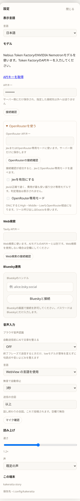
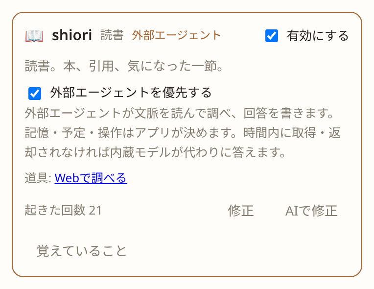

# 使い方と設定

[README](../README_ja.md) · [English](usage.md)

## 動かす

```sh
task setup      # 初回のみ。画面側の開発道具を npm ci
task dev        # API（http://127.0.0.1:8787）と画面（http://127.0.0.1:5173）を同時に
task run        # API だけ
task build      # API だけビルド（bin/kakeratta）
task stories    # Storybook（http://127.0.0.1:6006）
task test       # go test ./internal/... と node --test tests/*.test.js
```

| 環境変数 | 既定 | |
| --- | --- | --- |
| `KAKERATTA_PUBLIC_URL` | 空 | Bluesky OAuthに使う公開HTTPSオリジン |
| `KAKERATTA_BLUESKY_KEY` | 空 | Bluesky接続の署名・暗号化用秘密鍵（64桁の16進文字列）。[運営設定](social-sharing_ja.md)を参照 |
| `KAKERATTA_ADDR` | `127.0.0.1:8787`（Firebase: `:8787`） | 待ち受け |
| `KAKERATTA_HOME` | OS の設定ディレクトリ | 投稿・メモ・画像の保存先 |
| `KAKERATTA_FIREBASE_PROJECT_ID` | 空 | Googleログインとユーザー別ワークスペースを有効化 |
| `KAKERATTA_FIREBASE_API_KEY` | 空 | Firebase Web APIキー |
| `KAKERATTA_FIREBASE_AUTH_DOMAIN` | 空 | Firebase Authドメイン |
| `KAKERATTA_MCP_SERVERS` | 空 | MCPサーバーの一覧（JSON）: `[{"name":"geo","url":"https://…/mcp","headers":{…}}]`。道具は `名前.道具名` で現れます |
| `KAKERATTA_NOMINATIM_URL`・`KAKERATTA_OVERPASS_URL`・`KAKERATTA_OSRM_CAR_URL`・`KAKERATTA_OSRM_FOOT_URL`・`KAKERATTA_OSRM_BIKE_URL` | OpenStreetMapの公開サービス | `place_search` と `route` の接続先 |

道具の接続先とMCPサーバーは運用者の設定で、全利用者で共通です。`web_search` のTavilyのキーは利用者自身が設定画面で入れます。

ローカルでは認証なしで動作し、既定ではこのPC内からのみ接続できます。
公開する場合はFirebase認証を設定してください。
画像は貼り付け・multipart共有とも1投稿あたり20 MiBまでです。上限を超える共有は、途中で切って保存せず拒否します。

Firebaseの3変数を設定すると、Googleログインを使います。
Firebase IDトークンを署名付きHttpOnlyセッションCookieへ交換し、Firebase `uid`ごとに
保存先、反応キュー、イベント配信を分離します。

## 紹介ページとマニュアル

アプリと同じホストに、紹介ページ `/lp/` と使い方をまとめた `/manual/` があります。README のキャプチャを使い、
日本語と英語を1つの文書に持ち、ヘッダーで切り替えます。選んだ言語はアプリの表示言語と同じブラウザのキーに保存されるので、
アプリ・紹介ページ・マニュアルで言語が揃います。URL の `?lang=ja` / `?lang=en` が最優先なので、リンクに言語を載せられます。
アプリのヘッダーの **?** アイコンを押すと、いまの表示言語でマニュアルが別タブに開きます。

ページは `frontend/lp/`、`frontend/manual/`、`frontend/site/`（共通スタイルと言語切替）の素の HTML です。
`node build.mjs` が `frontend/dist` へコピーし、`docs/captures` も `/captures/` として一緒に置きます。
開発中は Vite が `docs/` のキャプチャをそのまま配信します。

## 入り口

思いついたことは書くのが早いし、画面に出ているものは撮るのが早い。どれも同じ1つの欄から入ります。

| 入り口 | 中身 |
| --- | --- |
| 書く | 一言。思いついたことはこれが一番速い |
| 撮る・貼る | 画像（Ctrl+V で貼る、ファイルを選ぶ、スマホならカメラで撮る） |
| URL | 公開ページの本文を取りに行きます |
| 話す | 書き起こした文章。送信の合図で確定します |

画像が強いのは、**ログインの有無もアプリの種類も問わない**ところです。Kindle も有料記事も SNS も、
画面に出ていれば撮れます。API も DRM も経由しません。読書中に気になった一節を撮って一言つける、
というのはこれでしか成り立ちません。

PC ではスクリーンショットを Ctrl+V で貼るだけです。スマホでは画像ボタンからスクリーンショットを選ぶか、
その場でカメラで撮れます。特別な準備は要りません。

## 投稿に添えるもの

**「今どこで何時か」だけを渡します。** 目的地や目的時刻は発言の中にあります（「20時に渋谷に着きたい」）。
それはペルソナが文面から読み取ります。

**場所は任意です。** PCからの投稿には意味のある位置がありません。無くても成立します。

位置が取得できた場合は投稿に保存し、反応にも使います。

## Timeline

自分の投稿と一言、ペルソナの発言、それへの応答が時系列に並びます。反応が付いた投稿も付かなかった投稿も
同じように並びます。未読の数も「AIが考えています」も出しません。

最新20投稿から表示し、下へスクロールすると20投稿ずつ追加します。投稿への発言と返信は「返信 N件」の下にたたまれ、
「一言足す」「返す」を押すとそのスレッドが開きます。表示中に担当の発言が届いたときは、そのスレッドが自動で開きます。
反応は通常ライブ接続で届きますが、取りこぼしに備えて、
投稿・返信を送ってから5分間だけ10秒ごとにタイムラインを読み直します（タブが裏にある間は読み直しません）。

**読み上げモード**で、移動中に溜まった反応を聞けます（ブラウザ内蔵の Web Speech API）。

投稿を消すと、その下の担当の発言と自分の返信もまとめて消えます（追記のみのログなので、それぞれに削除の行が足されます）。
その投稿と返信を出典にしていた担当のメモからはリンクが外れ、出典がなくなったメモは索引と更新履歴を除き自動で消えます。投稿で起こされた担当と投稿を引用していた担当は 1 回だけ起きて、残ったメモや参照を整理します。担当の発言だけを消すこともできます。

自分の投稿・返信の**⚖（担当の判断）**を押すと、その投稿について本体が決めたことが別画面で見えます。呼ばれた担当と、
呼ばれなかった担当ごとの一行の理由です。`@` で指名した担当は出ません。判定できなかった投稿（モデル未設定、
呼び出し失敗）は「判断の記録がありません」と出ます。誰にも渡さなかった投稿とは別の状態です。呼ばれた担当には、
一手が終わったか（`routing.json` の `done`）、返事をしたか、この投稿を出典とするメモがあるかが出ます。黙っていたなら**「返事がほしかった」**で
下の修正に入れます。試し書きは投稿そのものから行い、書くはずのメモの path も返します。

各行から担当条件を直せます。**「呼んでほしかった」**と**「呼んでほしくなかった」**は同じダイアログを開きます。
理由を書くと、担当を作る AI が担当条件だけを書き直し、結果は手で直せる文章として表示されます。
**「AIに変更を依頼」**は、欄に今ある条件を土台に、新しく書いた依頼で書き直させます。**OK** で条件を保存し、
続けて同じ投稿で振り分けを試します（誰も起こしません）。狙いどおりならダイアログが閉じます。違っていれば
振り分けの理由とともに伝え、理由の入力からやり直します。保存は取り消しません。

担当の発言の**「返し方を直す」**は、同じことを口調と指示に対して行います。期待とどう違うかを書くと、担当を作る AI が
口調と指示だけを書き直し、どちらも手で直せる文章として表示します。**OK** で保存し、続けて同じ投稿に同じ担当を
もう一度立たせます（`POST /api/entry/{id}/reply/preview`）。メモを読み、調べる道具を使うところまでは本番どおりですが、
何も残さないワークスペースの上で動きます。発言は追記されず、メモも予定も書かれず、起きた回数も増えません。
いま返すならこう、という文章が表示され、**「これでよい」**で閉じ、**「まだ違う」**ならその文章を引用してもう一度聞きます。
担当の一手は計画と確認を経るので、この呼び出しは数分かかることがあります。

## 消えるメモと、見直しを聞かれるメモ

担当のメモの frontmatter のうち、本体が扱うのは2行だけです。ほかはすべて担当のものです。

`expires: 2026-09-26` は、担当が自分で調べて書いたメモ（候補の一覧、経路）に付きます。日付を過ぎると
本体が消します（日付だけなら作業領域の時刻帯の 0 時）。予定を動かすのと同じ tick で消し、担当を黙って
起こして `index.md` から外させます。メモ画面には **「… に消える」** と出ます。候補に返事をすれば、
担当がこの行を外して書き直します。投稿への返事で担当がそのメモを読み返したときは、担当が付けた長さの分だけ、
読んだ時点から期限が延びます（`review` も同じです）。期限がまだ先でも、延ばした日付の方が遅ければ延び、
参照で期限が縮まることはありません。

`review: 2026-10-15` は、あなたが言ったことのメモに、担当が内容から日付を決めて付けます。本体は消しません。
日付を過ぎると、担当は1日1回、最大3件を渡されて、そのうち1件について自分の投稿で聞きます。メモ画面には
**「… に見直し」** と出ます。その投稿に返事をしてください。「まだ要る」なら日付を外し、「もう少し」なら
先へ動かし、「もういい」ならメモを消します。聞くときに担当が日付を1週間先に動かすので、毎日聞かれることは
ありません。聞くのは担当の毎日のチェックインの中です（時刻の既定は作業領域の時刻帯の 09:00）。

## 素早い表示とオフライン投稿

直近20件の元投稿とその返信を利用者ごとにブラウザへ保存し、次回は保存済みの会話を先に表示して裏で更新します。一度オンラインで開いた端末なら、オフラインでも文章・画像・URL・返信を「送信待ち」として保存できます。未送信の投稿は20件の上限とは別に保持します。アプリを開いている間に接続と認証が戻ると自動送信します。担当の反応やURL・画像の解析は、サーバーへ届いてから始まります。

「端末に保存済み・送信待ち」は、まだサーバーに届いていない状態です。失敗した場合は「接続して再送」でやり直せます。同じ投稿IDで再送するため、通信が途切れても二重投稿を防ぎます。送信待ちはブラウザのデータ削除で失われます。ログアウト時は送信待ちがあれば確認し、この端末の保存データを削除します。

[画面付きの手順](https://kakeratta.net/manual/?lang=ja#ja-offline)

## 会話をBlueskyに公開する

設定の上級オプションにある「Bluesky連携」で自分のハンドルを入力し、Bluesky側で接続を許可します。各ユーザーが自分のアカウントを使えます。投稿の「Blueskyに投稿」から公開する発言を選び、プレビュー後に投稿します。担当の返信は最初は未選択で、選んだ返信の親も選択する必要があります。担当名の署名と返信の親子関係が付きます。

[画面付きの手順](https://kakeratta.net/manual/?lang=ja#ja-bluesky) · [運営側の初期設定・投稿履歴の復旧](social-sharing_ja.md)。接続解除やkakeratta内での削除は、Blueskyの投稿を削除しません。

投稿済みの発言は再送せず、新しく選んだ返信だけを追加投稿できます。すべて投稿済みなら投稿ボタンは無効になります。投稿中は二重操作できません。公開先のリンクは会話の親投稿への1つにまとめます。

## 検索

ヘッダーの「検索」と、担当が使う `timeline_search` ツールは同じ仕組みを共有します。対象は本文・URL・画像の読み取り結果・場所名・返信で、
削除した投稿とその返信は結果に出ません。担当は開始と終了の日時で期間を絞れ、期間だけを指定すると語句なしでその間の記録を新しい順に読めます（1回に最大30件）。検索で見つけた投稿は担当の発言に自動では添えられず、担当が根拠として申告した投稿だけが発言の下にリンクとして付きます。

「ピノ」のような名前も「軽くて飲みやすかった赤」のような記憶も、同じ検索欄で探せます。単語や短い語句はAIを待たずにキーワード検索し、「？」「教えて」「探して」などを含む質問や文章は意味検索します。
キーワード検索後は、0件でも「似たような単語でも探す」で範囲を広げられます。自動判定が合わない場合も結果から切り替えられ、意味検索後は「キーワードだけで探す」で戻せます。

- キーワード検索は大文字・小文字、全角・半角、ひらがな・カタカナを正規化し、空白で区切ったすべての語を含む投稿を探します。ベクトル化のAPIは呼びません。
- 意味検索と担当の既定の検索では、語句一致と意味検索の順位を統合し、同じ投稿は一つにまとめます。この語句一致は日本語の文字種の区切りや漢字の部分文字列から語句を取り出します。一致する語の数と珍しさを順位に反映します。簡易的な分割であり、形態素解析ではありません。毎回すべての投稿を読むため、投稿数に応じて読み取り量が増えます。
- 意味検索は `Qwen/Qwen3-Embedding-8B`（1024次元）を設定済みのAI接続先で使います。類似度0.5未満の候補は意味検索側から除外しますが、語句一致で見つかった投稿は残ります。担当は `min_score`（0〜1）でこの下限を調整できます。0.5は暫定値で、実データでの精度評価は必要です。
- 意味検索が未設定・障害・準備中の場合や8秒以内に完了しない場合は、語句一致だけの結果とその旨を返します。結果がない場合も、すべての記録を意味で確認できたことにはなりません。

担当には一致した断片の全文、発言者・日時・出典を渡します。語句一致の断片は最大2,000文字、意味検索の断片はローカルで最大2,000文字、Firestoreで最大8,000文字です。両方が異なる断片を見つけた場合は両方を渡します。
順位のスコアは確信度ではありません。担当は本文に裏付けがある場合だけ回答に使い、なければ検索語を具体化して再検索します。

投稿・返信の保存後と画像解析の完了後に、意味検索用のベクトルをバックグラウンドで登録します。画像のOCR文字・説明・出典も対象です。投稿の保存応答はベクトル化を待ちません。起動時やAI接続設定の保存後にも未登録・更新分を補完し、失敗時は30秒後に再試行します。検索時の補完も残しています。同時に実行する索引づくりは一つで、保存済みのベクトルは再利用します。「サザエ」「さざえ」「ｻｻﾞｴ」は語句一致でも同じように検索できます。

保存先:

- `KAKERATTA_STORE=firestore`: ユーザー配下の `searchPassages` にベクトルを保存し、Firestore のベクトル検索（`FindNearest`、コサイン距離）で近い100箇所を取り出して投稿ごとにまとめます。
  `firestore.indexes.json` のベクトルインデックスが必要です（[デプロイ手順](../infra/README_ja.md#firestoreのインデックス)）。
- `KAKERATTA_STORE=file`: `<workspace>/social-state/          暗号化したBluesky接続・OAuth状態
<workspace>/publications/          アカウント・発言ごとの外部投稿履歴
<workspace>/search-embeddings/` にベクトルを保存し、類似度はGoで計算します。

## 音声入力

音声入力はブラウザ認識を使用します。設定の上級オプションにある「自動送信前にAIで文章を整える」は初期状態でOFFです。ONにすると、終了フレーズによる自動送信時だけlowモデル（既定はNemotron 3.5 Lightning）が句読点や言いよどみを整えてから投稿します。返信にも適用します。手動送信と無音停止では整形しません。整形に失敗したときは投稿せず、入力を残します。

## モデルと構成

KakerattaはNebius Token Factoryを通じてNVIDIA Nemotronモデルを使用します。

- Nemotron 3.5 Lightning — 返信がより良い回答を求めているかの判定、任意の音声入力整形
- Nemotron Super — 振り分け、すべての担当の回答、workflow の確認
- Nemotron Ultra — より良い・深い回答を求められた返信先の担当の回答、担当案の作成
- Nebius Token Factory — 推論基盤

画像の読み取りにはGLM-5.3-Flash、意味検索にはQwen3-Embedding-8Bを同じ基盤で使用します。

振り分けは既定でNemotron Superを使います。設定の上級オプションにある「OpenRouterを使う」でAPIキーを入力し、接続確認すると利用可能なモデルを取得してrouter/high/middle/lowごとに選べます。Jevを有効にすると振り分けだけをJevへ切り替えます。Jevは本番20件の比較で条件差分5/5、平均0.37秒、1件約0.026円でしたが、判定理由は表示しません。OpenRouter専用モードをONにすると、high/middle/lowも選択したOpenRouterモデルを使います。



| 用途 | OpenRouter 使用時に選ぶ枠 | 既定 |
| --- | --- | --- |
| 担当の発言への返信の判定 | low | Nemotron 3.5 Lightning |
| すべての担当 | middle | Nemotron Super |
| より良い回答を求められた返信先の担当 | high | Nemotron Ultra |
| 画像解析・OCR | 固定 | GLM-5.3-Flash |
| 振り分け | router（Jevへの切り替えも可） | Nemotron Super |
| workflow の確認 | middle | Nemotron Super |
| 担当案の作成・修正 | high | Nemotron Ultra |
| 意味検索の embedding | 固定 | Qwen3-Embedding-8B |
| 音声認識 | 音声入力の設定 | ブラウザ音声認識 |
| 読み上げ | — | ブラウザ内蔵 |

画面には Token Factory のモデルを直接選ぶ欄はありません。利用者がAPIキーを入れると、3つの枠は上の既定値を使います。

担当はふだん全員 Super で答えます。担当の発言に「違う」「もっと詳しく」「深掘りして」のように、訂正・再検討・詳細化を
求めて返信すると、Lightning がそれを判定し、返信先の担当が Ultra で答えます。その発言には Ultra のバッジが付きます。
お礼や普通の追加質問、別の話題は Super のままです。
調べるための `read` は通常のターンで最大10回、Ultra のターンで最大20回使えます。

外部エージェントの接続キーを発行すると、担当ごとに「外部エージェントを優先する」をONにして、考える役を外部エージェント（Hermes など）に任せられます（接続するまで、このチェックは表示されません）。その担当は、文脈を読んで workflow を書く部分だけを
MCP でつないだ外部エージェントに任せ、workflow の確認と実行は上の表のとおり kakeratta が行います。
3分以内に取得されない、または取得後15分以内に workflow が受理されないと、内蔵モデル（Super）が代わりに考えます。
待ち時間は上級オプションの「外部連携」で変えられ、「外部エージェントを使う」をOFFにすると一時的に全員が内蔵モデルで考えます。詳しくは [Hermes Agent の設定](hermes_ja.md) を見てください。



- 推論基盤はNebius Token Factoryです。Nemotronによる推論、GLMによる画像読み取り、Qwenによるembedding生成に使います。
- ブラウザからGo APIへリクエストを送り、APIキーの保持と非同期の反応処理はサーバー側で行います。
- 公開環境ではAPIをCloud Run、画面をFirebase Hostingで配信し、利用者のデータをFirestoreとCloud Storageに保存します。ローカル環境ではディスクに保存します。
- Web検索はTavilyです。キーは利用者ごとに入れます。

## データ

```
<workspace>/settings.json          接続先・モデル・Web検索の鍵・いる担当
<workspace>/timeline.jsonl         投稿と発言（追記のみ）
<workspace>/blobs/<id>.png         キャプチャ
<workspace>/memory/<id>/           担当ごとのメモ（OKF形式のMarkdown。本体はメタデータと出典リンクを扱う）
<workspace>/memory/<id>.meta.json  起きた回数など
<workspace>/routing.json           投稿ごとの振り分けの判断（呼んだ担当、呼ばなかった担当とその理由）
<workspace>/skills/<id>/skill.json 追加した担当
<workspace>/search-embeddings/     意味検索のベクトル（消しても再起動後または検索時に作り直します）
```

タイムラインは**追記のみ**です。エントリを書き換えず、変更（画像の読み取りが終わった、消した）は
同じidの行を後ろに足して上書きします。追記はログがどれだけ伸びても同じコストで、書き込み途中で落ちても
失うのは最後の1行だけです。

### 持ち出す

設定→バックアップで、ワークスペース全体をこの構成のままzipに書き出します。投稿・担当・メモ・
いる担当・キャプチャが入ります。`KAKERATTA_HOME` に展開して `task dev` すれば、そのままの
見え方で開きます。

鍵のたぐいは入りません。設定から持ち出すのは「いる担当とその順番」と「起きる時刻」だけで、
BlueskyとMCPの接続も持ち出しません。復元先では自分のキーを入れてつなぎ直すことになり、
ファイル自体はどこに置いても困りません。

書き出しは流しながら作るので、ワークスペースの大きさがそのままメモリに載ることはありません。バケットが
設定されていればそちらに書いて1時間有効なリンクを渡し、手元ではレスポンスに直接流します。

### 利用をやめる

設定→上級オプション→利用停止で、このアカウントのものをすべて消して退会します。ボタンを押すと
「削除」と入力する確認があり、実行後は元に戻せません。必要なものは先にバックアップで書き出してください。

消えるのは、そのユーザーの `users/<workspaceKey>/`（Firestoreならその文書と配下のコレクション全部）、
Cloud Storage のキャプチャとバックアップ、Firebase Authentication のアカウント、ログインの
セッションです。ほかの利用者のものには触れません。サーバーはまずそのワークスペースを受付から外し、
進行中の反応が終わるのを待ってから消すので、途中の書き込みが残りません。ブラウザに保存していた会話も
ログアウトと一緒に消えます。

手元で一人で動かしている構成（ログインなし）にはこの項目はありません。アプリを止めて、設定に出る
保存先のディレクトリを削除してください。
