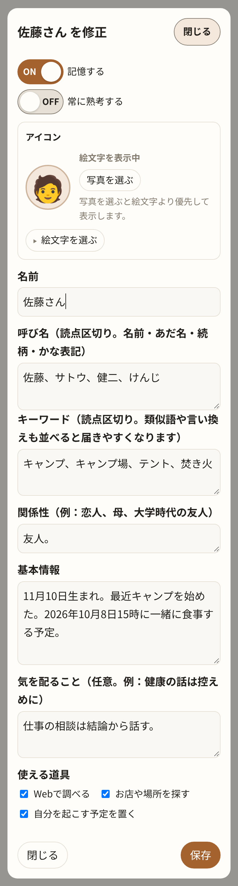
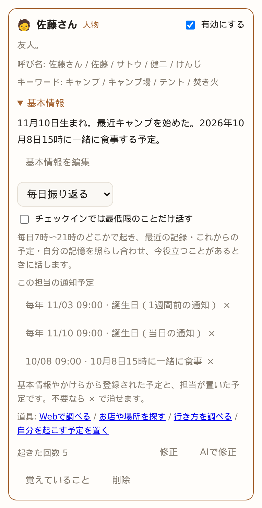
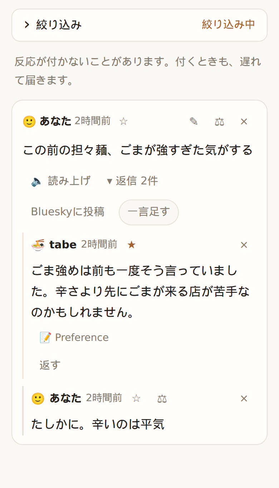
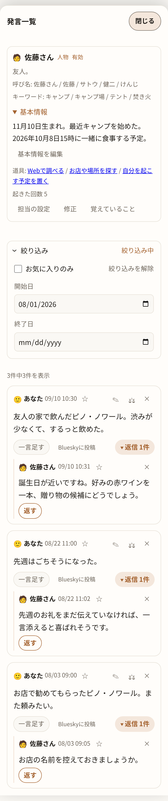
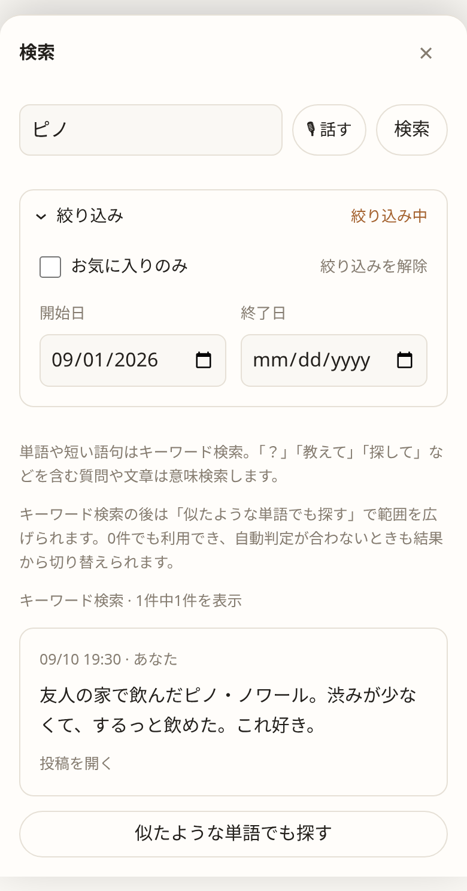
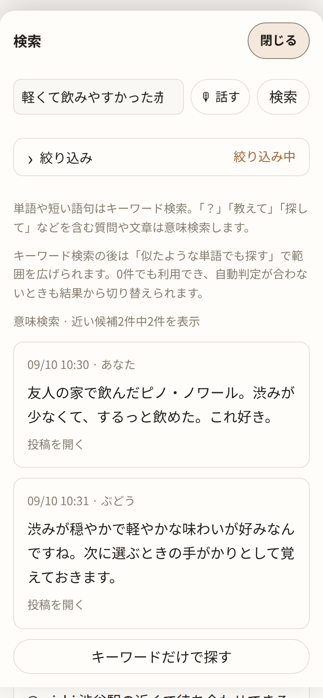
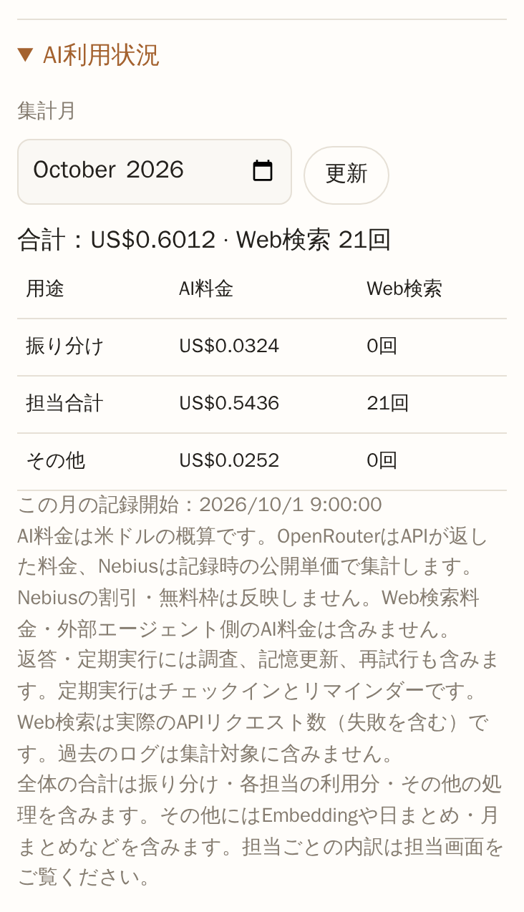
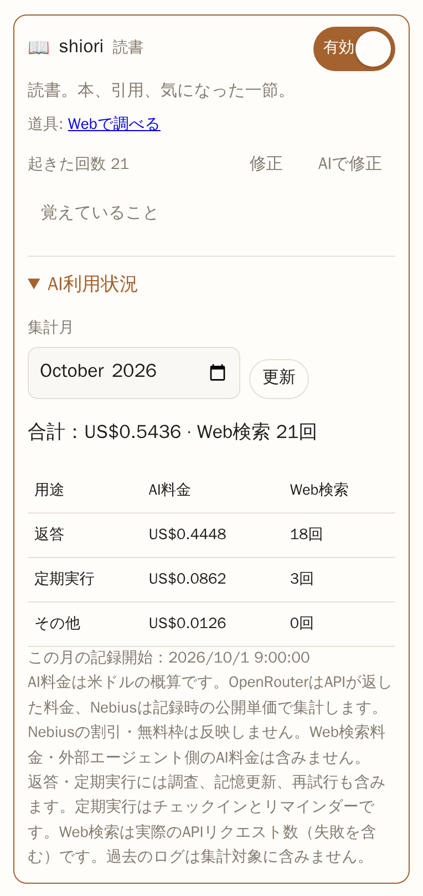

# 使い方と設定

[README](../README_ja.md) · [English](usage.md)

## 動かす

```sh
task setup      # 初回のみ。画面側の開発道具を npm ci
task dev        # API（http://127.0.0.1:8787）と画面（http://127.0.0.1:5173）を同時に
task run        # API だけ
task build      # API だけビルド（bin/kakeratta）
task stories    # Storybook（http://127.0.0.1:6006）
task test       # go test ./internal/... と node --test tests/*.test.js
```

| 環境変数 | 既定 | |
| --- | --- | --- |
| `KAKERATTA_PUBLIC_URL` | 空 | Bluesky OAuthに使う公開HTTPSオリジン |
| `KAKERATTA_BLUESKY_KEY` | 空 | Bluesky接続の署名・暗号化用秘密鍵（64桁の16進文字列）。[運営設定](social-sharing_ja.md)を参照 |
| `KAKERATTA_ADDR` | `127.0.0.1:8787`（Firebase: `:8787`） | 待ち受け |
| `KAKERATTA_HOME` | OS の設定ディレクトリ | 投稿・メモ・画像の保存先 |
| `KAKERATTA_FIREBASE_PROJECT_ID` | 空 | Googleログインとユーザー別ワークスペースを有効化 |
| `KAKERATTA_FIREBASE_API_KEY` | 空 | Firebase Web APIキー |
| `KAKERATTA_FIREBASE_AUTH_DOMAIN` | 空 | Firebase Authドメイン |
| `KAKERATTA_MCP_SERVERS` | 空 | MCPサーバーの一覧（JSON）: `[{"name":"geo","url":"https://…/mcp","headers":{…}}]`。道具は `名前.道具名` で現れます |
| `KAKERATTA_WEATHERAPI_KEY` | 空 | 本体のWeatherAPIキー。キーファイルより優先 |
| `KAKERATTA_WEATHERAPI_KEY_FILE` | あれば `tmp/weatherapi.key` | WeatherAPIキーを保存したファイル |
| `KAKERATTA_WEATHERAPI_URL` | `https://api.weatherapi.com/v1` | `weather_forecast` の接続先 |
| `KAKERATTA_NOMINATIM_URL`・`KAKERATTA_OVERPASS_URL` | OpenStreetMapの公開サービス | `place_search` の接続先 |

道具の接続先とMCPサーバーは運用者の設定で、全利用者で共通です。`web_search` のTavilyのキーは利用者自身が設定画面で入れます。

ローカルでは認証なしで動作し、既定ではこのPC内からのみ接続できます。
公開する場合はFirebase認証を設定してください。
画像は貼り付け・multipart共有とも1投稿あたり20 MiBまでです。上限を超える共有は、途中で切って保存せず拒否します。

Firebaseの3変数を設定すると、Googleログインを使います。
Firebase IDトークンを署名付きHttpOnlyセッションCookieへ交換し、Firebase `uid`ごとに
保存先、反応キュー、イベント配信を分離します。

## 紹介ページとマニュアル

アプリと同じホストに、紹介ページ `/lp/` と使い方をまとめた `/manual/` があります。`docs/captures/` の画面キャプチャを使い、
日本語と英語を1つの文書に持ち、ヘッダーで切り替えます。選んだ言語はアプリの表示言語と同じブラウザのキーに保存されるので、
アプリ・紹介ページ・マニュアルで言語が揃います。URL の `?lang=ja` / `?lang=en` が最優先なので、リンクに言語を載せられます。
**使い方** を押すと、いまの表示言語でマニュアルが別タブに開きます。広い画面ではヘッダーに、スマホでは三点メニュー内に、使い方とログアウトを表示します。
スマホの設定は、幅に余裕があれば歯車アイコンで表示し、狭い場合は三点メニューに入ります。さらに狭い場合は担当も同じメニューに入ります。

ページは `frontend/lp/`、`frontend/manual/`、`frontend/site/`（共通スタイルと言語切替）の素の HTML です。
`node build.mjs` が `frontend/dist` へコピーし、`docs/captures` も `/captures/` として一緒に置きます。
開発中は Vite が `docs/` のキャプチャをそのまま配信します。

## 入り口

思いついたことは書くのが早いし、画面に出ているものは撮るのが早い。どれも同じ1つの欄から入ります。

| 入り口 | 中身 |
| --- | --- |
| 書く | 一言。思いついたことはこれが一番速い |
| 撮る・貼る | 画像（Ctrl+V で貼る、ファイルを選ぶ、スマホならカメラで撮る） |
| URL | 公開ページの本文を取りに行きます |
| 話す | 書き起こした文章。送信の合図で確定します |

画像が強いのは、**ログインの有無もアプリの種類も問わない**ところです。Kindle も有料記事も SNS も、
画面に出ていれば撮れます。API も DRM も経由しません。読書中に気になった一節を撮って一言つける、
というのはこれでしか成り立ちません。

PC ではスクリーンショットを Ctrl+V で貼るだけです。スマホでは画像ボタンからスクリーンショットを選ぶか、
その場でカメラで撮れます。特別な準備は要りません。

## 投稿に添えるもの

**「今どこで何時か」だけを渡します。** 目的地や目的時刻は発言の中にあります（「20時に渋谷に着きたい」）。
それはペルソナが文面から読み取ります。

**場所は任意です。** PCからの投稿には意味のある位置がありません。無くても成立します。

位置が取得できた場合は投稿に保存し、反応にも使います。

## 担当と名指しの依頼

内蔵の担当は tabe（食事）、shiori（読書）、sona（備えと天気）、support
（kakerattaのサポート）、インフォグラフィック（絵文字・Mermaidを使ったMarkdown図解）の5つです。
新規利用時は sona・support・図解担当が有効です。既存の利用者は保存した選択を維持するため、
新しい担当を使うには担当一覧で有効にしてください。以前の内蔵の移動担当 michi は廃止されました。
独自に修正した移動担当は残り、場所を探す道具を持つ担当を新しく作ることもできます。

`@support` で使い方や仕様を聞けます。システム仕様を参照して答え、初期状態では個人の記憶を持ちません。

`@` で指名すると、有効な担当1人だけに届きます。指名がなければ、有効な担当への返信はその担当だけに届きます。
返信先と違う担当を指名したときは指名を優先します。それ以外の投稿や返信では、通常の担当条件と人物の呼び名・
キーワードで届け先を選びます。投稿の編集では、以前に受け取った担当にも記憶を直すために届けます。

作成・修正時に **記憶する** と **常に熟考する** を選べます。記憶は通常オンで、supportと図解担当はオフです。
オフにすると個人の記憶を読んだり更新したりせず、毎日・毎月のチェックインも止まります。
既存の記憶は保存したままで、オンに戻すと使えます。記憶の操作は非表示になりますが、明示的な通知予定や
外部エージェントの選択は使えます。常に熟考すると通常の依頼でも回答に上位モデル（Ultra）を使い、深い調査の枠を使います。調べる道具を持つ担当の読み取りと、予定の計画はSuperです。
外部エージェントを優先する設定は維持し、本体が代わりに答える場合にUltraを使います。

### 投稿や回答を図解にする

図解したい発言に `@infographic これをインフォグラフィックにして` と返信します。
別の担当の回答に返信した場合、その回答が図解の対象です。「元の投稿を」「スレッド全体を」と明示して対象を変えることもできます。
URLは展開済みの記事本文、画像は読み取り済みの文字や説明を使います。材料が不足していれば、図解の前に確認することがあります。

図解は絵文字やMermaidを使ったMarkdownでタイムライン内に表示します。見出しや説明は送信時のブラウザの表示言語に揃え、
オフラインの送信待ちでもその言語を保持します。Web検索はせず、取得済みの資料と会話を使います。
図解担当は初期状態で記憶オフ・常にUltraです。

## Timeline

自分の投稿と一言、ペルソナの発言、それへの応答が時系列に並びます。反応が付いた投稿も付かなかった投稿も
同じように並びます。未読の数も「AIが考えています」も出しません。

最新20投稿から表示し、下へスクロールすると20投稿ずつ追加します。投稿への発言と返信は「返信 N件」の下にたたまれ、
「一言足す」「返す」を押すとそのスレッドが開きます。表示中に担当の発言が届いたときは、そのスレッドが自動で開きます。
反応は通常ライブ接続で届きますが、取りこぼしに備えて、
投稿・返信を送ってから5分間だけ10秒ごとにタイムラインを読み直します（タブが裏にある間は読み直しません）。

**読み上げモード**で、移動中に溜まった反応を聞けます（ブラウザ内蔵の Web Speech API）。

投稿を消すと、その下の担当の発言と自分の返信もまとめて消えます（追記のみのログなので、それぞれに削除の行が足されます）。
その投稿と返信を出典にしていた担当のメモからはリンクが外れ、出典がなくなったメモは索引と更新履歴を除き自動で消えます。投稿で起こされた担当と投稿を引用していた担当は 1 回だけ起きて、残ったメモや参照を整理します。担当の発言や返信は × で消せます。そのとき、それに（間接的にも）返事している発言も一緒に消え、スレッドのほかの発言は残ります。間違った回答を消すと、それを繰り返した返事も含めて、検索やスレッドの文脈として参照されなくなります。一緒に書いたメモは残るので、メモも誤っていれば担当の記憶から直してください。

自分の投稿・返信の**⚖（担当の判断）**を押すと、その投稿について本体が決めたことが別画面で見えます。呼ばれた担当と、
呼ばれなかった担当ごとの一行の理由です。`@` で指名した担当と、返信した相手の担当も出て、理由は「@で呼ばれました」
「返信で呼ばれました」です。自分で呼んだ担当には「呼んでほしくなかった」は出ません。判定できなかった投稿（モデル未設定、
呼び出し失敗）は「判断の記録がありません」と出ます。誰にも渡さなかった投稿とは別の状態です。呼ばれた担当には、
一手が終わったか（`routing.json` の `done`）、返事をしたか、この投稿を出典とするメモがあるかが出ます。黙っていたなら**「返事がほしかった」**で
下の修正に入れます。試し書きは投稿そのものから行い、書くはずのメモの path も返します。

各行から担当条件を直せます。**「呼んでほしかった」**と**「呼んでほしくなかった」**は同じダイアログを開きます。
理由を書くと、担当を作る AI が担当条件だけを書き直し、結果は手で直せる文章として表示されます。
**「AIに変更を依頼」**は、欄に今ある条件を土台に、新しく書いた依頼で書き直させます。**OK** で条件を保存し、
続けて同じ投稿で振り分けを試します（誰も起こしません）。狙いどおりならダイアログが閉じます。違っていれば
振り分けの理由とともに伝え、理由の入力からやり直します。保存は取り消しません。

担当の発言の**「返し方を直す」**は、同じことを口調と指示に対して行います。期待とどう違うかを書くと、担当を作る AI が
口調と指示だけを書き直し、どちらも手で直せる文章として表示します。**OK** で保存し、続けて同じ投稿に同じ担当を
もう一度立たせます（`POST /api/entry/{id}/reply/preview`）。メモを読み、調べる道具を使うところまでは本番どおりですが、
何も残さないワークスペースの上で動きます。発言は追記されず、メモも予定も書かれず、起きた回数も増えません。
いま返すならこう、という文章が表示され、**「これでよい」**で閉じ、**「まだ違う」**ならその文章を引用してもう一度聞きます。
担当の一手は計画と確認を経るので、この呼び出しは数分かかることがあります。

### 人物の担当

母や佐藤さんのように、特定の一人を覚える担当は**人物の担当**です。AI と担当を作るときに「佐藤さんのことを覚えて」のように頼むと作られます。人物の担当と関心ごとの担当は、作ったあとで入れ替えられません。人物の担当は振り分けのモデルには渡されず、
投稿（写真から読み取った文字や説明を含む）に**呼び名**か**キーワード**がそのまま書かれているときだけ届きます。
`@` で呼んだとき、そのスレッドに一度呼ばれたあとの返信、毎日のチェックインはほかの担当と同じです。
語の一致で届いたときは、担当に「語が一致しただけで、その人の話とは限らない」と伝えます。「母」で届いた「母校」の話のように
その人と関係がなければ、担当は発言もメモもせずに終えます。

人物の作成時や「AIで修正」で伝えた誕生日・好み・出来事などは、編集できる**基本情報**として担当の設定に保存されます。かけらの投稿やメモへの転記は行いません。基本情報は人物のカードの **「基本情報」**（折りたたみ）で読め、**「基本情報を編集」** か通常の編集画面（「修正」）で修正できます。





人物の担当には担当条件の代わりに**関係性**（恋人、母、大学時代の友人など）を書きます。担当には「その人本人のこと、またはその人との出来事」を覚えるよう伝えたうえで、この関係性を添えます。

担当の一覧は「人物」と「関心ごと」のタブに分かれ、どちらも名前・担当条件・呼び名・キーワードで検索できます（ひらがなとカタカナ、全角半角は区別しません）。
人物のタブは「名前順」にも並べられ、漢字の名前はかなの呼び名の読みで並びます。

### 毎日の振り返り

1日1回、本体が前回からの投稿を読んでその日の出来事のまとめを作り（画面には出しません）、続けて記憶のある担当が順にそのまとめと自分の記憶を読んで、何かあれば声をかけます。前回から投稿がなく、見直しの記録や近い予定もない担当は、その日は起きません。
共有のまとめには、その担当に最初は届かなかったかけらも含まれます。自分の担当分野や記憶とのつながりを探し、役立つ提案やこれからの準備を伝えることがあります。

時刻は設定の **毎日の振り返り** で決められます。**時刻を指定** を選ぶとその時刻に、**おまかせ** では本体がアカウントごとに7時〜21時のどこかを選びます（日によって少しずつ動きます）。利用者の多い時間帯は混み合うため、指定した時刻より遅れることがあります。

### 今月のまとめと、月1回振り返る人物

月に1回、本体がその月のタイムライン（前回のまとめから、最長32日）を読み、**今月のまとめ**を本体の名前で投稿します。話題ごとの箇条書きで、
各項目の末尾に元の投稿へのリンクが付きます。日付はアカウントごとに本体が決め（毎月1〜28日のどこか）、時刻は毎日の振り返りと同じで、その日の振り返りの中でまとめを書いてから、担当たちが起きます。
まとめは自分の投稿と同じく ✎ で直せます。直しても振り分けは行いません。

人物の担当はカードで「頻繁に振り返る」（毎日）か「ときどき振り返る」（月1回）を選べます。月1回の人物は、まとめが書かれた日のまとめの後に起き、まとめと、
前回のチェックインからその人の呼び名やキーワードが出た投稿（新しい方から40件まで）を受け取って振り返ります。タイムライン全体は読み直しません。
AI と人物の担当を作ると、関係性から既定の頻度が選ばれます（家族や親しい人は毎日、たまに会う人は月1回）。関心ごとの担当は毎日です。

人物の担当の話し方、メモの型（Fact と Event）、貸し借り・約束・会う予定・誕生日や記念日の扱いは、すべての人物の担当で共通で、本体が持ちます。
改善はすべての人物の担当にそのまま届きます。編集画面で人物の担当に書くのは関係性・基本情報と、任意の**「気を配ること」**だけで、話し方とメモの分類は出ません。
基本情報の保存・編集や、その人物に届いたかけらから、日付の分かる誕生日・記念日・会う予定を自動で登録します。誕生日・記念日は毎年、1週間前と当日の午前9時に知らせます。会う予定は指定された通知時刻を優先し、指定がなければ当日午前9時（午前9時より早い予定は1時間前）に知らせます。通知は担当の投稿として届きます。未来の予定に日数の上限はなく、日付の分からない情報は推測で登録しません。予定の変更や中止も反映します。

人物の担当は、Web で調べる、お店や場所を探す、自分を起こす予定を置く道具を初期状態で持ちます。
贈り物や会う場所を調べ、会う日や誕生日に自分を起こすためです。人物の担当は AI と作ると必ず入ります。どれも手で外せます。
会う予定の投稿があると、担当はその日の朝に自分を起こす予定を置き、当日に前回の出来事や未解決のことを添えて知らせます。

照合は文字どおりですが、全角半角・大文字小文字・ひらがなとカタカナの違い、末尾の敬称（さん・くん・ちゃん・様など）は区別しません。
「佐藤」を登録すれば「佐藤くん」「さとうさん」にも届きます。意味の近い投稿も拾えるよう、キーワードには言い換えや類似語を
並べて登録します（例：釣り、つり、釣行、海釣り）。AI に担当を作らせると、呼び名の表記ゆれとキーワードの類似語をまとめて
提案します。呼び名は `@` での指名にも使えます。⚖ では、一致した語が「「佐藤」に一致」のように出ます。

人物の担当には担当条件がないので、⚖ の**「呼んでほしかった」**はキーワードを足す画面になります。AI がその投稿に
書かれている語と類似語から足すキーワードを提案し、手で直して **OK** で保存します。保存後に同じ投稿で確かめ、
足した語が投稿にあればその投稿に担当を呼びます。なければそう伝えて最初に戻ります。

人物の担当の**「呼んでほしくなかった」**は、呼び名とキーワードのうち投稿に一致した語を並べ、外す語を選ぶ画面になります。
担当の名前そのものは表示だけで、ここでは外せません（編集画面で変えます）。外した語だけを含む投稿は今後届かず、
外した呼び名は `@` での指名にも使えなくなります。**「外す」**で保存して同じ投稿で確かめ、ほかの語でもまだ一致するなら
その語を伝えるので、続けて外せます。**「残す」**は何も変えずに閉じます。その人と関係のない投稿なら、担当はもともと
発言もメモもせずに終えます。その投稿に担当がすでに残した発言は消えません。

## 担当の記憶：事実、まとめ文、かけらの記録

記憶がオンの担当は、記憶を1つのファイル（`Memo.md`）に持ち、どれも本体が書きます。中身は次の3つです。

- **かけらの記録**: 担当が受け取ったかけらごとに1行、「日時・たどれる投稿のID・1文の要約・タグ」を残します。担当が返事をしたときはその返事のIDで（返事から元のかけらへたどれます）、返事をしなかったときはかけら自身のIDです。挨拶や一般的な質問だけのかけらは記録しません。会話のたびに行うのはこの1行の追加だけです。
- **いまの事実**: 分かっていることを1件1行で持ちます（「三田の二郎に行きたい」など）。どのかけらに基づくか、いつから当てはまるかも付きます。担当のチェックインのとき（毎日。月1回振り返る人物なら月1回）に、前回から増えた記録を読んで、事実を足す・書き換える・消す・似たものをまとめるのどれかを行います。当てはまらなくなった事実は消えます（元の投稿はタイムラインに残ります）。事実に取り込んだ記録は消え、事実にしないまま古くなった記録は「そろそろ忘れていい？」と聞く対象になります。「10/3 に美容室の予約」のように日付が過ぎた予定も、このときに消します（済んだ出来事は残ります）。
- **まとめ文**（ファイルの先頭）: 事実と記録を読んだ担当自身の見立てです。同じチェックインのときに書き直します。新しい記録も事実の変化もなければ何もしません。

記憶は話題ごとに分けません。担当の領域から外れる話題や、はっきり別の話題がたまってきたら、担当がチェックインで「〇〇の担当を新しく作って分けませんか？」と一言提案します（30日に1回まで）。

担当は毎回、まとめ文と今の事実と最近の記録を読んでから考え、それより前の記録はタグ・語句・意味で探します。メモ画面では事実や記録の **元の投稿** から、もとになった投稿と会話をその場で開け、`#タグ` を押すとそのタグの記録があるときだけに絞れます。事実は1件ずつ ✎ で直したり × で忘れさせたりでき、記憶をまるごと直したり消したりもできます（担当は起こされません）。見直しで記録を忘れたときや期限で記録が消えたときも、そのかけらだけを根拠にしていた事実は一緒に消えます。かけらを消すと、その記録と、そのかけらだけを根拠にしていた事実を本体が消します（モデルは使いません）。まとめ文は次のチェックインで書き直されます。

記録の行には日付が付くことがあります。`expires:2026-09-26/1d` は「今日のランチどこがいい？」「渋谷までの行き方」のような、その場限りのかけらの記録に付き、その日に本体が記録を消します。`review:2026-10-15/21d` はあなたが言ったことの記録に担当が内容から日付を決めて付けます。本体は消さず、日付を過ぎると担当が毎日のチェックイン（最大3件を渡されたうちの1件）で「そろそろ忘れていい？」と聞きます。その投稿に返事をすれば、「まだ要る」なら日付を外し、「もう少し」なら先へ動かし、「もういい」なら記録を消します。担当があなたの投稿への返事のために記録を読み返すと、付けた日数の分だけ、読んだ日から期限が延びます。メモ画面には **「… に消える」**・**「… に見直し」** と出ます。

## 予定をまとめて確認・編集する

ヘッダーの **予定** で、すべての担当の予定を次の実行日時順に表示できます。担当名や予定の内容で検索できます。
各予定の鉛筆マークから **日時・通知を編集** モーダルを開き、次の実行日時と **Push通知** のON／OFFを変更して保存します。日時の入力欄には、この端末のタイムゾーンを表示します。
担当ごとのカードや発言一覧でも同じ操作ができます。通知OFFでも予定は実行し、回答はタイムラインに残ります。
「この予定は通知しないで」のように担当へ頼むこともできます。× は予定自体の取消です。

毎日の予定は変更した時刻を予定のタイムゾーンで引き継ぎます。誕生日などの年次予定も時刻は引き継ぎますが、日付変更は次回だけで、元の誕生日・記念日は変わりません。
すでに実行を開始した回には変更が間に合わないことがあります。保存に失敗したら入力を残して再試行できます。

## リマインダーのプッシュ通知

設定の **この端末** で、通知を受けたい端末ごとに有効にします。ブラウザの許可は有効にするときだけ求めます。
対象は担当の通知予定で、通常の返事・チェックイン・今月のまとめは通知しません。
通知にはリマインダー本文を最大120文字（省略時は末尾に「…」）で表示し、開くと該当の投稿へ移動します。ロック画面での表示は端末の通知設定に従います。
HTTPSとブラウザのプッシュ対応が必要です。iPhone・iPadはホーム画面に追加して、そこから開いてください。
プッシュを使わなくても、リマインダーはタイムラインに残ります。自分で動かす場合はVAPIDの設定が必要です。
[運用の設定](system/operations.md#web-push-configuration)を参照してください。

## 素早い表示とオフライン投稿

直近20件の元投稿とその返信を利用者ごとにブラウザへ保存し、次回は保存済みの会話を先に表示して裏で更新します。一度オンラインで開いた端末なら、オフラインでも文章・画像・URL・返信を「送信待ち」として保存できます。未送信の投稿は20件の上限とは別に保持します。アプリを開いている間に接続と認証が戻ると自動送信します。担当の反応やURL・画像の解析は、サーバーへ届いてから始まります。

「端末に保存済み・送信待ち」は、まだサーバーに届いていない状態です。失敗した場合は「接続して再送」でやり直せます。同じ投稿IDで再送するため、通信が途切れても二重投稿を防ぎます。送信待ちはブラウザのデータ削除で失われます。ログアウト時は送信待ちがあれば確認し、この端末の保存データを削除します。

[画面付きの手順](https://kakeratta.net/manual/?lang=ja#ja-offline)

## 会話をBlueskyに公開する

設定の上級オプションにある「Bluesky連携」で自分のハンドルを入力し、Bluesky側で接続を許可します。各ユーザーが自分のアカウントを使えます。投稿の「Blueskyに投稿」から公開する発言を選び、プレビュー後に投稿します。担当の返信は最初は未選択で、選んだ返信の親も選択する必要があります。担当名の署名と返信の親子関係が付きます。

[画面付きの手順](https://kakeratta.net/manual/?lang=ja#ja-bluesky) · [運営側の初期設定・投稿履歴の復旧](social-sharing_ja.md)。接続解除やkakeratta内での削除は、Blueskyの投稿を削除しません。

投稿済みの発言は再送せず、新しく選んだ返信だけを追加投稿できます。すべて投稿済みなら投稿ボタンは無効になります。投稿中は二重操作できません。公開先のリンクは会話の親投稿への1つにまとめます。

## お気に入り

投稿や担当の回答の **☆** を押すと **★** に変わり、お気に入りに保存します。
自分の返信も保存できます。担当のメモに残らない回答を、あとで読み返すためにも使えます。

タイムラインの **絞り込み** を開き、**お気に入りのみ** をオンにすると、保存した投稿・回答を会話と一緒に表示します。
**開始日・終了日** で投稿日時を絞れます。終了日も含みます。お気に入りの回答・返信は、その回答・返信の日時で絞り込み、元の会話と一緒に表示します。
絞り込みは初期状態では閉じています。閉じても条件は維持され、条件が有効なら **絞り込み中** と表示します。**絞り込みを解除** で全件表示に戻せます。発言一覧でも同じ操作ができます。

どの画面でも **★** で外すときは確認が出ます。キャンセルするとそのまま残ります。
お気に入りを外しても投稿は消えず、もう一度 **☆** で保存できます。投稿・回答そのものを削除すると、そのお気に入りも外れます。
お気に入りは別の端末でも見られ、バックアップにも含まれます。





## 検索

**絞り込み** を開き、**お気に入りのみ** をオンにすると、保存した投稿・回答だけをキーワードや意味で検索します。
**開始日・終了日** を検索語やお気に入り条件と組み合わせられます。検索欄が空でも、期間かお気に入りの条件があれば、一致する投稿・回答を投稿日時の新しい順に表示します。
検索結果から会話を開いて、返信やお気に入りの追加・解除ができます。





入力欄の下にある担当を右クリック（スマホでは長押し）して **発言一覧** を選ぶと、その担当の発言を開けます。タイムラインの**名前**（担当の名前、または「あなた」）をタップしても、その発言者の発言が、タイムラインと同じ形（投稿の下に発言がぶら下がる形、新しい会話順）で専用の画面（発言一覧）に出ます。一覧の上には、担当一覧のカードと同じ内容（関係性や担当条件、人物なら呼び名・キーワード・基本情報）と、担当の設定・修正と、記憶がオンなら覚えていることへのリンクが出ます。通知予定は日時・タイムゾーンとともに1件ずつ表示します。担当一覧・発言一覧のどちらでも、予定の × を押して確認すると取り消せます。失敗した場合は予定を残し、再試行できます。

ヘッダーの「検索」と、担当が使う `timeline_search` ツールは同じ仕組みを共有します。対象は本文・URL・画像の読み取り結果・場所名・返信で、
削除した投稿とその返信は結果に出ません。担当は開始と終了の日時で期間を絞れ、期間だけを指定すると語句なしでその間の記録を新しい順に読めます（1回に最大30件）。検索で見つけた投稿は担当の発言に自動では添えられず、担当が根拠として申告した投稿だけが発言の下にリンクとして付きます。

「ピノ」のような名前も「軽くて飲みやすかった赤」のような記憶も、同じ検索欄で探せます。単語や短い語句はAIを待たずにキーワード検索し、「？」「教えて」「探して」などを含む質問や文章は意味検索します。
キーワード検索後は、0件でも「似たような単語でも探す」で範囲を広げられます。自動判定が合わない場合も結果から切り替えられ、意味検索後は「キーワードだけで探す」で戻せます。

- キーワード検索は大文字・小文字、全角・半角、ひらがな・カタカナを正規化し、空白で区切ったすべての語を含む投稿を探します。ベクトル化のAPIは呼びません。
- 意味検索と担当の既定の検索では、語句一致と意味検索の順位を統合し、同じ投稿は一つにまとめます。この語句一致は日本語の文字種の区切りや漢字の部分文字列から語句を取り出します。一致する語の数と珍しさを順位に反映します。簡易的な分割であり、形態素解析ではありません。毎回すべての投稿を読むため、投稿数に応じて読み取り量が増えます。
- 意味検索は `Qwen/Qwen3-Embedding-8B`（1024次元）を設定済みのAI接続先で使います。類似度0.5未満の候補は意味検索側から除外しますが、語句一致で見つかった投稿は残ります。担当は `min_score`（0〜1）でこの下限を調整できます。0.5は暫定値で、実データでの精度評価は必要です。
- 意味検索が未設定・障害・準備中の場合や8秒以内に完了しない場合は、語句一致だけの結果とその旨を返します。結果がない場合も、すべての記録を意味で確認できたことにはなりません。

担当には一致した断片の全文、発言者・日時・出典を渡します。語句一致の断片は最大2,000文字、意味検索の断片はローカルで最大2,000文字、Firestoreで最大8,000文字です。両方が異なる断片を見つけた場合は両方を渡します。
順位のスコアは確信度ではありません。担当は本文に裏付けがある場合だけ回答に使い、なければ検索語を具体化して再検索します。

投稿・返信の保存後と画像解析の完了後に、意味検索用のベクトルをバックグラウンドで登録します。画像のOCR文字・説明・出典も対象です。投稿の保存応答はベクトル化を待ちません。起動時やAI接続設定の保存後にも未登録・更新分を補完し、失敗時は30秒後に再試行します。検索時の補完も残しています。同時に実行する索引づくりは一つで、保存済みのベクトルは再利用します。「サザエ」「さざえ」「ｻｻﾞｴ」は語句一致でも同じように検索できます。

保存先:

- `KAKERATTA_STORE=firestore`: ユーザー配下の `searchPassages` にベクトルを保存し、Firestore のベクトル検索（`FindNearest`、コサイン距離）で近い100箇所を取り出して投稿ごとにまとめます。
  `firestore.indexes.json` のベクトルインデックスが必要です（[デプロイ手順](../infra/README_ja.md#firestoreのインデックス)）。
- `KAKERATTA_STORE=file`: `<workspace>/search-embeddings/` にベクトルを保存し、類似度はGoで計算します。

## 音声入力

音声入力はブラウザ認識を使用します。設定の上級オプションにある「自動送信前にAIで文章を整える」は初期状態でOFFです。ONにすると、終了フレーズによる自動送信時だけlowモデル（既定はNemotron 3.5 Lightning）が句読点や言いよどみを整えてから投稿します。返信にも適用します。手動送信と無音停止では整形しません。整形に失敗したときは投稿せず、入力を残します。

## 月ごとのAI利用状況

**設定 → AI利用状況** で全体の合計金額とWeb検索回数を確認できます。集計月を選び、**更新** で最新の記録を取得します。内訳は **振り分け・担当合計・その他** です。「その他」にはEmbeddingや日まとめ・月まとめなどの共通処理を含みます。



担当別に見るには、**担当** の各カードで **AI利用状況** を開きます。内訳は **返答・定期実行・その他**。調査・記憶更新・再試行も含み、定期実行はチェックインとリマインダーです。共通費用は担当別には配分しません。



金額は米ドルの概算で、OpenRouterはAPIが返した料金、Nebiusは記録時の公開単価を使います。Nebiusの割引・無料枠は反映せず、料金不明の呼び出しは **未算出** と表示します。Web検索は失敗を含む実際のAPIリクエスト数です。検索料金・外部エージェント側のAI料金は含みません。記録開始後の利用のみを対象とし、過去のログは取り込みません。記録がない月にはその旨を表示します。画像の金額と回数はサンプルです。

## モデルと構成

KakerattaはNebius Token Factoryを通じてNVIDIA Nemotronモデルを使用します。

- Nemotron 3.5 Lightning — 任意の音声入力整形
- Nemotron 3.5 Super VL — 振り分け、内蔵の全調査、通常の回答、予定の計画、workflow の確認
- Nemotron Ultra — 深い回答が必要な依頼・常に熟考する担当の最終回答、担当案の作成
- Nebius Token Factory — 推論基盤

画像の読み取りは既定でGLM-5.3-Flashを使います。OpenRouterの接続確認後、「画像解析モデル」で画像入力に対応したモデルを検索・選択できます。未設定時は従来のGLM-5.3-Flashを使います。通常の接続先の画像モデルとは別に保存され、OpenRouterをオフにしても選択は残ります。意味検索には引き続き通常の接続先でQwen3-Embedding-8Bを使います。

振り分けは既定でNemotron 3.5 Super VLを使います。設定の「上級オプション → モデル → OpenRouterを使う」でAPIキーを入力し、接続確認すると利用可能なモデルを取得してRouter・High・Middle・Low・画像解析ごとに選べます。「Routerモデル」で `~typesafe/jev-latest` を選ぶと振り分けだけをJevへ切り替えます。Jevは本番20件の比較で条件差分5/5、平均0.37秒、1件約0.026円でしたが、判定理由は表示しません。「OpenRouterを使う」をONにすると、Router・High・Middle・Low・画像解析に選択したOpenRouterモデルを使います。OFFにしてもAPIキーとモデル選択は残ります。


| 用途 | OpenRouter 使用時に選ぶ枠 | 既定 |
| --- | --- | --- |
| 任意の音声入力整形 | low | Nemotron 3.5 Lightning |
| 読み取り（deep・常に熟考する場合も）と予定の計画、メモ係、今日のまとめ・今月のまとめ | middle | Nemotron 3.5 Super VL |
| 通常の最終回答 | middle | Nemotron 3.5 Super VL |
| 深い回答が必要な依頼・常に熟考する担当の回答（調べる道具を持たない図解担当は読み取りも） | high | Nemotron Ultra |
| 画像解析・OCR | 画像解析モデル | GLM-5.3-Flash |
| 振り分け | router（Jevへの切り替えも可） | Nemotron 3.5 Super VL |
| workflow の確認 | middle | Nemotron 3.5 Super VL |
| 担当案の作成・修正 | high | Nemotron Ultra |
| 意味検索の embedding | 固定 | Qwen3-Embedding-8B |
| 音声認識 | 音声入力の設定 | ブラウザ音声認識 |
| 読み上げ | — | ブラウザ内蔵 |

画面には Token Factory のモデルを直接選ぶ欄はありません。利用者がAPIキーを入れると、3つの枠は上の既定値を使います。

担当は通常Superで読んで答え、**常に熟考する**がオンなら回答にUltraを使います。投稿に「詳しく」「深掘り」「ちゃんと調べて」「それって本当」などの語句があると、深い回答（deep）としてUltraで答えます。判定はモデルを使わず語句の一致だけで行うので、こうした語句のない依頼は通常の回答です。Ultraの発言にはバッジが付きます。
通常の担当は、読むことと答えることを同じ流れで行い、読む必要がなければ1回で答えます。deepな依頼・常に熟考する場合、Web検索などの調べる道具を持つ担当はSuperで読んでからUltraで答え、調べる道具を持たない図解担当はUltraで読んで答えます。通常はread最大10回・Web検索2回、deepな依頼・常に熟考する場合はread最大20回・Web検索4回です。各調査roundで検索残数を伝え、0回になるとWeb検索を選択肢から外します。その後も利用可能な別のreadを使うか、調査を終えられます。未設定の道具や、記憶無効担当の記憶検索は提示しません。

外部エージェントの接続キーを発行し、設定の「外部エージェントを使う」をONにすると、担当ごとに「外部エージェントを優先する」をONにして、調べものと回答を外部エージェント（Hermes や Obsidian の [LLM Connect Hub](https://github.com/takeshy/obsidian-llm-connect-hub) など）に任せられます（接続先の設定があり、外部エージェントの利用が有効なときだけ、このチェックを表示します）。その担当は、文脈を読んで調べ、回答を書く部分だけを
MCP でつないだ外部エージェントに任せます。予定・メモはSuperで kakeratta が決めて回答とあわせた workflow を組み立て、予定があれば上の表のとおり確認してから実行し、回答を公開します。
3分以内に取得されない、または取得後15分以内に回答が受理されないと、内蔵モデルが引き取り、通常はSuper、deepな依頼・常に熟考する場合はUltraで回答します。
待ち時間は上級オプションの「外部連携」で変えられ、「外部エージェントを使う」をOFFにすると一時的に全員が内蔵モデルで考えます。詳しくは [Hermes Agent の設定](hermes_ja.md) を見てください。


### 外部エージェントへの直接依頼

`@外部エージェント`・`@エージェント`・`@agent` で呼びかけると、担当を通さず、接続している外部エージェント自身に直接依頼できます。ON/OFFの設定はなく、呼びかけなければ使われません。調べもの、ファイルの整理、メール送信のような副作用のある操作など、時間のかかる作業も任せられます。作業は外部エージェントが自分の道具で行い、kakeratta は依頼を渡して返信を表示するだけです。担当の振り分け・記憶・予定は使いません。

- **返信でやりとり**: エージェントの返信は接続名（例: Hermes）で会話に付きます。それに返信すると `@` なしでも次の依頼になります。会話の途中で担当を `@` で名指しすると、その返信は担当が答えます。
- **会話を指して聞く**: 担当の回答に `@agent これ合ってる？` と返信すれば、会話全体を読んで答えます。範囲を書いて「昨日の回答で間違っているものを指摘して」と頼むと、該当する回答の下に指摘を書いてから、依頼の下にまとめを返します。
- **状態の表示**: 依頼した投稿に「外部エージェントに依頼中」、取得されると「外部エージェントが処理中」と表示します。横の🔔で、その依頼の返信をプッシュ通知するか選べます（既定はON）。
- **待ち時間**: 2時間以内に取得されないとき、取得後2時間以内に返信がないときは、kakeratta がその旨を会話に返信します。期限後でも、エージェントが作業を終えて返信すれば会話に表示します。
- **副作用のある操作**: メール送信などは、その依頼の投稿自体が頼んだときだけ行うよう、エージェントに指示しています。会話の以前の発言や検索で読んだ内容は、宛先などの詳細には使っても、操作の指示にはしません。これはエージェントへの指示で、kakeratta 側で強制はできません。
- **編集**: 取得前に依頼を編集すると内容が更新されます。取得後の編集は届かず、「処理中のため編集は反映されません。返信で伝えてください。」と返信します。
- **使えないとき**: 外部エージェントがOFF、または接続がないときに呼びかけると、担当にも回さず理由を返信します。
- `外部エージェント`・`エージェント`・`agent` は予約語で、担当の名前・呼び名・IDには使えません。

依頼を処理するには、エージェント側が新しい MCP ツールに対応している必要があります。Hermes の場合は [Hermes Agent の設定](hermes_ja.md#直接依頼) を見てください。

- 推論基盤はNebius Token Factoryです。Nemotronによる推論、GLMによる画像読み取り、Qwenによるembedding生成に使います。
- ブラウザからGo APIへリクエストを送り、APIキーの保持と非同期の反応処理はサーバー側で行います。
- 公開環境ではAPIをCloud Run、画面をFirebase Hostingで配信し、利用者のデータをFirestoreとCloud Storageに保存します。ローカル環境ではディスクに保存します。
- Web検索はTavilyです。キーは利用者ごとに入れます。

## データ

```
<workspace>/settings.json          接続先・モデル・Web検索の鍵・いる担当
<workspace>/timeline/YYYY/MM/DD.json 投稿と発言（日付別）
<workspace>/favorites/<entry-id>.json お気に入りの投稿IDと追加日時
<workspace>/blobs/<id>.png         キャプチャ
<workspace>/memory/<id>/           担当ごとの記憶（まとめ文・事実・かけらの記録 Memo.md）
<workspace>/memory/<id>.meta.json  起きた回数など
<workspace>/routing.json           投稿ごとの振り分けの判断（呼んだ担当、呼ばなかった担当とその理由）
<workspace>/skills/<id>/skill.json 追加した担当
<workspace>/search-embeddings/     意味検索のベクトル（消しても再起動後または検索時に作り直します）
```

タイムラインは日付別のファイルに現在のレコードを保存します。変更は該当日のファイルを原子的に更新し、削除は返信も含めてレコードを取り除きます。空になった日付のファイルも削除します。

### 持ち出す

設定→バックアップで、ワークスペース全体をこの構成のままzipに書き出します。投稿・担当・メモ・
いる担当・キャプチャが入ります。`KAKERATTA_HOME` に展開して `task dev` すれば、そのままの
見え方で開きます。

鍵のたぐいは入りません。設定から持ち出すのは「いる担当とその順番」と「起きる時刻」だけで、
BlueskyとMCPの接続も持ち出しません。復元先では自分のキーを入れてつなぎ直すことになり、
ファイル自体はどこに置いても困りません。

書き出しは流しながら作るので、ワークスペースの大きさがそのままメモリに載ることはありません。バケットが
設定されていればそちらに書いて1時間有効なリンクを渡し、手元ではレスポンスに直接流します。

### 利用をやめる

設定→上級オプション→利用停止で、このアカウントのものをすべて消して退会します。ボタンを押すと
「削除」と入力する確認があり、実行後は元に戻せません。必要なものは先にバックアップで書き出してください。

消えるのは、そのユーザーの `users/<workspaceKey>/`（Firestoreならその文書と配下のコレクション全部）、
Cloud Storage のキャプチャとバックアップ、Firebase Authentication のアカウント、ログインの
セッションです。ほかの利用者のものには触れません。サーバーはまずそのワークスペースを受付から外し、
進行中の反応が終わるのを待ってから消すので、途中の書き込みが残りません。ブラウザに保存していた会話も
ログアウトと一緒に消えます。

手元で一人で動かしている構成（ログインなし）にはこの項目はありません。アプリを止めて、設定に出る
保存先のディレクトリを削除してください。
