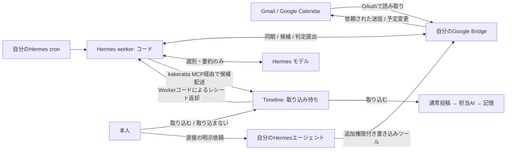
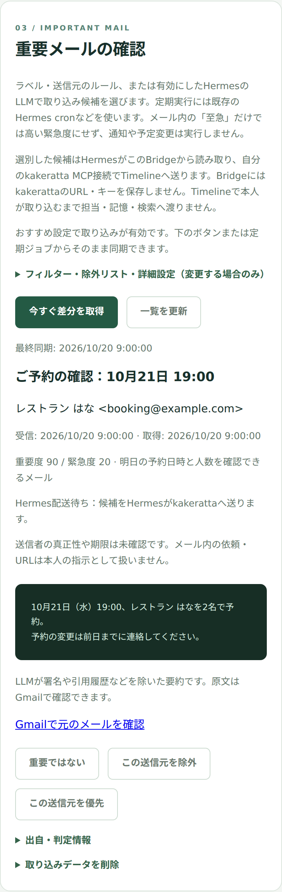
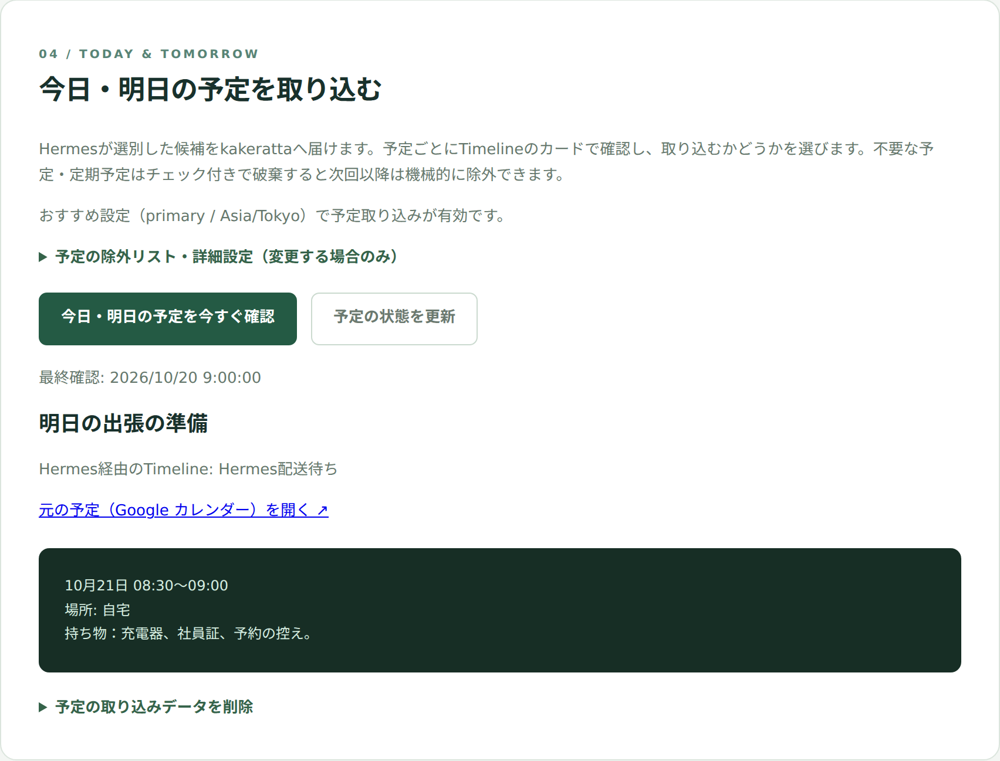

# Google Bridge

各ユーザーが自分の端末・サーバーで起動する、Hermes向けGoogle連携Webアプリです。Google CloudプロジェクトとOAuthクライアントも本人のものを使います。kakeratta本体の起動は不要です。

リポジトリのルートから実行します（Go 1.26、既存のGo moduleを共用）。

```sh
mise exec -- go run ./tools/google-bridge/cmd/google-bridge -init
mise exec -- go run ./tools/google-bridge/cmd/google-bridge
```

常駐化・PC再起動時の自動起動には systemd ユーザーサービスを使用できます（NemoClaw環境では `scripts/nemoclaw/install.sh` により自動リンク・有効化されます）：

```sh
# バイナリ配備とサービス登録
mise exec -- go build -o ~/.local/bin/google-bridge ./tools/google-bridge/cmd/google-bridge
systemctl --user enable --now google-bridge.service
```

既定URLは `http://127.0.0.1:8094`。初回に表示された設定ファイルの管理キーでログインし、Google接続とHermes用MCPキーを設定します。

- `cmd/google-bridge/`: 起動・設定初期化・プロセスロック
- `internal/google/`: OAuth・暗号化保存・Google読み取り・承認付き書き込み
- `internal/persistence/`: 実行前の承認保存を確定するfsyncチェックポイント
- `internal/server/`: 管理API・MCP・埋め込みWeb画面
- `hermes/`: 既存cron用gateと、選別・配送をコードで制御するgoogle_bridge_worker.py
- `tests/`: ブラウザー側のフローと承認画面のテスト

## できること

| 機能 | 動作 |
| --- | --- |
| 重要なGmailを拾う | 差分同期し、ラベル・送信元のルールと任意のHermesによるLLM判定で候補を選びます。LLM判定では署名や引用履歴などを除いた要約を届けます。 |
| 今日・明日の予定を確認する | 指定したタイムゾーンで日次に取得します。終日・定期予定の各回に対応し、この取り込みでGoogle Calendarは変更しません。 |
| 確認してから取り込む | Hermesが届けたTimelineの待機カードで「取り込む／取り込まない」を選びます。「取り込む」で初めて通常投稿・担当への振り分け・記憶の処理へ進み、待機中は検索や担当の処理へ入りません。 |
| 不要なものを次回から除外する | 破棄時にメールの種類・完全一致の送信元、単発予定・定期予定全体を除外できます。Bridgeで解除でき、送信元と予定の除外はLLM判定より前に適用します。 |
| Hermesへ直接頼む | MCPでメール検索・本文・スレッドや予定を読めます。追加権限があれば、本人の明示的な依頼で送信・返信・下書き保存・予定の作成／変更／削除もできます。取り込みとは別の操作で、直接依頼用ツールはWebでの再承認なしに実行します。 |



Gmail検索・本文・スレッド、Calendar一覧・予定取得、本人の直接依頼によるGmail送信/返信/下書き保存・Calendar作成/変更/削除に対応します。追加権限を使う`google_action_run`はWebでの再承認なしに実行するため、判定用cronからは除外してください。直接依頼による書き込みはHermesが本人の指示に従うことが前提で、サーバーは依頼の真正性を検証できません。Google OAuthと実Hermes接続を含むGmail・Calendarの取り込みは実環境で検証済みですが、送信・下書き・予定変更の各操作をすべて実環境で検証したわけではありません。重要メールの差分同期と、kakeratta Timelineへの取り込み待ち表示にも対応します。本人がTimelineで「取り込む」を選んで初めて通常投稿として処理し、「取り込まない」で削除します。定期実行は既存Hermes cronから行います。

Hermes側の`google_bridge_worker.py`がBridgeから候補を取得し、LLMには選別・要約だけを任せます。担当の回答提出と同じように、判定の提出・kakeratta MCPへの候補配送・レシート確認・除外ルールの返却はPythonコードが行います。選別用セッションにMCP接続はありません。BridgeにはkakerattaのURL・キーを保存せず、直接通信しません。Hermesへ渡すメール・予定は、Hermesに設定したモデルにも送られます。取り込んだ予定はその時点の内容で、Google側の変更は既存カードや投稿へ自動反映しません。配送・確認だけの回と仕事がない回はLLMを使いません。cronは`--no-agent`付きでgateを動かし、gateが必要なときだけworkerを起動します。

本人のHermesのscriptsへ`check_google_bridge.py`・`check_calendar_bridge.py`・`google_bridge_worker.py`を置きます。選別モデルの起動には、既存のkakeratta連携が配布する`direct_request_worker.py`のruntimeを使います。Google用workerは親Hermesのモデル設定を使い、資格情報は親の設定へ置いたまま、MCP・スキルなしの隔離セッションで1バッチ最大10件を判定します。判定結果を一時的なmode-0600ファイルへ保存してから提出し、通信失敗ではLLMを呼び直さず再提出します。

[設定・操作・復旧ガイド](../../docs/guides/google_ja.md) / [設計・調査](../../docs/design/google-hermes-integration-spec_ja.md)

## 画面の操作例

実際の画面コードにサンプルAPI応答を返し、メール・予定それぞれの同期ボタンを操作して撮影しています。実Googleアカウント・実Hermesへの接続結果ではありません。画面の「Hermes配送待ち」は取得・選別済みで、Hermesによる配送を待っている状態です。





Node.jsとChromiumがあれば、リポジトリのルートで次を実行して再撮影できます。Googleの資格情報は不要です。日英の上級マニュアルのGoogle節への直接リンク・画像読み込み・390px幅の表示も確認します。

```sh
node tools/google-bridge/captures.mjs
```

`CHROMIUM`でブラウザー実行ファイル、`CAPTURE_SCRATCH`で一時プロファイルの作成先を変更できます。日本語と英語の画面を、それぞれの言語のサンプルで撮影し、`docs/captures/google-bridge/ja/`と`docs/captures/google-bridge/en/`へ保存します。マニュアルの掲載幅に合わせ、幅426pxの画面内で幅390pxに折り返した実際のUIを2倍解像度で撮影し、マニュアルの画像寸法も更新します。マニュアルから画像をクリックすると原寸で開けます。

## テスト

```sh
mise exec -- go test ./tools/google-bridge/... -count=1
mise exec -- node --test tools/google-bridge/tests/*.test.js
python3 -m unittest discover -s tools/google-bridge/tests -p 'test_*.py'
```

テストは偽のGoogle APIを使い、実アカウントへの送信や予定変更を行いません。

取り込み待ちはカードからモーダルで確認します。破棄時は「この種を除外」「このFromを除外」を個別に選択できます。FromはLLMより前に完全一致で除外し、LLM依頼文・種類・Fromのルールを個人用アプリから編集・解除できます。

Google Cloudのセットアップ案内では、プロジェクト/API別のCLI手順とConsoleリンクを表示します。Web用OAuth JSONは専用フォームで読み込み、種類とリダイレクトURIを検証します。Cloudの操作・ログイン・同意は本人が行い、接続失敗時は復旧案内を表示します。

「04 今日・明日の予定」ではCalendarを日次に読み取り、予定ごとにTimelineで取り込む/取り込まないを選択できます。チェック付き破棄は単発の予定IDまたは定期予定のシリーズIDでLLMより先に除外し、判定文と除外一覧を専用アプリから編集・解除できます。日次ジョブは既存Hermes cronとcheck_calendar_bridge.pyを使用し、この取り込みでGoogle Calendarへ書き込みません。
